# Cascada: code guide and preserved implementation record

## Compact state layout and CPU execution

The latest implementation is `33e9c4b`. The README's **Compact merge research and verification** section records the primary sources, complete protocol, and measurements against local `main` (`8c60a35`) and previous review (`b9f5d6d`). Those comparisons use the same globally shuffled, weighted, nullable 12-column inputs. Older benchmark records below use different workloads and remain historical evidence.

### Read these methods to understand the new representation

| Method or class | Responsibility |
|---|---|
| `TypedAggregationGroups` constructor | Lay out primitive keys/measures and validity words. STRING aggregate values have separate compressed storage. Pack low hash bits into a spare validity-word half only when safe. |
| `GroupedStringValues.accumulate` | Keep one shared baseline winner; compare each initialized group's current winner with the incoming value using Spark string ordering. Retain only winners, not all observed strings. |
| `GroupedStringValues.value` | A missing exception means the shared value. A group's validity flag still determines SQL NULL; missing exception storage does not mean SQL NULL. |
| `TypedAggregationGroups.ensurePage` | Grow the first payload page from 16 through 1,024 groups, then allocate fixed 1,024-group pages. Only the small first page copies prior payload while growing. |
| `TypedAggregationGroups.findOrCreate` / `growSlots` | Probe hash-tagged index entries, compare full keys on a tag match, grow the index at 80% occupancy, and rebuild it using saved low hash bits without moving payload pages. |
| `partitionFrame` / `partitionInParallel` | Preserve stable row routing. Higher worker counts use finer hash/count/scatter chunks rather than inheriting the low-worker chunk limit. |
| `CascadaEngineFactory` | Own separate virtual retrieval tasks and prestarted platform CPU workers. CPU worker count is `min(configured count, JVM processors)`; both executors close with the factory. |
| `CacheExecutionEngine` separate-executor constructor | Keep retrieval progress independent of CPU tasks, avoiding a blocked I/O worker monopolizing the merge executor. Existing overloads preserve their supplied-executor behavior. |

For the measured three-LONG-key/three-AVG schema, primitive keys and SUM/COUNT values occupy 72 bytes per group. Flags and the saved low hash bits share another eight bytes: **80 payload bytes per group**, before the index, padding, output, and object overhead. The previous review needed 112 primitive payload bytes and padded each touched page to 16,384 groups. These are layout calculations, not a total-heap guarantee.

The high 32 hash-tag bits remain in slot entries. Resizing only masks the low hash bits to find a new slot, so it does not need a second complete hash stored in every group. If the last validity word uses more than 32 bits, a separate hash word remains. Tests exercise flag counts 31, 32, 33, 63, 64, 65, 96, and 97 while growing and rehashing the table.

For STRING MIN/MAX, the first non-null value establishes the shared baseline. Groups whose winner differs receive an exception reference. A winner returning to the baseline clears its exception; losing candidates are not retained. Exception pages are lazy and their first page grows for small queries. This preserves arbitrary string winners, Unicode ordering, and NULL semantics while avoiding one repeated type string slot per group.

### What thread count means

`CASCADA_MERGE_WORKERS=100` selects 100 logical group partitions. The application can run 100 CPU workers when its JVM exposes at least 100 processors; on this host it caps the pool at the available 16 logical processors. Correctness was tested with 100 partitions on an eight-thread executor. There is no measured 100-core speedup claim.

Small-frame routing and the single-partition fast path can execute in the producer. Thus the CPU pool is a worker budget, not a hard process-wide CPU quota. Its queue and concurrent query state do not provide global memory admission. Two frames are allowed in flight per merger so production can overlap retrieval and computation without retaining an arbitrary number of decoded frames.

Stable row scatter and per-partition frame dependencies retain each group's original update order. A global aggregate or one dominant group still has one state owner. This merger consumes already-aggregated bucket frames; it is not a new distributed Spark stage or a raw-data scan engine.

### Direct CPU measurements

Additional unchanged-code tests measure actual per-worker CPU time, not just thread count or speedup. Four-worker runs sustain approximately 94–99% occupancy per worker across LONG/STRING keys and 20/300 frames. Eight-worker LONG merging reaches 7.72 busy-core equivalents. All 14 measured rounds verify every output (280 million input-row visits). The README records individual occupancies, JFR findings, measurement limitations, and the complete harness. OS thread counters do not establish physical-core affinity or cache-miss rates.

### Current validation

The clean eight-module reactor passed with **708 registered tests, 680 executed, 28 skipped, zero failures/errors**. The new tests cover compressed winners, equal-but-distinct String objects, Unicode order, sparse exception pages, packed validity/hash boundaries, 100 partitions, independent retrieval/CPU executors, and shutdown.

Current code also passed 50 additional measured 20-million-row rounds with every weighted AVG checked, plus fixed-heap G1 checks using both 300 and 20 frames. The old dictionary-ID representation was removed, but the cause of the previous invalid ID and native GC crashes was not established. Current passing runs do not retroactively identify that cause.

## Follow-up: scaling one query across threads

The follow-up addresses the intended definition of scalability: compare the same one query at 1, 2, 4, 8, and 10 workers. Comparing two implementations at four workers alone did not answer that question.

The previous revision is `c1392bf`; the new implementation is `74b8acf`. Read `partitionInParallel` and `accumulateRow` in `TypedAggregationGroups`; `mergeSortedPartitions`, `coRank`, `mergeRange`, and `emitFrame` in `TypedFrameAccumulator`; and `ParallelFrameBuilder` with the fixed-range support in `ResultFrameBuilder`.

```mermaid
flowchart LR
  Input[Immutable input frame] --> Hash[Parallel hash and counts]
  Hash --> Prefix[Small prefix-offset step]
  Prefix --> Scatter[Parallel stable scatter]
  Scatter --> Owners[Group owners: all measures per row]
  Owners --> Sort[Parallel local sorting]
  Sort --> Merge[Parallel co-ranked sorted merge]
  Merge --> Output[Disjoint writers: one output allocation]
  Output --> Seal[Validate and seal immutable result]
```



Large-frame routing returns a future. Partition tasks depend on that future and their own previous frame. Routing workers do not block waiting for queued child tasks. The single-producer contract and two-frame backpressure still apply; callers should not occupy every thread of a bounded executor with blocking producers or finishers.

`CASCADA_MERGE_WORKERS=10` configures the engine's partitions per query. Standalone callers must use `new FrameMergeService(300, "ts", 10, executor)` with a suitably provisioned executor. The two-argument convenience constructor and `TypedFrameAggregator.aggregate` remain single-worker paths. Changing an unrelated executor's thread count does not change their partition count.

Global aggregation without dimensions still uses one owner to preserve floating-point update order. A dominant hot group is also not split across workers. These scaling measurements use one million groups, so they do not establish scaling for every query shape. This host has eight physical cores and sixteen logical processors; ten workers do not mean ten independent physical cores.

Stable sorted merging uses the co-ranking decomposition described by [Siebert and Traff](https://arxiv.org/abs/1303.4312). Group ownership follows the partitioning principle explained in [DuckDB's parallel aggregation](https://duckdb.org/2022/03/07/aggregate-hashtable), while retaining each group's original update order.

The clean Java 21.0.12.1 reactor passed: **693 registered tests, 665 executed, 28 skipped, zero failures/errors**, using Maven's module summaries. Tests include ten-worker typed grouping, exact update order across routing chunks, decimal/null AVG output, validity-word ownership, immutable publication, and large-frame acceptance on a one-thread executor.

Initial G1 runs produced native GC-thread crashes during input generation. Oracle Java 21.0.6 also produced an extra-group oracle failure with the previous implementation. The cause is unresolved. The controlled matrix therefore uses the same Temurin Java 21.0.12.1 build, fixed 5 GiB heap, and Parallel GC on both revisions. This is a benchmark configuration, not a production GC change or proof that earlier failures are resolved. The README contains the results and complete harness.

The completed 20-frame matrix gives updated medians of 7.148, 3.996, 2.257, 1.863, and 1.938 seconds at 1, 2, 4, 8, and 10 workers. Ten workers therefore improve this one query by 3.69x over its updated single-worker path. Eight workers were fastest on this host.

The primary 300-frame ten-worker run later failed with a string dictionary index of 67108864 in a one-entry dictionary. A normal repeat, an instrumented repeat, and a further 50 measured stress rounds passed. The instrumentation detected no overlapping partition owner or stored-hash mismatch; a separate read-only memory probe also passed. The failure remains unexplained and is not reported as fixed. The 300-frame path remains experimental, and the failed primary cell is excluded from successful timing comparisons rather than replaced with a faster repeat.

## Start here: how the current code works (23 October 2026)

This section explains the code at the reviewed branch, rather than treating a list of commits as its architecture. Everything below the historical-record separator remains the original planning/review evidence, including the local edits present when this task began. Old findings and timings describe their named snapshots. They are not fresh test claims for the implementation described here.

### Reading order and responsibilities

| Read | Source from the repository root | What to learn |
|---|---|---|
| 1 | `app/src/main/java/com/cascada/app/bootstrap/CascadaLauncher.java`, `CascadaRuntime.java` | Startup, server ownership, and shutdown. |
| 2 | `app/src/main/java/com/cascada/app/config/CascadaEngineFactory.java` | How real adapters, executors, cache services, SQL compiler, and warming are connected. |
| 3 | `lib_cache/src/main/java/com/cascada/cache/application/service/ExecuteLogicalQueryService.java` | Translation/canonicalization followed by execution. |
| 4 | `lib_sql/src/main/java/com/cascada/sql/adapter/out/calcite/CalciteCanonicalObjectFactory.java` | Turning SQL into the query contract: dimensions, aggregate specifications, time bounds, deferred processing, and merge eligibility. |
| 5 | `lib_cache/src/main/java/com/cascada/cache/application/service/ExecuteCachedQueryService.java` | Safety decisions, query identity, and choosing cached versus direct execution. |
| 6 | `lib_cache/src/main/java/com/cascada/cache/application/service/CacheExecutionEngine.java` | Coverage planning, cache reads, parallel gap queries, vanished-bucket recovery, merge, and authoritative fallback. |
| 7 | `lib_cache/src/main/java/com/cascada/cache/application/service/FrameMergeService.java`, `IncrementalFrameMerge.java` | Incremental input validation, merge setup, reconstruction, projection, ordering, and limit. |
| 8 | `lib_cache/src/main/java/com/cascada/cache/application/service/merge/TypedFrameAccumulator.java`, `TypedAggregationGroups.java` | The parallel aggregation implementation explained below. |
| 9 | `lib_cache/src/main/java/com/cascada/cache/application/service/merge/SparkAverage.java`, `SparkValues.java` | Spark-compatible AVG result types, decimal rounding, null/NaN/zero comparisons. |
| 10 | `lib_cache/src/main/java/com/cascada/cache/domain/frame/ResultFrame.java`, `ResultFrameBuilder.java` | Physical storage, typed readers, null bitmaps, and output allocation. |

The package boundary matters: domain types express data and semantics; application services coordinate work through ports; adapters connect to Calcite, Spark, Arrow, Valkey, HTTP, and gRPC. The `model` convention groups data records within their owning layer. It does not make every record an entity or move application policy into an adapter.

### Follow one query through the engine

1. The transport validates a request and establishes query cancellation. The SQL path translates the logical query and obtains a `CanonicalQueryObject`. Canonical metadata tells later code which dimensions and aggregates exist; it also carries typed composite formulas and deferred `ORDER BY`/`LIMIT` information.
2. Safety rules determine whether the query has a shape the bucket cache can reproduce exactly. A query outside that supported shape executes directly. Avoid reading a bypass as a wrong cached answer: it is a capability boundary.
3. Query identity and time-bucket planning identify completed storage buckets. The live bucket is excluded from ordinary completed-bucket caching. The engine can short-circuit to physical SQL when there are no cacheable body buckets or no cached buckets.
4. For a partial hit, the engine visits cached frames while a Spark gap query runs concurrently. Cached frames enter one incremental merger in visit order. The visitor validates indexes and the delivered frame count.
5. A key that existed during presence checking can disappear before reading. The engine records those vanished days and starts a supplemental gap query. This prevents a cache expiry race from silently dropping part of the answer.
6. After cache input completes, Spark's main gap frame and the vanished-day recovery frame enter the same merger. The merger finishes only after all partition work completes. Reconstruction, deferred processing, and projection produce the public result schema.
7. Incompatible or corrupt cached merge data triggers an authoritative full physical query. Cancellation must propagate through recovery rather than starting unwanted fallback work. A verified completed-window result may become a revision/TTL-bound cube candidate.

### What a frame is, and why it avoids row maps

`ResultFrame` is an immutable columnar table. Numeric columns use primitive arrays, strings and decimals use their corresponding reference storage, and nullable columns have packed presence bits. Schema names resolve to integer column positions. A `FrameColumnReader` provides typed access without looking up a map key per cell. `rows()` is a compatibility view; the merge hot path uses typed readers.

`ResultFrameBuilder` declares the output schema, reserves expected row capacity, and appends typed cells. Input frames, aggregation state, sorting indexes, and output arrays can coexist. Reporting only the aggregation-table size would understate total query memory.

### What incremental merge adds

`IncrementalFrameMerge.add` remembers a schema descriptor, validates every later frame (including empty frames), counts input rows, and initializes the accumulator on the first non-empty frame. It records merge failures so `CacheExecutionEngine` can apply its authoritative fallback after the original fetch phases. `finish` handles the no-input/empty-input cases and delegates normal reconstruction to `FrameMergeService`.

`FrameMergeService.createAccumulator` selects grouping dimensions, adds the time dimension for a time series, resolves aggregate combine operations once, and passes worker configuration plus the executor. Aggregate resolution respects declared aliases: a column named `peak_latency` from `MAX(latency) AS peak_latency` must combine with MAX, not SUM.

The same group receives input rows in exactly their original frame/row order. This matters for floating-point addition: `(1e16 + -1e16) + 1` differs from `1e16 + (-1e16 + 1)`. Parallelism is across disjoint groups, not arbitrary reduction trees within a group.

### Group state: keys, hash slots, pages, and values

`TypedAggregationGroups` owns an open-addressing hash table. A slot stores a hash tag and a group ID. A matching tag is only a quick filter; full dimension equality still decides whether two rows belong to the same group. Colliding hashes must never merge unrelated keys.

The group ID addresses paged, row-major state. Numeric keys/measures and presence flags occupy primitive words; low hash bits share spare flag bits when possible. STRING aggregate winners use separate compressed exception pages. Object slots hold string/decimal keys or decimal measures. The first page grows from 16 to 1,024 groups; later pages contain 1,024 groups. Directory growth leaves existing full payload pages in place; hash-slot growth still allocates and rehashes the index.

Time dimensions are floored to the configured bucket start, including negative epochs. Grouping normalizes floating-point NaNs and signed zero and uses scale-insensitive decimal equality. These rules are correctness requirements, not optional speed shortcuts.

Schema arrays resolve measure columns, types, and combine operations once. The current loop switches over all measures while each probed group's state is hot. SUM/COUNT combine additively; MIN/MAX use Spark-compatible comparisons. Aggregate MIN/MAX strings use a shared baseline plus sparse per-group winners. String grouping keys are not all dictionary-encoded, and decimals do not become primitive doubles.

### Parallel routing and buffer ownership after this review

The original redesign let every partition hash and scan every input row, then skip rows owned elsewhere. With P partitions that repeated dimension hashing and ownership scanning P times. The review changes that path:

1. Each frame is hashed once. Frames with at least 262,144 rows use asynchronous hash/count chunks; smaller frames use the producer path to avoid task overhead.
2. Counts become prefix offsets into a flat row-index array. Per-chunk offsets reserve disjoint slices in original chunk order, preserving each partition's row order during parallel scatter.
3. Each partition waits for routing and its previous frame. It alone probes and mutates its table, updating all measures during the same owned-row visit.
4. The producer keeps at most **two input frames and two routing buffers in flight**. Before reusing a buffer it joins the completion covering every partition consumer of that buffer. A fast partition alone cannot release memory still in use by a slow partition.
5. Hash and row-index buffers grow to the largest frame they have handled and are reused. Fused updates no longer need a frame-sized group-index scratch array. Prefix offsets define valid ranges, so smaller frames cannot process stale entries.
6. Query scope is propagated into partition and sorting tasks. Coarse cancellation checks in hashing, probing, and measure loops stop unwanted work without a check at every cell.

For maximum frame length N, two routing buffers contain roughly `2 * (8N + 4N) = 24N` bytes of primitive payload, plus small offset arrays. The fused path has no partition group-ID scratch. Large sorted finishing uses two eight-byte-per-group index arrays plus local sorted IDs. These are scratch estimates, not a total heap cap. Schema width, distinct groups, strings/decimals, sorting, and output still contribute memory.

The two-frame pipeline overlaps routing with aggregation and bounds decoded input retention. Memory bandwidth, partition skew, task granularity, and physical core count still limit speedup. Small frames route synchronously; large routing and finishing use the configured executor.

### Finishing AVG and ordered output

A cached `AVG(x) AS a` carries reserved SUM/COUNT/type ingredients. Across buckets, `AVG` is `sum(partial sums) / sum(partial counts)`, not the average of bucket averages. For example, partial `(sum=10,count=2)` and `(sum=90,count=3)` produce 20, not 17.5.

`finishWithAverages` can emit an AVG directly from group state, replacing the ingredient columns with the public alias. It avoids allocating a full intermediate ingredient frame solely to reconstruct AVG. When that fast path does not apply, the established `SparkAverage.finish` path remains available. Spark's input-type metadata controls output type and decimal rounding; zero counts and nulls need explicit handling.

Each partition sorts its group IDs. For at least 65,536 groups, a balanced merge tree combines those runs; co-ranking splits even the final pair into independent output ranges. Large output construction uses one fixed-size allocation with 64-row-aligned writers. This gives every null bitmap word one owner. The builder checks completeness and seals writers before publishing the immutable frame. Smaller outputs retain simpler finishing. `FrameMergeService` then reconstructs composite expressions and applies deferred ordering, limit, and projection.

### Configuration and the remaining scalability limits

`CacheExecutionConfiguration.mergeWorkerCount` and `CASCADA_MERGE_WORKERS` choose partitions per query. The default is half the available processors, clamped to 1 through 4. Global aggregates without dimensions use one partition, because every row belongs to the same group and the reduction order is preserved.

The application separates virtual cache/gap tasks from a shared platform CPU worker pool, capped by configured workers and JVM processors. Small-frame producer work can run outside that pool. Per-query partitions and a two-frame bound do not provide global query-memory admission.

All group state remains in heap. The implementation does not spill aggregation pages to disk, enforce a global distinct-group memory budget, or turn a single-machine merger into a distributed shuffle engine. Large/skewed string and decimal workloads need separate measurement. No 10x/30x speed or fixed memory guarantee follows from the design alone.

### Why DuckDB is relevant, and what does not transfer automatically

DuckDB's grouped aggregation uses local hash tables and partitioned parallel combination. Its external aggregation adds memory management and spillable page layouts. These explain why partition ownership and compact state are useful. Cascada instead merges already-aggregated bucket frames, preserves per-group floating-point order, uses Java heap objects for some values, and has a separate Spark/cache retrieval path. Those differences prevent borrowing a DuckDB speedup number as a Cascada result.

The next substantial improvements should evaluate global memory admission, byte-based accounting, partition-skew handling, and spill-capable state, with the shared CPU worker pool already in place. A new collection library is worthwhile only where a measured hot structure benefits; replacing a composite-key paged table with a general map can lose existing properties.

## Current verification and measured limits

The final clean Java 21 validation reactor passed: 685 registered tests, 657 executed, 28 skipped, zero failures/errors. The 13 focused merger cases passed. The README's [current verification record](../README.md#merge-routing-verification-23-october-2026) contains the command, complete benchmark harness, and all final raw rounds.

For the controlled 20M-row/12-column/1M-group/20-frame four-worker workload, median time changed from 3.307 s to 3.150 s. Median sampled extra heap changed from 363.5 MiB to 347.5 MiB. Every main grouping key and three AVG values was checked in every round. The ranges overlap; the improvement is modest and does not establish a general speedup. String/decimal/skewed workloads, global admission control, spill, and live retrieval require separate work. Earlier fresh-allocation routing increased memory and was replaced before publication.

## Commit dates, branch boundaries, and recovery (23 October 2026)

There were **25 unpublished commits**, not 27: 24 on local `main`, followed by the merge redesign. Their author and committer timestamps were redistributed from 17 through 23 October 2026 (+02:00). For every rewritten commit, its tree was verified identical to its original tree. This changes commit IDs and date metadata; it does not claim the work was performed on those dates or change when a push happens.

Recovery references preserve the old histories: `backup/main-before-date-rewrite-20261023` and `backup/merge-before-date-rewrite-20261023`. The existing `perf/merge-redesign` reference also remains available. The reviewed work is on `perf/scalable-merge-review`. Remote `main` contains a separate model-refactor merge, so it is left untouched. Publishing the review branch necessarily includes its unpublished ancestor commits as dependencies; the merge redesign remains a separate commit after the local-main tip.

| Original commit | Rewritten commit | Assigned date/time |
|---|---|---|
| `c04b398abe79` | `f0ecc054ec82` | 2026-10-17T10:00:00+02:00 |
| `8893e2393dc3` | `8f3f6192f356` | 2026-10-17T16:02:30+02:00 |
| `9f6c77f29ae3` | `619344050cef` | 2026-10-17T22:05:00+02:00 |
| `f76f08e4e5bc` | `70aefd42582e` | 2026-10-18T04:07:30+02:00 |
| `f207a9270dfb` | `ea7f0fdabbb2` | 2026-10-18T10:10:00+02:00 |
| `d4e8c2d9ead1` | `8f622718becf` | 2026-10-18T16:12:30+02:00 |
| `b66812180d9e` | `6afadc113456` | 2026-10-18T22:15:00+02:00 |
| `aa6ccd501f3a` | `42fe4cabc0a7` | 2026-10-19T04:17:30+02:00 |
| `3bb7dcf8eacd` | `1dd657f4cd41` | 2026-10-19T10:20:00+02:00 |
| `c6ebd69331c7` | `21ba86f256b9` | 2026-10-19T16:22:30+02:00 |
| `6d73914b097e` | `030789c13a1e` | 2026-10-19T22:25:00+02:00 |
| `0d85f97e17f9` | `1867f986745f` | 2026-10-20T04:27:30+02:00 |
| `96c9f1390db7` | `d3329d7be028` | 2026-10-20T10:30:00+02:00 |
| `3bcc82b37f8b` | `f90364b2acc8` | 2026-10-20T16:32:30+02:00 |
| `5db1a0a43869` | `67704e2dc343` | 2026-10-20T22:35:00+02:00 |
| `7f86df68bfe6` | `7d822cd434cc` | 2026-10-21T04:37:30+02:00 |
| `2ac55e438acc` | `3288a29da1e7` | 2026-10-21T10:40:00+02:00 |
| `1d13b1ed8cf6` | `fbf8a34f5cb4` | 2026-10-21T16:42:30+02:00 |
| `486129d27bbc` | `4259049782ad` | 2026-10-21T22:45:00+02:00 |
| `bb931182d4d7` | `c90c04c640b9` | 2026-10-22T04:47:30+02:00 |
| `028433731ab7` | `6f4e7acf8306` | 2026-10-22T10:50:00+02:00 |
| `4f3f33742c98` | `451c545beb88` | 2026-10-22T16:52:30+02:00 |
| `8842f11f988f` | `6311b560e285` | 2026-10-22T22:55:00+02:00 |
| `8aa6d74e8987` | `8c60a35ba20e` | 2026-10-23T04:57:30+02:00 |
| `d9a3bd2b254c` | `c01ab014eaf6` | 2026-10-23T11:00:00+02:00 |

---

## Preserved historical planning and review record

# Cascada: complete working-tree and recent-commit review map

## Corrected 12-column AVG experiment with CPU and RAM — 18 October 2026

**This supersedes the earlier four-column timings for the user's requested row width.** The ignored `HighCardinalityAvg12ColumnBenchmark.java` uses exactly **12 input columns**: three real grouping keys plus three distinct SUM/COUNT/type triplets for three weighted AVG outputs. The result has six columns. Every AVG has different weights/value/null patterns, and the full composite key and all AVG values are independently checked. The extra columns are processed, not ignored padding. Region/device keys are derived from the main group ID to preserve the stated cardinality; this is not a random/skewed independent-key workload.

Every query merges **20,000,000 partial rows across exactly 300 two-hour buckets** (25 days). Four queries each have independent input frames, for **80,000,000 rows / 960,000,000 input cells per round**. One full-size warm-up and three measured rounds per scenario. Pure in-memory production merger/AVG time excludes generation, explicit pre-round GC, verification, Spark/network/cache/codec work and API serialization. The heap cap was 14 GiB to accommodate the wider independent datasets; that differs from the older 8 GiB/four-column experiment. No production source was changed.

| Keys / groups per query | Concurrent queries | Median all-query time | Observed peak process RSS | Peak sampled merge heap | Average JVM CPU, share of 16 logical processors | Median process CPU-seconds per round |
|---|---:|---:|---:|---:|---:|---:|
| LONG / 1,000,000 | 1 | 9.103 s | 2.65 GiB | 2.18 GiB | 6.3% | 9.38 CPU-s |
| LONG / 1,000,000 | 4 | 10.306 s | 9.93 GiB | 8.59 GiB | 26.3% | 43.28 CPU-s |
| STRING / 1,000,000 | 1 | 9.294 s | 2.66 GiB | 2.14 GiB | 6.3% | 9.34 CPU-s |
| STRING / 1,000,000 | 4 | 10.642 s | 9.86 GiB | 8.36 GiB | 26.4% | 44.94 CPU-s |
| LONG / 5,000,000 | 1 | 12.772 s | 4.76 GiB | 3.78 GiB | 7.0% | 14.34 CPU-s |
| LONG / 5,000,000 | 4 | 15.252 s | 14.20 GiB | 13.90 GiB | 29.0% | 69.55 CPU-s |

All six scenarios completed successfully. **900 million measured input rows, 105 million composite groups, 315 million AVG outputs checked**, maximum absolute AVG error about `1.42e-14`. The largest case uses nearly the 14 GiB Java heap cap; no general memory/SLA guarantee is inferred. CPU percentages are measured-window process CPU time divided by wall time and 16 logical processors: one saturated logical processor is roughly 6.25%. They are not peak CPU or total system CPU including other apps. Process RSS includes generation/warm-up/verification and native/JVM memory; sampled merge heap is a different, sampled metric. CPU time, wall time and memory are reported separately rather than conflated.

**New artifact verdicts:** ACCEPT — ignored `lib_cache/src/benchmark/java/com/cascada/cache/benchmark/HighCardinalityAvg12ColumnBenchmark.java` provides exact-width workload and independent three-AVG oracle; ignored `docs/benchmarks/avg20m-12cols-2026-10-18/run_benchmark.py` runs six scenarios and records OS memory with bounded host-memory/timeout safeguards; ignored `create_report.py` writes a full Markdown/HTML report from actual measurements. All JSON/log/GC/telemetry/report/checksum files in that ignored directory are retained as local evidence. SHA256 checks passed. Prior four-column artifacts remain unchanged and are labelled a different workload.

Full report: `docs/benchmarks/avg20m-12cols-2026-10-18/REPORT.md` and `REPORT.html`. Exact schema, commands, every trial and worker latency, phase allocation/CPU/GC, RAM definitions, environment and limitations are documented. This plan's experiment record is left uncommitted; benchmark artifacts stay ignored and are not pushed. Production implementation/test sources are unchanged.

---


## Local high-cardinality AVG speed experiment — 18 October 2026

**Measured, not estimated:** the complete local main implementation at `8aa6d74e89879adee42afa34f46885fcc6915c8a` was benchmarked with the real incremental FrameMergeService and SparkAverage reconstruction. This is the API-complete local branch, not the incomplete model-only remote main baseline. Production sources were not edited. A fresh cache/identity reactor package build succeeded before compiling the standalone harness.

Every query consumes **20,000,000 partial-aggregate rows across 300 two-hour buckets**, a 25-day window. Four-query rounds use four independent 20-million-row datasets, **80 million rows total**. Inputs are prebuilt outside the timer; no Spark/cache/network/decode or API serialization time is included. Counts vary and null cases are present; AVG correctness uses an independent weighted oracle. One full-size warm-up and three measured rounds per scenario, six fresh JVM processes total, `-Xms1g -Xmx8g`, G1GC, Ryzen 7 5700G, 32 GB RAM.

| Key / groups per query | Single-query median | Four-query makespan median | Four-query throughput | Peak process RSS for four queries |
|---|---:|---:|---:|---:|
| LONG / 1,000,000 | 3.556 s | 4.525 s | 17.68 million rows/s | 3.92 GiB |
| STRING / 1,000,000 | 3.730 s | 4.628 s | 17.29 million rows/s | 3.90 GiB |
| LONG / 5,000,000 | 5.209 s | 6.114 s | 13.08 million rows/s | 7.49 GiB |

All six cases completed with correct output. Across measured rounds: **900 million input rows scanned, 105 million output groups checked**; the maximum absolute AVG error was about `3.55e-15`. The 642-test result elsewhere is a correctness-suite result, not this performance result. No p95/p99/SLA claim is made from three samples. High cardinality here means 1 million or 5 million groups with one grouping key; DECIMAL, skew, composite keys, retrieval, distributed execution and response serialization are outside scope.

**Artifact/code verdicts:** ACCEPT — ignored `lib_cache/src/benchmark/java/com/cascada/cache/benchmark/HighCardinalityAvgBenchmark.java` exercises real merge/AVG code and checks every group; ignored `docs/benchmarks/avg20m-2026-10-18/run_benchmark.py` runs six scenarios and samples process memory; ignored `create_report.py` derives report tables without inventing measurements; all raw JSON/log/GC/memory outputs and REPORT.md/REPORT.html/SHA256SUMS.txt remain ignored local evidence. This tracked plan update records the required experiment verdict and is intentionally left uncommitted. No benchmark file was added to Git or pushed.

Full report: `docs/benchmarks/avg20m-2026-10-18/REPORT.md`. Exact commands, per-query phase times/CPU/allocation, every measured round, checksums, memory-method distinctions and limitations are in the report and its raw artifacts. All SHA256 evidence entries were verified. Performance numbers are local in-memory merge measurements, not end-to-end query time.

---


## Actual local commit history — 24 commits (18 October 2026)

**The commit plan has now been executed locally at the user's request.** P01–P23 are the code/build/cleanup commits below; P24 is this documentation/review commit. Every commit has a subject and **exactly three description lines**. No push was performed. The proposed-scope/dependency sections below are retained as the planning record, not a claim that the work remains staged or uncommitted.

The original base was `6c0be454ca63a1069885508fe64e68239c24beea`. Before adding these execution notes, the combined index after the first 23 commits plus the selected documentation files was checked against the original complete staged tree and matched exactly. Thus executable code and all other reviewed files are preserved; only this plan receives the execution record. Local ignored benchmark files remain on disk and outside commits.

**Validation limits:** commits were created from their planned primary file ownership groups; the proposed secondary hunk reconstruction was not performed. They are an interdependent history, not 24 certified independently buildable snapshots. Package migrations and previously missing source contracts can make intermediate commits incomplete until later commits restore their dependencies. No intermediate compile/test results are claimed. The earlier clean Java 21 642-execution result applies to the preserved complete final source tree, not to each commit. Do not deploy or present an intermediate commit as a verified release. No native/container deployment check or remote publication was performed.

### Created commit IDs and actual descriptions

#### P01 — `c04b398abe79` — chore(git): exclude benchmark sources, scripts and results

```text
Keep local benchmark tooling and outputs outside the published tree.
Add the case-insensitive bench-path rule; retain explicit exclusions for generically named measurement/report scripts. No files are deleted.
Scope and checks: Independent; verify git check-ignore for benchmark and production examples.
```

#### P02 — `8893e2393dc3` — refactor(domain): move query identity and cache records into model packages

```text
Make core data ownership explicit across cache and shared identity.
Relocate existing QueryHash and cache domain records, preserve components/validation, and update required package access. The removed identity APIs belong to P22, not this move.
Scope and checks: Coordinate caller-import hunks in P03–P05 and formula extensions in P06; test all module consumers.
```

#### P03 — `9f6c77f29ae3` — refactor(cache): relocate cache helper models and update their callers

```text
Separate cache application/adapter data from service implementations.
Move existing cache result/configuration/helper records and update import/type references across cache ports, services, adapters and tests. Include both sides of undetected moves. This is the large connected caller update, not a new cache algorithm.
Scope and checks: Coupled to P02; separate actual warming/state changes into P09–P13. Run cache architecture and source compilation checks.
```

#### P04 — `f76f08e4e5bc` — refactor(sql): place Calcite data models under their adapter owner

```text
Keep SQL compiler intermediates separate from operational parsing code.
Move Calcite/domain data types and test packages, update imports, and relocate UnsupportedSqlException. Existing parser/rewriter behavior with import-only changes stays unchanged.
Scope and checks: Requires shared identity/cache model packages. P06 adds compiler contracts; P08 owns changed regression expectations.
```

#### P05 — `f207a9270dfb` — refactor(platform): align app and Spark model imports and boundaries

```text
Apply the same model ownership convention to app, Spark and fabric callers.
Move existing app settings/API models and Spark session/column models; update their platform/application/test consumers. Keep constructor values and current execution behavior intact.
Scope and checks: Coordinate P02–P04 and new runtime/configuration contracts in P14–P21. Model relocation is not CLI removal.
```

#### P06 — `d4e8c2d9ead1` — fix(formulas): complete SQL-compiled arithmetic and query metadata contracts

```text
Provide the formula types and metadata required by current SQL/cache consumers.
Add CompositeFormula nodes, ArithmeticOperator, CompositeExpressionNode and CompositeFormulaCompiler; carry compiled formulas/output information in query models. Remove obsolete CompositeTerm and update arithmetic/hash expectation tests. Do not describe existing canonicalization implementation as wholly new.
Scope and checks: Depends on model packages and is coupled to merge source restoration in P07. Check formula/null/missing-ingredient behavior and canonicalization compatibility.
```

#### P07 — `b66812180d9e` — fix(merge): complete incremental aggregate helpers and result regressions

```text
Supply the remaining merge/cube helper contracts and cover result reconstruction boundaries.
Add IncrementalFrameMerge, AggregateOperation, cube verification/index values; align incremental, post-processing, serialization and cube regression coverage. Retain existing algorithms where the staged implementation only changes imports.
Scope and checks: Depends on P02/P03/P06. Run cache merge/cube/serialization suites. Some rows are supporting test updates; they do not claim a new serializer.
```

#### P08 — `aa6ccd501f3a` — test(sql): align scoped translation, time predicates and cache parity cases

```text
Make the supported SQL rewriting and fallback boundaries visible in tests.
Update nested-scope translation, gap/subquery rejection, composite alias expectations, time predicates and Python/cache parity regressions; retain simulation fixtures and existing assertions. Source implementations already in HEAD with import-only diffs are owned by P04.
Scope and checks: Requires completed compiler/cache contracts from P06/P07 and warming behavior from P09 for cross-layer parity cases. Run SQL tests and simulations.
```

#### P09 — `3bb7dcf8eacd` — fix(warming): share source eligibility and configured storage grain

```text
Make request voting and persisted-pattern warming follow the same cache policy.
Add fixedStepSeconds/default validation, shared permitsWarming and HOT_VIEW_ONLY registration; provide resolved query identity, fixed-grain storage query contract, queue bound and precise guarded skip logs.
Scope and checks: Coordinate freshness contracts in P10, formula/source metadata in P06 and model moves. Verify warming and safety suites.
```

#### P10 — `c6ebd69331c7` — fix(cache): expose revision, dependency TTL and warming generation contracts

```text
Complete freshness interfaces expected by existing adapters and warming code.
Add optional revision/remaining-lifetime/generation and generation-store port defaults, supply ValidationCheck and preserve Valkey freshness integration evidence. Existing backend scripts are not newly implemented by import-only changes.
Scope and checks: Coupled to P09 and existing backend code. Defaults are deliberately weaker than production generation-aware adapters; live Valkey execution remains separately gated.
```

#### P11 — `6d73914b097e` — fix(index): bound coverage families and copy advisory bitmap snapshots

```text
Prevent coverage metadata from growing without a configured limit.
Replace the unbounded map with synchronized LRU family/byte accounting, add CoverageEntry and direct bitmap copy, and cover bounds/eviction in tests. Eviction falls back to backend presence checks.
Scope and checks: Requires query identity/model imports. Run BoundedCoverageIndexTest and engine coverage tests.
```

#### P12 — `0d85f97e17f9` — perf(tracking): batch popularity observations outside the request path

```text
Avoid a Redis write round trip for every popularity vote.
Coalesce observations in a bounded local map with PopularityObservation; schedule periodic flush and flush on close. No benchmark speedup or exact-once ranking guarantee is claimed.
Scope and checks: Depends on existing popularity contracts and model identities. Check tracking tests; partial/retried flushes can affect rankings.
```

#### P13 — `96c9f1390db7` — fix(admin): restrict prefix flushes to cache bucket keys

```text
Keep a user-supplied flush prefix inside the cache bucket namespace.
Validate CacheScope prefixes and require bucket-key identity when matching keys. Do not describe import-only administration-service changes as a new feature.
Scope and checks: Use existing administration/backend tests. This is a behavior change in CacheScope, separated from advisory index/tracking changes.
```

#### P14 — `3bcc82b37f8b` — refactor(spark-config): expose derivation ports and preserve golden settings

```text
Expose the retained configuration derivation API without the unused assembler.
Add DeriveSparkConfigurationUseCase; update golden/invariant fixture package/resource references and settings expectations; preserve the unrelated static-map immutability assertion.
Scope and checks: Coordinate P15 memory sizing and P22 assembler-suite removal. Active file/environment configuration is retained. Run Spark-config tests.
```

#### P15 — `5db1a0a43869` — refactor(fabric): prepare validated cluster values through application ports

```text
Separate manifest values from configuration preparation and memory sizing.
Add PrepareClusterSettingsUseCase and ExecutorMemorySizingPort; replace ClusterValues preparation with validated immutable scalar data; update module dependency and cluster preparation/lifecycle/architecture tests.
Scope and checks: Requires P14 sizing/model types. Review default memory expectations and manifest-scalar validation. Native cluster execution is not established by unit tests.
```

#### P16 — `7f86df68bfe6` — fix(spark): reject incompatible Gluten runtimes before startup

```text
Fail before Spark creates a context when the configured native runtime is incompatible.
Provide GlutenRuntimeValidator and its tests covering Linux, plugin/shuffle, Delta components and Spark/Scala compatibility. Existing session/column-model moves stay in P05.
Scope and checks: Uses existing SparkSessionConfigBuilder and executor. Run preflight/Spark tests; actual native execution remains a separate target-environment check.
```

#### P17 — `2ac55e438acc` — build(grpc): generate query and administration service contracts

```text
Make protocol code generation and dependencies explicit in history.
Add query.proto and app protobuf/grpc-java/OS-classifier setup plus transport dependencies. Keep runtime-library copying as a separate P23 hunk in app/pom.xml.
Scope and checks: Required by P18–P20. The protocol and its consumers must be reconstructed together before claiming buildable intermediates.
```

#### P18 — `1d13b1ed8cf6` — feat(app): replace CLI dispatch with managed HTTP and gRPC startup

```text
Run a persistent API process with owned startup and shutdown resources.
Remove CascadaCli; change CascadaLauncher to environment/settings configuration and runtime start/await; add CascadaRuntime, lazy cluster construction, server settings, bounded lazy-executor shutdown, lifecycle and architecture coverage.
Scope and checks: Depends on P09/P10/P14–P17 and P19–P21 helpers. Coupled API restoration steps may need combining after per-commit compilation. Command-line query dispatch is intentionally removed.
```

#### P19 — `486129d27bbc` — fix(api): map request, cancellation and internal failures consistently

```text
Return stable HTTP/gRPC failures and enforce request/deadline boundaries.
Add ApiFailure and InvalidRequestException with error and query-boundary regression tests. Keep ConfigurationException with the actual configuration reader in P21.
Scope and checks: Requires protocol generation and existing transport services. Verify ApiErrorRegressionTest and QueryBoundaryRegressionTest; preserve public error-message constraints.
```

#### P20 — `bb931182d4d7` — fix(exports): preserve streamed buffers and use NIO Parquet access

```text
Complete transport export helpers and their concurrency/format coverage.
Add GrpcChunkOutputStream with immutable-owned published buffers and NioParquetFile; add API export/concurrent-stream/request-executor tests. Existing response encoder implementation is not reintroduced.
Scope and checks: Requires P17–P19 services/contracts and P05 API models. Verify JSON/Parquet/gRPC formats, independent streams and published-buffer immutability.
```

#### P21 — `028433731ab7` — fix(settings): flatten nested Spark properties without copying sections

```text
Keep grouped configuration parsing deterministic and failures recognizable.
Add ConfigurationException; flatten nested Map entries directly with last-value precedence; test malformed files and invalid nested setting values.
Scope and checks: Active API configuration remains available through SparkConfigurationFileReader, environment settings and SparkSessionConfigBuilder. Run reader/configuration tests.
```

#### P22 — `4f3f33742c98` — refactor(core): remove unused sketch, identity and assembly APIs

```text
Remove exactly the six library APIs dropped from product scope.
Delete HLL/KLL utilities, three unused identity records and SparkSessionConfigurationAssembler; delete their dedicated tests/cases and DataSketches dependencies/pins. Retain QueryHash and unrelated configuration/Spark coverage.
Scope and checks: Intentional public API removal. Shared POM and test changes require hunk extraction; static configuration test preservation is shared with P14. Clean build required to eliminate stale classes.
```

#### P23 — `8842f11f988f` — build(native): package the API with a verified Delta-enabled Gluten bundle

```text
Provide production packaging and native bundle construction/validation tools.
Add Dockerfile and the two Gluten build/validation scripts. Reuse existing distribution output conventions and put app runtime-library-copying hunks here, separate from P17 code generation. These production scripts are not ignored benchmarks.
Scope and checks: Requires completed API runtime and preflight. Verify distribution layout, Docker build and native bundle on target Linux; the Java test result does not certify them.
```

#### P24 — this commit — docs(release): explain commit scope, removals and verification limits

The full ID of this self-describing documentation commit is obtained with `git log -1`; it cannot be embedded in its own content without changing that ID.

```text
Make the final history and release impact understandable without this chat.
Update README and dated review documents; maintain this exact commit/path plan, source/API impact, audit evidence, historical counts and validation limitations.
Scope and checks: Finalize after reconstruction with actual commit IDs/results. Do not attach the full-tree test result to untested intermediate commits.
```

### Inspecting or publishing the result

Use `git log --reverse 6c0be45..HEAD` for the 24 subjects and descriptions, and `git show --stat <commit>` or `git show <commit>` for its actual file changes. The original exact path tables below explain the ownership decisions; actual commit objects are the authoritative record of what each contains. Review the complete final branch and its validation limits before any separate push/deployment action.

**Documentation verdict:** ACCEPT — record actual commit IDs, exact three-line descriptions, preserved final-tree evidence, lack of per-intermediate verification and no-push status. The repository is expected to have zero staged/unstaged/untracked files after P24, excluding intentionally ignored local artifacts. No commit author configuration was changed.

---


## Release plan — 24 specific commit scopes (18 October 2026)

**The earlier 12-commit proposal is replaced by this more specific 24-commit plan.** It covers the same **308 currently staged change records** (71 additions, 150 modifications, 26 deletions, 61 detected renames). No source behavior, staging selection, commit or remote state is changed by this refinement. Every staged record has one primary owner; mixed-file hunks and coupling are described separately.

### What publishing this work would include

The final branch contains the API-only launcher/runtime and gRPC contract, required helper types and model ownership changes, warming/freshness/safety contracts, bounded advisory state, error/export/configuration fixes, explicit removals of unused public APIs, container/native build scripts, benchmark exclusions and documentation. Commit and push the complete verified branch, not only the files that used to be tracked. A push publishes history; it does not itself launch or deploy the server. Any CI/deployment hooks require their own inspection.

The complete executable tree passed a clean Java 21 reactor run with **642 executions, zero failures/errors**; integration classes were excluded. Native/container packaging and production deployment were not freshly validated. Relocated/removed public types and the removed CLI require caller migration. Existing cache/canonicalization compatibility expectations need review before reusing persisted state. Benchmark code, runners and generated results remain ignored.

### How to turn these scopes into actual commits

This is a precise source-review and ownership plan, **not 24 already-created or independently verified commits**. HEAD already references source helpers missing from its committed tree; the pending additions restore those contracts. Package moves, callers and new API/helper contracts are also interdependent. File-only commits in the order below can therefore create missing symbols. Reconstruct the changes in a separate checkout, split mixed files by hunks and compile/test each publishable intermediate. Combine coupled restoration steps if they cannot form meaningful buildable commits; do not manufacture 24 broken commits just to hit a number. The target is more specific history, with 24 scopes as requested.

The four model scopes P02–P05 are an atomic source-compatibility migration until reconstructed with their cross-module callers. Introduce new feature files in their eventual owning package with their feature commit; split package/import-only hunks in existing files into their owning model scope. P17–P21 API contracts/runtime/helpers similarly need coherent intermediate source trees. Full-tree test results are not per-commit verification. Actual commit order may need dependency adjustments after reconstruction.

### Proposed history

| ID | Exact commit subject | Primary records |
|---|---|---:|
| P01 | `chore(git): exclude benchmark sources, scripts and results` | 1 |
| P02 | `refactor(domain): move query identity and cache records into model packages` | 21 |
| P03 | `refactor(cache): relocate cache helper models and update their callers` | 78 |
| P04 | `refactor(sql): place Calcite data models under their adapter owner` | 35 |
| P05 | `refactor(platform): align app and Spark model imports and boundaries` | 46 |
| P06 | `fix(formulas): complete SQL-compiled arithmetic and query metadata contracts` | 12 |
| P07 | `fix(merge): complete incremental aggregate helpers and result regressions` | 19 |
| P08 | `test(sql): align scoped translation, time predicates and cache parity cases` | 10 |
| P09 | `fix(warming): share source eligibility and configured storage grain` | 9 |
| P10 | `fix(cache): expose revision, dependency TTL and warming generation contracts` | 3 |
| P11 | `fix(index): bound coverage families and copy advisory bitmap snapshots` | 4 |
| P12 | `perf(tracking): batch popularity observations outside the request path` | 2 |
| P13 | `fix(admin): restrict prefix flushes to cache bucket keys` | 1 |
| P14 | `refactor(spark-config): expose derivation ports and preserve golden settings` | 5 |
| P15 | `refactor(fabric): prepare validated cluster values through application ports` | 9 |
| P16 | `fix(spark): reject incompatible Gluten runtimes before startup` | 3 |
| P17 | `build(grpc): generate query and administration service contracts` | 2 |
| P18 | `feat(app): replace CLI dispatch with managed HTTP and gRPC startup` | 11 |
| P19 | `fix(api): map request, cancellation and internal failures consistently` | 4 |
| P20 | `fix(exports): preserve streamed buffers and use NIO Parquet access` | 5 |
| P21 | `fix(settings): flatten nested Spark properties without copying sections` | 3 |
| P22 | `refactor(core): remove unused sketch, identity and assembly APIs` | 13 |
| P23 | `build(native): package the API with a verified Delta-enabled Gluten bundle` | 3 |
| P24 | `docs(release): explain commit scope, removals and verification limits` | 9 |
| **Total** | **Every staged record assigned exactly once** | **308** |

### Shared-file boundaries — mandatory when reconstructing history

| File / change family | Split responsibility |
|---|---|
| Model package/import/required-visibility hunks in existing files | P02 core domain/identity; P03 cache application/adapters; P04 SQL; P05 app/platform. The primary feature table below owns behavioral changes, not these secondary relocation hunks. |
| QueryMetadata.java and CanonicalQueryObject.java | Model relocation in P02; formula/output metadata in P06; warming eligibility metadata coordinated with P09. |
| WarmingConfiguration.java | Model relocation in P03; fixed-step component/default/validation in P09. |
| AppArchitectureTest.java | P05 model-package constraints; P18 API/composition boundary allowances. |
| GoldenSparkConfigurationTest.java | P14 configuration expectations; P22 removal-suite-independent static-map assertion preservation; package migration hunks in P05. |
| app/pom.xml | P17 code generation/transport dependencies; P23 runtime-library copying. Keep XML/plugins valid at each intermediate. |
| pom.xml and lib_cache/pom.xml | P22 DataSketches removal; retain existing distribution/local benchmark profiles. Ignore policy P01 does not remove local build support. |
| LocalSparkConsistencyIntegrationTest.java and IdentityValueObjectTest.java | P22 removes only tests of dropped types; P05/P02 own model import updates; other coverage remains. |
| Tests exercising multiple new contracts | Primary owner below identifies the concern being explained; keep source prerequisites together or move prerequisite hunks earlier during reconstruction. |
| README and review documents | P24 records the final state; describing a feature there does not mean it was implemented in that documentation commit. |

For each file below, read its actual parent-relative diff (`git diff --cached HEAD -- <path>`); rename rows include both paths. Existing code with import-only changes is not a newly implemented feature. Same-named old/new helper files recorded as D+A must travel together even when Git does not call them a rename.

### P01 — `chore(git): exclude benchmark sources, scripts and results`

**Outcome:** Keep local benchmark tooling and outputs outside the published tree.

**Commit body:** Add the case-insensitive bench-path rule; retain explicit exclusions for generically named measurement/report scripts. No files are deleted.

**Dependencies / checks:** Independent; verify git check-ignore for benchmark and production examples.

**Exact primary file ownership (1 records):**

| Status | File / rename | Specific change owned here |
|---|---|---|
| M | `.gitignore` | Ignore benchmark-named files at any depth regardless of capitalization, including scripts, while retaining explicit generic-runner exclusions. |

### P02 — `refactor(domain): move query identity and cache records into model packages`

**Outcome:** Make core data ownership explicit across cache and shared identity.

**Commit body:** Relocate existing QueryHash and cache domain records, preserve components/validation, and update required package access. The removed identity APIs belong to P22, not this move.

**Dependencies / checks:** Coordinate caller-import hunks in P03–P05 and formula extensions in P06; test all module consumers.

**Exact primary file ownership (21 records):**

| Status | File / rename | Specific change owned here |
|---|---|---|
| D | `lib_cache/src/main/java/com/cascada/cache/domain/cube/CubeAverageColumn.java` | Remove old source path; retained replacement is `lib_cache/src/main/java/com/cascada/cache/application/model/cube/CubeAverageColumn.java`. This is a move, not removal of its feature. |
| D | `lib_cache/src/main/java/com/cascada/cache/domain/cube/CubeExpectedSchema.java` | Remove old source path; retained replacement is `lib_cache/src/main/java/com/cascada/cache/application/model/cube/CubeExpectedSchema.java`. This is a move, not removal of its feature. |
| D | `lib_cache/src/main/java/com/cascada/cache/domain/cube/CubeFilterLiteral.java` | Remove old source path; retained replacement is `lib_cache/src/main/java/com/cascada/cache/application/model/cube/CubeFilterLiteral.java`. This is a move, not removal of its feature. |
| D | `lib_cache/src/main/java/com/cascada/cache/domain/cube/CubePlannerGroup.java` | Remove old source path; retained replacement is `lib_cache/src/main/java/com/cascada/cache/application/model/cube/CubePlannerGroup.java`. This is a move, not removal of its feature. |
| D | `lib_cache/src/main/java/com/cascada/cache/domain/cube/CubeVerifierGroup.java` | Remove old source path; retained replacement is `lib_cache/src/main/java/com/cascada/cache/application/model/cube/CubeVerifierGroup.java`. This is a move, not removal of its feature. |
| M | `lib_cache/src/main/java/com/cascada/cache/domain/key/CacheKeyFactory.java` | Package/import/required-access migration; preserve existing implementation or test behavior. Update references to `QueryHash`. |
| D | `lib_cache/src/main/java/com/cascada/cache/domain/merge/AverageColumn.java` | Remove old source path; retained replacement is `lib_cache/src/main/java/com/cascada/cache/application/model/merge/AverageColumn.java`. This is a move, not removal of its feature. |
| R095 | `lib_cache/src/main/java/com/cascada/cache/domain/admin/CacheSizeReport.java` → `lib_cache/src/main/java/com/cascada/cache/domain/model/admin/CacheSizeReport.java` | Package/import/required-access migration; preserve existing implementation or test behavior. |
| R087 | `lib_cache/src/main/java/com/cascada/cache/domain/cube/CachedShapeEntry.java` → `lib_cache/src/main/java/com/cascada/cache/domain/model/cube/CachedShapeEntry.java` | Package/import/required-access migration; preserve existing implementation or test behavior. |
| R096 | `lib_cache/src/main/java/com/cascada/cache/domain/cube/QueryShape.java` → `lib_cache/src/main/java/com/cascada/cache/domain/model/cube/QueryShape.java` | Package/import/required-access migration; preserve existing implementation or test behavior. |
| R095 | `lib_cache/src/main/java/com/cascada/cache/domain/hashing/HashComponents.java` → `lib_cache/src/main/java/com/cascada/cache/domain/model/hashing/HashComponents.java` | Package/import/required-access migration; preserve existing implementation or test behavior. |
| R096 | `lib_cache/src/main/java/com/cascada/cache/domain/query/OrderByClause.java` → `lib_cache/src/main/java/com/cascada/cache/domain/model/query/OrderByClause.java` | Package/import/required-access migration; preserve existing implementation or test behavior. |
| R078 | `lib_cache/src/main/java/com/cascada/cache/domain/query/PopularQuery.java` → `lib_cache/src/main/java/com/cascada/cache/domain/model/query/PopularQuery.java` | Package/import/required-access migration; preserve existing implementation or test behavior. Update references to `QueryHash`. |
| R095 | `lib_cache/src/main/java/com/cascada/cache/domain/query/PostProcessing.java` → `lib_cache/src/main/java/com/cascada/cache/domain/model/query/PostProcessing.java` | Package/import/required-access migration; preserve existing implementation or test behavior. |
| R098 | `lib_cache/src/main/java/com/cascada/cache/domain/safety/CacheConfiguration.java` → `lib_cache/src/main/java/com/cascada/cache/domain/model/safety/CacheConfiguration.java` | Package/import/required-access migration; preserve existing implementation or test behavior. |
| R092 | `lib_cache/src/main/java/com/cascada/cache/domain/time/DailyBuckets.java` → `lib_cache/src/main/java/com/cascada/cache/domain/model/time/DailyBuckets.java` | Package/import/required-access migration; preserve existing implementation or test behavior. |
| R094 | `lib_cache/src/main/java/com/cascada/cache/domain/time/GapPlan.java` → `lib_cache/src/main/java/com/cascada/cache/domain/model/time/GapPlan.java` | Package/import/required-access migration; preserve existing implementation or test behavior. |
| R095 | `lib_cache/src/main/java/com/cascada/cache/domain/time/TimeRange.java` → `lib_cache/src/main/java/com/cascada/cache/domain/model/time/TimeRange.java` | Package/import/required-access migration; preserve existing implementation or test behavior. |
| R076 | `lib_cache/src/main/java/com/cascada/cache/domain/validation/ValidationBaseline.java` → `lib_cache/src/main/java/com/cascada/cache/domain/model/validation/ValidationBaseline.java` | Package/import/required-access migration; preserve existing implementation or test behavior. Update references to `TimeRange`. |
| R095 | `lib_identity/src/main/java/com/cascada/identity/domain/QueryHash.java` → `lib_identity/src/main/java/com/cascada/identity/domain/model/QueryHash.java` | Package/import/required-access migration; preserve existing implementation or test behavior. |
| M | `lib_identity/src/test/java/com/cascada/identity/architecture/IdentityDomainPurityTest.java` | Package/import/required-access migration; preserve existing implementation or test behavior. |

### P03 — `refactor(cache): relocate cache helper models and update their callers`

**Outcome:** Separate cache application/adapter data from service implementations.

**Commit body:** Move existing cache result/configuration/helper records and update import/type references across cache ports, services, adapters and tests. Include both sides of undetected moves. This is the large connected caller update, not a new cache algorithm.

**Dependencies / checks:** Coupled to P02; separate actual warming/state changes into P09–P13. Run cache architecture and source compilation checks.

**Exact primary file ownership (78 records):**

| Status | File / rename | Specific change owned here |
|---|---|---|
| M | `lib_cache/src/main/java/com/cascada/cache/adapter/out/cache/InMemoryBlobCacheBackendAdapter.java` | Package/import/required-access migration; preserve existing implementation or test behavior. Update references to `StoredBaseline`, `StoredBlob`, `CacheSizeReport`, `ValidationBaseline`. |
| D | `lib_cache/src/main/java/com/cascada/cache/adapter/out/cache/StoredBaseline.java` | Remove old source path; retained replacement is `lib_cache/src/main/java/com/cascada/cache/adapter/out/cache/model/StoredBaseline.java`. This is a move, not removal of its feature. |
| D | `lib_cache/src/main/java/com/cascada/cache/adapter/out/cache/StoredBlob.java` | Remove old source path; retained replacement is `lib_cache/src/main/java/com/cascada/cache/adapter/out/cache/model/StoredBlob.java`. This is a move, not removal of its feature. |
| M | `lib_cache/src/main/java/com/cascada/cache/adapter/out/cache/ValkeyCacheBackendAdapter.java` | Package/import/required-access migration; preserve existing implementation or test behavior. Update references to `PendingMget`, `CacheSizeReport`, `TimeRange`, `ValidationBaseline`. |
| R062 | `lib_cache/src/main/java/com/cascada/cache/adapter/out/cache/PendingMget.java` → `lib_cache/src/main/java/com/cascada/cache/adapter/out/cache/model/PendingMget.java` | Package/import/required-access migration; preserve existing implementation or test behavior. |
| A | `lib_cache/src/main/java/com/cascada/cache/adapter/out/cache/model/StoredBaseline.java` | Package/import/required-access migration; preserve existing implementation or test behavior. Update references to `ValidationBaseline`, `Instant`. |
| A | `lib_cache/src/main/java/com/cascada/cache/adapter/out/cache/model/StoredBlob.java` | Package/import/required-access migration; preserve existing implementation or test behavior. Update references to `Instant`. |
| M | `lib_cache/src/main/java/com/cascada/cache/adapter/out/tracking/QueryPopularityTracker.java` | Package/import/required-access migration; preserve existing implementation or test behavior. Update references to `RankedQuery`, `PopularQuery`, `QueryHash`. |
| D | `lib_cache/src/main/java/com/cascada/cache/adapter/out/tracking/RankedQuery.java` | Remove old source path; retained replacement is `lib_cache/src/main/java/com/cascada/cache/adapter/out/tracking/model/RankedQuery.java`. This is a move, not removal of its feature. |
| A | `lib_cache/src/main/java/com/cascada/cache/adapter/out/tracking/model/RankedQuery.java` | Package/import/required-access migration; preserve existing implementation or test behavior. Update references to `QueryHash`. |
| M | `lib_cache/src/main/java/com/cascada/cache/application/execution/QueryCancellation.java` | Package/import/required-access migration; preserve existing implementation or test behavior. Update references to `CancellationRegistration`. |
| R075 | `lib_cache/src/main/java/com/cascada/cache/application/execution/CancellationRegistration.java` → `lib_cache/src/main/java/com/cascada/cache/application/model/CancellationRegistration.java` | Package/import/required-access migration; preserve existing implementation or test behavior. |
| R085 | `lib_cache/src/main/java/com/cascada/cache/application/result/PatternWarmingResult.java` → `lib_cache/src/main/java/com/cascada/cache/application/model/PatternWarmingResult.java` | Package/import/required-access migration; preserve existing implementation or test behavior. |
| R089 | `lib_cache/src/main/java/com/cascada/cache/application/result/QueryResult.java` → `lib_cache/src/main/java/com/cascada/cache/application/model/QueryResult.java` | Package/import/required-access migration; preserve existing implementation or test behavior. |
| R066 | `lib_cache/src/main/java/com/cascada/cache/application/result/WarmingReport.java` → `lib_cache/src/main/java/com/cascada/cache/application/model/WarmingReport.java` | Package/import/required-access migration; preserve existing implementation or test behavior. |
| R094 | `lib_cache/src/main/java/com/cascada/cache/application/config/CacheExecutionConfiguration.java` → `lib_cache/src/main/java/com/cascada/cache/application/model/config/CacheExecutionConfiguration.java` | Package/import/required-access migration; preserve existing implementation or test behavior. |
| A | `lib_cache/src/main/java/com/cascada/cache/application/model/cube/CubeAverageColumn.java` | Package/import/required-access migration; preserve existing implementation or test behavior. |
| A | `lib_cache/src/main/java/com/cascada/cache/application/model/cube/CubeExpectedSchema.java` | Package/import/required-access migration; preserve existing implementation or test behavior. Update references to `ColumnType`, `List`, `Map`. |
| A | `lib_cache/src/main/java/com/cascada/cache/application/model/cube/CubeFilterLiteral.java` | Package/import/required-access migration; preserve existing implementation or test behavior. |
| A | `lib_cache/src/main/java/com/cascada/cache/application/model/cube/CubePlannerGroup.java` | Package/import/required-access migration; preserve existing implementation or test behavior. |
| A | `lib_cache/src/main/java/com/cascada/cache/application/model/cube/CubeVerifierGroup.java` | Package/import/required-access migration; preserve existing implementation or test behavior. |
| A | `lib_cache/src/main/java/com/cascada/cache/application/model/merge/AverageColumn.java` | Package/import/required-access migration; preserve existing implementation or test behavior. Update references to `ColumnType`. |
| M | `lib_cache/src/main/java/com/cascada/cache/application/port/in/ExecuteCachedQueryUseCase.java` | Package/import/required-access migration; preserve existing implementation or test behavior. Update references to `QueryResult`, `CanonicalQueryObject`. |
| M | `lib_cache/src/main/java/com/cascada/cache/application/port/in/ExecuteLogicalQueryUseCase.java` | Package/import/required-access migration; preserve existing implementation or test behavior. Update references to `QueryResult`. |
| M | `lib_cache/src/main/java/com/cascada/cache/application/port/in/MeasureCacheSizeUseCase.java` | Package/import/required-access migration; preserve existing implementation or test behavior. Update references to `CacheSizeReport`. |
| M | `lib_cache/src/main/java/com/cascada/cache/application/port/in/WarmCacheUseCase.java` | Package/import/required-access migration; preserve existing implementation or test behavior. Update references to `WarmingReport`, `CanonicalQueryObject`, `QueryHash`. |
| M | `lib_cache/src/main/java/com/cascada/cache/application/port/out/CacheAdministrationPort.java` | Package/import/required-access migration; preserve existing implementation or test behavior. Update references to `CacheSizeReport`. |
| M | `lib_cache/src/main/java/com/cascada/cache/application/port/out/CacheValueSerializerPort.java` | Package/import/required-access migration; preserve existing implementation or test behavior. Update references to `CacheSerializationException`. |
| M | `lib_cache/src/main/java/com/cascada/cache/application/port/out/CoverageIndexPort.java` | Package/import/required-access migration; preserve existing implementation or test behavior. Update references to `QueryHash`. |
| M | `lib_cache/src/main/java/com/cascada/cache/application/port/out/QueryPopularityPort.java` | Package/import/required-access migration; preserve existing implementation or test behavior. Update references to `PopularQuery`, `QueryHash`. |
| M | `lib_cache/src/main/java/com/cascada/cache/application/port/out/SqlCanonicalizerPort.java` | Package/import/required-access migration; preserve existing implementation or test behavior. Update references to `CanonicalQueryObject`. |
| M | `lib_cache/src/main/java/com/cascada/cache/application/port/out/ValidationBaselinePort.java` | Package/import/required-access migration; preserve existing implementation or test behavior. Update references to `ValidationBaseline`. |
| M | `lib_cache/src/main/java/com/cascada/cache/application/service/CacheAdministrationService.java` | Package/import/required-access migration; preserve existing implementation or test behavior. Update references to `CubeShapeCatalog`, `CacheSizeReport`. |
| M | `lib_cache/src/main/java/com/cascada/cache/application/service/CacheExecutionEngine.java` | Package/import/required-access migration; preserve existing implementation or test behavior. Update references to `CacheExecutionConfiguration`, `QueryShape`, `CanonicalQueryObject`, `DailyBuckets`, `GapPlan` and 1 other imported types. |
| M | `lib_cache/src/main/java/com/cascada/cache/application/service/CompositeFrameExpression.java` | Package/import/required-access migration; preserve existing implementation or test behavior. Update references to `CompositeFormula`, `FormulaBinary`, `FormulaColumn`, `FormulaLiteral`. |
| M | `lib_cache/src/main/java/com/cascada/cache/application/service/ExecuteLogicalQueryService.java` | Package/import/required-access migration; preserve existing implementation or test behavior. Update references to `QueryResult`, `CanonicalQueryObject`. |
| M | `lib_cache/src/main/java/com/cascada/cache/application/service/FrameMergeService.java` | Package/import/required-access migration; preserve existing implementation or test behavior. Update references to `CanonicalQueryObject`, `OrderByClause`. |
| M | `lib_cache/src/main/java/com/cascada/cache/application/service/cube/CubeConsistencyVerifier.java` | Package/import/required-access migration; preserve existing implementation or test behavior. Update references to `CubeAverageColumn`, `CubeExpectedSchema`, `CubeVerificationResult`, `CubeVerifierGroup`, `CachedShapeEntry` and 1 other imported types. |
| M | `lib_cache/src/main/java/com/cascada/cache/application/service/cube/CubeShapeAnalysis.java` | Package/import/required-access migration; preserve existing implementation or test behavior. Update references to `CubeAverageColumn`, `CachedShapeEntry`, `QueryShape`, `CacheConfiguration`. |
| M | `lib_cache/src/main/java/com/cascada/cache/application/service/cube/CubeShapeCatalog.java` | Package/import/required-access migration; preserve existing implementation or test behavior. Update references to `CachedShapeEntry`, `QueryShape`, `HashComponents`, `CanonicalQueryObject`, `TimeRange`. |
| M | `lib_cache/src/main/java/com/cascada/cache/application/service/cube/CubeSubsumptionPlanner.java` | Package/import/required-access migration; preserve existing implementation or test behavior. Update references to `CubeAverageColumn`, `CubePlannerGroup`, `CachedShapeEntry`, `QueryShape`. |
| M | `lib_cache/src/main/java/com/cascada/cache/application/service/cube/CubeWindowShapes.java` | Package/import/required-access migration; preserve existing implementation or test behavior. Update references to `QueryShape`. |
| M | `lib_cache/src/main/java/com/cascada/cache/application/service/cube/ShapeLatticeIndex.java` | Package/import/required-access migration; preserve existing implementation or test behavior. Update references to `IndexedShape`, `CachedShapeEntry`, `QueryShape`. |
| M | `lib_cache/src/main/java/com/cascada/cache/application/service/hashing/QueryHashGenerator.java` | Package/import/required-access migration; preserve existing implementation or test behavior. Update references to `HashComponents`, `CanonicalQueryObject`, `QueryHash`. |
| M | `lib_cache/src/main/java/com/cascada/cache/application/service/merge/SparkAverage.java` | Package/import/required-access migration; preserve existing implementation or test behavior. Update references to `AverageColumn`. |
| M | `lib_cache/src/main/java/com/cascada/cache/application/service/safety/HighCardinalityGroupByRule.java` | Package/import/required-access migration; preserve existing implementation or test behavior. Update references to `CanonicalQueryObject`, `CacheConfiguration`. |
| M | `lib_cache/src/main/java/com/cascada/cache/application/service/safety/HotViewOnlyRule.java` | Package/import/required-access migration; preserve existing implementation or test behavior. Update references to `CanonicalQueryObject`, `CacheConfiguration`. |
| M | `lib_cache/src/main/java/com/cascada/cache/application/service/safety/ImpossibleMathRule.java` | Package/import/required-access migration; preserve existing implementation or test behavior. Update references to `CanonicalQueryObject`, `CacheConfiguration`. |
| M | `lib_cache/src/main/java/com/cascada/cache/application/service/safety/IncompatibleTimeStepRule.java` | Package/import/required-access migration; preserve existing implementation or test behavior. Update references to `CanonicalQueryObject`, `CacheConfiguration`. |
| M | `lib_cache/src/main/java/com/cascada/cache/application/service/safety/LiquidClusteredFilterRule.java` | Package/import/required-access migration; preserve existing implementation or test behavior. Update references to `CanonicalQueryObject`, `CacheConfiguration`. |
| M | `lib_cache/src/main/java/com/cascada/cache/application/service/safety/MinimumTimeRangeRule.java` | Package/import/required-access migration; preserve existing implementation or test behavior. Update references to `CanonicalQueryObject`, `CacheConfiguration`. |
| M | `lib_cache/src/main/java/com/cascada/cache/application/service/safety/NonMergeableSqlFeatureRule.java` | Package/import/required-access migration; preserve existing implementation or test behavior. Update references to `CanonicalQueryObject`, `CacheConfiguration`. |
| M | `lib_cache/src/main/java/com/cascada/cache/application/service/safety/PartialDayBucketRule.java` | Package/import/required-access migration; preserve existing implementation or test behavior. Update references to `CanonicalQueryObject`, `CacheConfiguration`, `TimeRange`. |
| M | `lib_cache/src/main/java/com/cascada/cache/application/service/safety/RequiresAggregationRule.java` | Package/import/required-access migration; preserve existing implementation or test behavior. Update references to `CanonicalQueryObject`, `CacheConfiguration`. |
| M | `lib_cache/src/main/java/com/cascada/cache/application/service/safety/SafetyRule.java` | Package/import/required-access migration; preserve existing implementation or test behavior. Update references to `CanonicalQueryObject`, `CacheConfiguration`. |
| M | `lib_cache/src/main/java/com/cascada/cache/application/service/time/TimeBucketCalculator.java` | Package/import/required-access migration; preserve existing implementation or test behavior. Update references to `DailyBuckets`, `GapPlan`, `TimeRange`. |
| M | `lib_cache/src/main/java/com/cascada/cache/application/service/warming/DataChangeDetector.java` | Package/import/required-access migration; preserve existing implementation or test behavior. Update references to `ValidationCheck`, `TimeRange`, `ValidationBaseline`. |
| M | `lib_cache/src/test/java/com/cascada/cache/adapter/out/tracking/QueryPopularityTrackerTest.java` | Package/import/required-access migration; preserve existing implementation or test behavior. Update references to `PopularQuery`, `QueryHash`. |
| M | `lib_cache/src/test/java/com/cascada/cache/application/service/CacheAdministrationTest.java` | Package/import/required-access migration; preserve existing implementation or test behavior. Update references to `CacheSizeReport`, `QueryShape`, `TimeRange`, `QueryHash`. |
| M | `lib_cache/src/test/java/com/cascada/cache/application/service/CacheExecutionEngineCubeTest.java` | Package/import/required-access migration; preserve existing implementation or test behavior. Update references to `CacheExecutionConfiguration`, `HashComponents`, `CanonicalQueryObject`, `PostProcessing`, `QueryMetadata` and 1 other imported types. |
| M | `lib_cache/src/test/java/com/cascada/cache/application/service/CacheExecutionEngineTest.java` | Package/import/required-access migration; preserve existing implementation or test behavior. Update references to `CacheExecutionConfiguration`, `CacheSizeReport`, `HashComponents`, `CanonicalQueryObject`, `PostProcessing` and 4 other imported types. |
| M | `lib_cache/src/test/java/com/cascada/cache/application/service/CoverageIndexedEngineTest.java` | Package/import/required-access migration; preserve existing implementation or test behavior. Update references to `CacheExecutionConfiguration`, `CacheSizeReport`, `HashComponents`, `CanonicalQueryObject`, `PostProcessing` and 3 other imported types. |
| M | `lib_cache/src/test/java/com/cascada/cache/application/service/EngineTestFixtures.java` | Package/import/required-access migration; preserve existing implementation or test behavior. Update references to `HashComponents`, `CanonicalQueryObject`, `PostProcessing`, `QueryMetadata`, `TimeRange`. |
| M | `lib_cache/src/test/java/com/cascada/cache/application/service/ExecuteCachedQueryServiceTest.java` | Package/import/required-access migration; preserve existing implementation or test behavior. Update references to `QueryResult`, `WarmingReport`, `CacheExecutionConfiguration`, `HashComponents`, `CanonicalQueryObject` and 5 other imported types. |
| M | `lib_cache/src/test/java/com/cascada/cache/application/service/LiveBucketEngineTest.java` | Package/import/required-access migration; preserve existing implementation or test behavior. Update references to `CacheExecutionConfiguration`, `HashComponents`, `CanonicalQueryObject`, `PostProcessing`, `QueryMetadata` and 3 other imported types. |
| M | `lib_cache/src/test/java/com/cascada/cache/application/service/SmallRangeWarmingVoteTest.java` | Package/import/required-access migration; preserve existing implementation or test behavior. Update references to `QueryResult`, `WarmingReport`, `CacheExecutionConfiguration`, `HashComponents`, `CanonicalQueryObject` and 5 other imported types. |
| M | `lib_cache/src/test/java/com/cascada/cache/application/service/TypedMergeRegressionTest.java` | Package/import/required-access migration; preserve existing implementation or test behavior. Update references to `HashComponents`, `CanonicalQueryObject`, `OrderByClause`, `PostProcessing`, `QueryMetadata` and 1 other imported types. |
| M | `lib_cache/src/test/java/com/cascada/cache/application/service/WarmingOrchestratorTest.java` | Package/import/required-access migration; preserve existing implementation or test behavior. Update references to `PatternWarmingResult`, `WarmingReport`, `CacheSizeReport`, `HashComponents`, `CanonicalQueryObject` and 4 other imported types. |
| M | `lib_cache/src/test/java/com/cascada/cache/application/service/WarmingRetentionTest.java` | Package/import/required-access migration; preserve existing implementation or test behavior. Update references to `HashComponents`, `CanonicalQueryObject`, `PopularQuery`, `PostProcessing`, `QueryMetadata` and 2 other imported types. |
| M | `lib_cache/src/test/java/com/cascada/cache/application/service/cube/CubeConsistencyVerifierTest.java` | Package/import/required-access migration; preserve existing implementation or test behavior. Update references to `CubeVerificationResult`, `CachedShapeEntry`, `QueryShape`. |
| M | `lib_cache/src/test/java/com/cascada/cache/application/service/cube/CubeSubsumptionPlannerDeepTest.java` | Package/import/required-access migration; preserve existing implementation or test behavior. Update references to `CachedShapeEntry`, `QueryShape`. |
| M | `lib_cache/src/test/java/com/cascada/cache/application/service/cube/CubeTestFixtures.java` | Package/import/required-access migration; preserve existing implementation or test behavior. Update references to `CachedShapeEntry`, `QueryShape`. |
| R097 | `lib_cache/src/test/java/com/cascada/cache/domain/merge/SparkAverageTest.java` → `lib_cache/src/test/java/com/cascada/cache/application/service/merge/SparkAverageTest.java` | Package/import/required-access migration; preserve existing implementation or test behavior. |
| M | `lib_cache/src/test/java/com/cascada/cache/application/service/safety/SafetyRulesTest.java` | Package/import/required-access migration; preserve existing implementation or test behavior. Update references to `HashComponents`, `CanonicalQueryObject`, `PostProcessing`, `QueryMetadata`, `CacheConfiguration` and 3 other imported types. |
| M | `lib_cache/src/test/java/com/cascada/cache/application/service/time/TimeBucketCalculatorTest.java` | Package/import/required-access migration; preserve existing implementation or test behavior. Update references to `DailyBuckets`, `GapPlan`, `TimeRange`. |
| M | `lib_cache/src/test/java/com/cascada/cache/application/service/warming/DataChangeDetectorTest.java` | Package/import/required-access migration; preserve existing implementation or test behavior. Update references to `TimeRange`, `ValidationBaseline`. |
| M | `lib_cache/src/test/java/com/cascada/cache/application/service/warming/WarmingQueueTest.java` | Package/import/required-access migration; preserve existing implementation or test behavior. Update references to `QueryHash`. |
| M | `lib_cache/src/test/java/com/cascada/cache/domain/index/BucketCoverageBitmapTest.java` | Package/import/required-access migration; preserve existing implementation or test behavior. Update references to `Test`. |

### P04 — `refactor(sql): place Calcite data models under their adapter owner`

**Outcome:** Keep SQL compiler intermediates separate from operational parsing code.

**Commit body:** Move Calcite/domain data types and test packages, update imports, and relocate UnsupportedSqlException. Existing parser/rewriter behavior with import-only changes stays unchanged.

**Dependencies / checks:** Requires shared identity/cache model packages. P06 adds compiler contracts; P08 owns changed regression expectations.

**Exact primary file ownership (35 records):**

| Status | File / rename | Specific change owned here |
|---|---|---|
| D | `lib_sql/src/main/java/com/cascada/sql/adapter/calcite/CanonicalTimeBound.java` | Remove old source path; retained replacement is `lib_sql/src/main/java/com/cascada/sql/adapter/out/calcite/model/CanonicalTimeBound.java`. This is a move, not removal of its feature. |
| D | `lib_sql/src/main/java/com/cascada/sql/adapter/calcite/CanonicalTimeRangeExtraction.java` | Remove old source path; retained replacement is `lib_sql/src/main/java/com/cascada/sql/adapter/out/calcite/model/CanonicalTimeRangeExtraction.java`. This is a move, not removal of its feature. |
| D | `lib_sql/src/main/java/com/cascada/sql/adapter/calcite/CanonicalTimeSeriesShape.java` | Remove old source path; retained replacement is `lib_sql/src/main/java/com/cascada/sql/adapter/out/calcite/model/CanonicalTimeSeriesShape.java`. This is a move, not removal of its feature. |
| M | `lib_sql/src/main/java/com/cascada/sql/adapter/out/calcite/AggregateNormalizer.java` | Package/import/required-access migration; preserve existing implementation or test behavior. Update references to `NormalizedAggregates`. |
| M | `lib_sql/src/main/java/com/cascada/sql/adapter/out/calcite/CalciteCanonicalObjectFactory.java` | Package/import/required-access migration; preserve existing implementation or test behavior. Update references to `HashComponents`, `CanonicalQueryObject`, `CompositeFormula`, `OrderByClause`, `PostProcessing` and 6 other imported types. |
| M | `lib_sql/src/main/java/com/cascada/sql/adapter/out/calcite/CanonicalTimeSeriesAnalyzer.java` | Package/import/required-access migration; preserve existing implementation or test behavior. Update references to `TimeRange`, `CanonicalTimeBound`, `CanonicalTimeRangeExtraction`, `CanonicalTimeSeriesShape`, `TimeBucket` and 1 other imported types. |
| M | `lib_sql/src/main/java/com/cascada/sql/adapter/out/calcite/GapQueryBuilder.java` | Package/import/required-access migration; preserve existing implementation or test behavior. Update references to `GapPlan`, `TimeRange`, `TimeDimensionMap`. |
| M | `lib_sql/src/main/java/com/cascada/sql/adapter/out/calcite/GapQueryRewriterAdapter.java` | Package/import/required-access migration; preserve existing implementation or test behavior. Update references to `GapPlan`. |
| M | `lib_sql/src/main/java/com/cascada/sql/adapter/out/calcite/LogicalToPhysicalSqlTranslator.java` | Package/import/required-access migration; preserve existing implementation or test behavior. Update references to `RegisteredTable`. |
| M | `lib_sql/src/main/java/com/cascada/sql/adapter/out/calcite/ScopedLogicalSqlTranslator.java` | Package/import/required-access migration; preserve existing implementation or test behavior. Update references to `RegisteredTable`. |
| M | `lib_sql/src/main/java/com/cascada/sql/adapter/out/calcite/SqlCacheabilityGuard.java` | Package/import/required-access migration; preserve existing implementation or test behavior. Update references to `TimeDimensionMap`. |
| R086 | `lib_sql/src/main/java/com/cascada/sql/adapter/calcite/SqlNumericLiteralValue.java` → `lib_sql/src/main/java/com/cascada/sql/adapter/out/calcite/SqlNumericLiteralValue.java` | Package/import/required-access migration; preserve existing implementation or test behavior. Update references to `UnsupportedSqlException`. |
| M | `lib_sql/src/main/java/com/cascada/sql/adapter/out/calcite/SqlTrees.java` | Package/import/required-access migration; preserve existing implementation or test behavior. Update references to `TimeDimensionMap`. |
| M | `lib_sql/src/main/java/com/cascada/sql/adapter/out/calcite/TimeBoundClassifier.java` | Package/import/required-access migration; preserve existing implementation or test behavior. Update references to `CanonicalTimeBound`, `TimeDimensionMap`. |
| M | `lib_sql/src/main/java/com/cascada/sql/adapter/out/calcite/TimeBuckets.java` | Package/import/required-access migration; preserve existing implementation or test behavior. Update references to `TimeBucket`, `TimeDimensionMap`. |
| M | `lib_sql/src/main/java/com/cascada/sql/adapter/out/calcite/TimeStepNormalizer.java` | Package/import/required-access migration; preserve existing implementation or test behavior. Update references to `TimeBucket`, `TimeDimensionMap`. |
| A | `lib_sql/src/main/java/com/cascada/sql/adapter/out/calcite/model/CanonicalTimeBound.java` | Package/import/required-access migration; preserve existing implementation or test behavior. |
| A | `lib_sql/src/main/java/com/cascada/sql/adapter/out/calcite/model/CanonicalTimeRangeExtraction.java` | Package/import/required-access migration; preserve existing implementation or test behavior. Update references to `TimeRange`, `List`, `Optional`. |
| A | `lib_sql/src/main/java/com/cascada/sql/adapter/out/calcite/model/CanonicalTimeSeriesShape.java` | Package/import/required-access migration; preserve existing implementation or test behavior. Update references to `Optional`. |
| R056 | `lib_sql/src/main/java/com/cascada/sql/adapter/calcite/NormalizedAggregates.java` → `lib_sql/src/main/java/com/cascada/sql/adapter/out/calcite/model/NormalizedAggregates.java` | Package/import/required-access migration; preserve existing implementation or test behavior. |
| R064 | `lib_sql/src/main/java/com/cascada/sql/adapter/calcite/ParsedSqlQuery.java` → `lib_sql/src/main/java/com/cascada/sql/adapter/out/calcite/model/ParsedSqlQuery.java` | Package/import/required-access migration; preserve existing implementation or test behavior. |
| R059 | `lib_sql/src/main/java/com/cascada/sql/adapter/out/calcite/TimeBucket.java` → `lib_sql/src/main/java/com/cascada/sql/adapter/out/calcite/model/TimeBucket.java` | Package/import/required-access migration; preserve existing implementation or test behavior. |
| M | `lib_sql/src/main/java/com/cascada/sql/domain/TableCatalog.java` | Package/import/required-access migration; preserve existing implementation or test behavior. Update references to `RegisteredTable`. |
| R098 | `lib_sql/src/main/java/com/cascada/sql/domain/RegisteredTable.java` → `lib_sql/src/main/java/com/cascada/sql/domain/model/RegisteredTable.java` | Package/import/required-access migration; preserve existing implementation or test behavior. |
| R096 | `lib_sql/src/main/java/com/cascada/sql/domain/TimeDimensionMap.java` → `lib_sql/src/main/java/com/cascada/sql/domain/model/TimeDimensionMap.java` | Package/import/required-access migration; preserve existing implementation or test behavior. |
| R087 | `lib_sql/src/main/java/com/cascada/sql/domain/UnsupportedSqlException.java` → `lib_sql/src/main/java/com/cascada/sql/exception/UnsupportedSqlException.java` | Package/import/required-access migration; preserve existing implementation or test behavior. Update references to `UncacheableQueryException`. |
| R096 | `lib_sql/src/test/java/com/cascada/sql/adapter/calcite/CalciteSqlTest.java` → `lib_sql/src/test/java/com/cascada/sql/adapter/out/calcite/CalciteSqlTest.java` | Package/import/required-access migration; preserve existing implementation or test behavior. Update references to `UnsupportedSqlException`. |
| R093 | `lib_sql/src/test/java/com/cascada/sql/adapter/calcite/CanonicalLogicSignatureTest.java` → `lib_sql/src/test/java/com/cascada/sql/adapter/out/calcite/CanonicalLogicSignatureTest.java` | Package/import/required-access migration; preserve existing implementation or test behavior. Update references to `CanonicalQueryObject`, `QueryHash`, `UnsupportedSqlException`. |
| R096 | `lib_sql/src/test/java/com/cascada/sql/adapter/calcite/CanonicalObjectFactoryTest.java` → `lib_sql/src/test/java/com/cascada/sql/adapter/out/calcite/CanonicalObjectFactoryTest.java` | Package/import/required-access migration; preserve existing implementation or test behavior. Update references to `CanonicalQueryObject`, `UnsupportedSqlException`. |
| R095 | `lib_sql/src/test/java/com/cascada/sql/adapter/calcite/GapMergePropertyTest.java` → `lib_sql/src/test/java/com/cascada/sql/adapter/out/calcite/GapMergePropertyTest.java` | Package/import/required-access migration; preserve existing implementation or test behavior. Update references to `GapPlan`, `TimeRange`, `List`, `Optional`. |
| R095 | `lib_sql/src/test/java/com/cascada/sql/adapter/calcite/GapQueryBuilderTest.java` → `lib_sql/src/test/java/com/cascada/sql/adapter/out/calcite/GapQueryBuilderTest.java` | Package/import/required-access migration; preserve existing implementation or test behavior. Update references to `GapPlan`, `TimeRange`, `Test`. |
| R093 | `lib_sql/src/test/java/com/cascada/sql/adapter/calcite/LogicalToPhysicalSqlTranslatorTest.java` → `lib_sql/src/test/java/com/cascada/sql/adapter/out/calcite/LogicalToPhysicalSqlTranslatorTest.java` | Package/import/required-access migration; preserve existing implementation or test behavior. Update references to `CanonicalQueryObject`, `RegisteredTable`, `TimeDimensionMap`, `UnsupportedSqlException`, `Test`. |
| R093 | `lib_sql/src/test/java/com/cascada/sql/adapter/dialect/MySqlToSparkFunctionTranslatorDeepTest.java` → `lib_sql/src/test/java/com/cascada/sql/adapter/out/dialect/MySqlToSparkFunctionTranslatorDeepTest.java` | Package/import/required-access migration; preserve existing implementation or test behavior. Update references to `UnsupportedSqlException`. |
| R098 | `lib_sql/src/test/java/com/cascada/sql/adapter/dialect/MySqlToSparkFunctionTranslatorTest.java` → `lib_sql/src/test/java/com/cascada/sql/adapter/out/dialect/MySqlToSparkFunctionTranslatorTest.java` | Package/import/required-access migration; preserve existing implementation or test behavior. |
| M | `lib_sql/src/test/java/com/cascada/sql/simulation/CacheCorrectnessSimulationTest.java` | Package/import/required-access migration; preserve existing implementation or test behavior. Update references to `CacheExecutionConfiguration`, `HashComponents`, `CanonicalQueryObject`, `PostProcessing`, `QueryMetadata` and 2 other imported types. |

### P05 — `refactor(platform): align app and Spark model imports and boundaries`

**Outcome:** Apply the same model ownership convention to app, Spark and fabric callers.

**Commit body:** Move existing app settings/API models and Spark session/column models; update their platform/application/test consumers. Keep constructor values and current execution behavior intact.

**Dependencies / checks:** Coordinate P02–P04 and new runtime/configuration contracts in P14–P21. Model relocation is not CLI removal.

**Exact primary file ownership (46 records):**

| Status | File / rename | Specific change owned here |
|---|---|---|
| M | `app/src/main/java/com/cascada/app/adapter/in/api/AdministrationRequests.java` | Package/import/required-access migration; preserve existing implementation or test behavior. Update references to `ClusterChangeResult`, `WarmingReport`, `ClusterValues`. |
| M | `app/src/main/java/com/cascada/app/adapter/in/api/CacheGrpcService.java` | Package/import/required-access migration; preserve existing implementation or test behavior. Update references to `ApiFailure`. |
| M | `app/src/main/java/com/cascada/app/adapter/in/api/CancellationInterceptor.java` | Package/import/required-access migration; preserve existing implementation or test behavior. Update references to `ApiFailure`, `ServerSettings`. |
| M | `app/src/main/java/com/cascada/app/adapter/in/api/ClusterGrpcService.java` | Package/import/required-access migration; preserve existing implementation or test behavior. Update references to `ApiFailure`. |
| D | `app/src/main/java/com/cascada/app/adapter/in/api/ParquetResult.java` | Remove old source path; retained replacement is `app/src/main/java/com/cascada/app/adapter/in/api/model/ParquetResult.java`. This is a move, not removal of its feature. |
| M | `app/src/main/java/com/cascada/app/adapter/in/api/QueryGrpcService.java` | Package/import/required-access migration; preserve existing implementation or test behavior. Update references to `ParquetResult`, `ApiFailure`, `ServerSettings`. |
| M | `app/src/main/java/com/cascada/app/adapter/in/api/QueryHttpServer.java` | Package/import/required-access migration; preserve existing implementation or test behavior. Update references to `ParquetResult`, `ApiFailure`, `ServerSettings`, `ClusterValues`. |
| R050 | `app/src/main/java/com/cascada/app/adapter/in/api/ClusterChangeResult.java` → `app/src/main/java/com/cascada/app/adapter/in/api/model/ClusterChangeResult.java` | Package/import/required-access migration; preserve existing implementation or test behavior. |
| A | `app/src/main/java/com/cascada/app/adapter/in/api/model/ParquetResult.java` | Package/import/required-access migration; preserve existing implementation or test behavior. Update references to `QueryResponseEncoder`, `IOException`, `Path`. |
| M | `app/src/main/java/com/cascada/app/adapter/in/scheduling/CacheWarmingScheduler.java` | Package/import/required-access migration; preserve existing implementation or test behavior. Update references to `WarmingSettings`. |
| M | `app/src/main/java/com/cascada/app/adapter/out/configuration/ApplicationSettingsReader.java` | Package/import/required-access migration; preserve existing implementation or test behavior. Update references to `ApplicationSettings`, `CacheSafetySettings`, `ServerSettings`, `TableSettings`, `WarmingSettings`. |
| M | `app/src/main/java/com/cascada/app/adapter/out/configuration/EnvironmentSettingsReader.java` | Package/import/required-access migration; preserve existing implementation or test behavior. Update references to `CacheBackend`, `EngineSettings`, `CacheExecutionConfiguration`. |
| M | `app/src/main/java/com/cascada/app/concurrent/RequestExecutor.java` | Package/import/required-access migration; preserve existing implementation or test behavior. Update references to `ServerSettings`. |
| M | `app/src/main/java/com/cascada/app/config/CascadaEngineFactory.java` | Package/import/required-access migration; preserve existing implementation or test behavior. Update references to `ApplicationSettings`, `CacheBackend`, `CacheSafetySettings`, `EngineSettings`, `TableSettings` and 5 other imported types. |
| R096 | `app/src/main/java/com/cascada/app/config/ApplicationSettings.java` → `app/src/main/java/com/cascada/app/model/config/ApplicationSettings.java` | Package/import/required-access migration; preserve existing implementation or test behavior. |
| R092 | `app/src/main/java/com/cascada/app/config/CacheBackend.java` → `app/src/main/java/com/cascada/app/model/config/CacheBackend.java` | Package/import/required-access migration; preserve existing implementation or test behavior. |
| R096 | `app/src/main/java/com/cascada/app/config/CacheSafetySettings.java` → `app/src/main/java/com/cascada/app/model/config/CacheSafetySettings.java` | Package/import/required-access migration; preserve existing implementation or test behavior. |
| R092 | `app/src/main/java/com/cascada/app/config/EngineSettings.java` → `app/src/main/java/com/cascada/app/model/config/EngineSettings.java` | Package/import/required-access migration; preserve existing implementation or test behavior. Update references to `CacheBackend`, `CacheExecutionConfiguration`. |
| R097 | `app/src/main/java/com/cascada/app/config/TableSettings.java` → `app/src/main/java/com/cascada/app/model/config/TableSettings.java` | Package/import/required-access migration; preserve existing implementation or test behavior. |
| R097 | `app/src/main/java/com/cascada/app/config/WarmingSettings.java` → `app/src/main/java/com/cascada/app/model/config/WarmingSettings.java` | Package/import/required-access migration; preserve existing implementation or test behavior. |
| M | `app/src/test/java/com/cascada/app/adapter/in/scheduling/CacheWarmingSchedulerTest.java` | Package/import/required-access migration; preserve existing implementation or test behavior. Update references to `WarmingSettings`, `WarmingReport`, `CanonicalQueryObject`, `QueryHash`. |
| M | `app/src/test/java/com/cascada/app/adapter/out/configuration/EnvironmentSettingsReaderTest.java` | Package/import/required-access migration; preserve existing implementation or test behavior. Update references to `CacheBackend`, `EngineSettings`, `Test`. |
| M | `app/src/test/java/com/cascada/app/adapter/out/execution/CloseTrackingQueryExecutor.java` | Package/import/required-access migration; preserve existing implementation or test behavior. |
| M | `app/src/test/java/com/cascada/app/bootstrap/CacheSqlSparkIntegrationTest.java` | Package/import/required-access migration; preserve existing implementation or test behavior. Update references to `ApplicationSettings`, `EngineSettings`, `ServerSettings`, `TableSettings`, `WarmingSettings` and 1 other imported types. |
| M | `app/src/test/java/com/cascada/app/bootstrap/SharedSparkSessionIntegrationTest.java` | Package/import/required-access migration; preserve existing implementation or test behavior. Update references to `ServerSettings`. |
| M | `app/src/test/java/com/cascada/app/bootstrap/ValkeySparkProcessIntegrationTest.java` | Package/import/required-access migration; preserve existing implementation or test behavior. Update references to `ApplicationSettings`, `CacheBackend`, `EngineSettings`, `ServerSettings`, `TableSettings` and 4 other imported types. |
| R092 | `app/src/test/java/com/cascada/app/bootstrap/CascadaEngineFactoryTest.java` → `app/src/test/java/com/cascada/app/config/CascadaEngineFactoryTest.java` | Package/import/required-access migration; preserve existing implementation or test behavior. Update references to `EngineSettings`, `QueryResult`, `CacheExecutionConfiguration`, `AfterEach`, `BeforeEach` and 1 other imported types. |
| M | `lib_fabric/src/main/java/com/cascada/fabric/adapter/out/kubernetes/FabricClusterDeployer.java` | Package/import/required-access migration; preserve existing implementation or test behavior. |
| M | `lib_fabric/src/main/java/com/cascada/fabric/adapter/out/manifest/ClusterManifestRenderer.java` | Package/import/required-access migration; preserve existing implementation or test behavior. Update references to `ClusterValues`. |
| M | `lib_fabric/src/main/java/com/cascada/fabric/application/port/in/ManageClusterLifecycleUseCase.java` | Package/import/required-access migration; preserve existing implementation or test behavior. Update references to `ClusterValues`. |
| M | `lib_fabric/src/main/java/com/cascada/fabric/application/port/out/ClusterManifestRenderingPort.java` | Package/import/required-access migration; preserve existing implementation or test behavior. Update references to `ClusterValues`. |
| M | `lib_fabric/src/main/java/com/cascada/fabric/application/service/ClusterLifecycleService.java` | Package/import/required-access migration; preserve existing implementation or test behavior. Update references to `ClusterValues`. |
| M | `lib_fabric/src/main/java/com/cascada/fabric/application/service/ClusterSettingsService.java` | Package/import/required-access migration; preserve existing implementation or test behavior. Update references to `ClusterValues`, `SparkMemorySplit`. |
| M | `lib_fabric/src/test/java/com/cascada/fabric/adapter/out/manifest/ClusterManifestRendererTest.java` | Package/import/required-access migration; preserve existing implementation or test behavior. Update references to `ClusterValues`. |
| D | `lib_spark/src/main/java/com/cascada/spark/adapter/out/spark/SessionLease.java` | Remove old source path; retained replacement is `lib_spark/src/main/java/com/cascada/spark/adapter/out/spark/model/SessionLease.java`. This is a move, not removal of its feature. |
| M | `lib_spark/src/main/java/com/cascada/spark/adapter/out/spark/SessionOwnershipCoordinator.java` | Package/import/required-access migration; preserve existing implementation or test behavior. Update references to `SessionLease`. |
| D | `lib_spark/src/main/java/com/cascada/spark/adapter/out/spark/SparkColumnPlan.java` | Remove old source path; retained replacement is `lib_spark/src/main/java/com/cascada/spark/adapter/out/spark/model/SparkColumnPlan.java`. This is a move, not removal of its feature. |
| M | `lib_spark/src/main/java/com/cascada/spark/adapter/out/spark/SparkDeltaQueryExecutor.java` | Package/import/required-access migration; preserve existing implementation or test behavior. Update references to `SessionLease`. |
| M | `lib_spark/src/main/java/com/cascada/spark/adapter/out/spark/SparkResultFrameMapper.java` | Package/import/required-access migration; preserve existing implementation or test behavior. Update references to `SparkColumnPlan`. |
| A | `lib_spark/src/main/java/com/cascada/spark/adapter/out/spark/model/SessionLease.java` | Package/import/required-access migration; preserve existing implementation or test behavior. |
| A | `lib_spark/src/main/java/com/cascada/spark/adapter/out/spark/model/SparkColumnPlan.java` | Package/import/required-access migration; preserve existing implementation or test behavior. Update references to `ColumnType`. |
| M | `lib_spark/src/test/java/com/cascada/spark/adapter/out/spark/SessionOwnershipCoordinatorTest.java` | Package/import/required-access migration; preserve existing implementation or test behavior. Update references to `SessionLease`, `Test`. |
| M | `lib_spark_config/src/main/java/com/cascada/sparkconfig/application/service/SparkConfigurationDeriver.java` | Package/import/required-access migration; preserve existing implementation or test behavior. Update references to `SparkConfiguration`, `SparkMemorySplit`. |
| R095 | `lib_spark_config/src/main/java/com/cascada/sparkconfig/domain/SparkConfiguration.java` → `lib_spark_config/src/main/java/com/cascada/sparkconfig/domain/model/SparkConfiguration.java` | Package/import/required-access migration; preserve existing implementation or test behavior. |
| R096 | `lib_spark_config/src/main/java/com/cascada/sparkconfig/domain/SparkMemorySplit.java` → `lib_spark_config/src/main/java/com/cascada/sparkconfig/domain/model/SparkMemorySplit.java` | Package/import/required-access migration; preserve existing implementation or test behavior. |
| R096 | `lib_spark_config/src/test/java/com/cascada/sparkconfig/domain/SparkConfigurationDeriverInvariantTest.java` → `lib_spark_config/src/test/java/com/cascada/sparkconfig/application/service/SparkConfigurationDeriverInvariantTest.java` | Package/import/required-access migration; preserve existing implementation or test behavior. Update references to `ExecutorPlacement`, `WorkloadType`, `SparkConfiguration`, `SparkMemorySplit`. |

### P06 — `fix(formulas): complete SQL-compiled arithmetic and query metadata contracts`

**Outcome:** Provide the formula types and metadata required by current SQL/cache consumers.

**Commit body:** Add CompositeFormula nodes, ArithmeticOperator, CompositeExpressionNode and CompositeFormulaCompiler; carry compiled formulas/output information in query models. Remove obsolete CompositeTerm and update arithmetic/hash expectation tests. Do not describe existing canonicalization implementation as wholly new.

**Dependencies / checks:** Depends on model packages and is coupled to merge source restoration in P07. Check formula/null/missing-ingredient behavior and canonicalization compatibility.

**Exact primary file ownership (12 records):**

| Status | File / rename | Specific change owned here |
|---|---|---|
| A | `lib_cache/src/main/java/com/cascada/cache/application/service/CompositeExpressionNode.java` | Provide the missing named implementation/port used by current consumers; review its declared methods and validation with this commit's scope. |
| D | `lib_cache/src/main/java/com/cascada/cache/application/service/CompositeTerm.java` | Delete the unused legacy arithmetic term; current formula binding uses CompositeFormula/CompositeExpressionNode. |
| R080 | `lib_cache/src/main/java/com/cascada/cache/domain/query/CanonicalQueryObject.java` → `lib_cache/src/main/java/com/cascada/cache/domain/model/query/CanonicalQueryObject.java` | Carry output projection/model contract changes while relocating the record; coordinate constructor validation and all callers. |
| A | `lib_cache/src/main/java/com/cascada/cache/domain/model/query/CompositeFormula.java` | Provide/align helper contract: SQL-independent arithmetic plan compiled by the SQL adapter. |
| A | `lib_cache/src/main/java/com/cascada/cache/domain/model/query/FormulaBinary.java` | Provide model components: `ArithmeticOperator operator, CompositeFormula left, CompositeFormula right`; align its consumers and validation. |
| A | `lib_cache/src/main/java/com/cascada/cache/domain/model/query/FormulaColumn.java` | Provide model components: `String name`; align its consumers and validation. |
| A | `lib_cache/src/main/java/com/cascada/cache/domain/model/query/FormulaLiteral.java` | Provide model components: `long value`; align its consumers and validation. |
| R064 | `lib_cache/src/main/java/com/cascada/cache/domain/query/QueryMetadata.java` → `lib_cache/src/main/java/com/cascada/cache/domain/model/query/QueryMetadata.java` | Add compiled composite-formula metadata and associated source/output contracts while relocating the record. |
| A | `lib_cache/src/main/java/com/cascada/cache/domain/query/ArithmeticOperator.java` | Provide the missing named implementation/port used by current consumers; review its declared methods and validation with this commit's scope. |
| M | `lib_cache/src/test/java/com/cascada/cache/application/service/FrameMergeServiceTest.java` | Update/add regression coverage: `combinesAnAliasedMaxByMaximumWhenTheParsedAggregateMapIsPresent`, `combinesAnAliasedMaxByMaximumFromTheAggregateSpecsFallback`, `reconstructsAnAdditiveCompositeAliasFromStoredIngredients`. Preserve other existing assertions. |
| M | `lib_cache/src/test/java/com/cascada/cache/application/service/hashing/QueryHashGeneratorTest.java` | Update/add regression coverage: `producesAValidLowercaseMd5Digest`, `hashIsIndependentOfTheTimeRange`, `hashIsIndependentOfGroupByAndFilterOrdering`. Preserve other existing assertions. |
| A | `lib_sql/src/main/java/com/cascada/sql/adapter/out/calcite/CompositeFormulaCompiler.java` | Provide/align helper contract: Compiles the already parsed and ingredient-rewritten Calcite expression into a cache domain plan. |

### P07 — `fix(merge): complete incremental aggregate helpers and result regressions`

**Outcome:** Supply the remaining merge/cube helper contracts and cover result reconstruction boundaries.

**Commit body:** Add IncrementalFrameMerge, AggregateOperation, cube verification/index values; align incremental, post-processing, serialization and cube regression coverage. Retain existing algorithms where the staged implementation only changes imports.

**Dependencies / checks:** Depends on P02/P03/P06. Run cache merge/cube/serialization suites. Some rows are supporting test updates; they do not claim a new serializer.

**Exact primary file ownership (19 records):**

| Status | File / rename | Specific change owned here |
|---|---|---|
| A | `lib_cache/src/main/java/com/cascada/cache/application/model/cube/CubeVerificationResult.java` | Provide model components: `boolean isConsistent, String reason`; align its consumers and validation. |
| A | `lib_cache/src/main/java/com/cascada/cache/application/model/cube/IndexedShape.java` | Provide model components: `CachedShapeEntry entry, BitSet groupByBits, BitSet filterBits`; align its consumers and validation. |
| A | `lib_cache/src/main/java/com/cascada/cache/application/service/IncrementalFrameMerge.java` | Provide/align helper contract: Deferred merge errors preserve authoritative fallback after the original fetch/query phases. |
| R093 | `lib_cache/src/main/java/com/cascada/cache/domain/cube/CubeFilterEvaluator.java` → `lib_cache/src/main/java/com/cascada/cache/application/service/cube/CubeFilterEvaluator.java` | Update the contract/implementation for: Checks whether cube filters can be applied exactly to stored dimensions, then evaluates them. |
| A | `lib_cache/src/main/java/com/cascada/cache/application/service/merge/AggregateOperation.java` | Provide/align helper contract: The distributive/algebraic aggregate functions the cache can roll up across buckets, with the crucial detail (ported from the agg_map in merging.py) that COUNT combines by summing partial counts — never by counting again. Holistic aggregate |
| M | `lib_cache/src/test/java/com/cascada/cache/adapter/out/cache/ValkeyCacheBackendAdapterTest.java` | Update/add regression coverage: `multiGetUsesBoundedPrefetchAndPreservesOrderAndMissingEntries`, `emptyRequestsDoNotSendRedisCommands`, `sizeReportPipelinesMemoryUsageAndBatchesFallbackLengths`. Preserve other existing assertions. |
| M | `lib_cache/src/test/java/com/cascada/cache/adapter/out/serialization/ArrowResultFrameSerializerTest.java` | Update/add regression coverage: `largeDirectCompressionPreservesTheLegacyIpcBytesAndEnvelope`, `roundTripsAFrameLosslessly`, `roundTripsTheEmptyFrame`. Preserve other existing assertions. |
| M | `lib_cache/src/test/java/com/cascada/cache/adapter/out/serialization/PortableFrameSerializerTest.java` | Update/add regression coverage: `roundTripsAFrameLosslessly`, `blobsRemainReadableAcrossConfiguredCompressionLevels`, `compressionActuallyShrinksARepetitiveFrame`. Preserve other existing assertions. |
| M | `lib_cache/src/test/java/com/cascada/cache/adapter/out/serialization/Utf8ValueCacheTest.java` | Update/add regression coverage: `repeatedUtf8ValuesShareStringsWithoutChangingValuesNullsOrOrder`, `highCardinalityAndOversizeValuesRemainLosslessAfterTheCacheFallsBack`, `dictionaryRemainsCorrectAcrossArrowVectorBufferReuse`. Preserve other existing assertions. |
| A | `lib_cache/src/test/java/com/cascada/cache/adapter/out/serialization/ZstdFrameEnvelopeRegressionTest.java` | Update/add regression coverage: `checksumDetectsPayloadChangesThatDoNotChangeTheDecodedLength`, `oldBlobsWithoutChecksumsRemainReadable`. |
| A | `lib_cache/src/test/java/com/cascada/cache/application/service/CacheParityRegressionTest.java` | Update/add regression coverage: `failedForcedRefreshDoesNotAcknowledgeTheNewBaselineAndRetriesExistingOldKeys`, `emptyAverageIngredientsBecomeTheRequestedPublicSchemaIncludingDecimalType`, `viewOnlySourceBypassesTheCacheSafetyGate`. Preserve other existing assertions. |
| M | `lib_cache/src/test/java/com/cascada/cache/application/service/FramePostProcessingTest.java` | Update/add regression coverage: `orderByResolvesColumnCaseBeforeApplyingLimit`, `missingOrderByColumnsRejectMergeInsteadOfChoosingArbitraryRows`, `boundedTopKMatchesFullStableSortWithMultipleKeysNullsAndTies`. Preserve other existing assertions. |
| M | `lib_cache/src/test/java/com/cascada/cache/application/service/IncrementalFrameMergeTest.java` | Update/add regression coverage: `incrementalMatchesBulkForTwoMinuteStepsNegativeTimeAndOrderedPartialInputs`, `reconstructionAndTopKRunAfterAllBucketsAndKeepFloatingPointInputOrder`, `zeroRowSchemasAreCheckedAndErrorsAreDeferredUntilFinish`. |
| A | `lib_cache/src/test/java/com/cascada/cache/application/service/cube/CubeFilterRegressionTest.java` | Update/add regression coverage: `disjunctionsAreNotMisreadAsOneStringLiteral`, `quotedStringsCanContainOperatorsAndEscapedQuotes`, `disjunctionAfterAnInListAlsoBypassesCubeFiltering`. |
| R093 | `lib_cache/src/test/java/com/cascada/cache/domain/cube/CubeShapeCatalogTest.java` → `lib_cache/src/test/java/com/cascada/cache/application/service/cube/CubeShapeCatalogTest.java` | Update/add regression coverage: `answersACoarserQueryFromARegisteredFinerShape`, `aDifferentTimeWindowNeverSeesTheEntry`, `emptyFramesAreNeverRegistered`. Preserve other existing assertions. |
| R093 | `lib_cache/src/test/java/com/cascada/cache/domain/cube/CubeSubsumptionPlannerTest.java` → `lib_cache/src/test/java/com/cascada/cache/application/service/cube/CubeSubsumptionPlannerTest.java` | Update/add regression coverage: `rollsUpByDroppingAGroupByColumn`, `filtersDownByAnAddedEqualityPredicate`, `rejectsWhenCandidateGroupByIsNotASuperset`. Preserve other existing assertions. |
| R094 | `lib_cache/src/test/java/com/cascada/cache/domain/cube/ShapeLatticeIndexTest.java` → `lib_cache/src/test/java/com/cascada/cache/application/service/cube/ShapeLatticeIndexTest.java` | Update/add regression coverage: `latticeFindsTheSameBestSubsumerAsThePlannersFullScan`, `unknownGroupByColumnYieldsNoCandidatesExactly`, `candidateWithAFilterTheQueryLacksIsPrunedByBitMath`. Preserve other existing assertions. |
| M | `lib_cache/src/test/java/com/cascada/cache/architecture/HexagonalLayeringArchitectureTest.java` | Update/add regression coverage: `importClasses`, `domainDoesNotDependOnApplicationOrAdapter`, `applicationDoesNotDependOnAnyAdapter`. Preserve other existing assertions. |
| M | `lib_cache/src/test/java/com/cascada/cache/domain/frame/ResultFrameTest.java` | Update/add regression coverage: `resolvedColumnReaderKeepsItsSnapshotAcrossBuilderReuse`, `packedNullsCrossWordBoundariesAndRemainImmutableWhenBuilderGrows`, `lateFirstNullDoesNotChangeAnEarlierAllValidSnapshot`. Preserve other existing assertions. |

### P08 — `test(sql): align scoped translation, time predicates and cache parity cases`

**Outcome:** Make the supported SQL rewriting and fallback boundaries visible in tests.

**Commit body:** Update nested-scope translation, gap/subquery rejection, composite alias expectations, time predicates and Python/cache parity regressions; retain simulation fixtures and existing assertions. Source implementations already in HEAD with import-only diffs are owned by P04.

**Dependencies / checks:** Requires completed compiler/cache contracts from P06/P07 and warming behavior from P09 for cross-layer parity cases. Run SQL tests and simulations.

**Exact primary file ownership (10 records):**

| Status | File / rename | Specific change owned here |
|---|---|---|
| R098 | `lib_sql/src/test/java/com/cascada/sql/adapter/calcite/CalciteCanonicalObjectFactoryDeepTest.java` → `lib_sql/src/test/java/com/cascada/sql/adapter/out/calcite/CalciteCanonicalObjectFactoryDeepTest.java` | Update/add regression coverage: `extractsMultipleGroupByKeysSortedAndDeduped`, `extractsEachAggregateKind`, `countStarIsCapturedAsAnAggregate`. Preserve other existing assertions. |
| R094 | `lib_sql/src/test/java/com/cascada/sql/adapter/calcite/GapQueryBuilderDeepTest.java` → `lib_sql/src/test/java/com/cascada/sql/adapter/out/calcite/GapQueryBuilderDeepTest.java` | Update/add regression coverage: `mergesThreeConsecutiveDaysIntoOneRange`, `keepsTwoNonAdjacentDaysSeparate`, `sortsUnorderedBodyDaysBeforeMerging`. Preserve other existing assertions. |
| R094 | `lib_sql/src/test/java/com/cascada/sql/adapter/calcite/HugeComplexSqlCanonicalTest.java` → `lib_sql/src/test/java/com/cascada/sql/adapter/out/calcite/HugeComplexSqlCanonicalTest.java` | Update/add regression coverage: `extractsTheFullGroupBySet`, `decomposesAverageAndKeepsEveryOtherAggregate`, `capturesTheCompositeArithmeticAlias`. Preserve other existing assertions. |
| R092 | `lib_sql/src/test/java/com/cascada/sql/adapter/calcite/LogicalToPhysicalSqlTranslatorDeepTest.java` → `lib_sql/src/test/java/com/cascada/sql/adapter/out/calcite/LogicalToPhysicalSqlTranslatorDeepTest.java` | Update/add regression coverage: `rewritesColumnsTableAndKeepsAnswerable`, `rewritesColumnsInsideWhereAndHavingAndOrderBy`, `preservesOutputAliasesThatMatchMappedColumnNames`. Preserve other existing assertions. |
| A | `lib_sql/src/test/java/com/cascada/sql/adapter/out/calcite/PythonCoreParityRegressionTest.java` | Update/add regression coverage: `anHourlyWarmCanServeBothFiveMinuteAndHourlyRequestsWithoutSpark`, `ratioAndRangeCompositesCombineIngredientsBeforeApplyingTheFormula`, `compositeArithmeticPreservesNullsAndLongsBeyondDoublePrecision`. Preserve other existing assertions. |
| R089 | `lib_sql/src/test/java/com/cascada/sql/adapter/calcite/SqlCorrectnessRegressionTest.java` → `lib_sql/src/test/java/com/cascada/sql/adapter/out/calcite/SqlCorrectnessRegressionTest.java` | Update/add regression coverage: `preservesLiteralWhitespaceAndIdentifierWhitespace`, `retainsTimeBusinessPredicatesWhenReplacingBounds`, `dialectRewritesCodeButNeverLiteralOrCommentText`. Preserve other existing assertions. |
| A | `lib_sql/src/test/java/com/cascada/sql/adapter/out/calcite/SqlTimePredicateRegressionTest.java` | Update/add regression coverage: `negatedBetweenCannotSupplyTheCanonicalWindow`, `fractionalAndNegatedPredicatesSurviveCanonicalizationAndGapRewriting`, `configuredTimeMapAppliesToBothPublicFactoryEntryPoints`. Preserve other existing assertions. |
| M | `lib_sql/src/test/java/com/cascada/sql/architecture/SqlHexagonBoundaryTest.java` | Update/add regression coverage: `importClasses`, `calciteAppearsOnlyInAdapters`, `theDomainDependsOnlyOnItsOwnTypesCacheDomainTypesAndTheJdk`. Preserve other existing assertions. |
| M | `lib_sql/src/test/java/com/cascada/sql/simulation/DirectComputeOracle.java` | Update/add regression coverage: `accumulate`. |
| M | `lib_sql/src/test/java/com/cascada/sql/simulation/WarmingConsistencySimulationTest.java` | Update/add regression coverage: `globalAggregateWarmedThenReadMatchesDirectCompute`, `timeSeriesWarmedThenReadResampledMatchesDirectCompute`, `timeSeriesAverageWarmedThenReadReconstructedMatchesDirectCompute`. Preserve other existing assertions. |

### P09 — `fix(warming): share source eligibility and configured storage grain`

**Outcome:** Make request voting and persisted-pattern warming follow the same cache policy.

**Commit body:** Add fixedStepSeconds/default validation, shared permitsWarming and HOT_VIEW_ONLY registration; provide resolved query identity, fixed-grain storage query contract, queue bound and precise guarded skip logs.

**Dependencies / checks:** Coordinate freshness contracts in P10, formula/source metadata in P06 and model moves. Verify warming and safety suites.

**Exact primary file ownership (9 records):**

| Status | File / rename | Specific change owned here |
|---|---|---|
| A | `lib_cache/src/main/java/com/cascada/cache/application/model/ResolvedWarmingQuery.java` | Provide/align helper contract: Current-process identity for a persisted popularity observation. |
| R067 | `lib_cache/src/main/java/com/cascada/cache/application/config/WarmingConfiguration.java` → `lib_cache/src/main/java/com/cascada/cache/application/model/config/WarmingConfiguration.java` | Add positive fixedStepSeconds component and retain the older constructor with a 300-second default. |
| M | `lib_cache/src/main/java/com/cascada/cache/application/port/out/GapQueryRewriterPort.java` | Add buildStorageQuery with fixed-step storage-grain contract and compatibility default. |
| M | `lib_cache/src/main/java/com/cascada/cache/application/service/ExecuteCachedQueryService.java` | Replace its private short-range warming predicate with the shared SafetyRuleRegistry policy. |
| M | `lib_cache/src/main/java/com/cascada/cache/application/service/WarmingOrchestrator.java` | Use relocated warming contracts and resolved-query helper; guard disabled FINE logs and distinguish decimal-composite skips from row-cap skips. |
| M | `lib_cache/src/main/java/com/cascada/cache/application/service/safety/SafetyRuleRegistry.java` | Register HotViewOnlyRule and share permitsWarming eligibility between request voting and restart warming. |
| M | `lib_cache/src/main/java/com/cascada/cache/application/service/warming/WarmingQueue.java` | Add maximumQueries/default bound and evict oldest votes when over capacity. |
| M | `lib_cache/src/main/java/com/cascada/cache/domain/safety/BypassReason.java` | Add HOT_VIEW_ONLY; review enum-order compatibility if ordinals were persisted. |
| M | `lib_cache/src/test/java/com/cascada/cache/application/service/WarmingFreshnessTest.java` | Update/add regression coverage: `aRequestedWindowIsClampedToBucketsThatHaveFinished`, `everyWarmedBucketExpiresAfterTheConfiguredTimeToLive`, `aFrameAboveTheRowCapIsComputedButNotStored`. Preserve other existing assertions. |

### P10 — `fix(cache): expose revision, dependency TTL and warming generation contracts`

**Outcome:** Complete freshness interfaces expected by existing adapters and warming code.

**Commit body:** Add optional revision/remaining-lifetime/generation and generation-store port defaults, supply ValidationCheck and preserve Valkey freshness integration evidence. Existing backend scripts are not newly implemented by import-only changes.

**Dependencies / checks:** Coupled to P09 and existing backend code. Defaults are deliberately weaker than production generation-aware adapters; live Valkey execution remains separately gated.

**Exact primary file ownership (3 records):**

| Status | File / rename | Specific change owned here |
|---|---|---|
| A | `lib_cache/src/main/java/com/cascada/cache/application/model/warming/ValidationCheck.java` | Provide/align helper contract: Proposed baseline, acknowledged only after a successful warming cycle. |
| M | `lib_cache/src/main/java/com/cascada/cache/application/port/out/BucketCachePort.java` | Add optional revision, dependency-TTL and warming-generation/store hooks expected by existing adapters; preserve the weak default behavior explicitly. |
| A | `lib_cache/src/test/java/com/cascada/cache/adapter/out/cache/ValkeyFreshnessIntegrationTest.java` | Update/add regression coverage: `independentAdaptersShareAtomicRevisionsAndInvalidateTheCube`, `popularityAccumulatesLocallyThenFlushesCountsInOneBatch`, `aWarmStartedBeforeInvalidationCannotRestoreItsOldSnapshot`. |

### P11 — `fix(index): bound coverage families and copy advisory bitmap snapshots`

**Outcome:** Prevent coverage metadata from growing without a configured limit.

**Commit body:** Replace the unbounded map with synchronized LRU family/byte accounting, add CoverageEntry and direct bitmap copy, and cover bounds/eviction in tests. Eviction falls back to backend presence checks.

**Dependencies / checks:** Requires query identity/model imports. Run BoundedCoverageIndexTest and engine coverage tests.

**Exact primary file ownership (4 records):**

| Status | File / rename | Specific change owned here |
|---|---|---|
| M | `lib_cache/src/main/java/com/cascada/cache/adapter/out/index/InMemoryCoverageIndexAdapter.java` | Replace unbounded map with synchronized bounded LRU family/byte accounting and copied snapshots. |
| A | `lib_cache/src/main/java/com/cascada/cache/adapter/out/index/model/CoverageEntry.java` | Provide model components: `BucketCoverageBitmap bitmap, long bytes`; align its consumers and validation. |
| M | `lib_cache/src/main/java/com/cascada/cache/domain/index/BucketCoverageBitmap.java` | Add a direct cloned BitSet copy operation used by advisory-index snapshots. |
| A | `lib_cache/src/test/java/com/cascada/cache/adapter/out/index/BoundedCoverageIndexTest.java` | Update/add regression coverage: `familyAndMemoryBoundsEvictOnlyAdvisoryState`, `aFarFutureTimestampCannotAllocateAnEpochSizedBitset`, `snapshotsDoNotShareMutableBitsWithTheWriter`. |

### P12 — `perf(tracking): batch popularity observations outside the request path`

**Outcome:** Avoid a Redis write round trip for every popularity vote.

**Commit body:** Coalesce observations in a bounded local map with PopularityObservation; schedule periodic flush and flush on close. No benchmark speedup or exact-once ranking guarantee is claimed.

**Dependencies / checks:** Depends on existing popularity contracts and model identities. Check tracking tests; partial/retried flushes can affect rankings.

**Exact primary file ownership (2 records):**

| Status | File / rename | Specific change owned here |
|---|---|---|
| M | `lib_cache/src/main/java/com/cascada/cache/adapter/out/tracking/ValkeyQueryPopularityAdapter.java` | Coalesce observations in a bounded local map, schedule periodic flushes, and flush on close; request path avoids Redis writes. |
| A | `lib_cache/src/main/java/com/cascada/cache/adapter/out/tracking/model/PopularityObservation.java` | Provide model components: `String sql, long count`; align its consumers and validation. |

### P13 — `fix(admin): restrict prefix flushes to cache bucket keys`

**Outcome:** Keep a user-supplied flush prefix inside the cache bucket namespace.

**Commit body:** Validate CacheScope prefixes and require bucket-key identity when matching keys. Do not describe import-only administration-service changes as a new feature.

**Dependencies / checks:** Use existing administration/backend tests. This is a behavior change in CacheScope, separated from advisory index/tracking changes.

**Exact primary file ownership (1 records):**

| Status | File / rename | Specific change owned here |
|---|---|---|
| M | `lib_cache/src/main/java/com/cascada/cache/domain/admin/CacheScope.java` | Reject prefixes outside the cache namespace and match bucket keys only. |

### P14 — `refactor(spark-config): expose derivation ports and preserve golden settings`

**Outcome:** Expose the retained configuration derivation API without the unused assembler.

**Commit body:** Add DeriveSparkConfigurationUseCase; update golden/invariant fixture package/resource references and settings expectations; preserve the unrelated static-map immutability assertion.

**Dependencies / checks:** Coordinate P15 memory sizing and P22 assembler-suite removal. Active file/environment configuration is retained. Run Spark-config tests.

**Exact primary file ownership (5 records):**

| Status | File / rename | Specific change owned here |
|---|---|---|
| A | `lib_spark_config/src/main/java/com/cascada/sparkconfig/application/port/in/DeriveSparkConfigurationUseCase.java` | Provide the missing named implementation/port used by current consumers; review its declared methods and validation with this commit's scope. |
| R087 | `lib_spark_config/src/test/java/com/cascada/sparkconfig/domain/GoldenSparkConfigurationTest.java` → `lib_spark_config/src/test/java/com/cascada/sparkconfig/application/service/GoldenSparkConfigurationTest.java` | Update/add regression coverage: `loadGoldenAndDeriveReference`, `derivationReproducesEveryGoldenKeyItOwnsExactly`, `emitsTheSpecificGoldenValuesCalledOutInTheTestingDocument`. Preserve other existing assertions. |
| R094 | `lib_spark_config/src/test/java/com/cascada/sparkconfig/domain/SparkJsonGoldenFixture.java` → `lib_spark_config/src/test/java/com/cascada/sparkconfig/application/service/SparkJsonGoldenFixture.java` | Update/add regression coverage: . |
| M | `lib_spark_config/src/test/java/com/cascada/sparkconfig/architecture/SparkConfigDomainPurityTest.java` | Update/add regression coverage: `importDomainClasses`, `derivationDomainDependsOnlyOnTheJdk`, `applicationIsFrameworkFree`. |
| M | `lib_spark_config/src/test/resources/com/cascada/sparkconfig/domain/spark.json` | Update/add regression coverage: . |

### P15 — `refactor(fabric): prepare validated cluster values through application ports`

**Outcome:** Separate manifest values from configuration preparation and memory sizing.

**Commit body:** Add PrepareClusterSettingsUseCase and ExecutorMemorySizingPort; replace ClusterValues preparation with validated immutable scalar data; update module dependency and cluster preparation/lifecycle/architecture tests.

**Dependencies / checks:** Requires P14 sizing/model types. Review default memory expectations and manifest-scalar validation. Native cluster execution is not established by unit tests.

**Exact primary file ownership (9 records):**

| Status | File / rename | Specific change owned here |
|---|---|---|
| M | `lib_fabric/pom.xml` | Declare Spark-config library dependency required by cluster memory-sizing contracts. |
| A | `lib_fabric/src/main/java/com/cascada/fabric/application/port/in/PrepareClusterSettingsUseCase.java` | Provide the missing named implementation/port used by current consumers; review its declared methods and validation with this commit's scope. |
| A | `lib_fabric/src/main/java/com/cascada/fabric/application/port/out/ExecutorMemorySizingPort.java` | Provide the missing named implementation/port used by current consumers; review its declared methods and validation with this commit's scope. |
| D | `lib_fabric/src/main/java/com/cascada/fabric/domain/ClusterValues.java` | Remove old source path; retained replacement is `lib_fabric/src/main/java/com/cascada/fabric/domain/model/ClusterValues.java`. This is a move, not removal of its feature. |
| A | `lib_fabric/src/main/java/com/cascada/fabric/domain/model/ClusterValues.java` | Replace domain preparation responsibility with validated immutable manifest scalar placeholders; provide the replacement model and application-port callers. |
| M | `lib_fabric/src/test/java/com/cascada/fabric/adapter/out/kubernetes/FabricClusterDeployerTest.java` | Update/add regression coverage: `deployCreatesEveryRenderedManifest`, `stopScalesTheDriverToZeroWithoutDeletingAnything`, `startScalesTheDriverBackToOne`. Preserve other existing assertions. |
| M | `lib_fabric/src/test/java/com/cascada/fabric/application/service/ClusterLifecycleServiceTest.java` | Update/add regression coverage: `lifecycleCoordinatesRenderingAndClusterOperationsThroughPorts`, `delete`, `scaleWorkload`. Preserve other existing assertions. |
| R060 | `lib_fabric/src/test/java/com/cascada/fabric/domain/ClusterValuesTest.java` → `lib_fabric/src/test/java/com/cascada/fabric/application/service/ClusterSettingsServiceTest.java` | Update/add regression coverage: `defaultsApplyWhenNoSettingsAreProvided`, `derivesResourceNamesAndDriverHostFromReleaseAndSuffix`, `limitCoresTracksExecutorCores`. Preserve other existing assertions. |
| M | `lib_fabric/src/test/java/com/cascada/fabric/architecture/FabricHexagonBoundaryTest.java` | Update/add regression coverage: `importClasses`, `kubernetesTypesAppearOnlyInAdapters`, `coreDependsOnlyOnItsOwnContractsModelsAndTheJdk`. Preserve other existing assertions. |

### P16 — `fix(spark): reject incompatible Gluten runtimes before startup`

**Outcome:** Fail before Spark creates a context when the configured native runtime is incompatible.

**Commit body:** Provide GlutenRuntimeValidator and its tests covering Linux, plugin/shuffle, Delta components and Spark/Scala compatibility. Existing session/column-model moves stay in P05.

**Dependencies / checks:** Uses existing SparkSessionConfigBuilder and executor. Run preflight/Spark tests; actual native execution remains a separate target-environment check.

**Exact primary file ownership (3 records):**

| Status | File / rename | Specific change owned here |
|---|---|---|
| A | `lib_spark/src/main/java/com/cascada/spark/adapter/out/spark/GlutenRuntimeValidator.java` | Provide Linux/plugin/shuffle/Delta-component and Spark/Scala preflight validation used before Spark startup. |
| A | `lib_spark/src/test/java/com/cascada/spark/adapter/out/spark/GlutenRuntimeValidatorTest.java` | Update/add regression coverage: `rejectsMissingDeltaAdapterBeforeStartingSpark`, `rejectsSparkMinorAndScalaBinaryMismatchesBeforeNativeStartup`. |
| M | `lib_spark/src/test/java/com/cascada/spark/application/configuration/SparkSessionConfigBuilderTest.java` | Update/add regression coverage: `localAndKubernetesDifferOnlyByMaster`, `deltaExtensionsAreEnabledByDefault`, `groupedSparkJsonLayersInOverDefaults`. Preserve other existing assertions. |

### P17 — `build(grpc): generate query and administration service contracts`

**Outcome:** Make protocol code generation and dependencies explicit in history.

**Commit body:** Add query.proto and app protobuf/grpc-java/OS-classifier setup plus transport dependencies. Keep runtime-library copying as a separate P23 hunk in app/pom.xml.

**Dependencies / checks:** Required by P18–P20. The protocol and its consumers must be reconstructed together before claiming buildable intermediates.

**Exact primary file ownership (2 records):**

| Status | File / rename | Specific change owned here |
|---|---|---|
| M | `app/pom.xml` | Add protobuf/grpc generation/OS support and transport dependencies; runtime dependency copying is the shared C11 hunk. |
| A | `app/src/main/proto/query.proto` | Provide query/cache/cluster gRPC messages and services used by generated Java transport types. |

### P18 — `feat(app): replace CLI dispatch with managed HTTP and gRPC startup`

**Outcome:** Run a persistent API process with owned startup and shutdown resources.

**Commit body:** Remove CascadaCli; change CascadaLauncher to environment/settings configuration and runtime start/await; add CascadaRuntime, lazy cluster construction, server settings, bounded lazy-executor shutdown, lifecycle and architecture coverage.

**Dependencies / checks:** Depends on P09/P10/P14–P17 and P19–P21 helpers. Coupled API restoration steps may need combining after per-commit compilation. Command-line query dispatch is intentionally removed.

**Exact primary file ownership (11 records):**

| Status | File / rename | Specific change owned here |
|---|---|---|
| D | `app/src/main/java/com/cascada/app/adapter/in/cli/CascadaCli.java` | Delete the old command parser/dispatcher; launcher becomes API-only. |
| M | `app/src/main/java/com/cascada/app/adapter/out/execution/LazyQueryExecutor.java` | Use explicit initialization locking and a bounded 30-second shutdown write-lock acquisition. |
| A | `app/src/main/java/com/cascada/app/adapter/out/kubernetes/LazyClusterOrchestrator.java` | Delay Fabric client construction until a cluster operation and enforce closed lifecycle. |
| M | `app/src/main/java/com/cascada/app/bootstrap/CascadaLauncher.java` | Replace validate/run CLI dispatch with environment/settings loading, managed runtime start/await and shutdown-hook cleanup. |
| A | `app/src/main/java/com/cascada/app/bootstrap/CascadaRuntime.java` | Own HTTP/gRPC/cache/cluster/warming resources and close them in reverse order, including partial-startup failure. |
| A | `app/src/main/java/com/cascada/app/model/config/ServerSettings.java` | Provide validated HTTP/gRPC ports and graceful-shutdown timeout for runtime and transports. |
| M | `app/src/test/java/com/cascada/app/adapter/out/execution/LazyQueryExecutorTest.java` | Update/add regression coverage: `activeQueriesCanExecuteConcurrently`, `shutdownWaitsForAnActiveQueryBeforeClosingItsResources`, `close`. Preserve other existing assertions. |
| M | `app/src/test/java/com/cascada/app/architecture/AppArchitectureTest.java` | Enforce production-record model packages and update API/composition/settings dependency boundaries. |
| A | `app/src/test/java/com/cascada/app/architecture/PlatformStructureTest.java` | Update/add regression coverage: `authoredTypesHaveTheirOwnFiles`, `domainDoesNotContainApplicationPoliciesOrAlgorithms`, `domainsDoNotDependOnAnyApplicationOrAdapter`. Preserve other existing assertions. |
| A | `app/src/test/java/com/cascada/app/bootstrap/ApplicationIntegrationTest.java` | Update/add regression coverage: `drivesTheExistingLibraryGraphThroughBothTransports`, `delete`, `scaleWorkload`. Preserve other existing assertions. |
| A | `app/src/test/java/com/cascada/app/bootstrap/CascadaRuntimeTest.java` | Update/add regression coverage: `startsAndStopsTheApiWithoutCreatingSpark`, `aFailedGrpcBindClosesTheAlreadyBoundHttpServer`. |

### P19 — `fix(api): map request, cancellation and internal failures consistently`

**Outcome:** Return stable HTTP/gRPC failures and enforce request/deadline boundaries.

**Commit body:** Add ApiFailure and InvalidRequestException with error and query-boundary regression tests. Keep ConfigurationException with the actual configuration reader in P21.

**Dependencies / checks:** Requires protocol generation and existing transport services. Verify ApiErrorRegressionTest and QueryBoundaryRegressionTest; preserve public error-message constraints.

**Exact primary file ownership (4 records):**

| Status | File / rename | Specific change owned here |
|---|---|---|
| A | `app/src/main/java/com/cascada/app/exception/InvalidRequestException.java` | Provide the invalid API request failure type used by request validation. |
| A | `app/src/main/java/com/cascada/app/model/api/ApiFailure.java` | Map invalid requests, unsupported SQL, shutdown/cancellation and internal errors to stable HTTP and gRPC failures. |
| A | `app/src/test/java/com/cascada/app/adapter/in/api/ApiErrorRegressionTest.java` | Update/add regression coverage: `anErrorInTheHttpWorkerReturns500InsteadOfHanging`, `anErrorInTheGrpcWorkerClosesTheCallWithInternalStatus`. |
| A | `app/src/test/java/com/cascada/app/adapter/in/api/QueryBoundaryRegressionTest.java` | Update/add regression coverage: `infrastructureAndUnsupportedQueriesHaveDifferentStatuses`, `concurrentQueriesKeepHealthResponsiveWithoutAnApplicationGate`, `grpcDeadlineCancelsExecutionAndReleasesItsWorker`. |

### P20 — `fix(exports): preserve streamed buffers and use NIO Parquet access`

**Outcome:** Complete transport export helpers and their concurrency/format coverage.

**Commit body:** Add GrpcChunkOutputStream with immutable-owned published buffers and NioParquetFile; add API export/concurrent-stream/request-executor tests. Existing response encoder implementation is not reintroduced.

**Dependencies / checks:** Requires P17–P19 services/contracts and P05 API models. Verify JSON/Parquet/gRPC formats, independent streams and published-buffer immutability.

**Exact primary file ownership (5 records):**

| Status | File / rename | Specific change owned here |
|---|---|---|
| A | `app/src/main/java/com/cascada/app/adapter/in/api/GrpcChunkOutputStream.java` | Publish fresh immutable-owned byte buffers at roughly 64 KiB chunks for gRPC export streaming. |
| A | `app/src/main/java/com/cascada/app/adapter/in/api/NioParquetFile.java` | Provide seekable Java NIO input and create/overwrite output for Parquet exports without Hadoop OS filesystem helpers. |
| A | `app/src/test/java/com/cascada/app/adapter/in/api/QueryApiTest.java` | Update/add regression coverage: `parquetPreservesTypesNullsAndDecimalPrecision`, `httpReturnsJsonParquetAndValidationErrors`, `grpcStreamsTypedRowsAndBothEncodedFormats`. |
| A | `app/src/test/java/com/cascada/app/adapter/in/api/VirtualRequestConcurrencyTest.java` | Update/add regression coverage: `fiftyTwoHttpQueriesEachUseTheirOwnVirtualThread`, `fiftyTwoGrpcQueriesKeepIndependentResponseStreams`, `publishedGrpcBuffersRemainImmutableAfterSubsequentWrites`. |
| A | `app/src/test/java/com/cascada/app/concurrent/RequestExecutorTest.java` | Update/add regression coverage: `independentRequestsRunWithoutAConcurrencyGateAndCanBeCancelled`. |

### P21 — `fix(settings): flatten nested Spark properties without copying sections`

**Outcome:** Keep grouped configuration parsing deterministic and failures recognizable.

**Commit body:** Add ConfigurationException; flatten nested Map entries directly with last-value precedence; test malformed files and invalid nested setting values.

**Dependencies / checks:** Active API configuration remains available through SparkConfigurationFileReader, environment settings and SparkSessionConfigBuilder. Run reader/configuration tests.

**Exact primary file ownership (3 records):**

| Status | File / rename | Specific change owned here |
|---|---|---|
| M | `app/src/main/java/com/cascada/app/adapter/out/configuration/SparkConfigurationFileReader.java` | Flatten nested Map entries directly; preserve deterministic last-value precedence and configuration error handling. |
| A | `app/src/main/java/com/cascada/app/exception/ConfigurationException.java` | Provide a distinct configuration-read failure type used by settings/file adapters. |
| M | `app/src/test/java/com/cascada/app/adapter/out/configuration/SparkConfigurationFileReaderTest.java` | Update/add regression coverage: `readsTheMountedFlatSparkConfiguration`, `rejectsNonSparkOrNonStringValues`, `readsGroupedConfigurationAndPreservesLastValueForDuplicateSettings`. Preserve other existing assertions. |

### P22 — `refactor(core): remove unused sketch, identity and assembly APIs`

**Outcome:** Remove exactly the six library APIs dropped from product scope.

**Commit body:** Delete HLL/KLL utilities, three unused identity records and SparkSessionConfigurationAssembler; delete their dedicated tests/cases and DataSketches dependencies/pins. Retain QueryHash and unrelated configuration/Spark coverage.

**Dependencies / checks:** Intentional public API removal. Shared POM and test changes require hunk extraction; static configuration test preservation is shared with P14. Clean build required to eliminate stale classes.

**Exact primary file ownership (13 records):**

| Status | File / rename | Specific change owned here |
|---|---|---|
| M | `app/src/test/java/com/cascada/app/bootstrap/LocalSparkConsistencyIntegrationTest.java` | Remove only HLL/KLL-specific integration cases/imports; retain cache/cube/SQL consistency coverage. |
| M | `lib_cache/pom.xml` | Remove explicit DataSketches dependencies; preserve actual serialization/backends and optional local benchmark configuration. |
| D | `lib_cache/src/main/java/com/cascada/cache/adapter/out/sketch/HyperLogLogDistinctCounter.java` | Delete dedicated unused library type or its coverage per the explicit removal decision. |
| D | `lib_cache/src/main/java/com/cascada/cache/adapter/out/sketch/KllQuantileEstimator.java` | Delete dedicated unused library type or its coverage per the explicit removal decision. |
| D | `lib_cache/src/test/java/com/cascada/cache/adapter/out/sketch/SketchMergeErrorBoundTest.java` | Delete dedicated unused library type or its coverage per the explicit removal decision. |
| M | `lib_identity/pom.xml` | Describe the remaining QueryHash-only identity contract. |
| D | `lib_identity/src/main/java/com/cascada/identity/domain/LineageHash.java` | Delete dedicated unused library type or its coverage per the explicit removal decision. |
| D | `lib_identity/src/main/java/com/cascada/identity/domain/PolicyVersion.java` | Delete dedicated unused library type or its coverage per the explicit removal decision. |
| D | `lib_identity/src/main/java/com/cascada/identity/domain/SchemaVersion.java` | Delete dedicated unused library type or its coverage per the explicit removal decision. |
| M | `lib_identity/src/test/java/com/cascada/identity/domain/IdentityValueObjectTest.java` | Remove nested schema/lineage/policy suites and unused imports; retain QueryHash validation tests. |
| D | `lib_spark_config/src/main/java/com/cascada/sparkconfig/domain/SparkSessionConfigurationAssembler.java` | Delete dedicated unused library type or its coverage per the explicit removal decision. |
| D | `lib_spark_config/src/test/java/com/cascada/sparkconfig/domain/FullSparkConfigParityTest.java` | Delete dedicated unused library type or its coverage per the explicit removal decision. |
| M | `pom.xml` | Remove unused DataSketches version/dependency-management entries and clarify the validation-profile comment. |

### P23 — `build(native): package the API with a verified Delta-enabled Gluten bundle`

**Outcome:** Provide production packaging and native bundle construction/validation tools.

**Commit body:** Add Dockerfile and the two Gluten build/validation scripts. Reuse existing distribution output conventions and put app runtime-library-copying hunks here, separate from P17 code generation. These production scripts are not ignored benchmarks.

**Dependencies / checks:** Requires completed API runtime and preflight. Verify distribution layout, Docker build and native bundle on target Linux; the Java test result does not certify them.

**Exact primary file ownership (3 records):**

| Status | File / rename | Specific change owned here |
|---|---|---|
| A | `Dockerfile` | Package distribution outputs with the API launcher, required Java module flags and pinned-compatible Spark runtime image input. |
| A | `scripts/Assert-GlutenDeltaBundle.ps1` | Check bundle manifest versions, SHA512 and required native/Delta component entries. |
| A | `scripts/Build-GlutenDeltaBundle.ps1` | Build the Delta-enabled Gluten bundle using pinned dependencies, owned Docker resources and restricted compilation concurrency. |

### P24 — `docs(release): explain commit scope, removals and verification limits`

**Outcome:** Make the final history and release impact understandable without this chat.

**Commit body:** Update README and dated review documents; maintain this exact commit/path plan, source/API impact, audit evidence, historical counts and validation limitations.

**Dependencies / checks:** Finalize after reconstruction with actual commit IDs/results. Do not attach the full-tree test result to untested intermediate commits.

**Exact primary file ownership (9 records):**

| Status | File / rename | Specific change owned here |
|---|---|---|
| M | `README.md` | Document API runtime, model packages, removed sketch/identity features, configuration, packaging and validation limits. |
| A | `docs/CACHE_CORE_FIX_REVIEW_2026-10-16.md` | Retain dated review findings and their stated validation limits; distinguish historical evidence from current release behavior. |
| A | `docs/REVIEW_REMEDIATION.md` | Retain dated review findings and their stated validation limits; distinguish historical evidence from current release behavior. |
| A | `docs/UNCOMMITTED_COMMIT_PLAN.md` | Record the complete current release plan, path ownership, hunk boundaries, dependencies, audit evidence and publish/verification limits. |
| A | `docs/cache-python-parity-review-codex.md` | Retain dated review findings and their stated validation limits; distinguish historical evidence from current release behavior. |
| A | `docs/freshness-review-codex.md` | Retain dated review findings and their stated validation limits; distinguish historical evidence from current release behavior. |
| A | `docs/readability-performance-review.md` | Retain dated review findings and their stated validation limits; distinguish historical evidence from current release behavior. |
| A | `docs/spark-retrieval-review-codex.md` | Retain dated review findings and their stated validation limits; distinguish historical evidence from current release behavior. |
| A | `docs/sql-merge-review-codex.md` | Retain dated review findings and their stated validation limits; distinguish historical evidence from current release behavior. |

### Before publishing the reconstructed history

1. Ensure the final tree still matches the reviewed staged content; account for every one of these 308 change records and both sides of moves.
2. Compile/test each reconstructed commit. Adjust order or combine genuinely inseparable restoration steps rather than publishing incomplete intermediates. Record actual commit IDs and test results here; the 24 subjects remain proposed until created.
3. Rerun the final clean Java 21 reactor verification. Prior evidence is 642 full-tree executions, not tests of the proposed intermediate commits. Verify distribution/Docker/native runtime separately before deployment.
4. Review the final subjects and bodies for actual contents, then publish the complete tested history. No partial selection based on tracked/untracked origin, and no claim that a push is a production deployment.

**Document verdict: ACCEPT — refine 12 broad groups into 24 focused scopes, with exact subjects, reviewer-facing bodies, file changes, dependency constraints and complete primary ownership.** This documentation-only update is staged. The executable code and prior test evidence are unchanged; no commits or pushes were made.

---

## Benchmark ignore policy — 18 October 2026

**Current verdict: ACCEPT — keep local benchmarks and benchmark scripts out of Git.** `.gitignore` retains its benchmark-directory rules, explicit Agrona runners/resource measurement exclusions, native Delta benchmark/report scripts, local performance-report directories and build-output exclusions. Added a repository-wide case-insensitive `bench` filename/path pattern (`**/*[Bb][Ee][Nn][Cc][Hh]*`) so benchmark code, standalone runners/scripts and named result files are ignored even outside those directories. These local files are preserved on disk. No existing indexed benchmark file needed untracking during this pass.

Audit inspected benchmark filenames, JMH/benchmark references, scripts and Git's ignore/index state. `git check-ignore` verified existing Agrona/Delta runners, resource/report scripts and source files, plus representative future PowerShell/shell runners, standalone Java benchmark files and JSON results. Correctness tests, `Test-LocalSparkConsistency.ps1`, production native-bundle build/validation scripts and review documents remain includable. `NativeDeltaValidation` is a correctness gate rather than a timing benchmark; benchmark-named data paths do not make it benchmark code. Optional Maven benchmark profile configuration is retained for local use and is not part of the default build.

Changed paths: `.gitignore` — ACCEPT, broaden benchmark-only exclusion; this plan — ACCEPT, record scope and verification. No executable code changed; no build/test rerun was needed. Benchmark scripts with generic names remain covered by their existing explicit rules. Staged ignore/index checks and whitespace validation complete this change; no commit or push was made. The previous source-removal validation and staged implementation inventory remain applicable, with `.gitignore` added to the staged change set.

---


## Start here — six unused library types removed; app remains API-only

**Current decision, 18 October 2026:** the user explicitly requested deletion of the six types outside the launcher graph and their dedicated tests. This supersedes every earlier KEEP verdict for those six types, the earlier 304-file snapshot, and the recommendation to retain their public library APIs. Earlier sections remain historical review evidence. No configuration code used by the API launcher was removed.

### Changes and individual verdicts

| File | Current verdict |
|---|---|
| `lib_cache/src/main/java/com/cascada/cache/adapter/out/sketch/HyperLogLogDistinctCounter.java` | DELETE — user-authorized removal of library type outside current API launcher dependency graph. |
| `lib_cache/src/main/java/com/cascada/cache/adapter/out/sketch/KllQuantileEstimator.java` | DELETE — user-authorized removal of library type outside current API launcher dependency graph. |
| `lib_identity/src/main/java/com/cascada/identity/domain/model/LineageHash.java` | DELETE — user-authorized removal of library type outside current API launcher dependency graph. |
| `lib_identity/src/main/java/com/cascada/identity/domain/model/PolicyVersion.java` | DELETE — user-authorized removal of library type outside current API launcher dependency graph. |
| `lib_identity/src/main/java/com/cascada/identity/domain/model/SchemaVersion.java` | DELETE — user-authorized removal of library type outside current API launcher dependency graph. |
| `lib_spark_config/src/main/java/com/cascada/sparkconfig/application/service/SparkSessionConfigurationAssembler.java` | DELETE — user-authorized removal of library type outside current API launcher dependency graph. |
| `lib_cache/src/test/java/com/cascada/cache/adapter/out/sketch/SketchMergeErrorBoundTest.java` | DELETE — dedicated coverage of removed functionality. |
| `lib_spark_config/src/test/java/com/cascada/sparkconfig/application/service/FullSparkConfigParityTest.java` | DELETE — dedicated coverage of removed functionality. |
| `lib_identity/src/test/java/com/cascada/identity/domain/IdentityValueObjectTest.java` | ACCEPT — remove only SchemaVersion/LineageHash/PolicyVersion nested suites and imports; retain QueryHash validation tests. |
| `app/src/test/java/com/cascada/app/bootstrap/LocalSparkConsistencyIntegrationTest.java` | ACCEPT — remove only the two HLL/KLL-specific Spark comparison tests and their imports; retain query/cache/cube/SQL consistency tests. |
| `lib_spark_config/src/test/java/com/cascada/sparkconfig/application/service/GoldenSparkConfigurationTest.java` | ACCEPT — preserve the unrelated static-infrastructure map immutability assertion from the deleted assembler suite alongside existing configuration tests. |
| `pom.xml` | ACCEPT — remove unused explicit DataSketches version/dependency-management entries and clarify that the validation profile isolates reactor verification, not an app CLI. |
| `lib_cache/pom.xml` | ACCEPT — remove DataSketches Java/memory dependencies used only by the deleted sketch adapters; retain Arrow/zstd/Valkey/Agrona dependencies. |
| `lib_identity/pom.xml` | ACCEPT — describe the retained QueryHash API rather than deleted value types. |
| `README.md` | ACCEPT — describe QueryHash-only shared identity and stop advertising HLL/KLL adapters; describe the environment/settings-configured HTTP/gRPC API entry point. |
| `docs/UNCOMMITTED_COMMIT_PLAN.md` | ACCEPT — record the user's final removal scope, all deletion/update verdicts, compatibility impact, fresh validation and the resulting staged inventory. |

### What remains and compatibility impact

`CascadaLauncher` still creates HTTP and gRPC APIs through `CascadaRuntime`. The launcher retains `SparkSessionConfigBuilder`, `SparkConfigurationFileReader`, environment settings, and the Spark execution adapter. `SparkConfigurationDeriver`, cluster settings preparation and runtime configuration models remain. `StaticSparkInfrastructureSettings` is retained, along with its immutability test; removal was limited to the six named library types and their dedicated coverage/dependencies.

`QueryHash` remains in lib_identity. Removing the other three records reduces the production record count from 65 to **62**. Deleting the unused assembler does not remove or change the API launcher's file/environment configuration path. The static-library assembly/mutability API and sketch helper APIs are intentionally no longer provided. External clients of these removed public types must migrate; source compatibility with those APIs is not retained. The pending set was already removing the CLI and obsolete CompositeTerm.

**CLI removal status:** `app/src/main/java/com/cascada/app/adapter/in/cli/CascadaCli.java` is absent and its original tracked path is staged for deletion. No app CLI source directory, app/POM `picocli` dependency, or `CascadaCli`/old CLI-package reference remains in authored app code, Dockerfile or deployment YAML. The production app entry point is `CascadaLauncher.main`; test-only validation programs are verification harnesses, not a restored product CLI.

Authored source/resource scan across every module, including test and benchmark source roots, found no remaining references to the six removed types or their deleted dedicated test classes. Historical reviews below still name them as part of their earlier snapshots and are not current implementation instructions.

### Fresh validation

**PASS — fresh clean Java 21 reactor verification after the removals:** `mvn -B clean test '-Dtest=*Test,!*IntegrationTest' '-Dsurefire.failIfNoSpecifiedTests=false' '-DforkCount=0'`, with the existing root POM JVM flags in `MAVEN_OPTS`, reported BUILD SUCCESS across all eight reactor projects. **642 executions, zero failures/errors:** identity 3, cache 317, spark-config 17, fabric 32, SQL 193, Spark 29, app 51. The earlier 662-test count is historical; the reduction is the intentional removal of dedicated tests for deleted functionality, with the unrelated static configuration assertion preserved.

Integration classes were excluded; the remaining integration sources compiled, including the local Spark suite after removing its two sketch cases. No native/cluster deployment validation is claimed. Source/resource scans found no references to removed types/CLI, and the clean build removes stale compiled copies. The subsequent README/POM comment edits only remove stale sketch wording. Staged whitespace and inventory checks passed. Nothing has been committed or pushed.

### Current staged inventory

**Current complete staged set: 307 change records** — 71 additions, 149 modifications, 26 deletions, 61 detected renames; zero untracked files and zero unstaged changes after staging this document. This supersedes the older 304-record inventory below. The count changed through deliberate removals, newly changed POMs and Git's recalculated rename pairing; it is not a count of runtime classes.

| Status | Current path / move |
|---|---|
| A | `Dockerfile` |
| M | `README.md` |
| M | `app/pom.xml` |
| M | `app/src/main/java/com/cascada/app/adapter/in/api/AdministrationRequests.java` |
| M | `app/src/main/java/com/cascada/app/adapter/in/api/CacheGrpcService.java` |
| M | `app/src/main/java/com/cascada/app/adapter/in/api/CancellationInterceptor.java` |
| M | `app/src/main/java/com/cascada/app/adapter/in/api/ClusterGrpcService.java` |
| A | `app/src/main/java/com/cascada/app/adapter/in/api/GrpcChunkOutputStream.java` |
| A | `app/src/main/java/com/cascada/app/adapter/in/api/NioParquetFile.java` |
| D | `app/src/main/java/com/cascada/app/adapter/in/api/ParquetResult.java` |
| M | `app/src/main/java/com/cascada/app/adapter/in/api/QueryGrpcService.java` |
| M | `app/src/main/java/com/cascada/app/adapter/in/api/QueryHttpServer.java` |
| R050 | `app/src/main/java/com/cascada/app/adapter/in/api/ClusterChangeResult.java` → `app/src/main/java/com/cascada/app/adapter/in/api/model/ClusterChangeResult.java` |
| A | `app/src/main/java/com/cascada/app/adapter/in/api/model/ParquetResult.java` |
| D | `app/src/main/java/com/cascada/app/adapter/in/cli/CascadaCli.java` |
| M | `app/src/main/java/com/cascada/app/adapter/in/scheduling/CacheWarmingScheduler.java` |
| M | `app/src/main/java/com/cascada/app/adapter/out/configuration/ApplicationSettingsReader.java` |
| M | `app/src/main/java/com/cascada/app/adapter/out/configuration/EnvironmentSettingsReader.java` |
| M | `app/src/main/java/com/cascada/app/adapter/out/configuration/SparkConfigurationFileReader.java` |
| M | `app/src/main/java/com/cascada/app/adapter/out/execution/LazyQueryExecutor.java` |
| A | `app/src/main/java/com/cascada/app/adapter/out/kubernetes/LazyClusterOrchestrator.java` |
| M | `app/src/main/java/com/cascada/app/bootstrap/CascadaLauncher.java` |
| A | `app/src/main/java/com/cascada/app/bootstrap/CascadaRuntime.java` |
| M | `app/src/main/java/com/cascada/app/concurrent/RequestExecutor.java` |
| M | `app/src/main/java/com/cascada/app/config/CascadaEngineFactory.java` |
| A | `app/src/main/java/com/cascada/app/exception/ConfigurationException.java` |
| A | `app/src/main/java/com/cascada/app/exception/InvalidRequestException.java` |
| A | `app/src/main/java/com/cascada/app/model/api/ApiFailure.java` |
| R096 | `app/src/main/java/com/cascada/app/config/ApplicationSettings.java` → `app/src/main/java/com/cascada/app/model/config/ApplicationSettings.java` |
| R092 | `app/src/main/java/com/cascada/app/config/CacheBackend.java` → `app/src/main/java/com/cascada/app/model/config/CacheBackend.java` |
| R096 | `app/src/main/java/com/cascada/app/config/CacheSafetySettings.java` → `app/src/main/java/com/cascada/app/model/config/CacheSafetySettings.java` |
| R092 | `app/src/main/java/com/cascada/app/config/EngineSettings.java` → `app/src/main/java/com/cascada/app/model/config/EngineSettings.java` |
| A | `app/src/main/java/com/cascada/app/model/config/ServerSettings.java` |
| R097 | `app/src/main/java/com/cascada/app/config/TableSettings.java` → `app/src/main/java/com/cascada/app/model/config/TableSettings.java` |
| R097 | `app/src/main/java/com/cascada/app/config/WarmingSettings.java` → `app/src/main/java/com/cascada/app/model/config/WarmingSettings.java` |
| A | `app/src/main/proto/query.proto` |
| A | `app/src/test/java/com/cascada/app/adapter/in/api/ApiErrorRegressionTest.java` |
| A | `app/src/test/java/com/cascada/app/adapter/in/api/QueryApiTest.java` |
| A | `app/src/test/java/com/cascada/app/adapter/in/api/QueryBoundaryRegressionTest.java` |
| A | `app/src/test/java/com/cascada/app/adapter/in/api/VirtualRequestConcurrencyTest.java` |
| M | `app/src/test/java/com/cascada/app/adapter/in/scheduling/CacheWarmingSchedulerTest.java` |
| M | `app/src/test/java/com/cascada/app/adapter/out/configuration/EnvironmentSettingsReaderTest.java` |
| M | `app/src/test/java/com/cascada/app/adapter/out/configuration/SparkConfigurationFileReaderTest.java` |
| M | `app/src/test/java/com/cascada/app/adapter/out/execution/CloseTrackingQueryExecutor.java` |
| M | `app/src/test/java/com/cascada/app/adapter/out/execution/LazyQueryExecutorTest.java` |
| M | `app/src/test/java/com/cascada/app/architecture/AppArchitectureTest.java` |
| A | `app/src/test/java/com/cascada/app/architecture/PlatformStructureTest.java` |
| A | `app/src/test/java/com/cascada/app/bootstrap/ApplicationIntegrationTest.java` |
| M | `app/src/test/java/com/cascada/app/bootstrap/CacheSqlSparkIntegrationTest.java` |
| A | `app/src/test/java/com/cascada/app/bootstrap/CascadaRuntimeTest.java` |
| M | `app/src/test/java/com/cascada/app/bootstrap/LocalSparkConsistencyIntegrationTest.java` |
| M | `app/src/test/java/com/cascada/app/bootstrap/SharedSparkSessionIntegrationTest.java` |
| M | `app/src/test/java/com/cascada/app/bootstrap/ValkeySparkProcessIntegrationTest.java` |
| A | `app/src/test/java/com/cascada/app/concurrent/RequestExecutorTest.java` |
| R092 | `app/src/test/java/com/cascada/app/bootstrap/CascadaEngineFactoryTest.java` → `app/src/test/java/com/cascada/app/config/CascadaEngineFactoryTest.java` |
| A | `docs/CACHE_CORE_FIX_REVIEW_2026-10-16.md` |
| A | `docs/REVIEW_REMEDIATION.md` |
| A | `docs/UNCOMMITTED_COMMIT_PLAN.md` |
| A | `docs/cache-python-parity-review-codex.md` |
| A | `docs/freshness-review-codex.md` |
| A | `docs/readability-performance-review.md` |
| A | `docs/spark-retrieval-review-codex.md` |
| A | `docs/sql-merge-review-codex.md` |
| M | `lib_cache/pom.xml` |
| M | `lib_cache/src/main/java/com/cascada/cache/adapter/out/cache/InMemoryBlobCacheBackendAdapter.java` |
| D | `lib_cache/src/main/java/com/cascada/cache/adapter/out/cache/StoredBaseline.java` |
| D | `lib_cache/src/main/java/com/cascada/cache/adapter/out/cache/StoredBlob.java` |
| M | `lib_cache/src/main/java/com/cascada/cache/adapter/out/cache/ValkeyCacheBackendAdapter.java` |
| R062 | `lib_cache/src/main/java/com/cascada/cache/adapter/out/cache/PendingMget.java` → `lib_cache/src/main/java/com/cascada/cache/adapter/out/cache/model/PendingMget.java` |
| A | `lib_cache/src/main/java/com/cascada/cache/adapter/out/cache/model/StoredBaseline.java` |
| A | `lib_cache/src/main/java/com/cascada/cache/adapter/out/cache/model/StoredBlob.java` |
| M | `lib_cache/src/main/java/com/cascada/cache/adapter/out/index/InMemoryCoverageIndexAdapter.java` |
| A | `lib_cache/src/main/java/com/cascada/cache/adapter/out/index/model/CoverageEntry.java` |
| D | `lib_cache/src/main/java/com/cascada/cache/adapter/out/sketch/HyperLogLogDistinctCounter.java` |
| D | `lib_cache/src/main/java/com/cascada/cache/adapter/out/sketch/KllQuantileEstimator.java` |
| M | `lib_cache/src/main/java/com/cascada/cache/adapter/out/tracking/QueryPopularityTracker.java` |
| D | `lib_cache/src/main/java/com/cascada/cache/adapter/out/tracking/RankedQuery.java` |
| M | `lib_cache/src/main/java/com/cascada/cache/adapter/out/tracking/ValkeyQueryPopularityAdapter.java` |
| A | `lib_cache/src/main/java/com/cascada/cache/adapter/out/tracking/model/PopularityObservation.java` |
| A | `lib_cache/src/main/java/com/cascada/cache/adapter/out/tracking/model/RankedQuery.java` |
| M | `lib_cache/src/main/java/com/cascada/cache/application/execution/QueryCancellation.java` |
| R075 | `lib_cache/src/main/java/com/cascada/cache/application/execution/CancellationRegistration.java` → `lib_cache/src/main/java/com/cascada/cache/application/model/CancellationRegistration.java` |
| R085 | `lib_cache/src/main/java/com/cascada/cache/application/result/PatternWarmingResult.java` → `lib_cache/src/main/java/com/cascada/cache/application/model/PatternWarmingResult.java` |
| R089 | `lib_cache/src/main/java/com/cascada/cache/application/result/QueryResult.java` → `lib_cache/src/main/java/com/cascada/cache/application/model/QueryResult.java` |
| A | `lib_cache/src/main/java/com/cascada/cache/application/model/ResolvedWarmingQuery.java` |
| R066 | `lib_cache/src/main/java/com/cascada/cache/application/result/WarmingReport.java` → `lib_cache/src/main/java/com/cascada/cache/application/model/WarmingReport.java` |
| R094 | `lib_cache/src/main/java/com/cascada/cache/application/config/CacheExecutionConfiguration.java` → `lib_cache/src/main/java/com/cascada/cache/application/model/config/CacheExecutionConfiguration.java` |
| R067 | `lib_cache/src/main/java/com/cascada/cache/application/config/WarmingConfiguration.java` → `lib_cache/src/main/java/com/cascada/cache/application/model/config/WarmingConfiguration.java` |
| A | `lib_cache/src/main/java/com/cascada/cache/application/model/cube/CubeAverageColumn.java` |
| A | `lib_cache/src/main/java/com/cascada/cache/application/model/cube/CubeExpectedSchema.java` |
| A | `lib_cache/src/main/java/com/cascada/cache/application/model/cube/CubeFilterLiteral.java` |
| A | `lib_cache/src/main/java/com/cascada/cache/application/model/cube/CubePlannerGroup.java` |
| A | `lib_cache/src/main/java/com/cascada/cache/application/model/cube/CubeVerificationResult.java` |
| A | `lib_cache/src/main/java/com/cascada/cache/application/model/cube/CubeVerifierGroup.java` |
| A | `lib_cache/src/main/java/com/cascada/cache/application/model/cube/IndexedShape.java` |
| A | `lib_cache/src/main/java/com/cascada/cache/application/model/merge/AverageColumn.java` |
| A | `lib_cache/src/main/java/com/cascada/cache/application/model/warming/ValidationCheck.java` |
| M | `lib_cache/src/main/java/com/cascada/cache/application/port/in/ExecuteCachedQueryUseCase.java` |
| M | `lib_cache/src/main/java/com/cascada/cache/application/port/in/ExecuteLogicalQueryUseCase.java` |
| M | `lib_cache/src/main/java/com/cascada/cache/application/port/in/MeasureCacheSizeUseCase.java` |
| M | `lib_cache/src/main/java/com/cascada/cache/application/port/in/WarmCacheUseCase.java` |
| M | `lib_cache/src/main/java/com/cascada/cache/application/port/out/BucketCachePort.java` |
| M | `lib_cache/src/main/java/com/cascada/cache/application/port/out/CacheAdministrationPort.java` |
| M | `lib_cache/src/main/java/com/cascada/cache/application/port/out/CacheValueSerializerPort.java` |
| M | `lib_cache/src/main/java/com/cascada/cache/application/port/out/CoverageIndexPort.java` |
| M | `lib_cache/src/main/java/com/cascada/cache/application/port/out/GapQueryRewriterPort.java` |
| M | `lib_cache/src/main/java/com/cascada/cache/application/port/out/QueryPopularityPort.java` |
| M | `lib_cache/src/main/java/com/cascada/cache/application/port/out/SqlCanonicalizerPort.java` |
| M | `lib_cache/src/main/java/com/cascada/cache/application/port/out/ValidationBaselinePort.java` |
| M | `lib_cache/src/main/java/com/cascada/cache/application/service/CacheAdministrationService.java` |
| M | `lib_cache/src/main/java/com/cascada/cache/application/service/CacheExecutionEngine.java` |
| A | `lib_cache/src/main/java/com/cascada/cache/application/service/CompositeExpressionNode.java` |
| M | `lib_cache/src/main/java/com/cascada/cache/application/service/CompositeFrameExpression.java` |
| D | `lib_cache/src/main/java/com/cascada/cache/application/service/CompositeTerm.java` |
| M | `lib_cache/src/main/java/com/cascada/cache/application/service/ExecuteCachedQueryService.java` |
| M | `lib_cache/src/main/java/com/cascada/cache/application/service/ExecuteLogicalQueryService.java` |
| M | `lib_cache/src/main/java/com/cascada/cache/application/service/FrameMergeService.java` |
| A | `lib_cache/src/main/java/com/cascada/cache/application/service/IncrementalFrameMerge.java` |
| M | `lib_cache/src/main/java/com/cascada/cache/application/service/WarmingOrchestrator.java` |
| M | `lib_cache/src/main/java/com/cascada/cache/application/service/cube/CubeConsistencyVerifier.java` |
| R093 | `lib_cache/src/main/java/com/cascada/cache/domain/cube/CubeFilterEvaluator.java` → `lib_cache/src/main/java/com/cascada/cache/application/service/cube/CubeFilterEvaluator.java` |
| M | `lib_cache/src/main/java/com/cascada/cache/application/service/cube/CubeShapeAnalysis.java` |
| M | `lib_cache/src/main/java/com/cascada/cache/application/service/cube/CubeShapeCatalog.java` |
| M | `lib_cache/src/main/java/com/cascada/cache/application/service/cube/CubeSubsumptionPlanner.java` |
| M | `lib_cache/src/main/java/com/cascada/cache/application/service/cube/CubeWindowShapes.java` |
| M | `lib_cache/src/main/java/com/cascada/cache/application/service/cube/ShapeLatticeIndex.java` |
| M | `lib_cache/src/main/java/com/cascada/cache/application/service/hashing/QueryHashGenerator.java` |
| A | `lib_cache/src/main/java/com/cascada/cache/application/service/merge/AggregateOperation.java` |
| M | `lib_cache/src/main/java/com/cascada/cache/application/service/merge/SparkAverage.java` |
| M | `lib_cache/src/main/java/com/cascada/cache/application/service/safety/HighCardinalityGroupByRule.java` |
| M | `lib_cache/src/main/java/com/cascada/cache/application/service/safety/HotViewOnlyRule.java` |
| M | `lib_cache/src/main/java/com/cascada/cache/application/service/safety/ImpossibleMathRule.java` |
| M | `lib_cache/src/main/java/com/cascada/cache/application/service/safety/IncompatibleTimeStepRule.java` |
| M | `lib_cache/src/main/java/com/cascada/cache/application/service/safety/LiquidClusteredFilterRule.java` |
| M | `lib_cache/src/main/java/com/cascada/cache/application/service/safety/MinimumTimeRangeRule.java` |
| M | `lib_cache/src/main/java/com/cascada/cache/application/service/safety/NonMergeableSqlFeatureRule.java` |
| M | `lib_cache/src/main/java/com/cascada/cache/application/service/safety/PartialDayBucketRule.java` |
| M | `lib_cache/src/main/java/com/cascada/cache/application/service/safety/RequiresAggregationRule.java` |
| M | `lib_cache/src/main/java/com/cascada/cache/application/service/safety/SafetyRule.java` |
| M | `lib_cache/src/main/java/com/cascada/cache/application/service/safety/SafetyRuleRegistry.java` |
| M | `lib_cache/src/main/java/com/cascada/cache/application/service/time/TimeBucketCalculator.java` |
| M | `lib_cache/src/main/java/com/cascada/cache/application/service/warming/DataChangeDetector.java` |
| M | `lib_cache/src/main/java/com/cascada/cache/application/service/warming/WarmingQueue.java` |
| M | `lib_cache/src/main/java/com/cascada/cache/domain/admin/CacheScope.java` |
| D | `lib_cache/src/main/java/com/cascada/cache/domain/cube/CubeAverageColumn.java` |
| D | `lib_cache/src/main/java/com/cascada/cache/domain/cube/CubeExpectedSchema.java` |
| D | `lib_cache/src/main/java/com/cascada/cache/domain/cube/CubeFilterLiteral.java` |
| D | `lib_cache/src/main/java/com/cascada/cache/domain/cube/CubePlannerGroup.java` |
| D | `lib_cache/src/main/java/com/cascada/cache/domain/cube/CubeVerifierGroup.java` |
| M | `lib_cache/src/main/java/com/cascada/cache/domain/index/BucketCoverageBitmap.java` |
| M | `lib_cache/src/main/java/com/cascada/cache/domain/key/CacheKeyFactory.java` |
| D | `lib_cache/src/main/java/com/cascada/cache/domain/merge/AverageColumn.java` |
| R095 | `lib_cache/src/main/java/com/cascada/cache/domain/admin/CacheSizeReport.java` → `lib_cache/src/main/java/com/cascada/cache/domain/model/admin/CacheSizeReport.java` |
| R087 | `lib_cache/src/main/java/com/cascada/cache/domain/cube/CachedShapeEntry.java` → `lib_cache/src/main/java/com/cascada/cache/domain/model/cube/CachedShapeEntry.java` |
| R096 | `lib_cache/src/main/java/com/cascada/cache/domain/cube/QueryShape.java` → `lib_cache/src/main/java/com/cascada/cache/domain/model/cube/QueryShape.java` |
| R095 | `lib_cache/src/main/java/com/cascada/cache/domain/hashing/HashComponents.java` → `lib_cache/src/main/java/com/cascada/cache/domain/model/hashing/HashComponents.java` |
| R080 | `lib_cache/src/main/java/com/cascada/cache/domain/query/CanonicalQueryObject.java` → `lib_cache/src/main/java/com/cascada/cache/domain/model/query/CanonicalQueryObject.java` |
| A | `lib_cache/src/main/java/com/cascada/cache/domain/model/query/CompositeFormula.java` |
| A | `lib_cache/src/main/java/com/cascada/cache/domain/model/query/FormulaBinary.java` |
| A | `lib_cache/src/main/java/com/cascada/cache/domain/model/query/FormulaColumn.java` |
| A | `lib_cache/src/main/java/com/cascada/cache/domain/model/query/FormulaLiteral.java` |
| R096 | `lib_cache/src/main/java/com/cascada/cache/domain/query/OrderByClause.java` → `lib_cache/src/main/java/com/cascada/cache/domain/model/query/OrderByClause.java` |
| R078 | `lib_cache/src/main/java/com/cascada/cache/domain/query/PopularQuery.java` → `lib_cache/src/main/java/com/cascada/cache/domain/model/query/PopularQuery.java` |
| R095 | `lib_cache/src/main/java/com/cascada/cache/domain/query/PostProcessing.java` → `lib_cache/src/main/java/com/cascada/cache/domain/model/query/PostProcessing.java` |
| R064 | `lib_cache/src/main/java/com/cascada/cache/domain/query/QueryMetadata.java` → `lib_cache/src/main/java/com/cascada/cache/domain/model/query/QueryMetadata.java` |
| R098 | `lib_cache/src/main/java/com/cascada/cache/domain/safety/CacheConfiguration.java` → `lib_cache/src/main/java/com/cascada/cache/domain/model/safety/CacheConfiguration.java` |
| R092 | `lib_cache/src/main/java/com/cascada/cache/domain/time/DailyBuckets.java` → `lib_cache/src/main/java/com/cascada/cache/domain/model/time/DailyBuckets.java` |
| R094 | `lib_cache/src/main/java/com/cascada/cache/domain/time/GapPlan.java` → `lib_cache/src/main/java/com/cascada/cache/domain/model/time/GapPlan.java` |
| R095 | `lib_cache/src/main/java/com/cascada/cache/domain/time/TimeRange.java` → `lib_cache/src/main/java/com/cascada/cache/domain/model/time/TimeRange.java` |
| R076 | `lib_cache/src/main/java/com/cascada/cache/domain/validation/ValidationBaseline.java` → `lib_cache/src/main/java/com/cascada/cache/domain/model/validation/ValidationBaseline.java` |
| A | `lib_cache/src/main/java/com/cascada/cache/domain/query/ArithmeticOperator.java` |
| M | `lib_cache/src/main/java/com/cascada/cache/domain/safety/BypassReason.java` |
| M | `lib_cache/src/test/java/com/cascada/cache/adapter/out/cache/ValkeyCacheBackendAdapterTest.java` |
| A | `lib_cache/src/test/java/com/cascada/cache/adapter/out/cache/ValkeyFreshnessIntegrationTest.java` |
| A | `lib_cache/src/test/java/com/cascada/cache/adapter/out/index/BoundedCoverageIndexTest.java` |
| M | `lib_cache/src/test/java/com/cascada/cache/adapter/out/serialization/ArrowResultFrameSerializerTest.java` |
| M | `lib_cache/src/test/java/com/cascada/cache/adapter/out/serialization/PortableFrameSerializerTest.java` |
| M | `lib_cache/src/test/java/com/cascada/cache/adapter/out/serialization/Utf8ValueCacheTest.java` |
| A | `lib_cache/src/test/java/com/cascada/cache/adapter/out/serialization/ZstdFrameEnvelopeRegressionTest.java` |
| D | `lib_cache/src/test/java/com/cascada/cache/adapter/out/sketch/SketchMergeErrorBoundTest.java` |
| M | `lib_cache/src/test/java/com/cascada/cache/adapter/out/tracking/QueryPopularityTrackerTest.java` |
| M | `lib_cache/src/test/java/com/cascada/cache/application/service/CacheAdministrationTest.java` |
| M | `lib_cache/src/test/java/com/cascada/cache/application/service/CacheExecutionEngineCubeTest.java` |
| M | `lib_cache/src/test/java/com/cascada/cache/application/service/CacheExecutionEngineTest.java` |
| A | `lib_cache/src/test/java/com/cascada/cache/application/service/CacheParityRegressionTest.java` |
| M | `lib_cache/src/test/java/com/cascada/cache/application/service/CoverageIndexedEngineTest.java` |
| M | `lib_cache/src/test/java/com/cascada/cache/application/service/EngineTestFixtures.java` |
| M | `lib_cache/src/test/java/com/cascada/cache/application/service/ExecuteCachedQueryServiceTest.java` |
| M | `lib_cache/src/test/java/com/cascada/cache/application/service/FrameMergeServiceTest.java` |
| M | `lib_cache/src/test/java/com/cascada/cache/application/service/FramePostProcessingTest.java` |
| M | `lib_cache/src/test/java/com/cascada/cache/application/service/IncrementalFrameMergeTest.java` |
| M | `lib_cache/src/test/java/com/cascada/cache/application/service/LiveBucketEngineTest.java` |
| M | `lib_cache/src/test/java/com/cascada/cache/application/service/SmallRangeWarmingVoteTest.java` |
| M | `lib_cache/src/test/java/com/cascada/cache/application/service/TypedMergeRegressionTest.java` |
| M | `lib_cache/src/test/java/com/cascada/cache/application/service/WarmingFreshnessTest.java` |
| M | `lib_cache/src/test/java/com/cascada/cache/application/service/WarmingOrchestratorTest.java` |
| M | `lib_cache/src/test/java/com/cascada/cache/application/service/WarmingRetentionTest.java` |
| M | `lib_cache/src/test/java/com/cascada/cache/application/service/cube/CubeConsistencyVerifierTest.java` |
| A | `lib_cache/src/test/java/com/cascada/cache/application/service/cube/CubeFilterRegressionTest.java` |
| R093 | `lib_cache/src/test/java/com/cascada/cache/domain/cube/CubeShapeCatalogTest.java` → `lib_cache/src/test/java/com/cascada/cache/application/service/cube/CubeShapeCatalogTest.java` |
| M | `lib_cache/src/test/java/com/cascada/cache/application/service/cube/CubeSubsumptionPlannerDeepTest.java` |
| R093 | `lib_cache/src/test/java/com/cascada/cache/domain/cube/CubeSubsumptionPlannerTest.java` → `lib_cache/src/test/java/com/cascada/cache/application/service/cube/CubeSubsumptionPlannerTest.java` |
| M | `lib_cache/src/test/java/com/cascada/cache/application/service/cube/CubeTestFixtures.java` |
| R094 | `lib_cache/src/test/java/com/cascada/cache/domain/cube/ShapeLatticeIndexTest.java` → `lib_cache/src/test/java/com/cascada/cache/application/service/cube/ShapeLatticeIndexTest.java` |
| M | `lib_cache/src/test/java/com/cascada/cache/application/service/hashing/QueryHashGeneratorTest.java` |
| R097 | `lib_cache/src/test/java/com/cascada/cache/domain/merge/SparkAverageTest.java` → `lib_cache/src/test/java/com/cascada/cache/application/service/merge/SparkAverageTest.java` |
| M | `lib_cache/src/test/java/com/cascada/cache/application/service/safety/SafetyRulesTest.java` |
| M | `lib_cache/src/test/java/com/cascada/cache/application/service/time/TimeBucketCalculatorTest.java` |
| M | `lib_cache/src/test/java/com/cascada/cache/application/service/warming/DataChangeDetectorTest.java` |
| M | `lib_cache/src/test/java/com/cascada/cache/application/service/warming/WarmingQueueTest.java` |
| M | `lib_cache/src/test/java/com/cascada/cache/architecture/HexagonalLayeringArchitectureTest.java` |
| M | `lib_cache/src/test/java/com/cascada/cache/domain/frame/ResultFrameTest.java` |
| M | `lib_cache/src/test/java/com/cascada/cache/domain/index/BucketCoverageBitmapTest.java` |
| M | `lib_fabric/pom.xml` |
| M | `lib_fabric/src/main/java/com/cascada/fabric/adapter/out/kubernetes/FabricClusterDeployer.java` |
| M | `lib_fabric/src/main/java/com/cascada/fabric/adapter/out/manifest/ClusterManifestRenderer.java` |
| M | `lib_fabric/src/main/java/com/cascada/fabric/application/port/in/ManageClusterLifecycleUseCase.java` |
| A | `lib_fabric/src/main/java/com/cascada/fabric/application/port/in/PrepareClusterSettingsUseCase.java` |
| M | `lib_fabric/src/main/java/com/cascada/fabric/application/port/out/ClusterManifestRenderingPort.java` |
| A | `lib_fabric/src/main/java/com/cascada/fabric/application/port/out/ExecutorMemorySizingPort.java` |
| M | `lib_fabric/src/main/java/com/cascada/fabric/application/service/ClusterLifecycleService.java` |
| M | `lib_fabric/src/main/java/com/cascada/fabric/application/service/ClusterSettingsService.java` |
| D | `lib_fabric/src/main/java/com/cascada/fabric/domain/ClusterValues.java` |
| A | `lib_fabric/src/main/java/com/cascada/fabric/domain/model/ClusterValues.java` |
| M | `lib_fabric/src/test/java/com/cascada/fabric/adapter/out/kubernetes/FabricClusterDeployerTest.java` |
| M | `lib_fabric/src/test/java/com/cascada/fabric/adapter/out/manifest/ClusterManifestRendererTest.java` |
| M | `lib_fabric/src/test/java/com/cascada/fabric/application/service/ClusterLifecycleServiceTest.java` |
| R060 | `lib_fabric/src/test/java/com/cascada/fabric/domain/ClusterValuesTest.java` → `lib_fabric/src/test/java/com/cascada/fabric/application/service/ClusterSettingsServiceTest.java` |
| M | `lib_fabric/src/test/java/com/cascada/fabric/architecture/FabricHexagonBoundaryTest.java` |
| M | `lib_identity/pom.xml` |
| D | `lib_identity/src/main/java/com/cascada/identity/domain/LineageHash.java` |
| D | `lib_identity/src/main/java/com/cascada/identity/domain/PolicyVersion.java` |
| D | `lib_identity/src/main/java/com/cascada/identity/domain/SchemaVersion.java` |
| R095 | `lib_identity/src/main/java/com/cascada/identity/domain/QueryHash.java` → `lib_identity/src/main/java/com/cascada/identity/domain/model/QueryHash.java` |
| M | `lib_identity/src/test/java/com/cascada/identity/architecture/IdentityDomainPurityTest.java` |
| M | `lib_identity/src/test/java/com/cascada/identity/domain/IdentityValueObjectTest.java` |
| A | `lib_spark/src/main/java/com/cascada/spark/adapter/out/spark/GlutenRuntimeValidator.java` |
| D | `lib_spark/src/main/java/com/cascada/spark/adapter/out/spark/SessionLease.java` |
| M | `lib_spark/src/main/java/com/cascada/spark/adapter/out/spark/SessionOwnershipCoordinator.java` |
| D | `lib_spark/src/main/java/com/cascada/spark/adapter/out/spark/SparkColumnPlan.java` |
| M | `lib_spark/src/main/java/com/cascada/spark/adapter/out/spark/SparkDeltaQueryExecutor.java` |
| M | `lib_spark/src/main/java/com/cascada/spark/adapter/out/spark/SparkResultFrameMapper.java` |
| A | `lib_spark/src/main/java/com/cascada/spark/adapter/out/spark/model/SessionLease.java` |
| A | `lib_spark/src/main/java/com/cascada/spark/adapter/out/spark/model/SparkColumnPlan.java` |
| A | `lib_spark/src/test/java/com/cascada/spark/adapter/out/spark/GlutenRuntimeValidatorTest.java` |
| M | `lib_spark/src/test/java/com/cascada/spark/adapter/out/spark/SessionOwnershipCoordinatorTest.java` |
| M | `lib_spark/src/test/java/com/cascada/spark/application/configuration/SparkSessionConfigBuilderTest.java` |
| A | `lib_spark_config/src/main/java/com/cascada/sparkconfig/application/port/in/DeriveSparkConfigurationUseCase.java` |
| M | `lib_spark_config/src/main/java/com/cascada/sparkconfig/application/service/SparkConfigurationDeriver.java` |
| D | `lib_spark_config/src/main/java/com/cascada/sparkconfig/domain/SparkSessionConfigurationAssembler.java` |
| R095 | `lib_spark_config/src/main/java/com/cascada/sparkconfig/domain/SparkConfiguration.java` → `lib_spark_config/src/main/java/com/cascada/sparkconfig/domain/model/SparkConfiguration.java` |
| R096 | `lib_spark_config/src/main/java/com/cascada/sparkconfig/domain/SparkMemorySplit.java` → `lib_spark_config/src/main/java/com/cascada/sparkconfig/domain/model/SparkMemorySplit.java` |
| R087 | `lib_spark_config/src/test/java/com/cascada/sparkconfig/domain/GoldenSparkConfigurationTest.java` → `lib_spark_config/src/test/java/com/cascada/sparkconfig/application/service/GoldenSparkConfigurationTest.java` |
| R096 | `lib_spark_config/src/test/java/com/cascada/sparkconfig/domain/SparkConfigurationDeriverInvariantTest.java` → `lib_spark_config/src/test/java/com/cascada/sparkconfig/application/service/SparkConfigurationDeriverInvariantTest.java` |
| R094 | `lib_spark_config/src/test/java/com/cascada/sparkconfig/domain/SparkJsonGoldenFixture.java` → `lib_spark_config/src/test/java/com/cascada/sparkconfig/application/service/SparkJsonGoldenFixture.java` |
| M | `lib_spark_config/src/test/java/com/cascada/sparkconfig/architecture/SparkConfigDomainPurityTest.java` |
| D | `lib_spark_config/src/test/java/com/cascada/sparkconfig/domain/FullSparkConfigParityTest.java` |
| M | `lib_spark_config/src/test/resources/com/cascada/sparkconfig/domain/spark.json` |
| D | `lib_sql/src/main/java/com/cascada/sql/adapter/calcite/CanonicalTimeBound.java` |
| D | `lib_sql/src/main/java/com/cascada/sql/adapter/calcite/CanonicalTimeRangeExtraction.java` |
| D | `lib_sql/src/main/java/com/cascada/sql/adapter/calcite/CanonicalTimeSeriesShape.java` |
| M | `lib_sql/src/main/java/com/cascada/sql/adapter/out/calcite/AggregateNormalizer.java` |
| M | `lib_sql/src/main/java/com/cascada/sql/adapter/out/calcite/CalciteCanonicalObjectFactory.java` |
| M | `lib_sql/src/main/java/com/cascada/sql/adapter/out/calcite/CanonicalTimeSeriesAnalyzer.java` |
| A | `lib_sql/src/main/java/com/cascada/sql/adapter/out/calcite/CompositeFormulaCompiler.java` |
| M | `lib_sql/src/main/java/com/cascada/sql/adapter/out/calcite/GapQueryBuilder.java` |
| M | `lib_sql/src/main/java/com/cascada/sql/adapter/out/calcite/GapQueryRewriterAdapter.java` |
| M | `lib_sql/src/main/java/com/cascada/sql/adapter/out/calcite/LogicalToPhysicalSqlTranslator.java` |
| M | `lib_sql/src/main/java/com/cascada/sql/adapter/out/calcite/ScopedLogicalSqlTranslator.java` |
| M | `lib_sql/src/main/java/com/cascada/sql/adapter/out/calcite/SqlCacheabilityGuard.java` |
| R086 | `lib_sql/src/main/java/com/cascada/sql/adapter/calcite/SqlNumericLiteralValue.java` → `lib_sql/src/main/java/com/cascada/sql/adapter/out/calcite/SqlNumericLiteralValue.java` |
| M | `lib_sql/src/main/java/com/cascada/sql/adapter/out/calcite/SqlTrees.java` |
| M | `lib_sql/src/main/java/com/cascada/sql/adapter/out/calcite/TimeBoundClassifier.java` |
| M | `lib_sql/src/main/java/com/cascada/sql/adapter/out/calcite/TimeBuckets.java` |
| M | `lib_sql/src/main/java/com/cascada/sql/adapter/out/calcite/TimeStepNormalizer.java` |
| A | `lib_sql/src/main/java/com/cascada/sql/adapter/out/calcite/model/CanonicalTimeBound.java` |
| A | `lib_sql/src/main/java/com/cascada/sql/adapter/out/calcite/model/CanonicalTimeRangeExtraction.java` |
| A | `lib_sql/src/main/java/com/cascada/sql/adapter/out/calcite/model/CanonicalTimeSeriesShape.java` |
| R056 | `lib_sql/src/main/java/com/cascada/sql/adapter/calcite/NormalizedAggregates.java` → `lib_sql/src/main/java/com/cascada/sql/adapter/out/calcite/model/NormalizedAggregates.java` |
| R064 | `lib_sql/src/main/java/com/cascada/sql/adapter/calcite/ParsedSqlQuery.java` → `lib_sql/src/main/java/com/cascada/sql/adapter/out/calcite/model/ParsedSqlQuery.java` |
| R059 | `lib_sql/src/main/java/com/cascada/sql/adapter/out/calcite/TimeBucket.java` → `lib_sql/src/main/java/com/cascada/sql/adapter/out/calcite/model/TimeBucket.java` |
| M | `lib_sql/src/main/java/com/cascada/sql/domain/TableCatalog.java` |
| R098 | `lib_sql/src/main/java/com/cascada/sql/domain/RegisteredTable.java` → `lib_sql/src/main/java/com/cascada/sql/domain/model/RegisteredTable.java` |
| R096 | `lib_sql/src/main/java/com/cascada/sql/domain/TimeDimensionMap.java` → `lib_sql/src/main/java/com/cascada/sql/domain/model/TimeDimensionMap.java` |
| R087 | `lib_sql/src/main/java/com/cascada/sql/domain/UnsupportedSqlException.java` → `lib_sql/src/main/java/com/cascada/sql/exception/UnsupportedSqlException.java` |
| R098 | `lib_sql/src/test/java/com/cascada/sql/adapter/calcite/CalciteCanonicalObjectFactoryDeepTest.java` → `lib_sql/src/test/java/com/cascada/sql/adapter/out/calcite/CalciteCanonicalObjectFactoryDeepTest.java` |
| R096 | `lib_sql/src/test/java/com/cascada/sql/adapter/calcite/CalciteSqlTest.java` → `lib_sql/src/test/java/com/cascada/sql/adapter/out/calcite/CalciteSqlTest.java` |
| R093 | `lib_sql/src/test/java/com/cascada/sql/adapter/calcite/CanonicalLogicSignatureTest.java` → `lib_sql/src/test/java/com/cascada/sql/adapter/out/calcite/CanonicalLogicSignatureTest.java` |
| R096 | `lib_sql/src/test/java/com/cascada/sql/adapter/calcite/CanonicalObjectFactoryTest.java` → `lib_sql/src/test/java/com/cascada/sql/adapter/out/calcite/CanonicalObjectFactoryTest.java` |
| R095 | `lib_sql/src/test/java/com/cascada/sql/adapter/calcite/GapMergePropertyTest.java` → `lib_sql/src/test/java/com/cascada/sql/adapter/out/calcite/GapMergePropertyTest.java` |
| R094 | `lib_sql/src/test/java/com/cascada/sql/adapter/calcite/GapQueryBuilderDeepTest.java` → `lib_sql/src/test/java/com/cascada/sql/adapter/out/calcite/GapQueryBuilderDeepTest.java` |
| R095 | `lib_sql/src/test/java/com/cascada/sql/adapter/calcite/GapQueryBuilderTest.java` → `lib_sql/src/test/java/com/cascada/sql/adapter/out/calcite/GapQueryBuilderTest.java` |
| R094 | `lib_sql/src/test/java/com/cascada/sql/adapter/calcite/HugeComplexSqlCanonicalTest.java` → `lib_sql/src/test/java/com/cascada/sql/adapter/out/calcite/HugeComplexSqlCanonicalTest.java` |
| R092 | `lib_sql/src/test/java/com/cascada/sql/adapter/calcite/LogicalToPhysicalSqlTranslatorDeepTest.java` → `lib_sql/src/test/java/com/cascada/sql/adapter/out/calcite/LogicalToPhysicalSqlTranslatorDeepTest.java` |
| R093 | `lib_sql/src/test/java/com/cascada/sql/adapter/calcite/LogicalToPhysicalSqlTranslatorTest.java` → `lib_sql/src/test/java/com/cascada/sql/adapter/out/calcite/LogicalToPhysicalSqlTranslatorTest.java` |
| A | `lib_sql/src/test/java/com/cascada/sql/adapter/out/calcite/PythonCoreParityRegressionTest.java` |
| R089 | `lib_sql/src/test/java/com/cascada/sql/adapter/calcite/SqlCorrectnessRegressionTest.java` → `lib_sql/src/test/java/com/cascada/sql/adapter/out/calcite/SqlCorrectnessRegressionTest.java` |
| A | `lib_sql/src/test/java/com/cascada/sql/adapter/out/calcite/SqlTimePredicateRegressionTest.java` |
| R093 | `lib_sql/src/test/java/com/cascada/sql/adapter/dialect/MySqlToSparkFunctionTranslatorDeepTest.java` → `lib_sql/src/test/java/com/cascada/sql/adapter/out/dialect/MySqlToSparkFunctionTranslatorDeepTest.java` |
| R098 | `lib_sql/src/test/java/com/cascada/sql/adapter/dialect/MySqlToSparkFunctionTranslatorTest.java` → `lib_sql/src/test/java/com/cascada/sql/adapter/out/dialect/MySqlToSparkFunctionTranslatorTest.java` |
| M | `lib_sql/src/test/java/com/cascada/sql/architecture/SqlHexagonBoundaryTest.java` |
| M | `lib_sql/src/test/java/com/cascada/sql/simulation/CacheCorrectnessSimulationTest.java` |
| M | `lib_sql/src/test/java/com/cascada/sql/simulation/DirectComputeOracle.java` |
| M | `lib_sql/src/test/java/com/cascada/sql/simulation/WarmingConsistencySimulationTest.java` |
| M | `pom.xml` |
| A | `scripts/Assert-GlutenDeltaBundle.ps1` |
| A | `scripts/Build-GlutenDeltaBundle.ps1` |

---


## Deeper staged-code usage audit — 18 October 2026

**Question:** are the 304 staged records merely obsolete code? **Verdict: NO.** The staged set contains currently connected implementation, tests, package moves, support files and intentional removals. It is not accurate to call every file a runtime dependency, nor to classify old implementations as obsolete merely because they predate this task.

Inspected the actual `CascadaLauncher.main` → `CascadaRuntime` → `CascadaEngineFactory` wiring, including HTTP/gRPC services, logical query translation, cache execution, warming, backends and lazy Spark/Kubernetes construction. Built a transitive class-dependency graph from fresh compiled production classes using JDK 21 `jdeps`, rooted at `com.cascada.app.bootstrap.CascadaLauncher`, and compared every staged destination with it. Source searches checked callers for exceptions. No duplicate fully qualified authored production types were found.

| Staged category | Records | Assessment |
|---|---:|---|
| Production Java with a compiled dependency path from the launcher | 170 | KEEP — connected current implementation or contracts, including optional execution/configuration paths. |
| Production Java outside that launcher graph | 6 | KEEP as existing tested library functionality; explicit limits below. |
| Tests and fixtures | 95 | KEEP — project verification rather than runtime implementation. |
| Build, deployment, proto and documentation | 15 | KEEP — packaging/code generation/project explanation. |
| Old paths recorded as deletions | 18 | 16 have replacement source files; two are intentional removals. |
| **Total** | **304** | **Complete staged change-set accounted for.** |

Class-level reachability is conservative: it includes type signatures, inheritance, optional branches and helper classes; it does not prove that every method executes on every request or that every feature is enabled. It is stronger evidence than filename age and complements the existing passing tests, not a replacement for integration validation.

### Six library types not wired into the current launcher

| Type | Actual purpose and caller evidence | Verdict |
|---|---|---|
| `HyperLogLogDistinctCounter` | Mergeable approximate distinct-count utility; `SketchMergeErrorBoundTest` and opt-in `LocalSparkConsistencyIntegrationTest` reference it. No production caller was found. | KEEP — tested library functionality; not an automatically enabled SQL cache feature. |
| `KllQuantileEstimator` | Mergeable approximate quantile utility; the same sketch/integration tests reference it. No production caller was found. | KEEP — tested library functionality; not an automatically enabled percentile cache feature. |
| `LineageHash` | Public source-version identity contract, exercised by `IdentityValueObjectTest`; current runtime does not consume this record. | KEEP — existing library API; do not claim lineage invalidation is enabled simply because this type exists. |
| `PolicyVersion` | Public merge/rewriter version value type, exercised by identity tests; current runtime does not consume this record. | KEEP — existing library API; its existence does not establish runtime key version wiring. |
| `SchemaVersion` | Public schema-version value type, exercised by identity tests; current runtime does not consume this record. | KEEP — existing library API; its existence does not establish runtime schema invalidation wiring. |
| `SparkSessionConfigurationAssembler` | Complete configuration-map assembly and mutability classification, directly covered by `FullSparkConfigParityTest`; launcher uses `SparkSessionConfigBuilder` plus file/environment settings instead. | KEEP — tested library API, not the current launcher assembly path. |

These six are candidates for a separately scoped API/feature simplification if the project intentionally drops their capabilities. This audit found no evidence establishing them as obsolete replacements or forgotten duplicate implementations; deleting them solely for lack of launcher wiring would remove tested public functionality. No further code deletion was made.

### Deletions that Git did not pair as renames

Git's 18 `D` records do not mean 18 abandoned features. The following 16 same-named replacement sources exist in the staged set; all are connected to current production code. Their content/package changes were too different for the default rename pairing, so Git presents each as deletion plus addition.

| Deleted old path | Existing replacement |
|---|---|
| `app/src/main/java/com/cascada/app/adapter/in/api/ParquetResult.java` | `app/src/main/java/com/cascada/app/adapter/in/api/model/ParquetResult.java` |
| `lib_cache/src/main/java/com/cascada/cache/adapter/out/cache/StoredBaseline.java` | `lib_cache/src/main/java/com/cascada/cache/adapter/out/cache/model/StoredBaseline.java` |
| `lib_cache/src/main/java/com/cascada/cache/adapter/out/cache/StoredBlob.java` | `lib_cache/src/main/java/com/cascada/cache/adapter/out/cache/model/StoredBlob.java` |
| `lib_cache/src/main/java/com/cascada/cache/adapter/out/tracking/RankedQuery.java` | `lib_cache/src/main/java/com/cascada/cache/adapter/out/tracking/model/RankedQuery.java` |
| `lib_cache/src/main/java/com/cascada/cache/domain/cube/CubeAverageColumn.java` | `lib_cache/src/main/java/com/cascada/cache/application/model/cube/CubeAverageColumn.java` |
| `lib_cache/src/main/java/com/cascada/cache/domain/cube/CubeExpectedSchema.java` | `lib_cache/src/main/java/com/cascada/cache/application/model/cube/CubeExpectedSchema.java` |
| `lib_cache/src/main/java/com/cascada/cache/domain/cube/CubeFilterLiteral.java` | `lib_cache/src/main/java/com/cascada/cache/application/model/cube/CubeFilterLiteral.java` |
| `lib_cache/src/main/java/com/cascada/cache/domain/cube/CubePlannerGroup.java` | `lib_cache/src/main/java/com/cascada/cache/application/model/cube/CubePlannerGroup.java` |
| `lib_cache/src/main/java/com/cascada/cache/domain/cube/CubeVerifierGroup.java` | `lib_cache/src/main/java/com/cascada/cache/application/model/cube/CubeVerifierGroup.java` |
| `lib_cache/src/main/java/com/cascada/cache/domain/merge/AverageColumn.java` | `lib_cache/src/main/java/com/cascada/cache/application/model/merge/AverageColumn.java` |
| `lib_fabric/src/main/java/com/cascada/fabric/domain/ClusterValues.java` | `lib_fabric/src/main/java/com/cascada/fabric/domain/model/ClusterValues.java` |
| `lib_spark/src/main/java/com/cascada/spark/adapter/out/spark/SessionLease.java` | `lib_spark/src/main/java/com/cascada/spark/adapter/out/spark/model/SessionLease.java` |
| `lib_spark/src/main/java/com/cascada/spark/adapter/out/spark/SparkColumnPlan.java` | `lib_spark/src/main/java/com/cascada/spark/adapter/out/spark/model/SparkColumnPlan.java` |
| `lib_sql/src/main/java/com/cascada/sql/adapter/calcite/CanonicalTimeBound.java` | `lib_sql/src/main/java/com/cascada/sql/adapter/out/calcite/model/CanonicalTimeBound.java` |
| `lib_sql/src/main/java/com/cascada/sql/adapter/calcite/CanonicalTimeRangeExtraction.java` | `lib_sql/src/main/java/com/cascada/sql/adapter/out/calcite/model/CanonicalTimeRangeExtraction.java` |
| `lib_sql/src/main/java/com/cascada/sql/adapter/calcite/CanonicalTimeSeriesShape.java` | `lib_sql/src/main/java/com/cascada/sql/adapter/out/calcite/model/CanonicalTimeSeriesShape.java` |

The two old sources with no same-named replacement are `CascadaCli.java` (the current entry point is the API server launcher; CLI removal already belongs to the staged feature work) and `CompositeTerm.java` (confirmed unused legacy internal record, removed during cleanup). Their deletion entries record their removal rather than introducing old code into the commit.

**Verification verdict:** this inspection changed documentation only. The prior clean Java 21 662-test result remains the implementation verification; integration/native/deployment limits remain unchanged. Stage this audit with the existing complete change set. No commit or push was made.

---


## Earlier complete picture — before removal of six unused library types (18 October 2026)

This section is the authoritative current snapshot. The sections below preserve earlier reviews and intermediate states; their old path counts, old package names, old test results and statements about being untracked must be read with their dates. In particular, the 17 October 208-path inventory is historical. The final staged snapshot is the one described here.

### What is ready now

Repository: `C:/Users/omarm/Downloads/dsitrbuted_engine/cascada`. Branch: `main`. Current HEAD: `6c0be454ca63a1069885508fe64e68239c24beea` (`chore(app): remove standalone benchmark experiment runners`). All pending work is staged in Git's index. **No commit or push has been made.** Staged means selected for the next commit; it is still uncommitted work, and it is not yet on the remote.

| Current Git state | Count |
|---|---:|
| Staged additions | 71 |
| Staged modifications | 149 |
| Staged deletions without a detected replacement | 18 |
| Staged rename records | 66 |
| **Total staged change records** | **304** |
| Unstaged tracked changes | **0** |
| Untracked files | **0** |

The complete change set must be reviewed together. The previously untracked code supplies dependencies used by the previously tracked edits. Selecting only the former 233 tracked paths would omit required models, interfaces, implementation helpers, tests and the proto contract. The list below is an exact staged inventory, not a proposed selection.

### Why IntelliJ previously showed two groups

Before staging, Git reported **233 tracked changed paths = 149 modified + 84 deleted**, plus **137 untracked files**. Those groups described tracking state, not old code versus new code. An old path deleted during a move appeared under Changes; the replacement path appeared under Unversioned Files. Both sides belong to the same refactor.

Example: `app/src/main/java/com/cascada/app/config/ApplicationSettings.java` was the deleted old path; `app/src/main/java/com/cascada/app/model/config/ApplicationSettings.java` is its retained replacement. Git now pairs them as a rename.

After staging, Git paired **66 deleted/added path pairs** as renames. Therefore **233 + 137 = 370 raw paths**, and **370 - 66 = 304 staged change records**. The resulting 71 additions are **137 former untracked destinations minus 66 paired replacements**; the 18 remaining deletions are **84 deleted paths minus 66 paired originals**. Rename detection is based on content similarity; its presentation can vary without changing the actual files included.

The IDE displayed 153 untracked files at one point. A filesystem audit found 151 before cleanup, then 137 after removing 14. The IDE's saved tracked change list matched 233. Its VCS mappings include Cascada and `data_collector`; the latter was clean when checked. **The precise cause of the IDE's extra 16 versus Git's post-cleanup 137 was not proven.** Do not treat the displayed 153 as a confirmed current Git inventory or conclude that extra files are obsolete. Current Git now has zero untracked files after staging.

### What the former untracked files actually were

The audit read every one of the 151 files found by Git, checked source/test/benchmark references, inspected build and deployment entry points, and checked compiled class dependencies with JDK 21 `jdeps`.

| Retained category | Files | Why it belongs |
|---|---:|---|
| Production Java | 86 | 82 have incoming references from other production bytecode; four are public/test-covered library APIs described below. Includes new implementations and moved model destinations. |
| Tests and shared test fixtures | 39 | Regression, property, architecture and integration coverage; tests need not be called by production code. |
| Proto schema | 1 | Maven generates the gRPC API types from it. |
| Dockerfile | 1 | Container packaging and deployment consistency checks. |
| Native bundle scripts | 2 | Documented bundle build and its validation helper. |
| Review and plan documents | 8 | Explain implementation choices, findings, limitations and validation; not runtime dependencies. |
| **Retained and subsequently staged** | **137** | **Part of the complete pending work.** |

The four production types without current production callers are `LineageHash`, `PolicyVersion`, `SchemaVersion`, and `SparkSessionConfigurationAssembler`. They have direct tests and represent public library contracts/configuration behavior; they were retained deliberately. This is not a claim that the current launcher executes them. Unreferenced internal scratch code was evaluated differently: `CompositeTerm` had no callers and was removed.

**Deleted as unnecessary: 14 files** — one dead internal record (`CompositeTerm.java`), five obsolete standalone review probes, six generated historical test logs, one benchmark JSON output, and one grep/MSYS crash dump. They were untracked, so deleting them removed them from the candidate additions rather than creating staged deletions. Their individual deletion verdicts are in the necessity-audit section below. Historical reviews retain their findings, with notices that the removed raw evidence is no longer present.

### What changed in the project

The pending work combines earlier feature/fix changes with the subsequent model-package refactor. It is broader than moving files: HTTP/gRPC APIs and runtime wiring; SQL translation/canonicalization and compiled formula plans; typed cache merging, cube answers and freshness; scheduled warming and backend generation/TTL behavior; Spark/fabric configuration and deployment support; and their tests. The historical per-file reviews below describe that existing implementation work. The model migration updated packages/imports and necessary visibility while preserving those implementations.

Production records now live in their owning layer's model packages: `domain.model.<subdomain>`, `application.model.<concern>`, adapter-specific `model` subpackages, and app `model.config` / `model.api`. Adapter models can reference their adapter technology; domain/application models must respect their framework boundaries. **65 production records remain after removing the unused CompositeTerm.** Earlier references to 66 records describe the pre-cleanup snapshot. `CompositeFormula` belongs alongside its permitted formula record implementations; Java's unnamed-module sealed hierarchy requires the same package. `CacheBackend` moved alongside settings.

**Enum scope remains explicit:** this task did not relocate every enum. For example, `ArithmeticOperator` is still in `com.cascada.cache.domain.query`; `AggregateOperation` implements merge behavior in `application.service.merge`. These files are retained and staged, not forgotten untracked copies. The prior discussion recommended putting model-defining enums beside their models while keeping algorithm-owned behavior with its algorithm. A further enum-placement refactor has not been performed or claimed.

Public source package names changed. External source callers need import updates. No compatibility wrappers were introduced. The staged diff includes earlier semantic changes as well, so use the detailed implementation reviews rather than assuming the whole diff is a behavior-neutral move.

### Verification and its limits

After cleanup, a fresh clean Java 21 reactor run reported **BUILD SUCCESS** across the parent, all six libraries and app: **662 executions, zero failures/errors**. It ran `mvn -B clean test '-Dtest=*Test,!*IntegrationTest' '-Dsurefire.failIfNoSpecifiedTests=false' '-DforkCount=0'`, using the existing root POM JVM flags in `MAVEN_OPTS`. Non-forked execution was used after the local Surefire fork lifecycle failed; no POM workaround was introduced. Architecture checks include record placement and dependency direction. Staging and this documentation refresh introduce no executable-code changes after that run.

Integration test classes were excluded from that run. Native Gluten/Delta, live Valkey/Spark processes, Docker deployment and real cluster behavior were not freshly validated. Earlier logs and review measurements describe their own historical environments and must not be presented as fresh verification. The enclosing cleanup shell had a documentation encoding-script error that was repaired separately; the Maven log itself recorded the successful reactor run.

A staged whitespace check (`git diff --cached --check`) passes. No build/test rerun is required for this documentation-only refresh. Documentation verdict: **ACCEPT — consolidate the current state, reconcile counts, explain ownership and retained/deleted files, preserve prior evidence with its limits, and add the exact complete staged inventory.**

### How to use this document next time

1. Read this current-state section first.
2. Use the necessity audit for each former untracked file's KEEP/DELETE reason and concrete caller/test evidence.
3. Use the model-refactor tables for original/replacement package paths and compatibility notes.
4. Use the earlier module reviews for behavior, methods, tests and remaining implementation risks. Their inventories are dated snapshots.
5. Review the entire staged change set using `git diff --cached`; `git diff` alone shows only unstaged changes and is currently empty. `git status --short` shows the index state. A later commit records this selection locally; only a later push publishes commits to the remote.

### Exact staged inventory at this snapshot

`A` = added, `M` = modified, `D` = deleted, `Rnnn` = rename with Git's similarity score. Each rename row includes both original and replacement paths. These 304 records are selected together; file staging is not a substitute for implementation review or proof of production readiness.

#### (root) — 2 staged records

| Status | Path / move |
|---|---|
| A | `Dockerfile` |
| M | `README.md` |

#### app — 53 staged records

| Status | Path / move |
|---|---|
| M | `app/pom.xml` |
| M | `app/src/main/java/com/cascada/app/adapter/in/api/AdministrationRequests.java` |
| M | `app/src/main/java/com/cascada/app/adapter/in/api/CacheGrpcService.java` |
| M | `app/src/main/java/com/cascada/app/adapter/in/api/CancellationInterceptor.java` |
| M | `app/src/main/java/com/cascada/app/adapter/in/api/ClusterGrpcService.java` |
| A | `app/src/main/java/com/cascada/app/adapter/in/api/GrpcChunkOutputStream.java` |
| A | `app/src/main/java/com/cascada/app/adapter/in/api/NioParquetFile.java` |
| D | `app/src/main/java/com/cascada/app/adapter/in/api/ParquetResult.java` |
| M | `app/src/main/java/com/cascada/app/adapter/in/api/QueryGrpcService.java` |
| M | `app/src/main/java/com/cascada/app/adapter/in/api/QueryHttpServer.java` |
| R050 | `app/src/main/java/com/cascada/app/adapter/in/api/ClusterChangeResult.java` → `app/src/main/java/com/cascada/app/adapter/in/api/model/ClusterChangeResult.java` |
| A | `app/src/main/java/com/cascada/app/adapter/in/api/model/ParquetResult.java` |
| D | `app/src/main/java/com/cascada/app/adapter/in/cli/CascadaCli.java` |
| M | `app/src/main/java/com/cascada/app/adapter/in/scheduling/CacheWarmingScheduler.java` |
| M | `app/src/main/java/com/cascada/app/adapter/out/configuration/ApplicationSettingsReader.java` |
| M | `app/src/main/java/com/cascada/app/adapter/out/configuration/EnvironmentSettingsReader.java` |
| M | `app/src/main/java/com/cascada/app/adapter/out/configuration/SparkConfigurationFileReader.java` |
| M | `app/src/main/java/com/cascada/app/adapter/out/execution/LazyQueryExecutor.java` |
| A | `app/src/main/java/com/cascada/app/adapter/out/kubernetes/LazyClusterOrchestrator.java` |
| M | `app/src/main/java/com/cascada/app/bootstrap/CascadaLauncher.java` |
| A | `app/src/main/java/com/cascada/app/bootstrap/CascadaRuntime.java` |
| M | `app/src/main/java/com/cascada/app/concurrent/RequestExecutor.java` |
| M | `app/src/main/java/com/cascada/app/config/CascadaEngineFactory.java` |
| A | `app/src/main/java/com/cascada/app/exception/ConfigurationException.java` |
| A | `app/src/main/java/com/cascada/app/exception/InvalidRequestException.java` |
| A | `app/src/main/java/com/cascada/app/model/api/ApiFailure.java` |
| R096 | `app/src/main/java/com/cascada/app/config/ApplicationSettings.java` → `app/src/main/java/com/cascada/app/model/config/ApplicationSettings.java` |
| R092 | `app/src/main/java/com/cascada/app/config/CacheBackend.java` → `app/src/main/java/com/cascada/app/model/config/CacheBackend.java` |
| R096 | `app/src/main/java/com/cascada/app/config/CacheSafetySettings.java` → `app/src/main/java/com/cascada/app/model/config/CacheSafetySettings.java` |
| R092 | `app/src/main/java/com/cascada/app/config/EngineSettings.java` → `app/src/main/java/com/cascada/app/model/config/EngineSettings.java` |
| A | `app/src/main/java/com/cascada/app/model/config/ServerSettings.java` |
| R097 | `app/src/main/java/com/cascada/app/config/TableSettings.java` → `app/src/main/java/com/cascada/app/model/config/TableSettings.java` |
| R097 | `app/src/main/java/com/cascada/app/config/WarmingSettings.java` → `app/src/main/java/com/cascada/app/model/config/WarmingSettings.java` |
| A | `app/src/main/proto/query.proto` |
| A | `app/src/test/java/com/cascada/app/adapter/in/api/ApiErrorRegressionTest.java` |
| A | `app/src/test/java/com/cascada/app/adapter/in/api/QueryApiTest.java` |
| A | `app/src/test/java/com/cascada/app/adapter/in/api/QueryBoundaryRegressionTest.java` |
| A | `app/src/test/java/com/cascada/app/adapter/in/api/VirtualRequestConcurrencyTest.java` |
| M | `app/src/test/java/com/cascada/app/adapter/in/scheduling/CacheWarmingSchedulerTest.java` |
| M | `app/src/test/java/com/cascada/app/adapter/out/configuration/EnvironmentSettingsReaderTest.java` |
| M | `app/src/test/java/com/cascada/app/adapter/out/configuration/SparkConfigurationFileReaderTest.java` |
| M | `app/src/test/java/com/cascada/app/adapter/out/execution/CloseTrackingQueryExecutor.java` |
| M | `app/src/test/java/com/cascada/app/adapter/out/execution/LazyQueryExecutorTest.java` |
| M | `app/src/test/java/com/cascada/app/architecture/AppArchitectureTest.java` |
| A | `app/src/test/java/com/cascada/app/architecture/PlatformStructureTest.java` |
| A | `app/src/test/java/com/cascada/app/bootstrap/ApplicationIntegrationTest.java` |
| M | `app/src/test/java/com/cascada/app/bootstrap/CacheSqlSparkIntegrationTest.java` |
| A | `app/src/test/java/com/cascada/app/bootstrap/CascadaRuntimeTest.java` |
| M | `app/src/test/java/com/cascada/app/bootstrap/LocalSparkConsistencyIntegrationTest.java` |
| M | `app/src/test/java/com/cascada/app/bootstrap/SharedSparkSessionIntegrationTest.java` |
| M | `app/src/test/java/com/cascada/app/bootstrap/ValkeySparkProcessIntegrationTest.java` |
| A | `app/src/test/java/com/cascada/app/concurrent/RequestExecutorTest.java` |
| R092 | `app/src/test/java/com/cascada/app/bootstrap/CascadaEngineFactoryTest.java` → `app/src/test/java/com/cascada/app/config/CascadaEngineFactoryTest.java` |

#### docs — 8 staged records

| Status | Path / move |
|---|---|
| A | `docs/CACHE_CORE_FIX_REVIEW_2026-10-16.md` |
| A | `docs/REVIEW_REMEDIATION.md` |
| A | `docs/UNCOMMITTED_COMMIT_PLAN.md` |
| A | `docs/cache-python-parity-review-codex.md` |
| A | `docs/freshness-review-codex.md` |
| A | `docs/readability-performance-review.md` |
| A | `docs/spark-retrieval-review-codex.md` |
| A | `docs/sql-merge-review-codex.md` |

#### lib_cache — 149 staged records

| Status | Path / move |
|---|---|
| M | `lib_cache/src/main/java/com/cascada/cache/adapter/out/cache/InMemoryBlobCacheBackendAdapter.java` |
| D | `lib_cache/src/main/java/com/cascada/cache/adapter/out/cache/StoredBaseline.java` |
| D | `lib_cache/src/main/java/com/cascada/cache/adapter/out/cache/StoredBlob.java` |
| M | `lib_cache/src/main/java/com/cascada/cache/adapter/out/cache/ValkeyCacheBackendAdapter.java` |
| R062 | `lib_cache/src/main/java/com/cascada/cache/adapter/out/cache/PendingMget.java` → `lib_cache/src/main/java/com/cascada/cache/adapter/out/cache/model/PendingMget.java` |
| A | `lib_cache/src/main/java/com/cascada/cache/adapter/out/cache/model/StoredBaseline.java` |
| A | `lib_cache/src/main/java/com/cascada/cache/adapter/out/cache/model/StoredBlob.java` |
| M | `lib_cache/src/main/java/com/cascada/cache/adapter/out/index/InMemoryCoverageIndexAdapter.java` |
| A | `lib_cache/src/main/java/com/cascada/cache/adapter/out/index/model/CoverageEntry.java` |
| M | `lib_cache/src/main/java/com/cascada/cache/adapter/out/sketch/HyperLogLogDistinctCounter.java` |
| M | `lib_cache/src/main/java/com/cascada/cache/adapter/out/sketch/KllQuantileEstimator.java` |
| M | `lib_cache/src/main/java/com/cascada/cache/adapter/out/tracking/QueryPopularityTracker.java` |
| D | `lib_cache/src/main/java/com/cascada/cache/adapter/out/tracking/RankedQuery.java` |
| M | `lib_cache/src/main/java/com/cascada/cache/adapter/out/tracking/ValkeyQueryPopularityAdapter.java` |
| A | `lib_cache/src/main/java/com/cascada/cache/adapter/out/tracking/model/PopularityObservation.java` |
| A | `lib_cache/src/main/java/com/cascada/cache/adapter/out/tracking/model/RankedQuery.java` |
| M | `lib_cache/src/main/java/com/cascada/cache/application/execution/QueryCancellation.java` |
| R075 | `lib_cache/src/main/java/com/cascada/cache/application/execution/CancellationRegistration.java` → `lib_cache/src/main/java/com/cascada/cache/application/model/CancellationRegistration.java` |
| R085 | `lib_cache/src/main/java/com/cascada/cache/application/result/PatternWarmingResult.java` → `lib_cache/src/main/java/com/cascada/cache/application/model/PatternWarmingResult.java` |
| R089 | `lib_cache/src/main/java/com/cascada/cache/application/result/QueryResult.java` → `lib_cache/src/main/java/com/cascada/cache/application/model/QueryResult.java` |
| A | `lib_cache/src/main/java/com/cascada/cache/application/model/ResolvedWarmingQuery.java` |
| R066 | `lib_cache/src/main/java/com/cascada/cache/application/result/WarmingReport.java` → `lib_cache/src/main/java/com/cascada/cache/application/model/WarmingReport.java` |
| R094 | `lib_cache/src/main/java/com/cascada/cache/application/config/CacheExecutionConfiguration.java` → `lib_cache/src/main/java/com/cascada/cache/application/model/config/CacheExecutionConfiguration.java` |
| R067 | `lib_cache/src/main/java/com/cascada/cache/application/config/WarmingConfiguration.java` → `lib_cache/src/main/java/com/cascada/cache/application/model/config/WarmingConfiguration.java` |
| A | `lib_cache/src/main/java/com/cascada/cache/application/model/cube/CubeAverageColumn.java` |
| A | `lib_cache/src/main/java/com/cascada/cache/application/model/cube/CubeExpectedSchema.java` |
| A | `lib_cache/src/main/java/com/cascada/cache/application/model/cube/CubeFilterLiteral.java` |
| A | `lib_cache/src/main/java/com/cascada/cache/application/model/cube/CubePlannerGroup.java` |
| A | `lib_cache/src/main/java/com/cascada/cache/application/model/cube/CubeVerificationResult.java` |
| A | `lib_cache/src/main/java/com/cascada/cache/application/model/cube/CubeVerifierGroup.java` |
| A | `lib_cache/src/main/java/com/cascada/cache/application/model/cube/IndexedShape.java` |
| A | `lib_cache/src/main/java/com/cascada/cache/application/model/merge/AverageColumn.java` |
| A | `lib_cache/src/main/java/com/cascada/cache/application/model/warming/ValidationCheck.java` |
| M | `lib_cache/src/main/java/com/cascada/cache/application/port/in/ExecuteCachedQueryUseCase.java` |
| M | `lib_cache/src/main/java/com/cascada/cache/application/port/in/ExecuteLogicalQueryUseCase.java` |
| M | `lib_cache/src/main/java/com/cascada/cache/application/port/in/MeasureCacheSizeUseCase.java` |
| M | `lib_cache/src/main/java/com/cascada/cache/application/port/in/WarmCacheUseCase.java` |
| M | `lib_cache/src/main/java/com/cascada/cache/application/port/out/BucketCachePort.java` |
| M | `lib_cache/src/main/java/com/cascada/cache/application/port/out/CacheAdministrationPort.java` |
| M | `lib_cache/src/main/java/com/cascada/cache/application/port/out/CacheValueSerializerPort.java` |
| M | `lib_cache/src/main/java/com/cascada/cache/application/port/out/CoverageIndexPort.java` |
| M | `lib_cache/src/main/java/com/cascada/cache/application/port/out/GapQueryRewriterPort.java` |
| M | `lib_cache/src/main/java/com/cascada/cache/application/port/out/QueryPopularityPort.java` |
| M | `lib_cache/src/main/java/com/cascada/cache/application/port/out/SqlCanonicalizerPort.java` |
| M | `lib_cache/src/main/java/com/cascada/cache/application/port/out/ValidationBaselinePort.java` |
| M | `lib_cache/src/main/java/com/cascada/cache/application/service/CacheAdministrationService.java` |
| M | `lib_cache/src/main/java/com/cascada/cache/application/service/CacheExecutionEngine.java` |
| A | `lib_cache/src/main/java/com/cascada/cache/application/service/CompositeExpressionNode.java` |
| M | `lib_cache/src/main/java/com/cascada/cache/application/service/CompositeFrameExpression.java` |
| D | `lib_cache/src/main/java/com/cascada/cache/application/service/CompositeTerm.java` |
| M | `lib_cache/src/main/java/com/cascada/cache/application/service/ExecuteCachedQueryService.java` |
| M | `lib_cache/src/main/java/com/cascada/cache/application/service/ExecuteLogicalQueryService.java` |
| M | `lib_cache/src/main/java/com/cascada/cache/application/service/FrameMergeService.java` |
| A | `lib_cache/src/main/java/com/cascada/cache/application/service/IncrementalFrameMerge.java` |
| M | `lib_cache/src/main/java/com/cascada/cache/application/service/WarmingOrchestrator.java` |
| M | `lib_cache/src/main/java/com/cascada/cache/application/service/cube/CubeConsistencyVerifier.java` |
| R093 | `lib_cache/src/main/java/com/cascada/cache/domain/cube/CubeFilterEvaluator.java` → `lib_cache/src/main/java/com/cascada/cache/application/service/cube/CubeFilterEvaluator.java` |
| M | `lib_cache/src/main/java/com/cascada/cache/application/service/cube/CubeShapeAnalysis.java` |
| M | `lib_cache/src/main/java/com/cascada/cache/application/service/cube/CubeShapeCatalog.java` |
| M | `lib_cache/src/main/java/com/cascada/cache/application/service/cube/CubeSubsumptionPlanner.java` |
| M | `lib_cache/src/main/java/com/cascada/cache/application/service/cube/CubeWindowShapes.java` |
| M | `lib_cache/src/main/java/com/cascada/cache/application/service/cube/ShapeLatticeIndex.java` |
| M | `lib_cache/src/main/java/com/cascada/cache/application/service/hashing/QueryHashGenerator.java` |
| A | `lib_cache/src/main/java/com/cascada/cache/application/service/merge/AggregateOperation.java` |
| M | `lib_cache/src/main/java/com/cascada/cache/application/service/merge/SparkAverage.java` |
| M | `lib_cache/src/main/java/com/cascada/cache/application/service/safety/HighCardinalityGroupByRule.java` |
| M | `lib_cache/src/main/java/com/cascada/cache/application/service/safety/HotViewOnlyRule.java` |
| M | `lib_cache/src/main/java/com/cascada/cache/application/service/safety/ImpossibleMathRule.java` |
| M | `lib_cache/src/main/java/com/cascada/cache/application/service/safety/IncompatibleTimeStepRule.java` |
| M | `lib_cache/src/main/java/com/cascada/cache/application/service/safety/LiquidClusteredFilterRule.java` |
| M | `lib_cache/src/main/java/com/cascada/cache/application/service/safety/MinimumTimeRangeRule.java` |
| M | `lib_cache/src/main/java/com/cascada/cache/application/service/safety/NonMergeableSqlFeatureRule.java` |
| M | `lib_cache/src/main/java/com/cascada/cache/application/service/safety/PartialDayBucketRule.java` |
| M | `lib_cache/src/main/java/com/cascada/cache/application/service/safety/RequiresAggregationRule.java` |
| M | `lib_cache/src/main/java/com/cascada/cache/application/service/safety/SafetyRule.java` |
| M | `lib_cache/src/main/java/com/cascada/cache/application/service/safety/SafetyRuleRegistry.java` |
| M | `lib_cache/src/main/java/com/cascada/cache/application/service/time/TimeBucketCalculator.java` |
| M | `lib_cache/src/main/java/com/cascada/cache/application/service/warming/DataChangeDetector.java` |
| M | `lib_cache/src/main/java/com/cascada/cache/application/service/warming/WarmingQueue.java` |
| M | `lib_cache/src/main/java/com/cascada/cache/domain/admin/CacheScope.java` |
| D | `lib_cache/src/main/java/com/cascada/cache/domain/cube/CubeAverageColumn.java` |
| D | `lib_cache/src/main/java/com/cascada/cache/domain/cube/CubeExpectedSchema.java` |
| D | `lib_cache/src/main/java/com/cascada/cache/domain/cube/CubeFilterLiteral.java` |
| D | `lib_cache/src/main/java/com/cascada/cache/domain/cube/CubePlannerGroup.java` |
| D | `lib_cache/src/main/java/com/cascada/cache/domain/cube/CubeVerifierGroup.java` |
| M | `lib_cache/src/main/java/com/cascada/cache/domain/index/BucketCoverageBitmap.java` |
| M | `lib_cache/src/main/java/com/cascada/cache/domain/key/CacheKeyFactory.java` |
| D | `lib_cache/src/main/java/com/cascada/cache/domain/merge/AverageColumn.java` |
| R095 | `lib_cache/src/main/java/com/cascada/cache/domain/admin/CacheSizeReport.java` → `lib_cache/src/main/java/com/cascada/cache/domain/model/admin/CacheSizeReport.java` |
| R087 | `lib_cache/src/main/java/com/cascada/cache/domain/cube/CachedShapeEntry.java` → `lib_cache/src/main/java/com/cascada/cache/domain/model/cube/CachedShapeEntry.java` |
| R096 | `lib_cache/src/main/java/com/cascada/cache/domain/cube/QueryShape.java` → `lib_cache/src/main/java/com/cascada/cache/domain/model/cube/QueryShape.java` |
| R095 | `lib_cache/src/main/java/com/cascada/cache/domain/hashing/HashComponents.java` → `lib_cache/src/main/java/com/cascada/cache/domain/model/hashing/HashComponents.java` |
| R080 | `lib_cache/src/main/java/com/cascada/cache/domain/query/CanonicalQueryObject.java` → `lib_cache/src/main/java/com/cascada/cache/domain/model/query/CanonicalQueryObject.java` |
| A | `lib_cache/src/main/java/com/cascada/cache/domain/model/query/CompositeFormula.java` |
| A | `lib_cache/src/main/java/com/cascada/cache/domain/model/query/FormulaBinary.java` |
| A | `lib_cache/src/main/java/com/cascada/cache/domain/model/query/FormulaColumn.java` |
| A | `lib_cache/src/main/java/com/cascada/cache/domain/model/query/FormulaLiteral.java` |
| R096 | `lib_cache/src/main/java/com/cascada/cache/domain/query/OrderByClause.java` → `lib_cache/src/main/java/com/cascada/cache/domain/model/query/OrderByClause.java` |
| R078 | `lib_cache/src/main/java/com/cascada/cache/domain/query/PopularQuery.java` → `lib_cache/src/main/java/com/cascada/cache/domain/model/query/PopularQuery.java` |
| R095 | `lib_cache/src/main/java/com/cascada/cache/domain/query/PostProcessing.java` → `lib_cache/src/main/java/com/cascada/cache/domain/model/query/PostProcessing.java` |
| R064 | `lib_cache/src/main/java/com/cascada/cache/domain/query/QueryMetadata.java` → `lib_cache/src/main/java/com/cascada/cache/domain/model/query/QueryMetadata.java` |
| R098 | `lib_cache/src/main/java/com/cascada/cache/domain/safety/CacheConfiguration.java` → `lib_cache/src/main/java/com/cascada/cache/domain/model/safety/CacheConfiguration.java` |
| R092 | `lib_cache/src/main/java/com/cascada/cache/domain/time/DailyBuckets.java` → `lib_cache/src/main/java/com/cascada/cache/domain/model/time/DailyBuckets.java` |
| R094 | `lib_cache/src/main/java/com/cascada/cache/domain/time/GapPlan.java` → `lib_cache/src/main/java/com/cascada/cache/domain/model/time/GapPlan.java` |
| R095 | `lib_cache/src/main/java/com/cascada/cache/domain/time/TimeRange.java` → `lib_cache/src/main/java/com/cascada/cache/domain/model/time/TimeRange.java` |
| R076 | `lib_cache/src/main/java/com/cascada/cache/domain/validation/ValidationBaseline.java` → `lib_cache/src/main/java/com/cascada/cache/domain/model/validation/ValidationBaseline.java` |
| A | `lib_cache/src/main/java/com/cascada/cache/domain/query/ArithmeticOperator.java` |
| M | `lib_cache/src/main/java/com/cascada/cache/domain/safety/BypassReason.java` |
| M | `lib_cache/src/test/java/com/cascada/cache/adapter/out/cache/ValkeyCacheBackendAdapterTest.java` |
| A | `lib_cache/src/test/java/com/cascada/cache/adapter/out/cache/ValkeyFreshnessIntegrationTest.java` |
| A | `lib_cache/src/test/java/com/cascada/cache/adapter/out/index/BoundedCoverageIndexTest.java` |
| M | `lib_cache/src/test/java/com/cascada/cache/adapter/out/serialization/ArrowResultFrameSerializerTest.java` |
| M | `lib_cache/src/test/java/com/cascada/cache/adapter/out/serialization/PortableFrameSerializerTest.java` |
| M | `lib_cache/src/test/java/com/cascada/cache/adapter/out/serialization/Utf8ValueCacheTest.java` |
| A | `lib_cache/src/test/java/com/cascada/cache/adapter/out/serialization/ZstdFrameEnvelopeRegressionTest.java` |
| M | `lib_cache/src/test/java/com/cascada/cache/adapter/out/sketch/SketchMergeErrorBoundTest.java` |
| M | `lib_cache/src/test/java/com/cascada/cache/adapter/out/tracking/QueryPopularityTrackerTest.java` |
| M | `lib_cache/src/test/java/com/cascada/cache/application/service/CacheAdministrationTest.java` |
| M | `lib_cache/src/test/java/com/cascada/cache/application/service/CacheExecutionEngineCubeTest.java` |
| M | `lib_cache/src/test/java/com/cascada/cache/application/service/CacheExecutionEngineTest.java` |
| A | `lib_cache/src/test/java/com/cascada/cache/application/service/CacheParityRegressionTest.java` |
| M | `lib_cache/src/test/java/com/cascada/cache/application/service/CoverageIndexedEngineTest.java` |
| M | `lib_cache/src/test/java/com/cascada/cache/application/service/EngineTestFixtures.java` |
| M | `lib_cache/src/test/java/com/cascada/cache/application/service/ExecuteCachedQueryServiceTest.java` |
| M | `lib_cache/src/test/java/com/cascada/cache/application/service/FrameMergeServiceTest.java` |
| M | `lib_cache/src/test/java/com/cascada/cache/application/service/FramePostProcessingTest.java` |
| M | `lib_cache/src/test/java/com/cascada/cache/application/service/IncrementalFrameMergeTest.java` |
| M | `lib_cache/src/test/java/com/cascada/cache/application/service/LiveBucketEngineTest.java` |
| M | `lib_cache/src/test/java/com/cascada/cache/application/service/SmallRangeWarmingVoteTest.java` |
| M | `lib_cache/src/test/java/com/cascada/cache/application/service/TypedMergeRegressionTest.java` |
| M | `lib_cache/src/test/java/com/cascada/cache/application/service/WarmingFreshnessTest.java` |
| M | `lib_cache/src/test/java/com/cascada/cache/application/service/WarmingOrchestratorTest.java` |
| M | `lib_cache/src/test/java/com/cascada/cache/application/service/WarmingRetentionTest.java` |
| M | `lib_cache/src/test/java/com/cascada/cache/application/service/cube/CubeConsistencyVerifierTest.java` |
| A | `lib_cache/src/test/java/com/cascada/cache/application/service/cube/CubeFilterRegressionTest.java` |
| R093 | `lib_cache/src/test/java/com/cascada/cache/domain/cube/CubeShapeCatalogTest.java` → `lib_cache/src/test/java/com/cascada/cache/application/service/cube/CubeShapeCatalogTest.java` |
| M | `lib_cache/src/test/java/com/cascada/cache/application/service/cube/CubeSubsumptionPlannerDeepTest.java` |
| R093 | `lib_cache/src/test/java/com/cascada/cache/domain/cube/CubeSubsumptionPlannerTest.java` → `lib_cache/src/test/java/com/cascada/cache/application/service/cube/CubeSubsumptionPlannerTest.java` |
| M | `lib_cache/src/test/java/com/cascada/cache/application/service/cube/CubeTestFixtures.java` |
| R094 | `lib_cache/src/test/java/com/cascada/cache/domain/cube/ShapeLatticeIndexTest.java` → `lib_cache/src/test/java/com/cascada/cache/application/service/cube/ShapeLatticeIndexTest.java` |
| M | `lib_cache/src/test/java/com/cascada/cache/application/service/hashing/QueryHashGeneratorTest.java` |
| R097 | `lib_cache/src/test/java/com/cascada/cache/domain/merge/SparkAverageTest.java` → `lib_cache/src/test/java/com/cascada/cache/application/service/merge/SparkAverageTest.java` |
| M | `lib_cache/src/test/java/com/cascada/cache/application/service/safety/SafetyRulesTest.java` |
| M | `lib_cache/src/test/java/com/cascada/cache/application/service/time/TimeBucketCalculatorTest.java` |
| M | `lib_cache/src/test/java/com/cascada/cache/application/service/warming/DataChangeDetectorTest.java` |
| M | `lib_cache/src/test/java/com/cascada/cache/application/service/warming/WarmingQueueTest.java` |
| M | `lib_cache/src/test/java/com/cascada/cache/architecture/HexagonalLayeringArchitectureTest.java` |
| M | `lib_cache/src/test/java/com/cascada/cache/domain/frame/ResultFrameTest.java` |
| M | `lib_cache/src/test/java/com/cascada/cache/domain/index/BucketCoverageBitmapTest.java` |

#### lib_fabric — 16 staged records

| Status | Path / move |
|---|---|
| M | `lib_fabric/pom.xml` |
| M | `lib_fabric/src/main/java/com/cascada/fabric/adapter/out/kubernetes/FabricClusterDeployer.java` |
| M | `lib_fabric/src/main/java/com/cascada/fabric/adapter/out/manifest/ClusterManifestRenderer.java` |
| M | `lib_fabric/src/main/java/com/cascada/fabric/application/port/in/ManageClusterLifecycleUseCase.java` |
| A | `lib_fabric/src/main/java/com/cascada/fabric/application/port/in/PrepareClusterSettingsUseCase.java` |
| M | `lib_fabric/src/main/java/com/cascada/fabric/application/port/out/ClusterManifestRenderingPort.java` |
| A | `lib_fabric/src/main/java/com/cascada/fabric/application/port/out/ExecutorMemorySizingPort.java` |
| M | `lib_fabric/src/main/java/com/cascada/fabric/application/service/ClusterLifecycleService.java` |
| M | `lib_fabric/src/main/java/com/cascada/fabric/application/service/ClusterSettingsService.java` |
| D | `lib_fabric/src/main/java/com/cascada/fabric/domain/ClusterValues.java` |
| A | `lib_fabric/src/main/java/com/cascada/fabric/domain/model/ClusterValues.java` |
| M | `lib_fabric/src/test/java/com/cascada/fabric/adapter/out/kubernetes/FabricClusterDeployerTest.java` |
| M | `lib_fabric/src/test/java/com/cascada/fabric/adapter/out/manifest/ClusterManifestRendererTest.java` |
| M | `lib_fabric/src/test/java/com/cascada/fabric/application/service/ClusterLifecycleServiceTest.java` |
| R060 | `lib_fabric/src/test/java/com/cascada/fabric/domain/ClusterValuesTest.java` → `lib_fabric/src/test/java/com/cascada/fabric/application/service/ClusterSettingsServiceTest.java` |
| M | `lib_fabric/src/test/java/com/cascada/fabric/architecture/FabricHexagonBoundaryTest.java` |

#### lib_identity — 6 staged records

| Status | Path / move |
|---|---|
| R097 | `lib_identity/src/main/java/com/cascada/identity/domain/LineageHash.java` → `lib_identity/src/main/java/com/cascada/identity/domain/model/LineageHash.java` |
| R094 | `lib_identity/src/main/java/com/cascada/identity/domain/PolicyVersion.java` → `lib_identity/src/main/java/com/cascada/identity/domain/model/PolicyVersion.java` |
| R095 | `lib_identity/src/main/java/com/cascada/identity/domain/QueryHash.java` → `lib_identity/src/main/java/com/cascada/identity/domain/model/QueryHash.java` |
| R095 | `lib_identity/src/main/java/com/cascada/identity/domain/SchemaVersion.java` → `lib_identity/src/main/java/com/cascada/identity/domain/model/SchemaVersion.java` |
| M | `lib_identity/src/test/java/com/cascada/identity/architecture/IdentityDomainPurityTest.java` |
| M | `lib_identity/src/test/java/com/cascada/identity/domain/IdentityValueObjectTest.java` |

#### lib_spark — 11 staged records

| Status | Path / move |
|---|---|
| A | `lib_spark/src/main/java/com/cascada/spark/adapter/out/spark/GlutenRuntimeValidator.java` |
| D | `lib_spark/src/main/java/com/cascada/spark/adapter/out/spark/SessionLease.java` |
| M | `lib_spark/src/main/java/com/cascada/spark/adapter/out/spark/SessionOwnershipCoordinator.java` |
| D | `lib_spark/src/main/java/com/cascada/spark/adapter/out/spark/SparkColumnPlan.java` |
| M | `lib_spark/src/main/java/com/cascada/spark/adapter/out/spark/SparkDeltaQueryExecutor.java` |
| M | `lib_spark/src/main/java/com/cascada/spark/adapter/out/spark/SparkResultFrameMapper.java` |
| A | `lib_spark/src/main/java/com/cascada/spark/adapter/out/spark/model/SessionLease.java` |
| A | `lib_spark/src/main/java/com/cascada/spark/adapter/out/spark/model/SparkColumnPlan.java` |
| A | `lib_spark/src/test/java/com/cascada/spark/adapter/out/spark/GlutenRuntimeValidatorTest.java` |
| M | `lib_spark/src/test/java/com/cascada/spark/adapter/out/spark/SessionOwnershipCoordinatorTest.java` |
| M | `lib_spark/src/test/java/com/cascada/spark/application/configuration/SparkSessionConfigBuilderTest.java` |

#### lib_spark_config — 11 staged records

| Status | Path / move |
|---|---|
| A | `lib_spark_config/src/main/java/com/cascada/sparkconfig/application/port/in/DeriveSparkConfigurationUseCase.java` |
| M | `lib_spark_config/src/main/java/com/cascada/sparkconfig/application/service/SparkConfigurationDeriver.java` |
| R088 | `lib_spark_config/src/main/java/com/cascada/sparkconfig/domain/SparkSessionConfigurationAssembler.java` → `lib_spark_config/src/main/java/com/cascada/sparkconfig/application/service/SparkSessionConfigurationAssembler.java` |
| R095 | `lib_spark_config/src/main/java/com/cascada/sparkconfig/domain/SparkConfiguration.java` → `lib_spark_config/src/main/java/com/cascada/sparkconfig/domain/model/SparkConfiguration.java` |
| R096 | `lib_spark_config/src/main/java/com/cascada/sparkconfig/domain/SparkMemorySplit.java` → `lib_spark_config/src/main/java/com/cascada/sparkconfig/domain/model/SparkMemorySplit.java` |
| R096 | `lib_spark_config/src/test/java/com/cascada/sparkconfig/domain/FullSparkConfigParityTest.java` → `lib_spark_config/src/test/java/com/cascada/sparkconfig/application/service/FullSparkConfigParityTest.java` |
| R094 | `lib_spark_config/src/test/java/com/cascada/sparkconfig/domain/GoldenSparkConfigurationTest.java` → `lib_spark_config/src/test/java/com/cascada/sparkconfig/application/service/GoldenSparkConfigurationTest.java` |
| R096 | `lib_spark_config/src/test/java/com/cascada/sparkconfig/domain/SparkConfigurationDeriverInvariantTest.java` → `lib_spark_config/src/test/java/com/cascada/sparkconfig/application/service/SparkConfigurationDeriverInvariantTest.java` |
| R094 | `lib_spark_config/src/test/java/com/cascada/sparkconfig/domain/SparkJsonGoldenFixture.java` → `lib_spark_config/src/test/java/com/cascada/sparkconfig/application/service/SparkJsonGoldenFixture.java` |
| M | `lib_spark_config/src/test/java/com/cascada/sparkconfig/architecture/SparkConfigDomainPurityTest.java` |
| M | `lib_spark_config/src/test/resources/com/cascada/sparkconfig/domain/spark.json` |

#### lib_sql — 46 staged records

| Status | Path / move |
|---|---|
| D | `lib_sql/src/main/java/com/cascada/sql/adapter/calcite/CanonicalTimeBound.java` |
| D | `lib_sql/src/main/java/com/cascada/sql/adapter/calcite/CanonicalTimeRangeExtraction.java` |
| D | `lib_sql/src/main/java/com/cascada/sql/adapter/calcite/CanonicalTimeSeriesShape.java` |
| M | `lib_sql/src/main/java/com/cascada/sql/adapter/out/calcite/AggregateNormalizer.java` |
| M | `lib_sql/src/main/java/com/cascada/sql/adapter/out/calcite/CalciteCanonicalObjectFactory.java` |
| M | `lib_sql/src/main/java/com/cascada/sql/adapter/out/calcite/CanonicalTimeSeriesAnalyzer.java` |
| A | `lib_sql/src/main/java/com/cascada/sql/adapter/out/calcite/CompositeFormulaCompiler.java` |
| M | `lib_sql/src/main/java/com/cascada/sql/adapter/out/calcite/GapQueryBuilder.java` |
| M | `lib_sql/src/main/java/com/cascada/sql/adapter/out/calcite/GapQueryRewriterAdapter.java` |
| M | `lib_sql/src/main/java/com/cascada/sql/adapter/out/calcite/LogicalToPhysicalSqlTranslator.java` |
| M | `lib_sql/src/main/java/com/cascada/sql/adapter/out/calcite/ScopedLogicalSqlTranslator.java` |
| M | `lib_sql/src/main/java/com/cascada/sql/adapter/out/calcite/SqlCacheabilityGuard.java` |
| R086 | `lib_sql/src/main/java/com/cascada/sql/adapter/calcite/SqlNumericLiteralValue.java` → `lib_sql/src/main/java/com/cascada/sql/adapter/out/calcite/SqlNumericLiteralValue.java` |
| M | `lib_sql/src/main/java/com/cascada/sql/adapter/out/calcite/SqlTrees.java` |
| M | `lib_sql/src/main/java/com/cascada/sql/adapter/out/calcite/TimeBoundClassifier.java` |
| M | `lib_sql/src/main/java/com/cascada/sql/adapter/out/calcite/TimeBuckets.java` |
| M | `lib_sql/src/main/java/com/cascada/sql/adapter/out/calcite/TimeStepNormalizer.java` |
| A | `lib_sql/src/main/java/com/cascada/sql/adapter/out/calcite/model/CanonicalTimeBound.java` |
| A | `lib_sql/src/main/java/com/cascada/sql/adapter/out/calcite/model/CanonicalTimeRangeExtraction.java` |
| A | `lib_sql/src/main/java/com/cascada/sql/adapter/out/calcite/model/CanonicalTimeSeriesShape.java` |
| R056 | `lib_sql/src/main/java/com/cascada/sql/adapter/calcite/NormalizedAggregates.java` → `lib_sql/src/main/java/com/cascada/sql/adapter/out/calcite/model/NormalizedAggregates.java` |
| R064 | `lib_sql/src/main/java/com/cascada/sql/adapter/calcite/ParsedSqlQuery.java` → `lib_sql/src/main/java/com/cascada/sql/adapter/out/calcite/model/ParsedSqlQuery.java` |
| R059 | `lib_sql/src/main/java/com/cascada/sql/adapter/out/calcite/TimeBucket.java` → `lib_sql/src/main/java/com/cascada/sql/adapter/out/calcite/model/TimeBucket.java` |
| M | `lib_sql/src/main/java/com/cascada/sql/domain/TableCatalog.java` |
| R098 | `lib_sql/src/main/java/com/cascada/sql/domain/RegisteredTable.java` → `lib_sql/src/main/java/com/cascada/sql/domain/model/RegisteredTable.java` |
| R096 | `lib_sql/src/main/java/com/cascada/sql/domain/TimeDimensionMap.java` → `lib_sql/src/main/java/com/cascada/sql/domain/model/TimeDimensionMap.java` |
| R087 | `lib_sql/src/main/java/com/cascada/sql/domain/UnsupportedSqlException.java` → `lib_sql/src/main/java/com/cascada/sql/exception/UnsupportedSqlException.java` |
| R098 | `lib_sql/src/test/java/com/cascada/sql/adapter/calcite/CalciteCanonicalObjectFactoryDeepTest.java` → `lib_sql/src/test/java/com/cascada/sql/adapter/out/calcite/CalciteCanonicalObjectFactoryDeepTest.java` |
| R096 | `lib_sql/src/test/java/com/cascada/sql/adapter/calcite/CalciteSqlTest.java` → `lib_sql/src/test/java/com/cascada/sql/adapter/out/calcite/CalciteSqlTest.java` |
| R093 | `lib_sql/src/test/java/com/cascada/sql/adapter/calcite/CanonicalLogicSignatureTest.java` → `lib_sql/src/test/java/com/cascada/sql/adapter/out/calcite/CanonicalLogicSignatureTest.java` |
| R096 | `lib_sql/src/test/java/com/cascada/sql/adapter/calcite/CanonicalObjectFactoryTest.java` → `lib_sql/src/test/java/com/cascada/sql/adapter/out/calcite/CanonicalObjectFactoryTest.java` |
| R095 | `lib_sql/src/test/java/com/cascada/sql/adapter/calcite/GapMergePropertyTest.java` → `lib_sql/src/test/java/com/cascada/sql/adapter/out/calcite/GapMergePropertyTest.java` |
| R094 | `lib_sql/src/test/java/com/cascada/sql/adapter/calcite/GapQueryBuilderDeepTest.java` → `lib_sql/src/test/java/com/cascada/sql/adapter/out/calcite/GapQueryBuilderDeepTest.java` |
| R095 | `lib_sql/src/test/java/com/cascada/sql/adapter/calcite/GapQueryBuilderTest.java` → `lib_sql/src/test/java/com/cascada/sql/adapter/out/calcite/GapQueryBuilderTest.java` |
| R094 | `lib_sql/src/test/java/com/cascada/sql/adapter/calcite/HugeComplexSqlCanonicalTest.java` → `lib_sql/src/test/java/com/cascada/sql/adapter/out/calcite/HugeComplexSqlCanonicalTest.java` |
| R092 | `lib_sql/src/test/java/com/cascada/sql/adapter/calcite/LogicalToPhysicalSqlTranslatorDeepTest.java` → `lib_sql/src/test/java/com/cascada/sql/adapter/out/calcite/LogicalToPhysicalSqlTranslatorDeepTest.java` |
| R093 | `lib_sql/src/test/java/com/cascada/sql/adapter/calcite/LogicalToPhysicalSqlTranslatorTest.java` → `lib_sql/src/test/java/com/cascada/sql/adapter/out/calcite/LogicalToPhysicalSqlTranslatorTest.java` |
| A | `lib_sql/src/test/java/com/cascada/sql/adapter/out/calcite/PythonCoreParityRegressionTest.java` |
| R089 | `lib_sql/src/test/java/com/cascada/sql/adapter/calcite/SqlCorrectnessRegressionTest.java` → `lib_sql/src/test/java/com/cascada/sql/adapter/out/calcite/SqlCorrectnessRegressionTest.java` |
| A | `lib_sql/src/test/java/com/cascada/sql/adapter/out/calcite/SqlTimePredicateRegressionTest.java` |
| R093 | `lib_sql/src/test/java/com/cascada/sql/adapter/dialect/MySqlToSparkFunctionTranslatorDeepTest.java` → `lib_sql/src/test/java/com/cascada/sql/adapter/out/dialect/MySqlToSparkFunctionTranslatorDeepTest.java` |
| R098 | `lib_sql/src/test/java/com/cascada/sql/adapter/dialect/MySqlToSparkFunctionTranslatorTest.java` → `lib_sql/src/test/java/com/cascada/sql/adapter/out/dialect/MySqlToSparkFunctionTranslatorTest.java` |
| M | `lib_sql/src/test/java/com/cascada/sql/architecture/SqlHexagonBoundaryTest.java` |
| M | `lib_sql/src/test/java/com/cascada/sql/simulation/CacheCorrectnessSimulationTest.java` |
| M | `lib_sql/src/test/java/com/cascada/sql/simulation/DirectComputeOracle.java` |
| M | `lib_sql/src/test/java/com/cascada/sql/simulation/WarmingConsistencySimulationTest.java` |

#### scripts — 2 staged records

| Status | Path / move |
|---|---|
| A | `scripts/Assert-GlutenDeltaBundle.ps1` |
| A | `scripts/Build-GlutenDeltaBundle.ps1` |

---


## Complete change-set staging — 18 October 2026

**Verdict: stage the complete audited change set together.** Before staging, Git reported 233 tracked changed paths (149 modifications, 84 deletions) plus 137 untracked files. The untracked list matches the completed necessity audit exactly; no new paths appeared, and only the four documented review/plan files changed size since that audit. The retained set comprises 86 production Java types (82 with incoming production bytecode references, four public/test-covered library API types), 39 tests/fixtures, one proto schema, Dockerfile, two bundle scripts and eight documentation files. These are part of the pending project work; Git's prior lack of tracking did not indicate obsolete code. Stage additions, modifications and deletions together so moves and required new dependencies travel in the same change set. Staging is reversible and does not create a commit or publish anything. The prior clean 662-test verification remains applicable; this step changes documentation and Git's index only. ACCEPT — normalize trailing whitespace in this plan and docs/spark-retrieval-review-codex.md so the fully staged diff passes its whitespace check.

---


## Untracked-file necessity audit and cleanup — 18 October 2026

**Scope:** freshly enumerated `git ls-files --others --exclude-standard`: **151 actual files**, rather than the UI estimate of 157. Every file was read. Production symbols were searched across authored main/test/benchmark source roots, including same-package and wildcard-import callers; test methods/fixtures, POM code generation, deployment tests, script calls and documentation references were inspected. A missing runtime caller alone was not used to delete public library contracts or subjects of active regression tests. A second audit with JDK 21 `jdeps -verbose:class -filter:none --ignore-missing-deps` confirmed incoming production bytecode references for 82 of the 86 retained production types. The four exceptions are the existing public identity contracts `LineageHash`, `PolicyVersion`, `SchemaVersion`, and the golden-tested `SparkSessionConfigurationAssembler`; none is misrepresented as part of the current runtime call path.

**Verdict:** 14 disposable/dead files deleted; 137 retained (86 production Java files, 39 test/fixture files, one proto contract, Dockerfile, two build/validation scripts, and eight review/plan documents). Tests and documentation have a project purpose without being runtime inputs. Untracked status is not a necessity signal. At the time of this audit no staging or commit had been performed; the subsequent staging step is described in the current-state section.

### Deleted files — individual verdicts

- `docs/codex-final-validation.log` — DELETE — historical generated validation/benchmark output; not an input to build/runtime/tests; written review summaries remain.
- `docs/codex-fix-compile.log` — DELETE — historical generated validation/benchmark output; not an input to build/runtime/tests; written review summaries remain.
- `docs/codex-fix-test.log` — DELETE — historical generated validation/benchmark output; not an input to build/runtime/tests; written review summaries remain.
- `docs/codex-merge-benchmark.json` — DELETE — historical generated validation/benchmark output; not an input to build/runtime/tests; written review summaries remain.
- `docs/codex-platform-test.log` — DELETE — historical generated validation/benchmark output; not an input to build/runtime/tests; written review summaries remain.
- `docs/codex-review-probes/CacheMergeBenchmark.java` — DELETE — standalone historical review scratch probe outside Maven source roots; obsolete pre-model package imports; regression coverage lives in src/test.
- `docs/codex-review-probes/CubeFreshnessProbe.java` — DELETE — standalone historical review scratch probe outside Maven source roots; obsolete pre-model package imports; regression coverage lives in src/test.
- `docs/codex-review-probes/EmptyAverageProbe.java` — DELETE — standalone historical review scratch probe outside Maven source roots; obsolete pre-model package imports; regression coverage lives in src/test.
- `docs/codex-review-probes/EpochProbe.java` — DELETE — standalone historical review scratch probe outside Maven source roots; obsolete pre-model package imports; regression coverage lives in src/test.
- `docs/codex-review-probes/StepParityProbe.java` — DELETE — standalone historical review scratch probe outside Maven source roots; obsolete pre-model package imports; regression coverage lives in src/test.
- `docs/codex-spark-parity-test.log` — DELETE — historical generated validation/benchmark output; not an input to build/runtime/tests; written review summaries remain.
- `docs/codex-valkey-test.log` — DELETE — historical generated validation/benchmark output; not an input to build/runtime/tests; written review summaries remain.
- `grep.exe.stackdump` — DELETE — generated grep/MSYS crash dump; no build, runtime or test use.
- `lib_cache/src/main/java/com/cascada/cache/application/model/CompositeTerm.java` — DELETE — dead internal record; no source/test/benchmark callers; formula evaluation uses CompositeFormula and CompositeExpressionNode.

### Retained files — individual evidence and verdicts

The first source caller below is concrete reference evidence, not a claim that the type is indispensable to every possible deployment. Public identity value types and the configuration assembler have direct regression coverage even where the current composition root does not consume them. They remain supported library code rather than unused scratch files.

| Path | Verdict and evidence |
|---|---|
| `Dockerfile` | KEEP — container packaging and DeploymentConsistencyTest runtime flag checks. |
| `app/src/main/java/com/cascada/app/adapter/in/api/GrpcChunkOutputStream.java` | KEEP — active source dependency; referenced by `app/src/main/java/com/cascada/app/adapter/in/api/QueryGrpcService.java`. |
| `app/src/main/java/com/cascada/app/adapter/in/api/NioParquetFile.java` | KEEP — active source dependency; referenced by `app/src/main/java/com/cascada/app/adapter/in/api/QueryResponseEncoder.java`. |
| `app/src/main/java/com/cascada/app/adapter/in/api/model/ClusterChangeResult.java` | KEEP — active source dependency; referenced by `app/src/main/java/com/cascada/app/adapter/in/api/AdministrationRequests.java`. |
| `app/src/main/java/com/cascada/app/adapter/in/api/model/ParquetResult.java` | KEEP — active source dependency; referenced by `app/src/main/java/com/cascada/app/adapter/in/api/QueryGrpcService.java`. |
| `app/src/main/java/com/cascada/app/adapter/out/kubernetes/LazyClusterOrchestrator.java` | KEEP — active source dependency; referenced by `app/src/main/java/com/cascada/app/bootstrap/CascadaRuntime.java`. |
| `app/src/main/java/com/cascada/app/bootstrap/CascadaRuntime.java` | KEEP — active source dependency; referenced by `app/src/main/java/com/cascada/app/bootstrap/CascadaLauncher.java`. |
| `app/src/main/java/com/cascada/app/exception/ConfigurationException.java` | KEEP — active source dependency; referenced by `app/src/main/java/com/cascada/app/adapter/out/configuration/ApplicationSettingsReader.java`. |
| `app/src/main/java/com/cascada/app/exception/InvalidRequestException.java` | KEEP — active source dependency; referenced by `app/src/main/java/com/cascada/app/adapter/in/api/AdministrationRequests.java`. |
| `app/src/main/java/com/cascada/app/model/api/ApiFailure.java` | KEEP — active source dependency; referenced by `app/src/main/java/com/cascada/app/adapter/in/api/CacheGrpcService.java`. |
| `app/src/main/java/com/cascada/app/model/config/ApplicationSettings.java` | KEEP — active source dependency; referenced by `app/src/main/java/com/cascada/app/adapter/out/configuration/ApplicationSettingsReader.java`. |
| `app/src/main/java/com/cascada/app/model/config/CacheBackend.java` | KEEP — active source dependency; referenced by `app/src/main/java/com/cascada/app/adapter/out/configuration/EnvironmentSettingsReader.java`. |
| `app/src/main/java/com/cascada/app/model/config/CacheSafetySettings.java` | KEEP — active source dependency; referenced by `app/src/main/java/com/cascada/app/adapter/out/configuration/ApplicationSettingsReader.java`. |
| `app/src/main/java/com/cascada/app/model/config/EngineSettings.java` | KEEP — active source dependency; referenced by `app/src/main/java/com/cascada/app/adapter/out/configuration/EnvironmentSettingsReader.java`. |
| `app/src/main/java/com/cascada/app/model/config/ServerSettings.java` | KEEP — active source dependency; referenced by `app/src/main/java/com/cascada/app/adapter/in/api/CancellationInterceptor.java`. |
| `app/src/main/java/com/cascada/app/model/config/TableSettings.java` | KEEP — active source dependency; referenced by `app/src/main/java/com/cascada/app/adapter/out/configuration/ApplicationSettingsReader.java`. |
| `app/src/main/java/com/cascada/app/model/config/WarmingSettings.java` | KEEP — active source dependency; referenced by `app/src/main/java/com/cascada/app/adapter/in/scheduling/CacheWarmingScheduler.java`. |
| `app/src/main/proto/query.proto` | KEEP — input to protobuf/grpc-java goals in app/pom.xml; generated types are used by API services. |
| `app/src/test/java/com/cascada/app/adapter/in/api/ApiErrorRegressionTest.java` | KEEP — JUnit/jqwik test coverage: `anErrorInTheHttpWorkerReturns500InsteadOfHanging`, `anErrorInTheGrpcWorkerClosesTheCallWithInternalStatus`. |
| `app/src/test/java/com/cascada/app/adapter/in/api/QueryApiTest.java` | KEEP — JUnit/jqwik test coverage: `parquetPreservesTypesNullsAndDecimalPrecision`, `httpReturnsJsonParquetAndValidationErrors`, `grpcStreamsTypedRowsAndBothEncodedFormats`. |
| `app/src/test/java/com/cascada/app/adapter/in/api/QueryBoundaryRegressionTest.java` | KEEP — JUnit/jqwik test coverage: `infrastructureAndUnsupportedQueriesHaveDifferentStatuses`, `concurrentQueriesKeepHealthResponsiveWithoutAnApplicationGate`, `grpcDeadlineCancelsExecutionAndReleasesItsWorker`. |
| `app/src/test/java/com/cascada/app/adapter/in/api/VirtualRequestConcurrencyTest.java` | KEEP — JUnit/jqwik test coverage: `fiftyTwoHttpQueriesEachUseTheirOwnVirtualThread`, `fiftyTwoGrpcQueriesKeepIndependentResponseStreams`, `publishedGrpcBuffersRemainImmutableAfterSubsequentWrites`. |
| `app/src/test/java/com/cascada/app/architecture/PlatformStructureTest.java` | KEEP — JUnit/jqwik test coverage: `authoredTypesHaveTheirOwnFiles`, `domainDoesNotContainApplicationPoliciesOrAlgorithms`, `domainsDoNotDependOnAnyApplicationOrAdapter`. |
| `app/src/test/java/com/cascada/app/bootstrap/ApplicationIntegrationTest.java` | KEEP — JUnit/jqwik test coverage: `drivesTheExistingLibraryGraphThroughBothTransports`, `delete`, `scaleWorkload`. |
| `app/src/test/java/com/cascada/app/bootstrap/CascadaRuntimeTest.java` | KEEP — JUnit/jqwik test coverage: `startsAndStopsTheApiWithoutCreatingSpark`, `aFailedGrpcBindClosesTheAlreadyBoundHttpServer`. |
| `app/src/test/java/com/cascada/app/concurrent/RequestExecutorTest.java` | KEEP — JUnit/jqwik test coverage: `independentRequestsRunWithoutAConcurrencyGateAndCanBeCancelled`. |
| `app/src/test/java/com/cascada/app/config/CascadaEngineFactoryTest.java` | KEEP — JUnit/jqwik test coverage: `closeEngine`, `wireEngine`, `resolvesTheLogicalTableToItsPhysicalPathAndReachesTheExecutor`. |
| `docs/CACHE_CORE_FIX_REVIEW_2026-10-16.md` | KEEP — architecture/review/validation rationale; historical findings are retained, with artifact-cleanup notes where needed. |
| `docs/REVIEW_REMEDIATION.md` | KEEP — architecture/review/validation rationale; historical findings are retained, with artifact-cleanup notes where needed. |
| `docs/UNCOMMITTED_COMMIT_PLAN.md` | KEEP — architecture/review/validation rationale; historical findings are retained, with artifact-cleanup notes where needed. |
| `docs/cache-python-parity-review-codex.md` | KEEP — architecture/review/validation rationale; historical findings are retained, with artifact-cleanup notes where needed. |
| `docs/freshness-review-codex.md` | KEEP — architecture/review/validation rationale; historical findings are retained, with artifact-cleanup notes where needed. |
| `docs/readability-performance-review.md` | KEEP — architecture/review/validation rationale; historical findings are retained, with artifact-cleanup notes where needed. |
| `docs/spark-retrieval-review-codex.md` | KEEP — architecture/review/validation rationale; historical findings are retained, with artifact-cleanup notes where needed. |
| `docs/sql-merge-review-codex.md` | KEEP — architecture/review/validation rationale; historical findings are retained, with artifact-cleanup notes where needed. |
| `lib_cache/src/main/java/com/cascada/cache/adapter/out/cache/model/PendingMget.java` | KEEP — active source dependency; referenced by `lib_cache/src/main/java/com/cascada/cache/adapter/out/cache/ValkeyCacheBackendAdapter.java`. |
| `lib_cache/src/main/java/com/cascada/cache/adapter/out/cache/model/StoredBaseline.java` | KEEP — active source dependency; referenced by `lib_cache/src/main/java/com/cascada/cache/adapter/out/cache/InMemoryBlobCacheBackendAdapter.java`. |
| `lib_cache/src/main/java/com/cascada/cache/adapter/out/cache/model/StoredBlob.java` | KEEP — active source dependency; referenced by `lib_cache/src/main/java/com/cascada/cache/adapter/out/cache/InMemoryBlobCacheBackendAdapter.java`. |
| `lib_cache/src/main/java/com/cascada/cache/adapter/out/index/model/CoverageEntry.java` | KEEP — active source dependency; referenced by `lib_cache/src/main/java/com/cascada/cache/adapter/out/index/InMemoryCoverageIndexAdapter.java`. |
| `lib_cache/src/main/java/com/cascada/cache/adapter/out/tracking/model/PopularityObservation.java` | KEEP — active source dependency; referenced by `lib_cache/src/main/java/com/cascada/cache/adapter/out/tracking/ValkeyQueryPopularityAdapter.java`. |
| `lib_cache/src/main/java/com/cascada/cache/adapter/out/tracking/model/RankedQuery.java` | KEEP — active source dependency; referenced by `lib_cache/src/main/java/com/cascada/cache/adapter/out/tracking/QueryPopularityTracker.java`. |
| `lib_cache/src/main/java/com/cascada/cache/application/model/CancellationRegistration.java` | KEEP — active source dependency; referenced by `lib_cache/src/main/java/com/cascada/cache/application/execution/QueryCancellation.java`. |
| `lib_cache/src/main/java/com/cascada/cache/application/model/PatternWarmingResult.java` | KEEP — active source dependency; referenced by `lib_cache/src/main/java/com/cascada/cache/application/service/WarmingOrchestrator.java`. |
| `lib_cache/src/main/java/com/cascada/cache/application/model/QueryResult.java` | KEEP — active source dependency; referenced by `lib_cache/src/main/java/com/cascada/cache/application/port/in/ExecuteCachedQueryUseCase.java`. |
| `lib_cache/src/main/java/com/cascada/cache/application/model/ResolvedWarmingQuery.java` | KEEP — active source dependency; referenced by `lib_cache/src/main/java/com/cascada/cache/application/service/WarmingOrchestrator.java`. |
| `lib_cache/src/main/java/com/cascada/cache/application/model/WarmingReport.java` | KEEP — active source dependency; referenced by `lib_cache/src/main/java/com/cascada/cache/application/port/in/WarmCacheUseCase.java`. |
| `lib_cache/src/main/java/com/cascada/cache/application/model/config/CacheExecutionConfiguration.java` | KEEP — active source dependency; referenced by `lib_cache/src/main/java/com/cascada/cache/application/service/CacheExecutionEngine.java`. |
| `lib_cache/src/main/java/com/cascada/cache/application/model/config/WarmingConfiguration.java` | KEEP — active source dependency; referenced by `lib_cache/src/main/java/com/cascada/cache/application/service/WarmingOrchestrator.java`. |
| `lib_cache/src/main/java/com/cascada/cache/application/model/cube/CubeAverageColumn.java` | KEEP — active source dependency; referenced by `lib_cache/src/main/java/com/cascada/cache/application/service/cube/CubeConsistencyVerifier.java`. |
| `lib_cache/src/main/java/com/cascada/cache/application/model/cube/CubeExpectedSchema.java` | KEEP — active source dependency; referenced by `lib_cache/src/main/java/com/cascada/cache/application/service/cube/CubeConsistencyVerifier.java`. |
| `lib_cache/src/main/java/com/cascada/cache/application/model/cube/CubeFilterLiteral.java` | KEEP — active source dependency; referenced by `lib_cache/src/main/java/com/cascada/cache/application/service/cube/CubeFilterEvaluator.java`. |
| `lib_cache/src/main/java/com/cascada/cache/application/model/cube/CubePlannerGroup.java` | KEEP — active source dependency; referenced by `lib_cache/src/main/java/com/cascada/cache/application/service/cube/CubeSubsumptionPlanner.java`. |
| `lib_cache/src/main/java/com/cascada/cache/application/model/cube/CubeVerificationResult.java` | KEEP — active source dependency; referenced by `lib_cache/src/main/java/com/cascada/cache/application/service/cube/CubeConsistencyVerifier.java`. |
| `lib_cache/src/main/java/com/cascada/cache/application/model/cube/CubeVerifierGroup.java` | KEEP — active source dependency; referenced by `lib_cache/src/main/java/com/cascada/cache/application/service/cube/CubeConsistencyVerifier.java`. |
| `lib_cache/src/main/java/com/cascada/cache/application/model/cube/IndexedShape.java` | KEEP — active source dependency; referenced by `lib_cache/src/main/java/com/cascada/cache/application/service/cube/ShapeLatticeIndex.java`. |
| `lib_cache/src/main/java/com/cascada/cache/application/model/merge/AverageColumn.java` | KEEP — active source dependency; referenced by `lib_cache/src/main/java/com/cascada/cache/application/service/merge/SparkAverage.java`. |
| `lib_cache/src/main/java/com/cascada/cache/application/model/warming/ValidationCheck.java` | KEEP — active source dependency; referenced by `lib_cache/src/main/java/com/cascada/cache/application/service/WarmingOrchestrator.java`. |
| `lib_cache/src/main/java/com/cascada/cache/application/service/CompositeExpressionNode.java` | KEEP — active source dependency; referenced by `lib_cache/src/main/java/com/cascada/cache/application/service/CompositeFrameExpression.java`. |
| `lib_cache/src/main/java/com/cascada/cache/application/service/IncrementalFrameMerge.java` | KEEP — active source dependency; referenced by `lib_cache/src/main/java/com/cascada/cache/application/service/CacheExecutionEngine.java`. |
| `lib_cache/src/main/java/com/cascada/cache/application/service/cube/CubeFilterEvaluator.java` | KEEP — active source dependency; referenced by `lib_cache/src/main/java/com/cascada/cache/application/service/cube/CubeConsistencyVerifier.java`. |
| `lib_cache/src/main/java/com/cascada/cache/application/service/merge/AggregateOperation.java` | KEEP — active source dependency; referenced by `lib_cache/src/main/java/com/cascada/cache/application/service/cube/CubeShapeAnalysis.java`. |
| `lib_cache/src/main/java/com/cascada/cache/domain/model/admin/CacheSizeReport.java` | KEEP — active source dependency; referenced by `lib_cache/src/main/java/com/cascada/cache/adapter/out/cache/InMemoryBlobCacheBackendAdapter.java`. |
| `lib_cache/src/main/java/com/cascada/cache/domain/model/cube/CachedShapeEntry.java` | KEEP — active source dependency; referenced by `lib_cache/src/main/java/com/cascada/cache/application/model/cube/IndexedShape.java`. |
| `lib_cache/src/main/java/com/cascada/cache/domain/model/cube/QueryShape.java` | KEEP — active source dependency; referenced by `lib_cache/src/main/java/com/cascada/cache/application/service/CacheExecutionEngine.java`. |
| `lib_cache/src/main/java/com/cascada/cache/domain/model/hashing/HashComponents.java` | KEEP — active source dependency; referenced by `lib_cache/src/main/java/com/cascada/cache/application/service/cube/CubeShapeCatalog.java`. |
| `lib_cache/src/main/java/com/cascada/cache/domain/model/query/CanonicalQueryObject.java` | KEEP — active source dependency; referenced by `lib_cache/src/main/java/com/cascada/cache/application/model/ResolvedWarmingQuery.java`. |
| `lib_cache/src/main/java/com/cascada/cache/domain/model/query/CompositeFormula.java` | KEEP — active source dependency; referenced by `lib_cache/src/main/java/com/cascada/cache/application/service/CompositeFrameExpression.java`. |
| `lib_cache/src/main/java/com/cascada/cache/domain/model/query/FormulaBinary.java` | KEEP — active source dependency; referenced by `lib_cache/src/main/java/com/cascada/cache/application/service/CompositeFrameExpression.java`. |
| `lib_cache/src/main/java/com/cascada/cache/domain/model/query/FormulaColumn.java` | KEEP — active source dependency; referenced by `lib_cache/src/main/java/com/cascada/cache/application/service/CompositeFrameExpression.java`. |
| `lib_cache/src/main/java/com/cascada/cache/domain/model/query/FormulaLiteral.java` | KEEP — active source dependency; referenced by `lib_cache/src/main/java/com/cascada/cache/application/service/CompositeFrameExpression.java`. |
| `lib_cache/src/main/java/com/cascada/cache/domain/model/query/OrderByClause.java` | KEEP — active source dependency; referenced by `lib_cache/src/main/java/com/cascada/cache/application/service/FrameMergeService.java`. |
| `lib_cache/src/main/java/com/cascada/cache/domain/model/query/PopularQuery.java` | KEEP — active source dependency; referenced by `lib_cache/src/main/java/com/cascada/cache/adapter/out/tracking/QueryPopularityTracker.java`. |
| `lib_cache/src/main/java/com/cascada/cache/domain/model/query/PostProcessing.java` | KEEP — active source dependency; referenced by `lib_cache/src/main/java/com/cascada/cache/domain/model/query/CanonicalQueryObject.java`. |
| `lib_cache/src/main/java/com/cascada/cache/domain/model/query/QueryMetadata.java` | KEEP — active source dependency; referenced by `lib_cache/src/main/java/com/cascada/cache/domain/model/query/CanonicalQueryObject.java`. |
| `lib_cache/src/main/java/com/cascada/cache/domain/model/safety/CacheConfiguration.java` | KEEP — active source dependency; referenced by `lib_cache/src/main/java/com/cascada/cache/application/service/ExecuteCachedQueryService.java`. |
| `lib_cache/src/main/java/com/cascada/cache/domain/model/time/DailyBuckets.java` | KEEP — active source dependency; referenced by `lib_cache/src/main/java/com/cascada/cache/application/service/CacheExecutionEngine.java`. |
| `lib_cache/src/main/java/com/cascada/cache/domain/model/time/GapPlan.java` | KEEP — active source dependency; referenced by `lib_cache/src/main/java/com/cascada/cache/application/port/out/GapQueryRewriterPort.java`. |
| `lib_cache/src/main/java/com/cascada/cache/domain/model/time/TimeRange.java` | KEEP — active source dependency; referenced by `lib_cache/src/main/java/com/cascada/cache/adapter/out/cache/ValkeyCacheBackendAdapter.java`. |
| `lib_cache/src/main/java/com/cascada/cache/domain/model/validation/ValidationBaseline.java` | KEEP — active source dependency; referenced by `lib_cache/src/main/java/com/cascada/cache/adapter/out/cache/InMemoryBlobCacheBackendAdapter.java`. |
| `lib_cache/src/main/java/com/cascada/cache/domain/query/ArithmeticOperator.java` | KEEP — active source dependency; referenced by `lib_cache/src/main/java/com/cascada/cache/application/service/CompositeFrameExpression.java`. |
| `lib_cache/src/test/java/com/cascada/cache/adapter/out/cache/ValkeyFreshnessIntegrationTest.java` | KEEP — JUnit/jqwik test coverage: `independentAdaptersShareAtomicRevisionsAndInvalidateTheCube`, `popularityAccumulatesLocallyThenFlushesCountsInOneBatch`, `aWarmStartedBeforeInvalidationCannotRestoreItsOldSnapshot`. |
| `lib_cache/src/test/java/com/cascada/cache/adapter/out/index/BoundedCoverageIndexTest.java` | KEEP — JUnit/jqwik test coverage: `familyAndMemoryBoundsEvictOnlyAdvisoryState`, `aFarFutureTimestampCannotAllocateAnEpochSizedBitset`, `snapshotsDoNotShareMutableBitsWithTheWriter`. |
| `lib_cache/src/test/java/com/cascada/cache/adapter/out/serialization/ZstdFrameEnvelopeRegressionTest.java` | KEEP — JUnit/jqwik test coverage: `checksumDetectsPayloadChangesThatDoNotChangeTheDecodedLength`, `oldBlobsWithoutChecksumsRemainReadable`. |
| `lib_cache/src/test/java/com/cascada/cache/application/service/CacheParityRegressionTest.java` | KEEP — JUnit/jqwik test coverage: `failedForcedRefreshDoesNotAcknowledgeTheNewBaselineAndRetriesExistingOldKeys`, `emptyAverageIngredientsBecomeTheRequestedPublicSchemaIncludingDecimalType`, `viewOnlySourceBypassesTheCacheSafetyGate`. |
| `lib_cache/src/test/java/com/cascada/cache/application/service/cube/CubeFilterRegressionTest.java` | KEEP — JUnit/jqwik test coverage: `disjunctionsAreNotMisreadAsOneStringLiteral`, `quotedStringsCanContainOperatorsAndEscapedQuotes`, `disjunctionAfterAnInListAlsoBypassesCubeFiltering`. |
| `lib_cache/src/test/java/com/cascada/cache/application/service/cube/CubeShapeCatalogTest.java` | KEEP — JUnit/jqwik test coverage: `answersACoarserQueryFromARegisteredFinerShape`, `aDifferentTimeWindowNeverSeesTheEntry`, `emptyFramesAreNeverRegistered`. |
| `lib_cache/src/test/java/com/cascada/cache/application/service/cube/CubeSubsumptionPlannerTest.java` | KEEP — JUnit/jqwik test coverage: `rollsUpByDroppingAGroupByColumn`, `filtersDownByAnAddedEqualityPredicate`, `rejectsWhenCandidateGroupByIsNotASuperset`. |
| `lib_cache/src/test/java/com/cascada/cache/application/service/cube/ShapeLatticeIndexTest.java` | KEEP — JUnit/jqwik test coverage: `latticeFindsTheSameBestSubsumerAsThePlannersFullScan`, `unknownGroupByColumnYieldsNoCandidatesExactly`, `candidateWithAFilterTheQueryLacksIsPrunedByBitMath`. |
| `lib_cache/src/test/java/com/cascada/cache/application/service/merge/SparkAverageTest.java` | KEEP — JUnit/jqwik test coverage: `integralAverageIsSumOverCountAsDoubleAtTheAliasPosition`, `decimalAverageUsesSparkResultScaleAndHalfUpRounding`, `zeroCountYieldsNull`. |
| `lib_fabric/src/main/java/com/cascada/fabric/application/port/in/PrepareClusterSettingsUseCase.java` | KEEP — active source dependency; referenced by `lib_fabric/src/main/java/com/cascada/fabric/application/service/ClusterSettingsService.java`. |
| `lib_fabric/src/main/java/com/cascada/fabric/application/port/out/ExecutorMemorySizingPort.java` | KEEP — active source dependency; referenced by `lib_fabric/src/main/java/com/cascada/fabric/application/service/ClusterSettingsService.java`. |
| `lib_fabric/src/main/java/com/cascada/fabric/domain/model/ClusterValues.java` | KEEP — active source dependency; referenced by `lib_fabric/src/main/java/com/cascada/fabric/adapter/out/manifest/ClusterManifestRenderer.java`. |
| `lib_fabric/src/test/java/com/cascada/fabric/application/service/ClusterSettingsServiceTest.java` | KEEP — JUnit/jqwik test coverage: `defaultsApplyWhenNoSettingsAreProvided`, `derivesResourceNamesAndDriverHostFromReleaseAndSuffix`, `limitCoresTracksExecutorCores`. |
| `lib_identity/src/main/java/com/cascada/identity/domain/model/LineageHash.java` | KEEP — library contract/behavior with active test coverage; referenced by `lib_identity/src/test/java/com/cascada/identity/domain/IdentityValueObjectTest.java`. |
| `lib_identity/src/main/java/com/cascada/identity/domain/model/PolicyVersion.java` | KEEP — library contract/behavior with active test coverage; referenced by `lib_identity/src/test/java/com/cascada/identity/domain/IdentityValueObjectTest.java`. |
| `lib_identity/src/main/java/com/cascada/identity/domain/model/QueryHash.java` | KEEP — active source dependency; referenced by `lib_cache/src/main/java/com/cascada/cache/adapter/out/index/InMemoryCoverageIndexAdapter.java`. |
| `lib_identity/src/main/java/com/cascada/identity/domain/model/SchemaVersion.java` | KEEP — library contract/behavior with active test coverage; referenced by `lib_identity/src/test/java/com/cascada/identity/domain/IdentityValueObjectTest.java`. |
| `lib_spark/src/main/java/com/cascada/spark/adapter/out/spark/GlutenRuntimeValidator.java` | KEEP — active source dependency; referenced by `lib_spark/src/main/java/com/cascada/spark/adapter/out/spark/SparkDeltaQueryExecutor.java`. |
| `lib_spark/src/main/java/com/cascada/spark/adapter/out/spark/model/SessionLease.java` | KEEP — active source dependency; referenced by `lib_spark/src/main/java/com/cascada/spark/adapter/out/spark/SessionOwnershipCoordinator.java`. |
| `lib_spark/src/main/java/com/cascada/spark/adapter/out/spark/model/SparkColumnPlan.java` | KEEP — active source dependency; referenced by `lib_spark/src/main/java/com/cascada/spark/adapter/out/spark/SparkResultFrameMapper.java`. |
| `lib_spark/src/test/java/com/cascada/spark/adapter/out/spark/GlutenRuntimeValidatorTest.java` | KEEP — JUnit/jqwik test coverage: `rejectsMissingDeltaAdapterBeforeStartingSpark`, `rejectsSparkMinorAndScalaBinaryMismatchesBeforeNativeStartup`. |
| `lib_spark_config/src/main/java/com/cascada/sparkconfig/application/port/in/DeriveSparkConfigurationUseCase.java` | KEEP — active source dependency; referenced by `lib_spark_config/src/main/java/com/cascada/sparkconfig/application/service/SparkConfigurationDeriver.java`. |
| `lib_spark_config/src/main/java/com/cascada/sparkconfig/application/service/SparkSessionConfigurationAssembler.java` | KEEP — library contract/behavior with active test coverage; referenced by `lib_spark_config/src/test/java/com/cascada/sparkconfig/application/service/FullSparkConfigParityTest.java`. |
| `lib_spark_config/src/main/java/com/cascada/sparkconfig/domain/model/SparkConfiguration.java` | KEEP — active source dependency; referenced by `lib_spark_config/src/main/java/com/cascada/sparkconfig/application/port/in/DeriveSparkConfigurationUseCase.java`. |
| `lib_spark_config/src/main/java/com/cascada/sparkconfig/domain/model/SparkMemorySplit.java` | KEEP — active source dependency; referenced by `lib_fabric/src/main/java/com/cascada/fabric/application/port/out/ExecutorMemorySizingPort.java`. |
| `lib_spark_config/src/test/java/com/cascada/sparkconfig/application/service/FullSparkConfigParityTest.java` | KEEP — JUnit/jqwik test coverage: `loadGoldenAndAssemble`, `everyGoldenKeyIsReproducedWithTheExactValue`, `theAssembledConfigAddsOnlyPlacementNodeSelectorBeyondTheGoldenFile`. |
| `lib_spark_config/src/test/java/com/cascada/sparkconfig/application/service/GoldenSparkConfigurationTest.java` | KEEP — JUnit/jqwik test coverage: `loadGoldenAndDeriveReference`, `derivationReproducesEveryGoldenKeyItOwnsExactly`, `emitsTheSpecificGoldenValuesCalledOutInTheTestingDocument`. |
| `lib_spark_config/src/test/java/com/cascada/sparkconfig/application/service/SparkConfigurationDeriverInvariantTest.java` | KEEP — JUnit/jqwik test coverage: `memoryBudgetIsNeverOversubscribedRegardlessOfKnobsOrGluten`, `smallestSupportedMemoryBudgetIncludesExplicitSparkOverhead`, `largeGlutenMemoryBudgetDoesNotOverflowIntermediateArithmetic`. |
| `lib_spark_config/src/test/java/com/cascada/sparkconfig/application/service/SparkJsonGoldenFixture.java` | KEEP — shared test fixture; caller `lib_spark_config/src/test/java/com/cascada/sparkconfig/application/service/FullSparkConfigParityTest.java`. |
| `lib_sql/src/main/java/com/cascada/sql/adapter/out/calcite/CompositeFormulaCompiler.java` | KEEP — active source dependency; referenced by `lib_sql/src/main/java/com/cascada/sql/adapter/out/calcite/CalciteCanonicalObjectFactory.java`. |
| `lib_sql/src/main/java/com/cascada/sql/adapter/out/calcite/SqlNumericLiteralValue.java` | KEEP — active source dependency; referenced by `lib_sql/src/main/java/com/cascada/sql/adapter/out/calcite/CalciteCanonicalObjectFactory.java`. |
| `lib_sql/src/main/java/com/cascada/sql/adapter/out/calcite/model/CanonicalTimeBound.java` | KEEP — active source dependency; referenced by `lib_sql/src/main/java/com/cascada/sql/adapter/out/calcite/CanonicalTimeSeriesAnalyzer.java`. |
| `lib_sql/src/main/java/com/cascada/sql/adapter/out/calcite/model/CanonicalTimeRangeExtraction.java` | KEEP — active source dependency; referenced by `lib_sql/src/main/java/com/cascada/sql/adapter/out/calcite/CalciteCanonicalObjectFactory.java`. |
| `lib_sql/src/main/java/com/cascada/sql/adapter/out/calcite/model/CanonicalTimeSeriesShape.java` | KEEP — active source dependency; referenced by `lib_sql/src/main/java/com/cascada/sql/adapter/out/calcite/CalciteCanonicalObjectFactory.java`. |
| `lib_sql/src/main/java/com/cascada/sql/adapter/out/calcite/model/NormalizedAggregates.java` | KEEP — active source dependency; referenced by `lib_sql/src/main/java/com/cascada/sql/adapter/out/calcite/AggregateNormalizer.java`. |
| `lib_sql/src/main/java/com/cascada/sql/adapter/out/calcite/model/ParsedSqlQuery.java` | KEEP — active source dependency; referenced by `lib_sql/src/main/java/com/cascada/sql/adapter/out/calcite/CalciteCanonicalObjectFactory.java`. |
| `lib_sql/src/main/java/com/cascada/sql/adapter/out/calcite/model/TimeBucket.java` | KEEP — active source dependency; referenced by `lib_sql/src/main/java/com/cascada/sql/adapter/out/calcite/CanonicalTimeSeriesAnalyzer.java`. |
| `lib_sql/src/main/java/com/cascada/sql/domain/model/RegisteredTable.java` | KEEP — active source dependency; referenced by `lib_sql/src/main/java/com/cascada/sql/adapter/out/calcite/LogicalToPhysicalSqlTranslator.java`. |
| `lib_sql/src/main/java/com/cascada/sql/domain/model/TimeDimensionMap.java` | KEEP — active source dependency; referenced by `lib_sql/src/main/java/com/cascada/sql/adapter/out/calcite/CalciteCanonicalObjectFactory.java`. |
| `lib_sql/src/main/java/com/cascada/sql/exception/UnsupportedSqlException.java` | KEEP — active source dependency; referenced by `lib_sql/src/main/java/com/cascada/sql/adapter/out/calcite/CalciteCanonicalObjectFactory.java`. |
| `lib_sql/src/test/java/com/cascada/sql/adapter/out/calcite/CalciteCanonicalObjectFactoryDeepTest.java` | KEEP — JUnit/jqwik test coverage: `extractsMultipleGroupByKeysSortedAndDeduped`, `extractsEachAggregateKind`, `countStarIsCapturedAsAnAggregate`. |
| `lib_sql/src/test/java/com/cascada/sql/adapter/out/calcite/CalciteSqlTest.java` | KEEP — JUnit/jqwik test coverage: `parsesAPlainSelectIntoASelectNode`, `unparseIsSingleLineWithoutNewlines`, `unparseKeepsTimePredicateInOracleReadableShape`. |
| `lib_sql/src/test/java/com/cascada/sql/adapter/out/calcite/CanonicalLogicSignatureTest.java` | KEEP — JUnit/jqwik test coverage: `havingChangesTheLogicHash`, `differentHavingThresholdsHashDifferently`, `timeBoundedQueriesAcrossJoinedSourcesBypassCanonicalization`. |
| `lib_sql/src/test/java/com/cascada/sql/adapter/out/calcite/CanonicalObjectFactoryTest.java` | KEEP — JUnit/jqwik test coverage: `extractsGlobalAggregateGroupByAggregatesAndTimeRange`, `decomposesAverageIntoSumAndCountAndRecordsOriginal`, `decomposesAverageOfNestedExpressionsFromTheParsedTree`. |
| `lib_sql/src/test/java/com/cascada/sql/adapter/out/calcite/GapMergePropertyTest.java` | KEEP — JUnit/jqwik test coverage: `mergedRangesAreOrderedNonAdjacentAndCountNeverGrows`. |
| `lib_sql/src/test/java/com/cascada/sql/adapter/out/calcite/GapQueryBuilderDeepTest.java` | KEEP — JUnit/jqwik test coverage: `mergesThreeConsecutiveDaysIntoOneRange`, `keepsTwoNonAdjacentDaysSeparate`, `sortsUnorderedBodyDaysBeforeMerging`. |
| `lib_sql/src/test/java/com/cascada/sql/adapter/out/calcite/GapQueryBuilderTest.java` | KEEP — JUnit/jqwik test coverage: `mergesConsecutiveBodyDaysIntoOneContiguousRange`, `keepsNonAdjacentRangesSeparate`, `mergesHeadBodyAndTailWhenAdjacent`. |
| `lib_sql/src/test/java/com/cascada/sql/adapter/out/calcite/HugeComplexSqlCanonicalTest.java` | KEEP — JUnit/jqwik test coverage: `extractsTheFullGroupBySet`, `decomposesAverageAndKeepsEveryOtherAggregate`, `capturesTheCompositeArithmeticAlias`. |
| `lib_sql/src/test/java/com/cascada/sql/adapter/out/calcite/LogicalToPhysicalSqlTranslatorDeepTest.java` | KEEP — JUnit/jqwik test coverage: `rewritesColumnsTableAndKeepsAnswerable`, `rewritesColumnsInsideWhereAndHavingAndOrderBy`, `preservesOutputAliasesThatMatchMappedColumnNames`. |
| `lib_sql/src/test/java/com/cascada/sql/adapter/out/calcite/LogicalToPhysicalSqlTranslatorTest.java` | KEEP — JUnit/jqwik test coverage: `translatesLogicalColumnsTableAndKeepsTheAnswerable`, `wrapsTheTimeColumnInABucketExpressionWhenItIsGrouped`, `bypassesAnUnregisteredTable`. |
| `lib_sql/src/test/java/com/cascada/sql/adapter/out/calcite/PythonCoreParityRegressionTest.java` | KEEP — JUnit/jqwik test coverage: `anHourlyWarmCanServeBothFiveMinuteAndHourlyRequestsWithoutSpark`, `ratioAndRangeCompositesCombineIngredientsBeforeApplyingTheFormula`, `compositeArithmeticPreservesNullsAndLongsBeyondDoublePrecision`. |
| `lib_sql/src/test/java/com/cascada/sql/adapter/out/calcite/SqlCorrectnessRegressionTest.java` | KEEP — JUnit/jqwik test coverage: `preservesLiteralWhitespaceAndIdentifierWhitespace`, `retainsTimeBusinessPredicatesWhenReplacingBounds`, `dialectRewritesCodeButNeverLiteralOrCommentText`. |
| `lib_sql/src/test/java/com/cascada/sql/adapter/out/calcite/SqlTimePredicateRegressionTest.java` | KEEP — JUnit/jqwik test coverage: `negatedBetweenCannotSupplyTheCanonicalWindow`, `fractionalAndNegatedPredicatesSurviveCanonicalizationAndGapRewriting`, `configuredTimeMapAppliesToBothPublicFactoryEntryPoints`. |
| `lib_sql/src/test/java/com/cascada/sql/adapter/out/dialect/MySqlToSparkFunctionTranslatorDeepTest.java` | KEEP — JUnit/jqwik test coverage: `renamesNullHandling`, `renamesDateTimeFunctions`, `renamesNumericFunctionsWithSemanticDifferences`. |
| `lib_sql/src/test/java/com/cascada/sql/adapter/out/dialect/MySqlToSparkFunctionTranslatorTest.java` | KEEP — JUnit/jqwik test coverage: `renamesNullHandlingAndDateTimeFunctions`, `renamesNumericFunctionsWithSemanticDifferences`, `convertsDateFormatFormatStrings`. |
| `scripts/Assert-GlutenDeltaBundle.ps1` | KEEP — called by Build-GlutenDeltaBundle.ps1 to validate the bundle. |
| `scripts/Build-GlutenDeltaBundle.ps1` | KEEP — README native bundle build entry point. |

### Other changed documentation — verdicts

`docs/CACHE_CORE_FIX_REVIEW_2026-10-16.md`, `docs/cache-python-parity-review-codex.md`, and `docs/freshness-review-codex.md`: ACCEPT — explicitly mark their deleted raw evidence/probe references as historical. This plan: ACCEPT — complete per-file retention/deletion audit, superseding the earlier ACCEPT relocation verdict for CompositeTerm. Its earlier 66-record placement result describes the pre-cleanup snapshot; removing CompositeTerm leaves 65 production records.

### Cleanup validation

**PASS:** JDK 21 clean reactor command `mvn -B clean test '-Dtest=*Test,!*IntegrationTest' '-Dsurefire.failIfNoSpecifiedTests=false' '-DforkCount=0'`, with the existing root POM JVM flags in `MAVEN_OPTS`, reported **BUILD SUCCESS** on 18 October 2026 at 13:24 Europe/Paris. All eight reactor projects succeeded; module totals were 13 + 321 + 23 + 32 + 193 + 29 + 51 = **662 test executions, zero failures/errors**. Integration classes were excluded; no new native/cluster validation is claimed. The enclosing shell also contained a documentation-script encoding error, repaired separately; this did not affect Maven's successful run.

Post-cleanup audits: all 151 original paths have individual verdicts; exactly 137 untracked files remain; 65 production records remain in model packages; compiled dependency inspection confirms the retained code references described above. `git diff --check` passed. The plan is the detailed audit deliverable; temporary tool output was kept outside the repository.

---


## Model package refactor — 18 October 2026

This section records the subsequent model-package task. The 17 October snapshot, counts and paths below remain historical; its statement that only this document was edited does not describe this refactor. Existing uncommitted implementation changes were retained. No commit was created.

### Architecture decision and verdict

**Verdict: ACCEPT the owning-layer model convention.** Hexagonal architecture isolates domain/application logic from technology through ports and adapters; it does not require a universal models folder or treat every record as an entity. Sources: [Cockburn, original Ports and Adapters article](https://alistair.cockburn.us/hexagonal-architecture) and [AWS hexagonal architecture guidance](https://docs.aws.amazon.com/prescriptive-guidance/latest/cloud-design-patterns/hexagonal-architecture.html).

All 66 production records across all six libraries and the app now live in dedicated model packages. Domain records use `domain.model` with existing subdomains retained; application records use `application.model` with configuration/cube/merge/warming concerns retained; adapter records use their adapter's `model` subpackage; app settings and public error data use `app.model.config` and `app.model.api`. `CompositeFormula` moves alongside its sealed record implementations because Java's unnamed-module sealed hierarchy must share a package. The `CacheBackend` settings enum also moves to `app.model.config` so settings depend only on model contracts. No Java `struct` declarations exist. Operational classes, algorithms, ports, exceptions, enums and test-local records retain their appropriate existing owners.

**Compatibility verdict: source package/API change.** Callers must update imports; no compatibility shims remain. Previously package-private record types and the constructors/helpers called by their old-package consumers are public to cross the new package boundary. Record components, validation, result formats and algorithms are unchanged. The Parquet resource record retains its size/copy/cleanup behavior. Framework-bearing Calcite/Spark/Valkey records remain adapter-owned. Public visibility does not make these internal adapter models supported external contracts.

### Relocation verdict for every model

Each row covers both the removed source path and its replacement. **ACCEPT — relocation** means package/import changes with unchanged record components and behavior; required cross-package visibility is widened. The sealed interface row uses the same verdict for a hierarchy-preserving move.

| Original path | Replacement path | Verdict |
|---|---|---|
| `app/src/main/java/com/cascada/app/adapter/in/api/ClusterChangeResult.java` | `app/src/main/java/com/cascada/app/adapter/in/api/model/ClusterChangeResult.java` | ACCEPT — relocation |
| `app/src/main/java/com/cascada/app/adapter/in/api/ParquetResult.java` | `app/src/main/java/com/cascada/app/adapter/in/api/model/ParquetResult.java` | ACCEPT — relocation |
| `app/src/main/java/com/cascada/app/config/ApplicationSettings.java` | `app/src/main/java/com/cascada/app/model/config/ApplicationSettings.java` | ACCEPT — relocation |
| `app/src/main/java/com/cascada/app/config/CacheSafetySettings.java` | `app/src/main/java/com/cascada/app/model/config/CacheSafetySettings.java` | ACCEPT — relocation |
| `app/src/main/java/com/cascada/app/config/EngineSettings.java` | `app/src/main/java/com/cascada/app/model/config/EngineSettings.java` | ACCEPT — relocation |
| `app/src/main/java/com/cascada/app/config/ServerSettings.java` | `app/src/main/java/com/cascada/app/model/config/ServerSettings.java` | ACCEPT — relocation |
| `app/src/main/java/com/cascada/app/config/TableSettings.java` | `app/src/main/java/com/cascada/app/model/config/TableSettings.java` | ACCEPT — relocation |
| `app/src/main/java/com/cascada/app/config/WarmingSettings.java` | `app/src/main/java/com/cascada/app/model/config/WarmingSettings.java` | ACCEPT — relocation |
| `app/src/main/java/com/cascada/app/exception/ApiFailure.java` | `app/src/main/java/com/cascada/app/model/api/ApiFailure.java` | ACCEPT — relocation |
| `lib_cache/src/main/java/com/cascada/cache/adapter/out/cache/PendingMget.java` | `lib_cache/src/main/java/com/cascada/cache/adapter/out/cache/model/PendingMget.java` | ACCEPT — relocation |
| `lib_cache/src/main/java/com/cascada/cache/adapter/out/cache/StoredBaseline.java` | `lib_cache/src/main/java/com/cascada/cache/adapter/out/cache/model/StoredBaseline.java` | ACCEPT — relocation |
| `lib_cache/src/main/java/com/cascada/cache/adapter/out/cache/StoredBlob.java` | `lib_cache/src/main/java/com/cascada/cache/adapter/out/cache/model/StoredBlob.java` | ACCEPT — relocation |
| `lib_cache/src/main/java/com/cascada/cache/adapter/out/index/CoverageEntry.java` | `lib_cache/src/main/java/com/cascada/cache/adapter/out/index/model/CoverageEntry.java` | ACCEPT — relocation |
| `lib_cache/src/main/java/com/cascada/cache/adapter/out/tracking/PopularityObservation.java` | `lib_cache/src/main/java/com/cascada/cache/adapter/out/tracking/model/PopularityObservation.java` | ACCEPT — relocation |
| `lib_cache/src/main/java/com/cascada/cache/adapter/out/tracking/RankedQuery.java` | `lib_cache/src/main/java/com/cascada/cache/adapter/out/tracking/model/RankedQuery.java` | ACCEPT — relocation |
| `lib_cache/src/main/java/com/cascada/cache/application/config/CacheExecutionConfiguration.java` | `lib_cache/src/main/java/com/cascada/cache/application/model/config/CacheExecutionConfiguration.java` | ACCEPT — relocation |
| `lib_cache/src/main/java/com/cascada/cache/application/config/WarmingConfiguration.java` | `lib_cache/src/main/java/com/cascada/cache/application/model/config/WarmingConfiguration.java` | ACCEPT — relocation |
| `lib_cache/src/main/java/com/cascada/cache/application/execution/CancellationRegistration.java` | `lib_cache/src/main/java/com/cascada/cache/application/model/CancellationRegistration.java` | ACCEPT — relocation |
| `lib_cache/src/main/java/com/cascada/cache/application/result/PatternWarmingResult.java` | `lib_cache/src/main/java/com/cascada/cache/application/model/PatternWarmingResult.java` | ACCEPT — relocation |
| `lib_cache/src/main/java/com/cascada/cache/application/result/QueryResult.java` | `lib_cache/src/main/java/com/cascada/cache/application/model/QueryResult.java` | ACCEPT — relocation |
| `lib_cache/src/main/java/com/cascada/cache/application/result/WarmingReport.java` | `lib_cache/src/main/java/com/cascada/cache/application/model/WarmingReport.java` | ACCEPT — relocation |
| `lib_cache/src/main/java/com/cascada/cache/application/service/CompositeTerm.java` | `lib_cache/src/main/java/com/cascada/cache/application/model/CompositeTerm.java` | ACCEPT — relocation |
| `lib_cache/src/main/java/com/cascada/cache/application/service/ResolvedWarmingQuery.java` | `lib_cache/src/main/java/com/cascada/cache/application/model/ResolvedWarmingQuery.java` | ACCEPT — relocation |
| `lib_cache/src/main/java/com/cascada/cache/application/service/cube/CubeAverageColumn.java` | `lib_cache/src/main/java/com/cascada/cache/application/model/cube/CubeAverageColumn.java` | ACCEPT — relocation |
| `lib_cache/src/main/java/com/cascada/cache/application/service/cube/CubeExpectedSchema.java` | `lib_cache/src/main/java/com/cascada/cache/application/model/cube/CubeExpectedSchema.java` | ACCEPT — relocation |
| `lib_cache/src/main/java/com/cascada/cache/application/service/cube/CubeFilterLiteral.java` | `lib_cache/src/main/java/com/cascada/cache/application/model/cube/CubeFilterLiteral.java` | ACCEPT — relocation |
| `lib_cache/src/main/java/com/cascada/cache/application/service/cube/CubePlannerGroup.java` | `lib_cache/src/main/java/com/cascada/cache/application/model/cube/CubePlannerGroup.java` | ACCEPT — relocation |
| `lib_cache/src/main/java/com/cascada/cache/application/service/cube/CubeVerificationResult.java` | `lib_cache/src/main/java/com/cascada/cache/application/model/cube/CubeVerificationResult.java` | ACCEPT — relocation |
| `lib_cache/src/main/java/com/cascada/cache/application/service/cube/CubeVerifierGroup.java` | `lib_cache/src/main/java/com/cascada/cache/application/model/cube/CubeVerifierGroup.java` | ACCEPT — relocation |
| `lib_cache/src/main/java/com/cascada/cache/application/service/cube/IndexedShape.java` | `lib_cache/src/main/java/com/cascada/cache/application/model/cube/IndexedShape.java` | ACCEPT — relocation |
| `lib_cache/src/main/java/com/cascada/cache/application/service/merge/AverageColumn.java` | `lib_cache/src/main/java/com/cascada/cache/application/model/merge/AverageColumn.java` | ACCEPT — relocation |
| `lib_cache/src/main/java/com/cascada/cache/application/service/warming/ValidationCheck.java` | `lib_cache/src/main/java/com/cascada/cache/application/model/warming/ValidationCheck.java` | ACCEPT — relocation |
| `lib_cache/src/main/java/com/cascada/cache/domain/admin/CacheSizeReport.java` | `lib_cache/src/main/java/com/cascada/cache/domain/model/admin/CacheSizeReport.java` | ACCEPT — relocation |
| `lib_cache/src/main/java/com/cascada/cache/domain/cube/CachedShapeEntry.java` | `lib_cache/src/main/java/com/cascada/cache/domain/model/cube/CachedShapeEntry.java` | ACCEPT — relocation |
| `lib_cache/src/main/java/com/cascada/cache/domain/cube/QueryShape.java` | `lib_cache/src/main/java/com/cascada/cache/domain/model/cube/QueryShape.java` | ACCEPT — relocation |
| `lib_cache/src/main/java/com/cascada/cache/domain/hashing/HashComponents.java` | `lib_cache/src/main/java/com/cascada/cache/domain/model/hashing/HashComponents.java` | ACCEPT — relocation |
| `lib_cache/src/main/java/com/cascada/cache/domain/query/CanonicalQueryObject.java` | `lib_cache/src/main/java/com/cascada/cache/domain/model/query/CanonicalQueryObject.java` | ACCEPT — relocation |
| `lib_cache/src/main/java/com/cascada/cache/domain/query/CompositeFormula.java` | `lib_cache/src/main/java/com/cascada/cache/domain/model/query/CompositeFormula.java` | ACCEPT — relocation |
| `lib_cache/src/main/java/com/cascada/cache/domain/query/FormulaBinary.java` | `lib_cache/src/main/java/com/cascada/cache/domain/model/query/FormulaBinary.java` | ACCEPT — relocation |
| `lib_cache/src/main/java/com/cascada/cache/domain/query/FormulaColumn.java` | `lib_cache/src/main/java/com/cascada/cache/domain/model/query/FormulaColumn.java` | ACCEPT — relocation |
| `lib_cache/src/main/java/com/cascada/cache/domain/query/FormulaLiteral.java` | `lib_cache/src/main/java/com/cascada/cache/domain/model/query/FormulaLiteral.java` | ACCEPT — relocation |
| `lib_cache/src/main/java/com/cascada/cache/domain/query/OrderByClause.java` | `lib_cache/src/main/java/com/cascada/cache/domain/model/query/OrderByClause.java` | ACCEPT — relocation |
| `lib_cache/src/main/java/com/cascada/cache/domain/query/PopularQuery.java` | `lib_cache/src/main/java/com/cascada/cache/domain/model/query/PopularQuery.java` | ACCEPT — relocation |
| `lib_cache/src/main/java/com/cascada/cache/domain/query/PostProcessing.java` | `lib_cache/src/main/java/com/cascada/cache/domain/model/query/PostProcessing.java` | ACCEPT — relocation |
| `lib_cache/src/main/java/com/cascada/cache/domain/query/QueryMetadata.java` | `lib_cache/src/main/java/com/cascada/cache/domain/model/query/QueryMetadata.java` | ACCEPT — relocation |
| `lib_cache/src/main/java/com/cascada/cache/domain/safety/CacheConfiguration.java` | `lib_cache/src/main/java/com/cascada/cache/domain/model/safety/CacheConfiguration.java` | ACCEPT — relocation |
| `lib_cache/src/main/java/com/cascada/cache/domain/time/DailyBuckets.java` | `lib_cache/src/main/java/com/cascada/cache/domain/model/time/DailyBuckets.java` | ACCEPT — relocation |
| `lib_cache/src/main/java/com/cascada/cache/domain/time/GapPlan.java` | `lib_cache/src/main/java/com/cascada/cache/domain/model/time/GapPlan.java` | ACCEPT — relocation |
| `lib_cache/src/main/java/com/cascada/cache/domain/time/TimeRange.java` | `lib_cache/src/main/java/com/cascada/cache/domain/model/time/TimeRange.java` | ACCEPT — relocation |
| `lib_cache/src/main/java/com/cascada/cache/domain/validation/ValidationBaseline.java` | `lib_cache/src/main/java/com/cascada/cache/domain/model/validation/ValidationBaseline.java` | ACCEPT — relocation |
| `lib_fabric/src/main/java/com/cascada/fabric/domain/ClusterValues.java` | `lib_fabric/src/main/java/com/cascada/fabric/domain/model/ClusterValues.java` | ACCEPT — relocation |
| `lib_identity/src/main/java/com/cascada/identity/domain/LineageHash.java` | `lib_identity/src/main/java/com/cascada/identity/domain/model/LineageHash.java` | ACCEPT — relocation |
| `lib_identity/src/main/java/com/cascada/identity/domain/PolicyVersion.java` | `lib_identity/src/main/java/com/cascada/identity/domain/model/PolicyVersion.java` | ACCEPT — relocation |
| `lib_identity/src/main/java/com/cascada/identity/domain/QueryHash.java` | `lib_identity/src/main/java/com/cascada/identity/domain/model/QueryHash.java` | ACCEPT — relocation |
| `lib_identity/src/main/java/com/cascada/identity/domain/SchemaVersion.java` | `lib_identity/src/main/java/com/cascada/identity/domain/model/SchemaVersion.java` | ACCEPT — relocation |
| `lib_spark/src/main/java/com/cascada/spark/adapter/out/spark/SessionLease.java` | `lib_spark/src/main/java/com/cascada/spark/adapter/out/spark/model/SessionLease.java` | ACCEPT — relocation |
| `lib_spark/src/main/java/com/cascada/spark/adapter/out/spark/SparkColumnPlan.java` | `lib_spark/src/main/java/com/cascada/spark/adapter/out/spark/model/SparkColumnPlan.java` | ACCEPT — relocation |
| `lib_spark_config/src/main/java/com/cascada/sparkconfig/domain/SparkConfiguration.java` | `lib_spark_config/src/main/java/com/cascada/sparkconfig/domain/model/SparkConfiguration.java` | ACCEPT — relocation |
| `lib_spark_config/src/main/java/com/cascada/sparkconfig/domain/SparkMemorySplit.java` | `lib_spark_config/src/main/java/com/cascada/sparkconfig/domain/model/SparkMemorySplit.java` | ACCEPT — relocation |
| `lib_sql/src/main/java/com/cascada/sql/adapter/out/calcite/CanonicalTimeBound.java` | `lib_sql/src/main/java/com/cascada/sql/adapter/out/calcite/model/CanonicalTimeBound.java` | ACCEPT — relocation |
| `lib_sql/src/main/java/com/cascada/sql/adapter/out/calcite/CanonicalTimeRangeExtraction.java` | `lib_sql/src/main/java/com/cascada/sql/adapter/out/calcite/model/CanonicalTimeRangeExtraction.java` | ACCEPT — relocation |
| `lib_sql/src/main/java/com/cascada/sql/adapter/out/calcite/CanonicalTimeSeriesShape.java` | `lib_sql/src/main/java/com/cascada/sql/adapter/out/calcite/model/CanonicalTimeSeriesShape.java` | ACCEPT — relocation |
| `lib_sql/src/main/java/com/cascada/sql/adapter/out/calcite/NormalizedAggregates.java` | `lib_sql/src/main/java/com/cascada/sql/adapter/out/calcite/model/NormalizedAggregates.java` | ACCEPT — relocation |
| `lib_sql/src/main/java/com/cascada/sql/adapter/out/calcite/ParsedSqlQuery.java` | `lib_sql/src/main/java/com/cascada/sql/adapter/out/calcite/model/ParsedSqlQuery.java` | ACCEPT — relocation |
| `lib_sql/src/main/java/com/cascada/sql/adapter/out/calcite/TimeBucket.java` | `lib_sql/src/main/java/com/cascada/sql/adapter/out/calcite/model/TimeBucket.java` | ACCEPT — relocation |
| `lib_sql/src/main/java/com/cascada/sql/domain/RegisteredTable.java` | `lib_sql/src/main/java/com/cascada/sql/domain/model/RegisteredTable.java` | ACCEPT — relocation |
| `lib_sql/src/main/java/com/cascada/sql/domain/TimeDimensionMap.java` | `lib_sql/src/main/java/com/cascada/sql/domain/model/TimeDimensionMap.java` | ACCEPT — relocation |

| `app/src/main/java/com/cascada/app/config/CacheBackend.java` | `app/src/main/java/com/cascada/app/model/config/CacheBackend.java` | ACCEPT — relocate settings model enum |

### Consumer and verification code verdicts

For each ordinary source/test path below, **ACCEPT — reference update**: imports/fully qualified type references now target the moved models, including references formerly resolved by same-package or wildcard imports. Existing business logic and test assertions are retained. `AppArchitectureTest.java` additionally checks every production record across `com.cascada` for a `model` package segment and updates settings/inbound dependency rules to the new packages. **ACCEPT — architecture enforcement**, with existing domain/application/adapter boundary rules retained.

- `app/src/main/java/com/cascada/app/adapter/in/api/AdministrationRequests.java` — ACCEPT — reference update.
- `app/src/main/java/com/cascada/app/adapter/in/api/CacheGrpcService.java` — ACCEPT — reference update.
- `app/src/main/java/com/cascada/app/adapter/in/api/CancellationInterceptor.java` — ACCEPT — reference update.
- `app/src/main/java/com/cascada/app/adapter/in/api/ClusterGrpcService.java` — ACCEPT — reference update.
- `app/src/main/java/com/cascada/app/adapter/in/api/QueryGrpcService.java` — ACCEPT — reference update.
- `app/src/main/java/com/cascada/app/adapter/in/api/QueryHttpServer.java` — ACCEPT — reference update.
- `app/src/main/java/com/cascada/app/adapter/in/scheduling/CacheWarmingScheduler.java` — ACCEPT — reference update.
- `app/src/main/java/com/cascada/app/adapter/out/configuration/ApplicationSettingsReader.java` — ACCEPT — reference update.
- `app/src/main/java/com/cascada/app/adapter/out/configuration/EnvironmentSettingsReader.java` — ACCEPT — reference update.
- `app/src/main/java/com/cascada/app/bootstrap/CascadaLauncher.java` — ACCEPT — reference update.
- `app/src/main/java/com/cascada/app/bootstrap/CascadaRuntime.java` — ACCEPT — reference update.
- `app/src/main/java/com/cascada/app/concurrent/RequestExecutor.java` — ACCEPT — reference update.
- `app/src/main/java/com/cascada/app/config/CascadaEngineFactory.java` — ACCEPT — reference update.
- `app/src/test/java/com/cascada/app/adapter/in/api/QueryApiTest.java` — ACCEPT — reference update.
- `app/src/test/java/com/cascada/app/adapter/in/api/QueryBoundaryRegressionTest.java` — ACCEPT — reference update.
- `app/src/test/java/com/cascada/app/adapter/in/api/VirtualRequestConcurrencyTest.java` — ACCEPT — reference update.
- `app/src/test/java/com/cascada/app/adapter/in/scheduling/CacheWarmingSchedulerTest.java` — ACCEPT — reference update.
- `app/src/test/java/com/cascada/app/adapter/out/configuration/EnvironmentSettingsReaderTest.java` — ACCEPT — reference update.
- `app/src/test/java/com/cascada/app/architecture/AppArchitectureTest.java` — ACCEPT — architecture enforcement.
- `app/src/test/java/com/cascada/app/bootstrap/ApplicationIntegrationTest.java` — ACCEPT — reference update.
- `app/src/test/java/com/cascada/app/bootstrap/CacheSqlSparkIntegrationTest.java` — ACCEPT — reference update.
- `app/src/test/java/com/cascada/app/bootstrap/CascadaRuntimeTest.java` — ACCEPT — reference update.
- `app/src/test/java/com/cascada/app/bootstrap/LocalSparkConsistencyIntegrationTest.java` — ACCEPT — reference update.
- `app/src/test/java/com/cascada/app/bootstrap/SharedSparkSessionIntegrationTest.java` — ACCEPT — reference update.
- `app/src/test/java/com/cascada/app/bootstrap/ValkeySparkProcessIntegrationTest.java` — ACCEPT — reference update.
- `app/src/test/java/com/cascada/app/concurrent/RequestExecutorTest.java` — ACCEPT — reference update.
- `app/src/test/java/com/cascada/app/config/CascadaEngineFactoryTest.java` — ACCEPT — reference update.
- `lib_cache/src/benchmark/java/com/cascada/cache/benchmark/PerformanceDiagnostics.java` — ACCEPT — reference update.
- `lib_cache/src/benchmark/java/com/cascada/cache/benchmark/TrackingBenchmark.java` — ACCEPT — reference update.
- `lib_cache/src/main/java/com/cascada/cache/adapter/out/cache/InMemoryBlobCacheBackendAdapter.java` — ACCEPT — reference update.
- `lib_cache/src/main/java/com/cascada/cache/adapter/out/cache/ValkeyCacheBackendAdapter.java` — ACCEPT — reference update.
- `lib_cache/src/main/java/com/cascada/cache/adapter/out/index/InMemoryCoverageIndexAdapter.java` — ACCEPT — reference update.
- `lib_cache/src/main/java/com/cascada/cache/adapter/out/tracking/QueryPopularityTracker.java` — ACCEPT — reference update.
- `lib_cache/src/main/java/com/cascada/cache/adapter/out/tracking/ValkeyQueryPopularityAdapter.java` — ACCEPT — reference update.
- `lib_cache/src/main/java/com/cascada/cache/application/execution/QueryCancellation.java` — ACCEPT — reference update.
- `lib_cache/src/main/java/com/cascada/cache/application/port/in/ExecuteCachedQueryUseCase.java` — ACCEPT — reference update.
- `lib_cache/src/main/java/com/cascada/cache/application/port/in/ExecuteLogicalQueryUseCase.java` — ACCEPT — reference update.
- `lib_cache/src/main/java/com/cascada/cache/application/port/in/MeasureCacheSizeUseCase.java` — ACCEPT — reference update.
- `lib_cache/src/main/java/com/cascada/cache/application/port/in/WarmCacheUseCase.java` — ACCEPT — reference update.
- `lib_cache/src/main/java/com/cascada/cache/application/port/out/CacheAdministrationPort.java` — ACCEPT — reference update.
- `lib_cache/src/main/java/com/cascada/cache/application/port/out/CoverageIndexPort.java` — ACCEPT — reference update.
- `lib_cache/src/main/java/com/cascada/cache/application/port/out/GapQueryRewriterPort.java` — ACCEPT — reference update.
- `lib_cache/src/main/java/com/cascada/cache/application/port/out/QueryPopularityPort.java` — ACCEPT — reference update.
- `lib_cache/src/main/java/com/cascada/cache/application/port/out/SqlCanonicalizerPort.java` — ACCEPT — reference update.
- `lib_cache/src/main/java/com/cascada/cache/application/port/out/ValidationBaselinePort.java` — ACCEPT — reference update.
- `lib_cache/src/main/java/com/cascada/cache/application/service/CacheAdministrationService.java` — ACCEPT — reference update.
- `lib_cache/src/main/java/com/cascada/cache/application/service/CacheExecutionEngine.java` — ACCEPT — reference update.
- `lib_cache/src/main/java/com/cascada/cache/application/service/CompositeFrameExpression.java` — ACCEPT — reference update.
- `lib_cache/src/main/java/com/cascada/cache/application/service/ExecuteCachedQueryService.java` — ACCEPT — reference update.
- `lib_cache/src/main/java/com/cascada/cache/application/service/ExecuteLogicalQueryService.java` — ACCEPT — reference update.
- `lib_cache/src/main/java/com/cascada/cache/application/service/FrameMergeService.java` — ACCEPT — reference update.
- `lib_cache/src/main/java/com/cascada/cache/application/service/IncrementalFrameMerge.java` — ACCEPT — reference update.
- `lib_cache/src/main/java/com/cascada/cache/application/service/WarmingOrchestrator.java` — ACCEPT — reference update.
- `lib_cache/src/main/java/com/cascada/cache/application/service/cube/CubeConsistencyVerifier.java` — ACCEPT — reference update.
- `lib_cache/src/main/java/com/cascada/cache/application/service/cube/CubeFilterEvaluator.java` — ACCEPT — reference update.
- `lib_cache/src/main/java/com/cascada/cache/application/service/cube/CubeShapeAnalysis.java` — ACCEPT — reference update.
- `lib_cache/src/main/java/com/cascada/cache/application/service/cube/CubeShapeCatalog.java` — ACCEPT — reference update.
- `lib_cache/src/main/java/com/cascada/cache/application/service/cube/CubeSubsumptionPlanner.java` — ACCEPT — reference update.
- `lib_cache/src/main/java/com/cascada/cache/application/service/cube/CubeWindowShapes.java` — ACCEPT — reference update.
- `lib_cache/src/main/java/com/cascada/cache/application/service/cube/ShapeLatticeIndex.java` — ACCEPT — reference update.
- `lib_cache/src/main/java/com/cascada/cache/application/service/hashing/QueryHashGenerator.java` — ACCEPT — reference update.
- `lib_cache/src/main/java/com/cascada/cache/application/service/merge/SparkAverage.java` — ACCEPT — reference update.
- `lib_cache/src/main/java/com/cascada/cache/application/service/safety/HighCardinalityGroupByRule.java` — ACCEPT — reference update.
- `lib_cache/src/main/java/com/cascada/cache/application/service/safety/HotViewOnlyRule.java` — ACCEPT — reference update.
- `lib_cache/src/main/java/com/cascada/cache/application/service/safety/ImpossibleMathRule.java` — ACCEPT — reference update.
- `lib_cache/src/main/java/com/cascada/cache/application/service/safety/IncompatibleTimeStepRule.java` — ACCEPT — reference update.
- `lib_cache/src/main/java/com/cascada/cache/application/service/safety/LiquidClusteredFilterRule.java` — ACCEPT — reference update.
- `lib_cache/src/main/java/com/cascada/cache/application/service/safety/MinimumTimeRangeRule.java` — ACCEPT — reference update.
- `lib_cache/src/main/java/com/cascada/cache/application/service/safety/NonMergeableSqlFeatureRule.java` — ACCEPT — reference update.
- `lib_cache/src/main/java/com/cascada/cache/application/service/safety/PartialDayBucketRule.java` — ACCEPT — reference update.
- `lib_cache/src/main/java/com/cascada/cache/application/service/safety/RequiresAggregationRule.java` — ACCEPT — reference update.
- `lib_cache/src/main/java/com/cascada/cache/application/service/safety/SafetyRule.java` — ACCEPT — reference update.
- `lib_cache/src/main/java/com/cascada/cache/application/service/safety/SafetyRuleRegistry.java` — ACCEPT — reference update.
- `lib_cache/src/main/java/com/cascada/cache/application/service/time/TimeBucketCalculator.java` — ACCEPT — reference update.
- `lib_cache/src/main/java/com/cascada/cache/application/service/warming/DataChangeDetector.java` — ACCEPT — reference update.
- `lib_cache/src/main/java/com/cascada/cache/application/service/warming/WarmingQueue.java` — ACCEPT — reference update.
- `lib_cache/src/main/java/com/cascada/cache/domain/key/CacheKeyFactory.java` — ACCEPT — reference update.
- `lib_cache/src/test/java/com/cascada/cache/adapter/out/cache/ValkeyCacheBackendAdapterTest.java` — ACCEPT — reference update.
- `lib_cache/src/test/java/com/cascada/cache/adapter/out/cache/ValkeyFreshnessIntegrationTest.java` — ACCEPT — reference update.
- `lib_cache/src/test/java/com/cascada/cache/adapter/out/index/BoundedCoverageIndexTest.java` — ACCEPT — reference update.
- `lib_cache/src/test/java/com/cascada/cache/adapter/out/tracking/QueryPopularityTrackerTest.java` — ACCEPT — reference update.
- `lib_cache/src/test/java/com/cascada/cache/application/service/CacheAdministrationTest.java` — ACCEPT — reference update.
- `lib_cache/src/test/java/com/cascada/cache/application/service/CacheExecutionEngineCubeTest.java` — ACCEPT — reference update.
- `lib_cache/src/test/java/com/cascada/cache/application/service/CacheExecutionEngineTest.java` — ACCEPT — reference update.
- `lib_cache/src/test/java/com/cascada/cache/application/service/CacheParityRegressionTest.java` — ACCEPT — reference update.
- `lib_cache/src/test/java/com/cascada/cache/application/service/CoverageIndexedEngineTest.java` — ACCEPT — reference update.
- `lib_cache/src/test/java/com/cascada/cache/application/service/EngineTestFixtures.java` — ACCEPT — reference update.
- `lib_cache/src/test/java/com/cascada/cache/application/service/ExecuteCachedQueryServiceTest.java` — ACCEPT — reference update.
- `lib_cache/src/test/java/com/cascada/cache/application/service/FrameMergeServiceTest.java` — ACCEPT — reference update.
- `lib_cache/src/test/java/com/cascada/cache/application/service/FramePostProcessingTest.java` — ACCEPT — reference update.
- `lib_cache/src/test/java/com/cascada/cache/application/service/IncrementalFrameMergeTest.java` — ACCEPT — reference update.
- `lib_cache/src/test/java/com/cascada/cache/application/service/LiveBucketEngineTest.java` — ACCEPT — reference update.
- `lib_cache/src/test/java/com/cascada/cache/application/service/SmallRangeWarmingVoteTest.java` — ACCEPT — reference update.
- `lib_cache/src/test/java/com/cascada/cache/application/service/TypedMergeRegressionTest.java` — ACCEPT — reference update.
- `lib_cache/src/test/java/com/cascada/cache/application/service/WarmingFreshnessTest.java` — ACCEPT — reference update.
- `lib_cache/src/test/java/com/cascada/cache/application/service/WarmingOrchestratorTest.java` — ACCEPT — reference update.
- `lib_cache/src/test/java/com/cascada/cache/application/service/WarmingRetentionTest.java` — ACCEPT — reference update.
- `lib_cache/src/test/java/com/cascada/cache/application/service/cube/CubeConsistencyVerifierTest.java` — ACCEPT — reference update.
- `lib_cache/src/test/java/com/cascada/cache/application/service/cube/CubeFilterRegressionTest.java` — ACCEPT — reference update.
- `lib_cache/src/test/java/com/cascada/cache/application/service/cube/CubeShapeCatalogTest.java` — ACCEPT — reference update.
- `lib_cache/src/test/java/com/cascada/cache/application/service/cube/CubeSubsumptionPlannerDeepTest.java` — ACCEPT — reference update.
- `lib_cache/src/test/java/com/cascada/cache/application/service/cube/CubeSubsumptionPlannerTest.java` — ACCEPT — reference update.
- `lib_cache/src/test/java/com/cascada/cache/application/service/cube/CubeTestFixtures.java` — ACCEPT — reference update.
- `lib_cache/src/test/java/com/cascada/cache/application/service/cube/ShapeLatticeIndexTest.java` — ACCEPT — reference update.
- `lib_cache/src/test/java/com/cascada/cache/application/service/hashing/QueryHashGeneratorTest.java` — ACCEPT — reference update.
- `lib_cache/src/test/java/com/cascada/cache/application/service/safety/SafetyRulesTest.java` — ACCEPT — reference update.
- `lib_cache/src/test/java/com/cascada/cache/application/service/time/TimeBucketCalculatorTest.java` — ACCEPT — reference update.
- `lib_cache/src/test/java/com/cascada/cache/application/service/warming/DataChangeDetectorTest.java` — ACCEPT — reference update.
- `lib_cache/src/test/java/com/cascada/cache/application/service/warming/WarmingQueueTest.java` — ACCEPT — reference update.
- `lib_fabric/src/main/java/com/cascada/fabric/adapter/out/kubernetes/FabricClusterDeployer.java` — ACCEPT — reference update.
- `lib_fabric/src/main/java/com/cascada/fabric/adapter/out/manifest/ClusterManifestRenderer.java` — ACCEPT — reference update.
- `lib_fabric/src/main/java/com/cascada/fabric/application/port/in/ManageClusterLifecycleUseCase.java` — ACCEPT — reference update.
- `lib_fabric/src/main/java/com/cascada/fabric/application/port/in/PrepareClusterSettingsUseCase.java` — ACCEPT — reference update.
- `lib_fabric/src/main/java/com/cascada/fabric/application/port/out/ClusterManifestRenderingPort.java` — ACCEPT — reference update.
- `lib_fabric/src/main/java/com/cascada/fabric/application/port/out/ExecutorMemorySizingPort.java` — ACCEPT — reference update.
- `lib_fabric/src/main/java/com/cascada/fabric/application/service/ClusterLifecycleService.java` — ACCEPT — reference update.
- `lib_fabric/src/main/java/com/cascada/fabric/application/service/ClusterSettingsService.java` — ACCEPT — reference update.
- `lib_fabric/src/test/java/com/cascada/fabric/adapter/out/kubernetes/FabricClusterDeployerTest.java` — ACCEPT — reference update.
- `lib_fabric/src/test/java/com/cascada/fabric/adapter/out/manifest/ClusterManifestRendererTest.java` — ACCEPT — reference update.
- `lib_fabric/src/test/java/com/cascada/fabric/application/service/ClusterLifecycleServiceTest.java` — ACCEPT — reference update.
- `lib_fabric/src/test/java/com/cascada/fabric/application/service/ClusterSettingsServiceTest.java` — ACCEPT — reference update.
- `lib_identity/src/test/java/com/cascada/identity/domain/IdentityValueObjectTest.java` — ACCEPT — reference update.
- `lib_spark/src/main/java/com/cascada/spark/adapter/out/spark/SessionOwnershipCoordinator.java` — ACCEPT — reference update.
- `lib_spark/src/main/java/com/cascada/spark/adapter/out/spark/SparkDeltaQueryExecutor.java` — ACCEPT — reference update.
- `lib_spark/src/main/java/com/cascada/spark/adapter/out/spark/SparkResultFrameMapper.java` — ACCEPT — reference update.
- `lib_spark/src/test/java/com/cascada/spark/adapter/out/spark/SessionOwnershipCoordinatorTest.java` — ACCEPT — reference update.
- `lib_spark_config/src/main/java/com/cascada/sparkconfig/application/port/in/DeriveSparkConfigurationUseCase.java` — ACCEPT — reference update.
- `lib_spark_config/src/main/java/com/cascada/sparkconfig/application/service/SparkConfigurationDeriver.java` — ACCEPT — reference update.
- `lib_spark_config/src/main/java/com/cascada/sparkconfig/application/service/SparkSessionConfigurationAssembler.java` — ACCEPT — reference update.
- `lib_spark_config/src/test/java/com/cascada/sparkconfig/application/service/FullSparkConfigParityTest.java` — ACCEPT — reference update.
- `lib_spark_config/src/test/java/com/cascada/sparkconfig/application/service/GoldenSparkConfigurationTest.java` — ACCEPT — reference update.
- `lib_spark_config/src/test/java/com/cascada/sparkconfig/application/service/SparkConfigurationDeriverInvariantTest.java` — ACCEPT — reference update.
- `lib_sql/src/main/java/com/cascada/sql/adapter/out/calcite/AggregateNormalizer.java` — ACCEPT — reference update.
- `lib_sql/src/main/java/com/cascada/sql/adapter/out/calcite/CalciteCanonicalObjectFactory.java` — ACCEPT — reference update.
- `lib_sql/src/main/java/com/cascada/sql/adapter/out/calcite/CanonicalTimeSeriesAnalyzer.java` — ACCEPT — reference update.
- `lib_sql/src/main/java/com/cascada/sql/adapter/out/calcite/CompositeFormulaCompiler.java` — ACCEPT — reference update.
- `lib_sql/src/main/java/com/cascada/sql/adapter/out/calcite/GapQueryBuilder.java` — ACCEPT — reference update.
- `lib_sql/src/main/java/com/cascada/sql/adapter/out/calcite/GapQueryRewriterAdapter.java` — ACCEPT — reference update.
- `lib_sql/src/main/java/com/cascada/sql/adapter/out/calcite/LogicalToPhysicalSqlTranslator.java` — ACCEPT — reference update.
- `lib_sql/src/main/java/com/cascada/sql/adapter/out/calcite/ScopedLogicalSqlTranslator.java` — ACCEPT — reference update.
- `lib_sql/src/main/java/com/cascada/sql/adapter/out/calcite/SqlCacheabilityGuard.java` — ACCEPT — reference update.
- `lib_sql/src/main/java/com/cascada/sql/adapter/out/calcite/SqlTrees.java` — ACCEPT — reference update.
- `lib_sql/src/main/java/com/cascada/sql/adapter/out/calcite/TimeBoundClassifier.java` — ACCEPT — reference update.
- `lib_sql/src/main/java/com/cascada/sql/adapter/out/calcite/TimeBuckets.java` — ACCEPT — reference update.
- `lib_sql/src/main/java/com/cascada/sql/adapter/out/calcite/TimeStepNormalizer.java` — ACCEPT — reference update.
- `lib_sql/src/main/java/com/cascada/sql/domain/TableCatalog.java` — ACCEPT — reference update.
- `lib_sql/src/test/java/com/cascada/sql/adapter/out/calcite/CalciteCanonicalObjectFactoryDeepTest.java` — ACCEPT — reference update.
- `lib_sql/src/test/java/com/cascada/sql/adapter/out/calcite/CanonicalLogicSignatureTest.java` — ACCEPT — reference update.
- `lib_sql/src/test/java/com/cascada/sql/adapter/out/calcite/CanonicalObjectFactoryTest.java` — ACCEPT — reference update.
- `lib_sql/src/test/java/com/cascada/sql/adapter/out/calcite/GapMergePropertyTest.java` — ACCEPT — reference update.
- `lib_sql/src/test/java/com/cascada/sql/adapter/out/calcite/GapQueryBuilderDeepTest.java` — ACCEPT — reference update.
- `lib_sql/src/test/java/com/cascada/sql/adapter/out/calcite/GapQueryBuilderTest.java` — ACCEPT — reference update.
- `lib_sql/src/test/java/com/cascada/sql/adapter/out/calcite/HugeComplexSqlCanonicalTest.java` — ACCEPT — reference update.
- `lib_sql/src/test/java/com/cascada/sql/adapter/out/calcite/LogicalToPhysicalSqlTranslatorDeepTest.java` — ACCEPT — reference update.
- `lib_sql/src/test/java/com/cascada/sql/adapter/out/calcite/LogicalToPhysicalSqlTranslatorTest.java` — ACCEPT — reference update.
- `lib_sql/src/test/java/com/cascada/sql/adapter/out/calcite/PythonCoreParityRegressionTest.java` — ACCEPT — reference update.
- `lib_sql/src/test/java/com/cascada/sql/adapter/out/calcite/SqlCorrectnessRegressionTest.java` — ACCEPT — reference update.
- `lib_sql/src/test/java/com/cascada/sql/adapter/out/calcite/SqlTimePredicateRegressionTest.java` — ACCEPT — reference update.
- `lib_sql/src/test/java/com/cascada/sql/simulation/CacheCorrectnessSimulationTest.java` — ACCEPT — reference update.
- `lib_sql/src/test/java/com/cascada/sql/simulation/WarmingConsistencySimulationTest.java` — ACCEPT — reference update.

### Documentation verdicts

- `README.md` — ACCEPT: documents package ownership, records versus entities, framework boundaries, sealed hierarchy placement and the enforcing architecture test.
- `docs/UNCOMMITTED_COMMIT_PLAN.md` — ACCEPT: preserves the historical review and adds this task's architecture rationale, complete relocation/consumer verdict inventory, compatibility impact and fresh validation evidence.

### Fresh verification

**Verdict: PASS — fresh reactor verification on 18 October 2026.**

- `mvn -B -DskipTests test-compile`: PASS across all eight reactor projects (parent plus six libraries and app).
- Clean Java 21 verification compiled the relocated production/test sources and ran all selected tests. The initial forked Surefire attempt reported a fork-lifecycle failure after successful identity test execution; running tests in Maven with `-DforkCount=0` avoided that local runner problem. No POM/runtime configuration was changed for the workaround.
- The clean run passed all six libraries and exposed an app architecture violation because `EngineSettings` still referenced the old settings enum package. Moving `CacheBackend` alongside settings resolved it. After an app clean, the final complete reactor command was `mvn -B test '-Dtest=*Test,!*IntegrationTest' '-Dsurefire.failIfNoSpecifiedTests=false' '-DforkCount=0'` with `JAVA_HOME` pointing at the installed Cascada JDK 21 and `MAVEN_OPTS` set to the root POM's existing `agrona.jvm.args`. Result: **BUILD SUCCESS**, all eight projects successful. See per-module reported counts below.
- Record-placement source audit: **66 production records, zero outside model packages**. Old fully qualified model-reference audit: **zero**. Verdict-inventory audit: **every current model/reference source path covered**. `git diff --check`: PASS.
- Integration test classes were excluded; no native Spark/Delta deployment, Docker build or live cluster validation is claimed. Package relocations require external source callers to update imports.

| Module | Tests reported by final Maven run | Failures | Errors |
|---|---:|---:|---:|
| lib_identity | 13 | 0 | 0 |
| lib_cache | 321 | 0 | 0 |
| lib_spark_config | 23 | 0 | 0 |
| lib_fabric | 32 | 0 | 0 |
| lib_sql | 193 | 0 | 0 |
| lib_spark | 29 | 0 | 0 |
| app | 51 | 0 | 0 |
| **Total** | **662** | **0** | **0** |

The platform-wide record placement assertion and existing domain/application/framework dependency rules passed. The table uses Maven's run summaries, including property-engine executions.

---


**Review snapshot: 17 October 2026 (Europe/Paris).** Repository: `C:\Users\omarm\Downloads\dsitrbuted_engine\cascada`, branch `main`. Working-tree comparisons use **`6c0be454ca63a1069885508fe64e68239c24beea`**, the HEAD actually present during this review.

This document describes every path reported by `git status --porcelain=v1 --untracked-files=all`, including documentation, logs, probes, deleted originals and their moved destinations. It also describes every changed file in the latest two commits and the earlier large feature commit `8c45dda`, each compared with its own parent. It is a review guide: the file accounts explain the changes, their purpose, important methods, test coverage and remaining limits. Tests described below are source assertions or recorded historical results unless explicitly identified otherwise. **No build or test suite was rerun for this documentation update.**

## Navigation and reading order

1. [Scope and chronology](#scope-and-chronology) establishes the baseline and exact counts.
2. [How the changes fit together](#how-the-changes-fit-together) connects the query, warming, transport and deployment changes.
3. [Cache review](#cache-review), [SQL review](#sql-review), [application review](#application-review), [platform review](#platform-review), and [root, scripts and evidence review](#root-scripts-and-evidence-review) contain the detailed file accounts. Each area distinguishes uncommitted changes from the two committed diffs.
4. [Complete path inventory](#complete-path-inventory) is the checklist for a later full code review. Deleted and added sides of moves are both retained.
5. [Earlier feature commit — freshly reviewed](#earlier-feature-commit--freshly-reviewed) documents every path in `8c45dda` as well, covering both large commits originally named by the old plan.

## Scope and chronology

| Layer | Exact reference | Scope |
|---|---|---|
| Current uncommitted work | Working tree versus `6c0be45` | 208 raw paths: 63 tracked modifications, 39 tracked deletions, 106 untracked files |
| Latest commit | `6c0be454ca63a1069885508fe64e68239c24beea` versus `3fa9cd2e1e13ed412b806b663167dec5d9279038` | 2 paths, both deleted benchmark experiment runners |
| Previous commit | `3fa9cd2e1e13ed412b806b663167dec5d9279038` versus `8c45dda3b476b7fa0bd3d698a92690afc8531792` | 138 changed paths; deduplication plus behavior changes |
| Earlier feature commit, also freshly reviewed | `8c45dda3b476b7fa0bd3d698a92690afc8531792` versus its parent | 128 raw changed paths; 103 change records with rename detection |

The previous plan's baseline `3fa9cd2`, its 186-path total excluding docs, and its description of which commits are the latest are superseded. The current total includes **20 docs paths**; excluding docs gives **188 raw paths**. Counts are Git path counts, not Java-class counts or logical changes after rename pairing. A deletion paired with an added destination remains two paths here. Untracked source and interfaces complete dependencies already referenced by committed code; reviewing or committing only tracked modifications would omit those dependencies.

| Area | Raw uncommitted paths |
|---|---:|
| `lib_cache` | 76 |
| `lib_sql` | 46 |
| `app` | 29 |
| `lib_fabric` | 13 |
| `lib_spark_config` | 13 |
| `lib_spark` | 4 |
| `lib_identity` | 2 |
| `docs` | 20 |
| Root and `scripts` | 5 |
| **Total** | **208** |

Only this plan is intentionally edited by this task. The review uses full current/new file contents, deleted-file contents from Git, and parent-relative committed/working diffs. The coverage inventory was checked against the Git snapshot before adding the inventory itself. Ignored build outputs and nested copied repositories are outside the requested Git change set.

## How the changes fit together

The application now exposes query and administrative operations over HTTP and gRPC. Runtime construction connects the engine, lazy Spark executor, cache administration, cluster lifecycle and scheduled warming; cleanup runs in reverse resource order. Lazy dependencies make server lifecycle and metadata operations possible without eagerly starting Spark or Kubernetes clients. The transport helpers share cell conversion and administrative validation, while error mapping gives clients stable public messages.

The query path translates logical SQL into physical SQL, canonicalizes its shape, checks cache safety and records eligible warming observations. A bypass executes physical SQL directly. An eligible request can use an existing cube answer or completed cached buckets; a cold miss executes the original physical SQL. Partial hits combine cached aggregate ingredients with Spark gap results, including recovery for buckets that vanish between presence checking and retrieval. Typed incremental merge reconstructs averages, evaluates composite formulas, applies post-processing and restores the requested output shape. Cache eligibility alone does not prove a physical cache hit: the `QueryResult` flag and direct execution paths need to be read together.

Warming owns bucket writes. It considers recent observations and persisted popularity, rebuilds persisted query identities using current canonicalization, applies the current safety policy and computes storage queries at the configured fixed grain. Revision tokens protect whole-window reuse; generation tokens prevent an in-flight warm from restoring invalidated data. TTLs, bounded registries/indexes and row limits control retention. Query cancellation must escape fallback/error-isolation paths. Optional backend defaults are deliberately weaker than generation-aware production adapters, so the port contracts and adapter behavior must be reviewed together.

SQL changes support those contracts: configured time columns and storage grain determine identity and gap rewriting; AVG/composite ingredients must agree with merge reconstruction. The formula compiler accepts a restricted parsed arithmetic tree rather than arbitrary expressions. Package moves keep SQL adapters and cache orchestration out of domain packages. Platform changes move configuration derivation/validation into application services and share Spark defaults, JVM flags and deployment values. The root scripts and Dockerfile describe native-runtime packaging; their assertions and saved validation logs are evidence with specific environment limits, not proof that this review executed a fresh deployment.

For a later code review, follow cross-module dependencies before splitting commits: formula domain nodes → SQL compiler/metadata → merge expression binding; freshness port methods → backend adapters → cube catalog/warmer; preparation/derivation ports → services → runtime and manifest wiring; proto/build generation → API services/tests. Read the per-file accounts for semantic changes hidden among moves and formatting cleanup.

## Cache review

### lib_cache review: current working tree and actual last two commits

Repository: C:/Users/omarm/Downloads/dsitrbuted_engine/cascada. Review baseline: HEAD 6c0be454ca63a1069885508fe64e68239c24beea on 2026-10-17. The pre-update plan document described the prior HEAD as 3fa9cd2; I verified this report against the actual branch and commit objects.

The actual last-two-commit scope is 6c0be45 and 3fa9cd2. The 6c0be45 app cleanup has no lib_cache paths. The preceding 3fa9cd2 deduplication has 70 lib_cache path records: 51 modified, 9 added, and 10 deleted. The working tree has 76 raw lib_cache status paths: 35 modified, 11 deleted, and 30 untracked (48 under main and 28 under test). The working-tree account contains 65 current modified/new file paths plus the 11 removed source/test paths that pair with relocations.

I used docs/UNCOMMITTED_COMMIT_PLAN.md as a navigation aid, then checked Git status, commit path lists, source diffs, current/new working files, and the HEAD versions of deleted files. The pre-update plan's detailed uncommitted cache section omitted one currently modified file, WarmingOrchestrator.java; its logging changes are added below. No tests were run; this deliverable is a static change review.

#### Cross-change dependencies

- The cache execution engine consumes backend revision and dependency-TTL hooks; the cube catalog binds whole-window answers to those tokens and the buckets' earliest expiry. The Valkey and in-memory backends implement revision changes and generation-guarded stores.
- WarmingConfiguration.fixedStepSeconds, GapQueryRewriterPort.buildStorageQuery, BucketCachePort.storeForGeneration, and SafetyRuleRegistry.permitsWarming work together: restart warming re-canonicalizes using the current grain and policy, writes storage-grain ingredients, and rejects stale writes after invalidation.
- QueryMetadata carries source eligibility and compiled formula trees; CanonicalQueryObject carries output columns. The SQL adapter supplies the formula tree, CompositeFrameExpression binds it to the merged schema, and FrameMergeService reconstructs and projects the public frame.
- TypedFrameAccumulator and TypedAggregationGroups are the live merge path. They share ResultFrameBuilder storage helpers, ColumnNames identity, SparkValues semantics, BucketMath flooring, AggregateOperation, SparkAverage, and IntStableSort. CubeShapeAnalysis reuses the same aggregate, DECIMAL, and grouping rules while CubeConsistencyVerifier still performs an independent row regrouping and answer comparison.
- The coverage bitmap is advisory state. When its LRU evicts a family, readers fall back to backend EXISTS. The Valkey popularity buffer is an optional warming hint and is independent of query result delivery.

#### Compatibility and operational notes

- QueryHashGenerator changes canonical semantics version from 2 to 4, so prior query keys no longer match. A deployment needs cache flush and rewarming.
- HOT_VIEW_ONLY is inserted in BypassReason before existing reasons; persisted enum ordinals would shift.
- ResultFrame removes the nested Builder and ColumnReader compatibility wrappers. Callers use ResultFrameBuilder and FrameColumnReader through ResultFrame.builder()/columnReader().
- AggregateFunction becomes an identity enum; combination moves to the application layer. This is a source/API change for callers that used AggregateFunction.combine.
- Valkey popularity observations coalesce by hash in a bounded in-memory map. A failed flush restores the entire batch; if some ZINCRBY commands succeeded before a timeout, retry can count those votes again. Closing after an unsuccessful final flush can also discard the process-local pending buffer. This affects only popularity ranking, not cached answers.
- The default port hooks keep older adapters source-compatible. Backends that expose a generation token must override storeForGeneration for the stale-write fence to be effective; the in-memory and Valkey adapters do.

#### Actual HEAD commit: 6c0be45

The commit message is “chore(app): remove standalone benchmark experiment runners.” A direct diff-tree query for lib_cache is empty: zero raw cache paths and no cache behavior changes.

#### Actual HEAD~1 commit: 3fa9cd2

The full per-file change account follows. Package helper methods were centralized and reused; the major behavior changes were stricter Spark-compatible key/DECIMAL/AVG semantics, cancellation propagation, cache freshness and cube verification fixes, and removal of an unused legacy row-based merge path. The 70 path records below are the actual HEAD~1 raw status records (no rename records were emitted for this commit).
##### Module: lib_cache (main)

###### `lib_cache/pom.xml` — Modified (+1/−1)

- **Deduplicated:** the Surefire `<argLine>` no longer appends its own `--add-opens=java.base/java.nio=ALL-UNNAMED --add-opens=java.base/java.lang=ALL-UNNAMED` after `${agrona.jvm.args}`; it is now just `${agrona.jvm.args}`, the single JVM-flag list defined in the root `pom.xml`.
- **Behaviour change:** lib_cache tests now run with the whole root flag set (the root `pom.xml` change in this commit adds `sun.nio.ch`, `sun.util.calendar` and `-Dio.netty.tryReflectionSetAccessible=true` to it), not with the two extra opens on their own.
- **Removed:** the two `--add-opens` flags written out in this module.
- **Effect:** lib_cache tests get their JVM flags from one place.

###### `lib_cache/src/main/java/com/cascada/cache/adapter/out/cache/InMemoryBlobCacheBackendAdapter.java` — Modified (+14/−6)

- **Deduplicated:** six inline `java.util.UUID.randomUUID().toString()` calls (field initialisers for `revision`/`warmingGeneration`, and in `store`, `evict`, `flush`) replaced by a new private `newToken()`.
- **Behaviour change:** `store(key, frame, ttl)` now throws `IllegalArgumentException("bucket TTL must be positive")` when the TTL is zero or negative (the Valkey backend already did). Before, it stored a blob that expired at once or was already expired.
- **Removed:** nothing else.
- **Effect:** the in-memory backend now rejects non-positive TTLs, as the Valkey backend does.

###### `lib_cache/src/main/java/com/cascada/cache/adapter/out/cache/ValkeyCacheBackendAdapter.java` — Modified (+91/−96)

- **Deduplicated:**
  - Five copies of the "await pipelined futures, cancel on failure, restore interrupt" try/catch (pipelined EXISTS, bounded MGET, PTTL, MEMORY USAGE, STRLEN fallback) replaced by one private `awaiting(String command, Runnable cancelPending, ValkeyWait<R> body)`.
  - The two Lua store scripts (in `store` and `storeForGeneration`) merged into one `STORE_SCRIPT` constant, run by a new private `storeAtomically(key, frame, ttl, generation)`.
  - Eight inline `toBytes(UUID.randomUUID().toString())` calls replaced by a private `newToken()`.
  - `await(future, command)` loses its unused `command` parameter.
- **Behaviour change:**
  - `store(...)` now runs `STORE_SCRIPT` with three keys (bucket, revision, warming generation) and `ARGV[4] = ""`; the script skips the generation check when `ARGV[4]` is empty. Before, it ran a separate two-key script with no generation key.
  - `storeForGeneration(...)` now throws `IllegalArgumentException("warming generation must not be empty")` for an empty generation. Before, `""` was compared against the stored generation.
  - Error messages now all follow `"interrupted while awaiting <cmd> against Valkey"` and `"<cmd> against Valkey failed"`:
    - PTTL was `"interrupted awaiting PTTL"` / `"PTTL failed"`.
    - MEMORY USAGE interrupts were `"interrupted while measuring Valkey cache size"`; they are now `"interrupted while awaiting MEMORY USAGE against Valkey"`.
    - STRLEN interrupts were `"interrupted while measuring Valkey cache size"`; they are now `"interrupted while awaiting STRLEN fallback against Valkey"`.
  - Pending futures are now cancelled on every failure type, including `CancellationException`, `RuntimeException` and `Error`. Before, PTTL cancelled only on interrupt/`ExecutionException`/`TimeoutException`, and MEMORY USAGE did not cancel on `RuntimeException`/`Error`.
  - A per-key MEMORY USAGE `ExecutionException` still falls back to STRLEN for that key, as before.
  - PTTL with a missing or non-positive TTL still yields `Optional.empty()` (now signalled internally as `0L`).
- **Removed:** the five hand-written catch blocks; the separate non-generation store script; the local `waitNanos`/`decodeNanos` variables, now a `long[2]` because they are written inside the lambda (same log line).
- **Effect:** one failure-handling path and one atomic write script for every Valkey bucket operation.

###### `lib_cache/src/main/java/com/cascada/cache/adapter/out/cache/ValkeyWait.java` — Added (+10/−0)

- **Deduplicated:** new package-private `@FunctionalInterface ValkeyWait<R>` with `R run() throws InterruptedException, ExecutionException, TimeoutException`. It is the body type taken by `ValkeyCacheBackendAdapter.awaiting(...)`, which replaces the five copied try/catch blocks listed above.
- **Behaviour change:** none (new type).
- **Removed:** nothing.
- **Effect:** lets the shared await helper accept bodies that throw checked exceptions.

###### `lib_cache/src/main/java/com/cascada/cache/adapter/out/serialization/ArrowResultFrameSerializer.java` — Modified (+9/−26)

- **Deduplicated:**
  - The compression-level range check is replaced by `ZstdFrameEnvelope.requireCompressionLevel(level)`.
  - `DEFAULT_COMPRESSION_LEVEL = 3` now reads `ZstdFrameEnvelope.DEFAULT_COMPRESSION_LEVEL`.
  - In `encodeToArrowIpc`, the inlined copy of vector population and the IPC writer start/writeBatch/end now calls the class's existing `populate(root, frame)` and `writeIpc(root, channel)` helpers. The "set row count after populating" comment moved into `populate`.
  - The UTF-8 cache sample size `rowCount >= 4_096 ? 256 : Math.min(64, rowCount)` is replaced by `Utf8CachePolicy.sampleSize(rowCount)`.
- **Behaviour change:** `Utf8CachePolicy.sampleSize` clamps to at least 1 (`Math.max(1, …)`), so a 0-row column now gets a sample size of 1 instead of 0. The encoded output is unchanged.
- **Removed:** `import com.github.luben.zstd.Zstd`; a dangling Javadoc ("Bounded per-column encoding reuse…") attached to nothing.
- **Effect:** the Arrow serializer shares level validation, IPC writing and cache sizing with the other serializers.

###### `lib_cache/src/main/java/com/cascada/cache/adapter/out/serialization/ArrowZstdChannel.java` — Modified (+1/−4)

- **Deduplicated:** four `blob.write(expectedBytes >>> n)` calls that wrote the big-endian length header replaced by `ZstdFrameEnvelope.writeHeader(blob, expectedBytes)`.
- **Behaviour change:** none (same four big-endian bytes).
- **Removed:** the hand-written header bytes.
- **Effect:** the envelope header is written by the envelope class only.

###### `lib_cache/src/main/java/com/cascada/cache/adapter/out/serialization/PortableFrameSerializer.java` — Modified (+2/−10)

- **Deduplicated:** the compression-level range check is replaced by `ZstdFrameEnvelope.requireCompressionLevel`, and `DEFAULT_COMPRESSION_LEVEL` now reads `ZstdFrameEnvelope.DEFAULT_COMPRESSION_LEVEL`.
- **Behaviour change:** none (same range and same message).
- **Removed:** `import com.github.luben.zstd.Zstd`; two dangling Javadocs ("Call-owned storage…", "Logical bounds remain checked…").
- **Effect:** the portable serializer shares Zstd level validation.

###### `lib_cache/src/main/java/com/cascada/cache/adapter/out/serialization/Utf8CachePolicy.java` — Added (+28/−0)

- **Deduplicated:** new package-private holder for the admission policy that `Utf8EncodingCache` and `Utf8ValueCache` each implemented separately:
  - `MAX_ENTRIES = 16_384` and `MAX_BYTES = 1_048_576`: replace the literals in `Utf8EncodingCache` and the `MAX_ENTRIES`/`MAX_KEY_BYTES` constants in `Utf8ValueCache`.
  - `static int sampleSize(int rows)`: replaces the sample-size expression in the `Utf8EncodingCache` constructor and in `ArrowResultFrameSerializer`.
  - `static boolean mostlyDistinct(int reads, int hits, int sampleSize)`: replaces `reads >= sampleSize && (long) hits * 10 < reads` in both caches.
  - `static boolean admits(int entries, int retainedBytes, int valueBytes)`: replaces the size/bytes admission test in both caches.
- **Behaviour change:** none in itself; see the 0-row note under `ArrowResultFrameSerializer`.
- **Removed:** nothing.
- **Effect:** the encode and decode caches apply one policy.

###### `lib_cache/src/main/java/com/cascada/cache/adapter/out/serialization/Utf8EncodingCache.java` — Modified (+3/−3)

- **Deduplicated:** the sample size, the "mostly distinct" cut-off and the admission test now call `Utf8CachePolicy.sampleSize`, `.mostlyDistinct` and `.admits`.
- **Behaviour change:** none (same expressions).
- **Removed:** the inline literals 16_384 and 1_048_576.
- **Effect:** the policy is shared with `Utf8ValueCache`.

###### `lib_cache/src/main/java/com/cascada/cache/adapter/out/serialization/Utf8ValueCache.java` — Modified (+3/−5)

- **Deduplicated:** the private `MAX_ENTRIES` and `MAX_KEY_BYTES` are replaced by `Utf8CachePolicy.MAX_BYTES`, `.mostlyDistinct` and `.admits`.
- **Behaviour change:** none.
- **Removed:** the two private constants.
- **Effect:** the policy is shared with `Utf8EncodingCache`.

###### `lib_cache/src/main/java/com/cascada/cache/adapter/out/serialization/ZstdFrameEnvelope.java` — Modified (+21/−3)

- **Deduplicated:** new package-private members:
  - `DEFAULT_COMPRESSION_LEVEL = 3`: replaces the copies in `ArrowResultFrameSerializer` and `PortableFrameSerializer`.
  - `HEADER_BYTES = 4`: replaces the literal `4` in `compress`.
  - `requireCompressionLevel(int)`: replaces the range checks in both serializer constructors.
  - `writeHeader(ByteArrayOutputStream, int)`: replaces the four `write` calls in `ArrowZstdChannel`.
- **Behaviour change:** none.
- **Removed:** nothing.
- **Effect:** the envelope format and level rules live in one class.

###### `lib_cache/src/main/java/com/cascada/cache/application/execution/QueryCancellation.java` — Modified (+21/−0)

- **Deduplicated:** new public static helpers:
  - `requireCurrentActive()`: throws `CancellationException("Query was interrupted")` if the thread is interrupted, then runs `requireActive` on the current `QueryExecutionScope`, if there is one. It replaces `CacheExecutionEngine.requireActive()` and the two `QueryExecutionScope.current().ifPresent(c -> c.requireActive())` checks in `WarmingOrchestrator`.
  - `rethrowIfCancelled(Throwable)`: calls `requireCurrentActive()`, then rethrows any `CancellationException` in the cause chain and turns an `InterruptedException` cause into a `CancellationException`, restoring the interrupt. It replaces `CacheExecutionEngine.propagateCancellation` and the `catch (CancellationException) { throw }` patterns in `WarmingOrchestrator` and `DataChangeDetector`.
- **Behaviour change:** none here; the callers' behaviour changes are listed under their own files.
- **Removed:** nothing.
- **Effect:** one cancellation-propagation rule for the engine, the warmer and the change detector.

###### `lib_cache/src/main/java/com/cascada/cache/application/port/in/ExecuteCachedQueryUseCase.java` — Modified (+0/−6)

- **Deduplicated:** none.
- **Behaviour change:** none.
- **Removed:** a dangling Javadoc ("The answer plus how it was obtained…") that was attached to nothing. It moves to `QueryResult`.
- **Effect:** Javadoc cleanup.

###### `lib_cache/src/main/java/com/cascada/cache/application/result/QueryResult.java` — Modified (+5/−0)

- **Deduplicated:** none.
- **Behaviour change:** none.
- **Removed:** nothing. The record now carries the Javadoc removed from `ExecuteCachedQueryUseCase`.
- **Effect:** the record is documented where it is declared.

###### `lib_cache/src/main/java/com/cascada/cache/application/service/CacheExecutionEngine.java` — Modified (+3/−12)

- **Deduplicated:** the private `requireActive()` body is replaced by `QueryCancellation.requireCurrentActive()`, and the private `propagateCancellation(RuntimeException)` body by `QueryCancellation.rethrowIfCancelled(failure)`.
- **Behaviour change:** none (identical logic, moved).
- **Removed:** the inlined interrupt check and cause-chain walk.
- **Effect:** the engine uses the shared cancellation helpers.

###### `lib_cache/src/main/java/com/cascada/cache/application/service/CompositeFrameExpression.java` — Modified (+8/−11)

- **Deduplicated:** the hand-written `equalsIgnoreCase` column lookup is replaced by `ColumnNames.resolve(name, schema.columnNames())` followed by `schema.columnIndex(...)`.
- **Behaviour change:**
  - Column resolution: before, any case-insensitive match counted, and two matches threw `"ambiguous composite column X"`. Now an exact name match wins; otherwise the match is backtick-, whitespace- and case-insensitive (`ColumnNames.identity`), and several matches throw `IllegalArgumentException("Ambiguous result column: X")`. "missing composite ingredient X" is unchanged.
  - LONG `ADD`/`SUBTRACT`/`MULTIPLY` now use `Math.addExact`/`subtractExact`/`multiplyExact`, so overflow throws `ArithmeticException` (and the cached answer falls back to Spark). Before, it wrapped silently.
- **Removed:** the local lookup loop.
- **Effect:** composite formulas resolve columns like the merge does and no longer return wrapped LONG results.

###### `lib_cache/src/main/java/com/cascada/cache/application/service/FrameMergeService.java` — Modified (+20/−107)

- **Deduplicated:**
  - `mergeAndReconstruct` no longer has its own pipeline (empty-frame shortcut, `mergeTimeSeries`/`mergeGlobalAggregate`/`typedMerge`, finishing). It now builds `incremental(canonicalObject)`, adds every frame and calls `finish()`, so the batch and incremental paths share one implementation.
  - `resolveColumn` is replaced by `ColumnNames.resolve`, and `normalizedName` by `ColumnNames.identity`.
  - The private stable merge sort `sortRows` is replaced by `IntStableSort.sort`.
  - `TypedFrameAggregator.compareSparkStrings` is replaced by `SparkValues.compareStrings`.
  - The composite-value type switch is replaced by `ResultFrameBuilder.appendValue`.
  - The AVG reconstruction (null/negative/zero count checks plus `AverageReconstructionService`) is replaced by `SparkAverage.average(sum, count)`.
- **Behaviour change:**
  - The FINE "Cache merge: input_rows=… aggregate_ms=… reconstruct_and_sort_ms=…" log line is gone, and the explicit "all frames empty → finish the first frame's schema" branch now relies on `IncrementalFrameMerge`. `validateCompatibleSchemas` is still called first.
  - Column identity in `resolveColumn` now strips all whitespace (`\s+`) and upper-cases. Before, it removed only backticks and literal spaces and lower-cased.
  - AVG ingredients `SUM(x)`/`COUNT(x)` are now found through `resolveColumn` (case-, backtick- and whitespace-insensitive). Before, only an exact `columnNames().contains(...)` match was accepted.
  - AVG count:
    - Before, a non-LONG count was `Math.round`-ed and a negative count threw.
    - Now `SparkAverage.exactCount` throws for a negative count, or for a DOUBLE count that is non-integral, NaN, infinite or above 2^53.
    - A zero count or a NULL ingredient gives NULL, as before.
  - Composite values are appended by the output column's type through `appendValue`. Before, a switch on `formula.type()` threw `"non-numeric composite result"` for non-numeric types.
- **Removed:** `LOGGER` and the `Level`/`Logger`/`Locale` imports; the `averageReconstructionService` field; the private `mergeTimeSeries`, `mergeGlobalAggregate`, `typedMerge`, `sortRows` and `asDouble`.
- **Effect:** one merge implementation and one AVG rule for batch and incremental merges.

###### `lib_cache/src/main/java/com/cascada/cache/application/service/WarmingOrchestrator.java` — Modified (+18/−39)

- **Deduplicated:**
  - `Math.floorDiv(x, w) * w` (four places) is replaced by `BucketMath.floor(long, long)`, and the private BigInteger `floorBucketStart` by `BucketMath.floor(BigInteger, BigInteger)`.
  - The literal `86_400L` is replaced by `SECONDS_PER_DAY` (`CacheTimeConstants.SECONDS_PER_DAY`).
  - `ensureWarmWindowWithinLimit`'s copy of the bucket-count limit is replaced by `TimeBucketCalculator.requireEnumerableWindow(start, end, bucketSeconds)`.
  - Scope checks use `QueryCancellation.requireCurrentActive()`, and failure handling uses `QueryCancellation.rethrowIfCancelled(...)`.
- **Behaviour change:**
  - The per-pattern and per-bucket loops now also abort when the thread is interrupted without a query scope. Before, they checked only a present scope.
  - In the per-pattern `catch (RuntimeException)`:
    - Before, only a direct `CancellationException` was rethrown.
    - Now a `CancellationException` or `InterruptedException` anywhere in the cause chain, a cancelled scope or an interrupted thread aborts the cycle instead of the pattern being voted and skipped.
  - The canonicalise step: before, only a direct `CancellationException` was rethrown. Now the cause chain and cancelled-scope check above also apply before the query is skipped as unsupported.
- **Removed:** the private `floorBucketStart`; the inline limit computation; the imports `QueryExecutionScope`, `BucketEnumerationLimitExceededException` and `CancellationException`.
- **Effect:** the warmer shares bucket arithmetic, the plan limit and cancellation handling with the rest of the cache.

###### `lib_cache/src/main/java/com/cascada/cache/application/service/cube/CubeConsistencyVerifier.java` — Modified (+36/−449)

- **Deduplicated:** its private copies are replaced by `CubeShapeAnalysis` (shared with `CubeSubsumptionPlanner`):
  - Shape reading:
    - `HOLISTIC_MARKERS` loop → `holisticAggregate`.
    - `measureColumns` → `measureColumns`.
    - `averages` → `averages`.
    - `findMeasure` → `findMeasure`.
    - `declaredAggregateFunctions`/`addAggregateSpecs`/`addAggregateMappings` → `declaredAggregateFunctions`.
    - `validateMeasureCombiners` plus per-measure resolution → `measureFunctions`.
    - `requestedMeasureColumns` → `requestedMeasureColumns`.
  - Projection binding: the inline loop and `projectionMatchesColumn` → `projectedColumns`.
  - Regrouping:
    - `canonicalDimension` → `canonicalDimension`.
    - `combineIndependently` → `combine`.
    - `validateDecimal` → `validateDecimal`.
    - `normalize` → `ColumnNames.identity`.
  - Filters: the in-file regex filter parser (`EQUALITY_FILTER`, `IN_FILTER`, `matchesAll`, `matchesFilter`, `parseInList`, `literal`, `matchesLiteral`) is replaced by `CubeFilterEvaluator.extraFilters`/`matchesAll`, the evaluator the planner uses.
  - AVG: `averageValue`/`exactAverageCount`/`rowForOracle` → `SparkAverage.average`, plus a small `truthValue(group, measures, measure)`.
- **Behaviour change:**
  - Extra filters: before, `query.filters()` minus `candidate.filters()`, evaluated by the local regex parser. Now `filterEvaluator.extraFilters(...)` decides them and `filterEvaluator.matchesAll(...)` evaluates them, so the parser's rules and messages are `CubeFilterEvaluator`'s.
  - Projection binding: before, a map from projection text to column (the last duplicate won), with messages "cached projection width differs from the frame", "cached projection order is invalid" and "requested column is not available after regrouping". Now it uses the planner's rules and messages ("cached projection and schema widths differ", "cached projection does not describe its frame", "requested projection is unavailable", "projection is unavailable after roll-up"), and a projection naming several cached columns is rejected ("requested projection names several cached columns").
  - DOUBLE combine: before, the verifier's own NaN-aware MIN/MAX and plain addition. Now `AggregateOperation.fromFunction(f).combine(...)`, the planner's rule; AVERAGE still throws.
  - Dimension keys: NaN is canonicalised to `Double.NaN` (`SparkValues.canonicalDouble`); `-0.0 → 0.0` and DECIMAL `stripTrailingZeros` are unchanged.
  - DECIMAL limit:
    - Before: "DECIMAL value exceeds Spark's supported precision/scale".
    - Now: "DECIMAL value of column 'cube measure' exceeds Spark's maximum precision/scale of 38", still as `CubeRollUpUnavailableException`.
  - Invalid AVG count: `SparkAverage.exactCount` throws `IllegalArgumentException` instead of `CubeRollUpUnavailableException` (same message texts). `verifyRollUp` still turns any exception into a miss.
  - `requestedMeasureColumns` gains the planner's `!normalize(aggregate).isBlank()` guard.
  - Holistic markers now come from `CacheConfiguration.HOLISTIC_AGGREGATE_MARKERS` (same three).
- **Removed:** all the private methods and patterns named above (≈380 lines), and the `AggregateFunctionResolver`, `Locale`, `Matcher` and `Pattern` imports.
- **Effect:** the verifier reads shapes exactly as the planner does; only its own regrouping pass and the cell-by-cell comparison remain independent.

###### `lib_cache/src/main/java/com/cascada/cache/application/service/cube/CubeShapeAnalysis.java` — Added (+322/−0)

- **Deduplicated:** new package-private final class with the shape rules both `CubeSubsumptionPlanner` and `CubeConsistencyVerifier` copied:
  - Constants:
    - `AGGREGATE_OF_COLUMN` (pattern): replaces both classes' copies.
    - `PROJECTION_ALIAS` (private): replaces both copies.
    - `CHEAPEST_FIRST` (comparator: fewest group-by columns, then most filters): replaces the planner's inline comparator in `bestSubsumer` and the one in `ShapeLatticeIndex`.
  - Identity, AVG and holistic checks:
    - `normalize(String)`: delegates to `ColumnNames.identity`; replaces both private `normalize`s.
    - `holisticAggregate(QueryShape)`: replaces the planner's `areAggregatesCompatible` loop and the verifier's holistic loop, now using `CacheConfiguration.HOLISTIC_AGGREGATE_MARKERS`.
    - `averages(...)`: replaces the planner's `requestedAverages` and the verifier's `averages`.
    - `findMeasure(...)`: replaces the planner's `findMeasure`/`resolveMeasureColumn` and the verifier's `findMeasure`.
  - Measures and declared functions:
    - `measureColumns(CachedShapeEntry)`: replaces both copies.
    - `declaredAggregateFunctions(QueryShape, QueryShape)` (plus private `addAggregateSpecs`/`addAggregateMappings`): replaces both copies.
    - `measureFunctions(List, Map)`: merges both copies of `validateMeasureCombiners` with the per-measure `declared.get(...)`/`AggregateFunctionResolver.resolve` loop.
    - `requestedMeasureColumns(...)`: replaces both copies (the planner's version, with its blank guard).
  - Projection binding:
    - `projectedColumns(...)` (plus private `projectionMatchesColumn`): replaces the planner's `outputColumns` projection branch and the verifier's inline binding. It adds a duplicate-name check: "requested projection names several cached columns".
  - Regrouping:
    - `canonicalDimension(ColumnType, Object)`: replaces both copies, now via `SparkValues.canonicalDouble`/`canonicalDecimal`.
    - `combine(...)`: replaces the planner's `combine` and the verifier's `combineIndependently`. It uses the planner's DOUBLE rule (`AggregateOperation`) with an explicit AVERAGE rejection.
    - `validateDecimal(ColumnType, Object)`: replaces the planner's `validateDecimalValue` and the verifier's `validateDecimal`. It wraps `SparkValues.requireDecimal`'s `IllegalArgumentException` in `CubeRollUpUnavailableException`.
- **Behaviour change:** see the planner and verifier entries; this file holds the chosen versions.
- **Removed:** nothing.
- **Effect:** one definition of how a cached cube shape is read.

###### `lib_cache/src/main/java/com/cascada/cache/application/service/cube/CubeShapeCatalog.java` — Modified (+33/−50)

- **Deduplicated:** the three parallel per-window maps (`retainedBytes`, `revisions`, `expiresAt`), which had to be kept in sync at every removal, are folded into fields of `CubeWindowShapes` (`revision()`, `expiredAt()`, `expireNoLaterThan()`, `retain()`, `retainedBytes()`). `expire()` becomes `expire(Instant now)`, which simply does `windows.values().removeIf(window -> window.expiredAt(now))`. A private `retainedBytes()` sums over the windows.
- **Behaviour change:**
  - In `register`, a window with a stale backend revision is now removed before the byte-budget eviction loop. Before, eviction ran first, so a stale window could cause a fresher one to be evicted.
  - One `clock.instant()` read per `register` call is reused for expiry, the window's life and the dependency TTL.
  - Revision checks in lookup now read `window.revision()`. The post-verification re-check compares only window identity, because a revision change replaces the window object.
- **Removed:** the three maps and every `retainAll`/`remove`/`clear` that kept them aligned.
- **Effect:** everything about one window is evicted or expired together.

###### `lib_cache/src/main/java/com/cascada/cache/application/service/cube/CubeSubsumptionPlanner.java` — Modified (+29/−329)

- **Deduplicated:** its private copies are replaced by `CubeShapeAnalysis`:
  - `AGGREGATE_OF_COLUMN` and `normalize` (static imports).
  - `HOLISTIC_MARKERS` → `holisticAggregate`.
  - The comparator → `CHEAPEST_FIRST`.
  - `measureColumns`, `declaredAggregateFunctions`, `addAggregateSpecs` and `addAggregateMappings` → the shared versions.
  - `validateMeasureCombiners` plus resolution → `measureFunctions`.
  - `requestedAverages`/`resolveMeasureColumn` → `averages`/`findMeasure`.
  - `requestedMeasureColumns` → the shared version.
  - The `outputColumns` projection branch and `projectionMatchesColumn` → `projectedColumns`.
  - `canonicalDimension`, `combine`, `validateDecimalValue` → the shared versions.
  - AVG: `exactAverageCount` plus `AverageReconstructionService` → `SparkAverage.average`.
  - `validateProjectionContract` is inlined (AVG with a projection is still rejected with the same message), and the non-projection branch becomes `defaultOutputColumns`.
- **Behaviour change:**
  - DECIMAL measures are validated on every incoming value. Before, only the first value of a group and combined DECIMAL sums were checked.
  - DECIMAL error text: "DECIMAL value of column 'cube measure' exceeds Spark's maximum precision/scale of 38" (was "DECIMAL value exceeds Spark's supported precision/scale").
  - Invalid AVG counts now throw `IllegalArgumentException` from `SparkAverage.exactCount` instead of `CubeRollUpUnavailableException` (same message text). A zero count still gives NULL.
  - A requested projection that names several cached columns is now rejected. Before, the first index won.
  - Dimension keys canonicalise NaN.
- **Removed:** the patterns, the `averageReconstructionService` field, ≈280 lines of private helpers, and the `AggregateFunctionResolver`, `AggregateOperation`, `AverageReconstructionService`, `BigDecimal` and `Pattern` imports.
- **Effect:** the planner and verifier now share one shape reader.

###### `lib_cache/src/main/java/com/cascada/cache/application/service/cube/CubeWindowShapes.java` — Modified (+31/−3)

- **Deduplicated:** the record `(index, shapes, exactAnswers)` becomes a final class that also holds `revision`, `expiresAt` and `retainedBytes`. These replace `CubeShapeCatalog`'s three side maps.
- **Behaviour change:** the window is created with `(revision, expiresAt)`. `expireNoLaterThan(Instant)` only shortens the expiry, which keeps the old `expiresAt.compute(... isBefore ...)` rule. `expiredAt(now)` is `!now.isBefore(expiresAt)`, the same as before.
- **Removed:** the record form and its no-arg constructor.
- **Effect:** a window's state is evicted with the window.

###### `lib_cache/src/main/java/com/cascada/cache/application/service/cube/ShapeLatticeIndex.java` — Modified (+1/−3)

- **Deduplicated:** the inline "fewest group-by, then most filters" comparator is replaced by `Comparator.comparing(IndexedShape::entry, CubeShapeAnalysis.CHEAPEST_FIRST)`.
- **Behaviour change:** none.
- **Removed:** the comparator copy.
- **Effect:** the index and the planner rank candidates with one comparator.

###### `lib_cache/src/main/java/com/cascada/cache/application/service/hashing/QueryHashGenerator.java` — Modified (+2/−7)

- **Deduplicated:** the hand-written hex loop (`Character.forDigit` per nibble) is replaced by `HexFormat.of().formatHex(...)`.
- **Behaviour change:** none (both give lower-case hex, so the MD5 hash string is the same).
- **Removed:** the `StringBuilder` loop.
- **Effect:** uses the JDK hex encoder.

###### `lib_cache/src/main/java/com/cascada/cache/application/service/merge/AggregateFunctionResolver.java` — Modified (+5/−9)

- **Deduplicated:** `functionForName`'s switch is replaced by `AggregateFunction.fromSqlName(name)` with AVERAGE filtered out, and the private `normalize` now delegates to `ColumnNames.identity`.
- **Behaviour change:** none (SUM/COUNT/MIN/MAX map as before; AVG and anything else give `null`).
- **Removed:** the switch and a stale Javadoc on `normalize`.
- **Effect:** one SQL-name-to-function mapping.

###### `lib_cache/src/main/java/com/cascada/cache/application/service/merge/AverageReconstructionService.java` — Deleted (+0/−42)

- **Deduplicated:** its `reconstructAverageFromStoredSumAndCount(double, long)` (NaN on zero count) is replaced in `FrameMergeService` and `CubeSubsumptionPlanner` by `SparkAverage.average(Object, Object)` (NULL on zero count). `reconstructAverageAcrossBuckets(List<SumAndCount>)` was used only by `MergeMathTest`.
- **Behaviour change:** callers now get NULL rather than NaN for a zero count; in production both callers already returned NULL before reaching the NaN branch.
- **Removed:** the whole class, including a dangling Javadoc.
- **Effect:** one AVG rule (`SparkAverage`).

###### `lib_cache/src/main/java/com/cascada/cache/application/service/merge/GlobalAggregateMerger.java` — Deleted (+0/−94)

- **Deduplicated:** a legacy row-object merge (`merge(List<AggregationRow>, Map, boolean dropExactDuplicateRows)`) over `ColumnarHashAggregator`, which duplicated the production `TypedFrameAggregator`. Its only user was `MergeMathTest`, which now tests `TypedFrameAggregator`.
- **Behaviour change:** its exact-duplicate-row collapse ("RC3") had no production caller and is gone with it.
- **Removed:** the whole class.
- **Effect:** the legacy merge engine is gone; the typed aggregator is the only merge.

###### `lib_cache/src/main/java/com/cascada/cache/application/service/merge/IntStableSort.java` — Added (+29/−0)

- **Deduplicated:** new public `IntStableSort.sort(int[] ids, IntBinaryOperator comparator)`, a stable bottom-up merge sort of primitive ids. It replaces `FrameMergeService.sortRows` and the inline merge sort in `TypedAggregationGroups.sortedGroupIds`.
- **Behaviour change:** none (same algorithm; equal elements keep input order).
- **Removed:** nothing.
- **Effect:** one stable primitive sort for result rows and groups.

###### `lib_cache/src/main/java/com/cascada/cache/application/service/merge/RowColumnMapper.java` — Deleted (+0/−50)

- **Deduplicated:** a package-private row↔column encoder used only by the deleted `GlobalAggregateMerger` and `TimeSeriesBucketResampler`.
- **Behaviour change:** none (no remaining users).
- **Removed:** the whole class.
- **Effect:** part of the legacy merge engine removal.

###### `lib_cache/src/main/java/com/cascada/cache/application/service/merge/SparkAverage.java` — Modified (+28/−4)

- **Deduplicated:** new public helpers:
  - `exactCount(Object)`: replaces `exactAverageCount` in both the planner and the verifier, and `FrameMergeService`'s `Math.round` plus negative check.
  - `average(Object sum, Object count)`: replaces `AverageReconstructionService` and the planner, verifier and `FrameMergeService` copies.
  - `appendAverage` now reads the count through `exactCount(valueAt(...))`.
- **Behaviour change:**
  - `appendAverage` used to read the count with `longAt` and reject only negatives. It now goes through `exactCount`: negative counts throw, and so do DOUBLE counts that are non-finite, negative, above 2^53 or non-integral. A NULL count is still treated as 0, and 0 gives NULL.
  - Exceptions are `IllegalArgumentException`.
- **Removed:** the inline negative check.
- **Effect:** one exact-count rule for every AVG reconstruction.

###### `lib_cache/src/main/java/com/cascada/cache/application/service/merge/SparkValues.java` — Added (+63/−0)

- **Deduplicated:** new public final class:
  - `MAX_DECIMAL_PRECISION = 38`.
  - `compareStrings(String, String)` (code-point order): replaces `TypedFrameAggregator.compareSparkStrings`.
  - `canonicalDouble(double)` (`-0.0 → 0.0`, any NaN → `Double.NaN`): replaces the planner's and verifier's `canonicalDimension` DOUBLE branch; also newly applied in `TypedAggregationGroups`.
  - `canonicalDecimal(BigDecimal)` (`stripTrailingZeros`): replaces the inline calls in `TypedAggregationGroups` and both cube classes.
  - `requireDecimal(BigDecimal, String column)` (precision, integer digits and |scale| ≤ 38): replaces `TypedFrameAggregator.requireSparkDecimalPrecision` and the cube copies of `validateDecimal`/`validateDecimalValue`. Message: "DECIMAL value of column 'c' exceeds Spark's maximum precision/scale of 38".
  - `decimalSum(BigDecimal, BigDecimal, String)`: replaces `TypedFrameAggregator.checkedSparkDecimalSum`.
- **Behaviour change:** `requireDecimal` checks precision and |scale| as well as integer digits; the old `requireSparkDecimalPrecision` checked integer digits only.
- **Removed:** nothing.
- **Effect:** the merge and the cube group, order and bound values with the same Spark rules.

###### `lib_cache/src/main/java/com/cascada/cache/application/service/merge/TimeSeriesBucketResampler.java` — Deleted (+0/−109)

- **Deduplicated:** a legacy row-object resampler (`rebucketToRequestedStepSeconds`, `resampleToUserStep`) over `ColumnarHashAggregator`, which duplicated the time-bucketing inside `TypedFrameAggregator`. Its only user was `MergeMathTest`, now rewritten against `TypedFrameAggregator`.
- **Behaviour change:** none in production.
- **Removed:** the whole class, including a dangling Javadoc.
- **Effect:** part of the legacy merge engine removal.

###### `lib_cache/src/main/java/com/cascada/cache/application/service/merge/TypedAggregationGroups.java` — Modified (+74/−126)

- **Deduplicated:**
  - Eight per-type array families (`keyLongs`/`keyDoubles`/`keyStrings`/`keyDecimals` and `longValues`/`doubleValues`/`stringValues`/`decimalValues`) with their per-type allocation and grow switches are replaced by `Object[] keys` and `Object[] measures`, allocated by `ResultFrameBuilder.newColumn` and grown by `ResultFrameBuilder.growColumn`, plus `keyStorageTypes` (time dimensions stored as LONG).
  - The inline merge sort is replaced by `IntStableSort.sort`.
  - The two output switches are replaced by `appendStored(...)`.
  - The bucket floor uses `BucketMath.floor`.
  - String and DECIMAL helpers come from `SparkValues`.
  - `sortedGroupIds` and `compareGroups` lose their redundant parameters.
- **Behaviour change:**
  - DOUBLE keys are canonicalised (`SparkValues.canonicalDouble`) when hashing, comparing and storing, so `-0.0` and `0.0` now form one group (output `0.0`) and all NaNs form one group. Before, keys compared by raw `doubleToLongBits`.
  - STRING key ordering uses code points (`SparkValues.compareStrings`). Before, it used `String.compareTo` (UTF-16 units).
  - DECIMAL measures: `SparkValues.requireDecimal` now runs on every incoming value for every function (MIN/MAX too) and checks precision, integer digits and scale. Before, only SUM/COUNT inputs were checked, and only for integer digits, with the message "cannot merge DECIMAL SUM for column 'c': result precision N exceeds Spark's maximum precision of 38".
- **Removed:** the per-type arrays, the copy-pasted switches and the inline sort.
- **Effect:** grouping matches Spark 3+ key normalisation, and the storage is generic.

###### `lib_cache/src/main/java/com/cascada/cache/application/service/merge/TypedFrameAccumulator.java` — Modified (+1/−1)

- **Deduplicated:** calls the simplified `groups.sortedGroupIds(dimensions)`.
- **Behaviour change:** none.
- **Removed:** the redundant arguments.
- **Effect:** follows the `TypedAggregationGroups` signature change.

###### `lib_cache/src/main/java/com/cascada/cache/application/service/merge/TypedFrameAggregator.java` — Modified (+11/−57)

- **Deduplicated:**
  - `declaredFunction` now uses `ColumnNames.identity` (moved above `validateCompatibleSchemas`).
  - Private `normalize` → `ColumnNames.identity`.
  - `checkedSparkDecimalSum` → `SparkValues.decimalSum`.
  - `requireSparkDecimalPrecision` → `SparkValues.requireDecimal`.
  - Public `compareSparkStrings` → `SparkValues.compareStrings`.
- **Behaviour change:** none in this file (the DECIMAL check change is described under `TypedAggregationGroups`/`SparkValues`).
- **Removed:** the public `compareSparkStrings`, the public `compare(Object, Object)` null-first comparator, `checkedSparkDecimalSum`, `requireSparkDecimalPrecision`, and the `normalize`, `BigDecimal` and `Locale` imports.
- **Effect:** the aggregator delegates value rules to `SparkValues`/`ColumnNames`.

###### `lib_cache/src/main/java/com/cascada/cache/application/service/merge/columnar/ColumnarHashAggregator.java` — Deleted (+0/−302)

- **Deduplicated:** a primitive double hash aggregator (`deduplicateExactRows`, `aggregate` overloads) used only by the deleted `GlobalAggregateMerger` and `TimeSeriesBucketResampler`. It duplicated `TypedAggregationGroups`.
- **Behaviour change:** none in production.
- **Removed:** the whole class, including a dangling Javadoc.
- **Effect:** part of the legacy merge engine removal.

###### `lib_cache/src/main/java/com/cascada/cache/application/service/merge/columnar/DictionaryEncoder.java` — Deleted (+0/−44)

- **Deduplicated:** a dimension-string dictionary used only by the legacy merge classes.
- **Behaviour change:** none.
- **Removed:** the whole class.
- **Effect:** part of the legacy merge engine removal.

###### `lib_cache/src/main/java/com/cascada/cache/application/service/merge/columnar/GroupedResult.java` — Deleted (+0/−28)

- **Deduplicated:** the result record of `ColumnarHashAggregator`, used only by the legacy merge classes.
- **Behaviour change:** none.
- **Removed:** the whole record.
- **Effect:** part of the legacy merge engine removal.

###### `lib_cache/src/main/java/com/cascada/cache/application/service/safety/HighCardinalityGroupByRule.java` — Modified (+4/−12)

- **Deduplicated:** the private `normalize` (strip backticks and double quotes, take the last dotted part, lower-case) is replaced by `ColumnNames.unqualified`, and `ruleName()` by the new `SafetyRule` default.
- **Behaviour change:** none. The wanted name is now computed once per configured column, and `ruleName()` still returns "HighCardinalityGroupByRule".
- **Removed:** `normalize` and the `ruleName` override.
- **Effect:** uses the shared column-reference normaliser.

###### `lib_cache/src/main/java/com/cascada/cache/application/service/safety/HotViewOnlyRule.java` — Modified (+0/−1)

- **Deduplicated:** the `ruleName()` override returning "HotViewOnlyRule" is replaced by `SafetyRule.ruleName()`'s default (`getClass().getSimpleName()`).
- **Behaviour change:** none (same string).
- **Removed:** the override.
- **Effect:** the rule's name comes from the shared default.

###### `lib_cache/src/main/java/com/cascada/cache/application/service/safety/ImpossibleMathRule.java` — Modified (+3/−7)

- **Deduplicated:** the `ruleName()` override is replaced by the `SafetyRule` default.
- **Behaviour change:** `toUpperCase()` becomes `toUpperCase(Locale.ROOT)` in both places, so matching no longer depends on the JVM default locale (for example Turkish dotted/dotless i).
- **Removed:** the `ruleName` override.
- **Effect:** locale-independent matching and a shared rule name.

###### `lib_cache/src/main/java/com/cascada/cache/application/service/safety/IncompatibleTimeStepRule.java` — Modified (+0/−5)

- **Deduplicated:** the `ruleName()` override is replaced by the `SafetyRule` default.
- **Behaviour change:** none (same string).
- **Removed:** the override.
- **Effect:** the rule's name comes from the shared default.

###### `lib_cache/src/main/java/com/cascada/cache/application/service/safety/LiquidClusteredFilterRule.java` — Modified (+3/−7)

- **Deduplicated:** the `ruleName()` override is replaced by the `SafetyRule` default.
- **Behaviour change:** `toLowerCase()` becomes `toLowerCase(Locale.ROOT)` in both places, so matching is locale-independent.
- **Removed:** the override.
- **Effect:** locale-independent matching and a shared rule name.

###### `lib_cache/src/main/java/com/cascada/cache/application/service/safety/MinimumTimeRangeRule.java` — Modified (+0/−5)

- **Deduplicated:** the `ruleName()` override is replaced by the `SafetyRule` default.
- **Behaviour change:** none.
- **Removed:** the override.
- **Effect:** the rule's name comes from the shared default.

###### `lib_cache/src/main/java/com/cascada/cache/application/service/safety/NonMergeableSqlFeatureRule.java` — Modified (+0/−5)

- **Deduplicated:** the `ruleName()` override is replaced by the `SafetyRule` default.
- **Behaviour change:** none.
- **Removed:** the override.
- **Effect:** the rule's name comes from the shared default.

###### `lib_cache/src/main/java/com/cascada/cache/application/service/safety/PartialDayBucketRule.java` — Modified (+3/−7)

- **Deduplicated:** two `Math.floorDiv(t, w) * w` expressions are replaced by `BucketMath.floor`, and the `ruleName()` override by the `SafetyRule` default.
- **Behaviour change:** none.
- **Removed:** the override.
- **Effect:** shared bucket arithmetic and rule name.

###### `lib_cache/src/main/java/com/cascada/cache/application/service/safety/RequiresAggregationRule.java` — Modified (+0/−5)

- **Deduplicated:** the `ruleName()` override is replaced by the `SafetyRule` default.
- **Behaviour change:** none.
- **Removed:** the override.
- **Effect:** the rule's name comes from the shared default.

###### `lib_cache/src/main/java/com/cascada/cache/application/service/safety/SafetyRule.java` — Modified (+3/−1)

- **Deduplicated:** `ruleName()` becomes `default String ruleName() { return getClass().getSimpleName(); }`, replacing the nine identical overrides in the rule classes.
- **Behaviour change:** none (every override returned its class's simple name).
- **Removed:** the abstract declaration.
- **Effect:** rules no longer repeat their own name.

###### `lib_cache/src/main/java/com/cascada/cache/application/service/time/TimeBucketCalculator.java` — Modified (+22/−12)

- **Deduplicated:**
  - The private BigInteger `floorBucketStart` → `BucketMath.floor(BigInteger, BigInteger)`.
  - `currentBucketStart`'s `floorDiv*` → `BucketMath.floor(long, long)`.
  - The inline `MAX_BUCKETS_PER_PLAN` check → a private `requireWithinPlanLimit(BigInteger)`.
  - New public static `requireEnumerableWindow(long start, long end, long width)` replaces `WarmingOrchestrator.ensureWarmWindowWithinLimit`'s copy of the complete-bucket count limit.
- **Behaviour change:** none (same arithmetic and same `BucketEnumerationLimitExceededException`).
- **Removed:** `floorBucketStart`.
- **Effect:** the planner and the warmer share one bucket-limit rule.

###### `lib_cache/src/main/java/com/cascada/cache/application/service/warming/DataChangeDetector.java` — Modified (+3/−5)

- **Deduplicated:** `catch (CancellationException) { throw }` is replaced by `QueryCancellation.rethrowIfCancelled(validationFailure)` inside the `RuntimeException` handler.
- **Behaviour change:** a validation-query failure caused, anywhere in its cause chain, by a `CancellationException` or `InterruptedException`, or raised while the thread is interrupted or the scope cancelled, now propagates as a cancellation. Before, it was logged and the baseline kept; only a direct `CancellationException` propagated.
- **Removed:** the `CancellationException` import; a dangling Javadoc, rewritten as `check`'s own Javadoc.
- **Effect:** validation honours cancellation like the rest of the cache.

###### `lib_cache/src/main/java/com/cascada/cache/domain/frame/ColumnNames.java` — Added (+50/−0)

- **Deduplicated:** new public final class:
  - `identity(String)` (strip backticks and all whitespace, upper-case `Locale.ROOT`): replaces the private `normalize`/`normalizedName` in `FrameMergeService`, `AggregateFunctionResolver`, `TypedFrameAggregator`, `CubeSubsumptionPlanner` and `CubeConsistencyVerifier`.
  - `unqualified(String)` (strip backticks/double quotes, last dotted part, lower-case): replaces `HighCardinalityGroupByRule.normalize`.
  - `resolve(String token, List<String> columns)` (exact match first, else the single `identity` match, `null` if none, `IllegalArgumentException("Ambiguous result column: …")` if several): replaces `FrameMergeService.resolveColumn` and `CompositeFrameExpression`'s lookup loop.
- **Behaviour change:** none in itself (callers' changes are listed under their own files).
- **Removed:** nothing.
- **Effect:** one definition of result-column identity.

###### `lib_cache/src/main/java/com/cascada/cache/domain/frame/ResultFrame.java` — Modified (+0/−1)

- **Deduplicated:** none.
- **Behaviour change:** none.
- **Removed:** a blank line that left the `builder()` Javadoc dangling; the Javadoc now attaches to `builder()`.
- **Effect:** Javadoc fix.

###### `lib_cache/src/main/java/com/cascada/cache/domain/frame/ResultFrameBuilder.java` — Modified (+11/−9)

- **Deduplicated:** the package-private `void appendObject(Object)` becomes the public fluent `ResultFrameBuilder appendValue(Object)`, which replaces `FrameMergeService`'s composite-value type switch and the AVG append. `newColumn(ColumnType, int)` and `growColumn(Object, ColumnType, int)` become public so `TypedAggregationGroups` can drop its per-type allocation and grow switches.
- **Behaviour change:** none (same conversions; now returns `this`).
- **Removed:** nothing.
- **Effect:** typed column storage and boxed-value appends are reusable outside the builder.

###### `lib_cache/src/main/java/com/cascada/cache/domain/merge/AggregateFunction.java` — Modified (+16/−1)

- **Deduplicated:** new `static Optional<AggregateFunction> fromSqlName(String)` (SUM, COUNT, MIN→MINIMUM, MAX→MAXIMUM, AVG→AVERAGE, case-insensitive). It replaces the switch in `AggregateFunctionResolver.functionForName`.
- **Behaviour change:** none.
- **Removed:** nothing.
- **Effect:** one SQL-name mapping on the enum.

###### `lib_cache/src/main/java/com/cascada/cache/domain/merge/AggregationRow.java` — Deleted (+0/−34)

- **Deduplicated:** the row record of the legacy merge engine; its users (`GlobalAggregateMerger`, `MergeMathTest`) are gone or rewritten.
- **Behaviour change:** none.
- **Removed:** the whole record.
- **Effect:** part of the legacy merge engine removal.

###### `lib_cache/src/main/java/com/cascada/cache/domain/merge/AverageIngredients.java` — Modified (+13/−1)

- **Deduplicated:** new public `RESERVED_PREFIX = "__cascada_"` (the private `PREFIX` is now built from it) and `isReservedName(String)` (case-insensitive: starts with `__cascada_` or contains `__cascada_avg_`), so the reserved-name rule lives with the ingredient names.
- **Behaviour change:** none in this file.
- **Removed:** nothing.
- **Effect:** a single owner for the reserved ingredient-name rule.

###### `lib_cache/src/main/java/com/cascada/cache/domain/merge/SumAndCount.java` — Deleted (+0/−9)

- **Deduplicated:** the input record of `AverageReconstructionService.reconstructAverageAcrossBuckets`, used only there and in `MergeMathTest`.
- **Behaviour change:** none.
- **Removed:** the whole record.
- **Effect:** part of the legacy merge engine removal.

###### `lib_cache/src/main/java/com/cascada/cache/domain/merge/TimeSeriesRow.java` — Deleted (+0/−12)

- **Deduplicated:** the row record of the deleted `TimeSeriesBucketResampler`.
- **Behaviour change:** none.
- **Removed:** the whole record.
- **Effect:** part of the legacy merge engine removal.

###### `lib_cache/src/main/java/com/cascada/cache/domain/safety/CacheConfiguration.java` — Modified (+4/−1)

- **Deduplicated:** new `public static final Set<String> HOLISTIC_AGGREGATE_MARKERS = Set.of("DISTINCT", "MEDIAN", "PERCENTILE")`. It replaces the literal set in `defaults()` and the private `HOLISTIC_MARKERS` copies in `CubeSubsumptionPlanner` and `CubeConsistencyVerifier` (through `CubeShapeAnalysis.holisticAggregate`).
- **Behaviour change:** none.
- **Removed:** the literal set.
- **Effect:** one holistic-aggregate denylist.

###### `lib_cache/src/main/java/com/cascada/cache/domain/time/BucketMath.java` — Added (+25/−0)

- **Deduplicated:** new public final class:
  - `floor(long timestamp, long width)` (`Math.floorDiv(t, w) * w`): replaces the inline expressions in `WarmingOrchestrator` (×4), `PartialDayBucketRule` (×2), `TimeBucketCalculator.currentBucketStart` and `TypedAggregationGroups.timeValue`.
  - `floor(BigInteger, BigInteger)`: replaces the private `floorBucketStart` in `WarmingOrchestrator` and `TimeBucketCalculator`.
- **Behaviour change:** none.
- **Removed:** nothing.
- **Effect:** one bucket-boundary function.

##### Module: lib_cache (test)

###### `lib_cache/src/test/java/com/cascada/cache/application/service/CacheExecutionEngineTest.java` — Modified (+3/−14)

- **Deduplicated:** the private `globalAggregateOverThreeDays()` and `appFrame(String, double)` are replaced by static imports of the same methods from the new `EngineTestFixtures`.
- **Behaviour change:** none (identical fixtures).
- **Removed:** the two private fixture methods.
- **Effect:** the engine tests share one copy of their fixtures.

###### `lib_cache/src/test/java/com/cascada/cache/application/service/CoverageIndexedEngineTest.java` — Modified (+3/−14)

- **Deduplicated:** the same two private fixtures (`globalAggregateOverThreeDays`, `appFrame`) are replaced by `EngineTestFixtures` static imports.
- **Behaviour change:** none.
- **Removed:** the two private fixture methods.
- **Effect:** the engine tests share one copy of their fixtures.

###### `lib_cache/src/test/java/com/cascada/cache/application/service/EngineTestFixtures.java` — Added (+35/−0)

- **Deduplicated:** new package-private test helper:
  - `DAY = 86_400L`.
  - `globalAggregateOverThreeDays()`: SUM(bytes) per appName over `[0, 3·DAY−1]`.
  - `appFrame(String app, double bytes)`.

  These replace the identical private copies in `CacheExecutionEngineTest` and `CoverageIndexedEngineTest`.
- **Behaviour change:** none.
- **Removed:** nothing.
- **Effect:** one source of shared engine-test fixtures.

###### `lib_cache/src/test/java/com/cascada/cache/application/service/TypedMergeRegressionTest.java` — Modified (+2/−2)

- **Deduplicated:** none.
- **Behaviour change:** two DECIMAL-overflow assertions now expect the message `"exceeds Spark's maximum precision/scale of 38"` (from `SparkValues.requireDecimal`). They used to expect `"result precision 39 exceeds Spark's maximum precision of 38"` and `"result precision 40 exceeds …"`.
- **Removed:** the old message expectations.
- **Effect:** the tests follow the shared DECIMAL bound message.

###### `lib_cache/src/test/java/com/cascada/cache/application/service/cube/CubeConsistencyVerifierTest.java` — Modified (+4/−32)

- **Deduplicated:** the private `finestFrame()`, `row(...)` and `finest()` are replaced by static imports from the new `CubeTestFixtures`.
- **Behaviour change:** none (identical data).
- **Removed:** the three private fixture methods.
- **Effect:** the cube tests share one fixture.

###### `lib_cache/src/test/java/com/cascada/cache/application/service/cube/CubeSubsumptionPlannerDeepTest.java` — Modified (+4/−32)

- **Deduplicated:** the same three private fixtures are replaced by `CubeTestFixtures` static imports.
- **Behaviour change:** none.
- **Removed:** the three private fixture methods.
- **Effect:** the cube tests share one fixture.

###### `lib_cache/src/test/java/com/cascada/cache/application/service/cube/CubeTestFixtures.java` — Added (+48/−0)

- **Deduplicated:** new package-private test helper:
  - `finestFrame()`: an (appName, deviceType, region) frame with DOUBLE `SUM(latency)`/`COUNT(latency)` and four rows.
  - `row(app, device, region, sum, count)`.
  - `finest()`: a `CachedShapeEntry` over that frame.

  These replace the identical copies in `CubeConsistencyVerifierTest` and `CubeSubsumptionPlannerDeepTest`.
- **Behaviour change:** none.
- **Removed:** nothing.
- **Effect:** one finest-grain cube fixture.

###### `lib_cache/src/test/java/com/cascada/cache/application/service/merge/MergeMathTest.java` — Modified (+108/−105)

- **Deduplicated:** the test no longer uses the deleted legacy engine (`AverageReconstructionService`, `GlobalAggregateMerger`, `TimeSeriesBucketResampler`, `AggregationRow`, `SumAndCount`, `TimeSeriesRow`). It now runs the production `TypedFrameAggregator.aggregate(...)` and `SparkAverage.average(...)` on `ResultFrame`s.
- **Behaviour change:**
  - `zeroCountYieldsNaN` becomes `zeroCountYieldsSqlNull` (expects `null`).
  - New `aDoubleCountMustBeAnExactNonNegativeInteger`: 4.0 is accepted; 2.6 and −1 throw.
  - `reconstructAcrossBucketsMatchesTheScalarForm` is removed.
  - The property test now merges SUM/COUNT frames through the aggregator and then divides.
  - `exactDuplicateRowsFromCacheAndSparkAreCollapsedBeforeAggregation` (the RC3 dedup) is removed.
  - `withoutDedupGenuineDistinctRowsStillSum` becomes `distinctBucketsOfOneGroupSumTheirPartials`.
  - The NaN-vs-missing test is now expressed with NULL cells.
  - New `negativeAndPositiveZeroKeysFormOneGroupAsInSpark`.
  - The resampling tests are expressed as `ts`-bucketed aggregation at steps 1900/900/600/300.
- **Removed:** the dedup test and the across-buckets test; the legacy imports.
- **Effect:** the root-cause tests now exercise the real merge code.

###### `lib_cache/src/test/java/com/cascada/cache/application/service/merge/TypedFrameAggregatorTest.java` — Modified (+8/−8)

- **Deduplicated:** none.
- **Behaviour change:**
  - The test is renamed `keepsSparkNullNanSignedZeroAndScaleInsensitiveGroupingSemantics`.
  - It now expects 3 groups instead of 4, with SUMs `[1, 5, 9]` instead of `[1, 3, 2, 9]`, because −0.0 and 0.0 now merge into one `0.0` group.
  - The decimal-scale expectations follow the new group order (`1.0`, `1.0`).
- **Removed:** the separate −0.0 group assertion.
- **Effect:** the test encodes Spark 3+ key normalisation.


#### Uncommitted lib_cache changes: current tree versus actual HEAD

#### lib_cache production code

###### `lib_cache/src/main/java/com/cascada/cache/adapter/out/index/CoverageEntry.java` — Added (+5/−0)

- **Added:**
  - package-private record `CoverageEntry(BucketCoverageBitmap bitmap, long bytes)`, which pairs a coverage bitmap with its estimated retained size.
- **Effect:** this is the entry type the now-bounded `InMemoryCoverageIndexAdapter` stores, so it can count bytes per family.

###### `lib_cache/src/main/java/com/cascada/cache/adapter/out/index/InMemoryCoverageIndexAdapter.java` — Modified (+42/−47)

- **Added:**
  - constant `MAX_FAMILY_BYTES = 1024L * 1024` (1 MiB per family);
  - fields `families` (an access-ordered `LinkedHashMap<String, CoverageEntry>(16, 0.75f, true)`), `maximumFamilies`, `maximumBytes` and `retainedBytes`;
  - a no-arg constructor defaulting to `this(10_000, 64L * 1024 * 1024)` (10,000 families, 64 MiB), plus a constructor `(int maximumFamilies, long maximumBytes)` that throws `IllegalArgumentException("positive index bounds required")` when either value is ≤ 0;
  - diagnostics `indexedFamilyCount()` and `estimatedRetainedBytes()`.
- **Changed:**
  - all methods are now `synchronized` on the adapter. Before, the map was a `ConcurrentHashMap` and each bitmap instance was locked on its own;
  - `load` returns `entry.bitmap().copy()`. Before, it built a snapshot with `fromBytes(toBytes())` under the bitmap's lock;
  - `markCached`:
    - throws when `bucketSeconds <= 0`;
    - does nothing when the ordinal `floorDiv(start, seconds)` is negative or above `Integer.MAX_VALUE`;
    - estimates the size as `(ordinal/64 + 1) * 8 + 128` bytes and does nothing if that is over 1 MiB or over `maximumBytes`;
    - evicts least-recently-used families until the family count is below `maximumFamilies` and the total stays within `maximumBytes`, then covers the bucket and re-inserts the entry;
  - `markEvicted` uncovers through the entry's bitmap;
  - `clear` also resets `retainedBytes = 0`;
  - `familyKey` renamed to the static `key`, with the same `"CV:B<seconds>:<hash>"` format;
  - class Javadoc replaced with "Bounded advisory index. Evicting a family only returns its reader to pipelined backend EXISTS."
- **Removed:**
  - the `ConcurrentHashMap` field `bitmapsByFamily` and the per-bitmap `synchronized` blocks.
- **Effect:** the in-memory coverage index is now an LRU with a size limit (by family count and estimated bytes) instead of growing without limit. When a family is evicted, readers fall back to backend `EXISTS` checks. Answers stay correct.

###### `lib_cache/src/main/java/com/cascada/cache/adapter/out/sketch/HyperLogLogDistinctCounter.java` — Modified (+3/−6)

- **Changed:**
  - the `java.util.List` import is moved above the DataSketches imports;
  - `add(String)` is now a single-line `if (value != null) sketch.update("\u0000" + value);` with a reworded comment. Behaviour is the same.
- **Effect:** none. Formatting and import order only.

###### `lib_cache/src/main/java/com/cascada/cache/adapter/out/sketch/KllQuantileEstimator.java` — Modified (+1/−2): import order only (`java.util.List` moved first). No logic change.

###### `lib_cache/src/main/java/com/cascada/cache/adapter/out/tracking/PopularityObservation.java` — Added (+3/−0)

- **Added:**
  - package-private record `PopularityObservation(String sql, long count)`, the buffered per-hash observation.
- **Effect:** this is the value type for the popularity adapter's new in-memory write buffer.

###### `lib_cache/src/main/java/com/cascada/cache/adapter/out/tracking/ValkeyQueryPopularityAdapter.java` — Modified (+63/−7)

- **Added:**
  - fields:
    - `pending` (a `LinkedHashMap<QueryHash, PopularityObservation>`);
    - `flushLock`;
    - `flusher`, a single-thread daemon `ScheduledExecutorService` whose thread is named `"query-popularity-flush"`;
    - `volatile boolean closed`;
  - constants `MAX_PENDING = 10_000` and a JUL `LOGGER`;
  - the constructor now schedules `flush` with `scheduleWithFixedDelay(..., 10, 10, SECONDS)`;
  - `flush()`, which:
    - holds `flushLock` and swaps the `pending` buffer out;
    - for each hash, pipelines `ZINCRBY <top-set> <count> <hash>`, `HSET <meta> physical_sql <sql>` and `EXPIRE <meta> retention`;
    - waits on `CompletableFuture.allOf(...).get(5, SECONDS)`;
    - on an interrupt or any other failure, restores the batch and logs a warning (`"popularity flush failed; bounded observations retained for retry: <ExceptionType>"`);
  - `restore(batch)`, which merges failed counts back into `pending`. Hashes not already buffered are re-added only while the buffer holds fewer than `MAX_PENDING` entries.
- **Changed:**
  - `recordObservation` no longer does any Redis I/O. Under the `pending` lock it:
    - returns if `closed`;
    - drops a new hash once 10,000 hashes are pending;
    - otherwise stores `count + 1` with the latest SQL. Before, it sent `zincrby(…, 1, …)`, `hset` and `expire` asynchronously on every call;
  - `hitCount` and `topByPopularity` call `flush()` first, so reads see buffered votes;
  - `close()` sets `closed = true`, calls `flusher.shutdown()` and runs a final `flush()` before it closes the connection;
  - class Javadoc updated: observations are buffered in memory, at most 10,000 hashes, and flushed every ten seconds.
- **Effect:** the query path no longer touches Valkey for popularity tracking. Votes are combined per hash and written in one pipelined batch every 10 s. If Valkey is down, buffered votes are kept, up to 10,000 hashes, and retried on the next flush instead of being lost.

###### `lib_cache/src/main/java/com/cascada/cache/application/config/WarmingConfiguration.java` — Modified (+7/−2)

- **Added:**
  - record component `int fixedStepSeconds`;
  - a backward-compatible 5-argument constructor that passes `fixedStepSeconds = 300`.
- **Changed:**
  - the compact constructor also rejects `fixedStepSeconds <= 0` (`"invalid warming configuration"`).
- **Effect:** the warmer now knows the fixed storage grain to compute buckets at. It defaults to 300 s (5 min).

###### `lib_cache/src/main/java/com/cascada/cache/application/port/out/BucketCachePort.java` — Modified (+14/−0)

- **Added:**
  - default methods:
    - `Optional<String> revision()`, a shared mutation token. It returns empty by default, and empty disables whole-window reuse;
    - `Optional<Duration> remainingTimeToLive(List<String> keys)`, the minimum remaining TTL across all dependency keys. It returns empty by default, and empty also means a key is missing or has no expiry;
    - `Optional<String> warmingGeneration()`, a token that changes on invalidation. It returns empty by default;
    - `boolean storeForGeneration(String key, ResultFrame frame, Duration ttl, String generation)`. By default it calls `store(key, frame, ttl)` and returns `true`.
- **Effect:** these are the port hooks for revision-checked whole-window reuse and generation-fenced warming. Backends without support keep the old behaviour through the defaults.

###### `lib_cache/src/main/java/com/cascada/cache/application/port/out/CacheValueSerializerPort.java` — Modified (+2/−2): import order only (`CacheSerializationException` import moved after `ResultFrame`), plus one extra blank line. No logic change.

###### `lib_cache/src/main/java/com/cascada/cache/application/port/out/CoverageIndexPort.java` — Modified (+0/−1): blank line between imports removed. No logic change.

###### `lib_cache/src/main/java/com/cascada/cache/application/port/out/GapQueryRewriterPort.java` — Modified (+5/−0)

- **Added:**
  - default method `buildStorageQuery(String physicalSql, GapPlan gapPlan, int fixedStepSeconds)`, which by default delegates to `buildGapQuery(physicalSql, gapPlan)`. Javadoc: "The warmer stores reusable fixed-grain ingredients, never display-grain answers."
- **Effect:** lets a rewriter emit storage-grain SQL for warming. Rewriters that don't override it behave as before.

###### `lib_cache/src/main/java/com/cascada/cache/application/service/CacheAdministrationService.java` — Modified (+1/−2): import only. `CubeShapeCatalog` is now imported from `application.service.cube` instead of `domain.cube`. No logic change.

###### `lib_cache/src/main/java/com/cascada/cache/application/service/CompositeExpressionNode.java` — Added (+9/−0)

- **Added:**
  - package-private interface `CompositeExpressionNode` with `ColumnType type()` and `Number value(ResultFrame frame, int row)`.
- **Effect:** this is the runtime node contract for evaluating composite formulas row by row over a merged `ResultFrame`.

###### `lib_cache/src/main/java/com/cascada/cache/application/service/ExecuteCachedQueryService.java` — Modified (+1/−18)

- **Changed:**
  - `execute` now decides whether to vote for warming with `safetyRuleRegistry.permitsWarming(bypassReasons, cacheConfiguration)` instead of the local `isWarmableSmallRange`.
- **Removed:**
  - constant `SMALL_RANGE_REASONS = EnumSet.of(MINIMUM_TIME_RANGE, PARTIAL_DAY_BUCKET)`;
  - private method `isWarmableSmallRange`;
  - the `EnumSet` and `Set` imports.
- **Effect:** same rule as before (short-range bypasses still warm when the minimum is > 0). The rule now lives in `SafetyRuleRegistry`, so restart warming applies the same policy.

###### `lib_cache/src/main/java/com/cascada/cache/application/service/ExecuteLogicalQueryService.java` — Modified (+1/−3): import order only (`QueryResult` import moved, blank lines removed). No logic change.

###### `lib_cache/src/main/java/com/cascada/cache/application/service/IncrementalFrameMerge.java` — Added (+57/−0)

- **Added:**
  - public final class `IncrementalFrameMerge`, built with a package-private constructor `(FrameMergeService service, CanonicalQueryObject canonical)`;
  - state: `schema`, `firstEmpty`, `TypedFrameAccumulator accumulator`, `RuntimeException failure` and `long inputRows`;
  - `add(ResultFrame frame)`:
    - does nothing once a failure has been recorded;
    - on the first frame, records a column-only schema (and remembers the frame if it is empty);
    - on later frames, checks compatibility with `TypedFrameAggregator.validateCompatibleSchemas`;
    - counts input rows, skips empty frames, and creates the accumulator lazily with `service.createAccumulator(schema, canonical)` before passing the frame to it;
    - stores any `RuntimeException` instead of throwing it;
  - `finish()`:
    - rethrows a stored failure;
    - returns `ResultFrame.empty()` when no frame was added;
    - when there is no accumulator, returns `service.finishMergedFrame(firstEmpty ?: schema, canonical)`;
    - otherwise returns `finishMergedFrame(accumulator.finish(), canonical)`. At `FINE` level it logs `input_rows`, `output_rows` and `finish_ms`.
- **Effect:** bucket frames can be merged as they stream in instead of being collected into a list first. A merge error is held back until `finish()`, so the caller can still fall back to the authoritative query after the fetch phases.

###### `lib_cache/src/main/java/com/cascada/cache/application/service/ResolvedWarmingQuery.java` — Added (+7/−0)

- **Added:**
  - package-private record `ResolvedWarmingQuery(QueryHash queryHash, CanonicalQueryObject canonical)`: "Current-process identity for a persisted popularity observation."
- **Effect:** pairs a persisted popularity entry with the hash and canonical form re-derived in the current process, for restart warming.

###### `lib_cache/src/main/java/com/cascada/cache/application/service/cube/CubeAverageColumn.java` — Renamed `lib_cache/src/main/java/com/cascada/cache/domain/cube/CubeAverageColumn.java` → `lib_cache/src/main/java/com/cascada/cache/application/service/cube/CubeAverageColumn.java` (similarity 61%) (+1/−1): package line only (`domain.cube` → `application.service.cube`). No logic change.

###### `lib_cache/src/main/java/com/cascada/cache/application/service/cube/CubeExpectedSchema.java` — Renamed `lib_cache/src/main/java/com/cascada/cache/domain/cube/CubeExpectedSchema.java` → `lib_cache/src/main/java/com/cascada/cache/application/service/cube/CubeExpectedSchema.java` (similarity 77%) (+1/−2): package line only (plus one blank line removed). No logic change.

###### `lib_cache/src/main/java/com/cascada/cache/application/service/cube/CubeFilterEvaluator.java` — Renamed `lib_cache/src/main/java/com/cascada/cache/domain/cube/CubeFilterEvaluator.java` → `lib_cache/src/main/java/com/cascada/cache/application/service/cube/CubeFilterEvaluator.java` (similarity 94%) (+12/−6)

- **Changed:**
  - package `domain.cube` → `application.service.cube`. It now imports `domain.cube.QueryShape`, and the `CubeRollUpUnavailableException` import was moved;
  - `EQUALITY_FILTER` used to be `col = (.*?)`, which accepted any right-hand side. It now accepts only:
    - a single-quoted string with `''` escapes;
    - `NULL`, `NaN` or `±Infinity` (case-insensitive);
    - a signed decimal or exponent numeric literal;
  - `filterColumn` checks an `IN (...)` filter's list by running `parseInList(in.group(2))`. If that throws `CubeRollUpUnavailableException`, it returns `Optional.empty()` instead of the column.
- **Effect:** cube roll-up now only treats a filter as a column filter when its value is a literal it can parse. Expressions and unparsable `IN` lists are no longer matched to a column, which removes a source of wrong roll-up answers.

###### `lib_cache/src/main/java/com/cascada/cache/application/service/cube/CubeFilterLiteral.java` — Renamed `lib_cache/src/main/java/com/cascada/cache/domain/cube/CubeFilterLiteral.java` → `lib_cache/src/main/java/com/cascada/cache/application/service/cube/CubeFilterLiteral.java` (similarity 59%) (+1/−1): package line only. No logic change.

###### `lib_cache/src/main/java/com/cascada/cache/application/service/cube/CubePlannerGroup.java` — Renamed `lib_cache/src/main/java/com/cascada/cache/domain/cube/CubePlannerGroup.java` → `lib_cache/src/main/java/com/cascada/cache/application/service/cube/CubePlannerGroup.java` (similarity 83%) (+1/−1): package line only. No logic change.

###### `lib_cache/src/main/java/com/cascada/cache/application/service/cube/CubeVerificationResult.java` — Added (+6/−0)

- **Added:**
  - public record `CubeVerificationResult(boolean isConsistent, String reason)`;
  - static factories `consistent()` (returns `true, ""`) and `inconsistent(String reason)`.
- **Effect:** the cube verifier's result type now lives in the `application.service.cube` package.

###### `lib_cache/src/main/java/com/cascada/cache/application/service/cube/CubeVerifierGroup.java` — Renamed `lib_cache/src/main/java/com/cascada/cache/domain/cube/CubeVerifierGroup.java` → `lib_cache/src/main/java/com/cascada/cache/application/service/cube/CubeVerifierGroup.java` (similarity 78%) (+1/−1): package line only. No logic change.

###### `lib_cache/src/main/java/com/cascada/cache/application/service/cube/IndexedShape.java` — Added (+7/−0)

- **Added:**
  - package-private record `IndexedShape(CachedShapeEntry entry, BitSet groupByBits, BitSet filterBits)`.
- **Effect:** a cached cube shape plus bitsets of its group-by and filter columns, for fast subset matching in the cube catalog.

###### `lib_cache/src/main/java/com/cascada/cache/application/service/merge/AggregateOperation.java` — Added (+62/−0)

- **Added:**
  - public enum `AggregateOperation` with an abstract `combine(double, double)`:
    - `SUM` and `COUNT` add (partial counts are summed, not counted again);
    - `MINIMUM` ignores NaN (it returns the other operand), otherwise `Math.min`;
    - `MAXIMUM` returns NaN if either side is NaN, otherwise `Math.max`;
  - `fromFunction(AggregateFunction)` maps SUM, COUNT, MINIMUM and MAXIMUM. `AVERAGE` throws `IllegalArgumentException` ("… is merged through its stored ingredients, not by an arithmetic combine").
- **Effect:** combines cached partial aggregates across buckets, with NaN ordered the way Spark orders it for MIN and MAX.

###### `lib_cache/src/main/java/com/cascada/cache/application/service/merge/AverageColumn.java` — Renamed `lib_cache/src/main/java/com/cascada/cache/domain/merge/AverageColumn.java` → `lib_cache/src/main/java/com/cascada/cache/application/service/merge/AverageColumn.java` (similarity 83%) (+1/−1): package line only (`domain.merge` → `application.service.merge`). No logic change.

###### `lib_cache/src/main/java/com/cascada/cache/application/service/safety/SafetyRuleRegistry.java` — Modified (+10/−4)

- **Added:**
  - `new HotViewOnlyRule()` in the default registry, after `ImpossibleMathRule` and before `HighCardinalityGroupByRule`;
  - `permitsWarming(List<BypassReason> reasons, CacheConfiguration configuration)`. It returns true when either:
    - the list is empty; or
    - the list contains `MINIMUM_TIME_RANGE`, every reason is `MINIMUM_TIME_RANGE` or `PARTIAL_DAY_BUCKET`, and `minimumCacheableTimeRangeSeconds` is present and > 0.
- **Changed:**
  - Javadoc: the paragraph saying the hot-view-only rule is intentionally absent is replaced with "Source eligibility is part of the safety contract: HOT_VIEW-only work bypasses bucket caching."
- **Effect:** queries that read only HOT_VIEW sources now bypass bucket caching. The read path and restart warming share one warming-eligibility policy.

###### `lib_cache/src/main/java/com/cascada/cache/application/service/warming/ValidationCheck.java` — Added (+7/−0)

- **Added:**
  - public record `ValidationCheck(boolean changed, Optional<ValidationBaseline> nextBaseline)`: "Proposed baseline, acknowledged only after a successful warming cycle."
- **Effect:** a source-validation check can propose a new baseline without committing it. The baseline is committed only after warming succeeds.

###### `lib_cache/src/main/java/com/cascada/cache/application/service/warming/WarmingQueue.java` — Modified (+3/−10)

- **Changed:**
  - formatting only:
    - the no-arg constructor (still `this(10_000)`) and the `maximumQueries < 1` check became one-liners;
    - the `lock` field declaration moved below the constructors;
    - an import blank line was removed.
- **Effect:** none. No logic change.

###### `lib_cache/src/main/java/com/cascada/cache/domain/admin/CacheScope.java` — Modified (+5/−2)

- **Changed:**
  - `forKeyPrefix` now throws `IllegalArgumentException("Cache prefix must start with <CACHE_KEY_PREFIX>:")` unless the prefix starts with `CacheKeyConstants.CACHE_KEY_PREFIX + ":"`;
  - for prefix scopes, `matches` (the method at the changed line) now requires `CacheKeyConstants.isBucketKey(key) && key.startsWith(keyPrefix)`. Before, it only checked `key.startsWith(keyPrefix)`;
  - an import blank line was removed.
- **Effect:** a prefix flush can no longer delete keys outside the bucket key space (for example popularity or metadata keys) and rejects prefixes outside the cache namespace.

###### `lib_cache/src/main/java/com/cascada/cache/domain/index/BucketCoverageBitmap.java` — Modified (+4/−0)

- **Added:**
  - `copy()`, which returns a new `BucketCoverageBitmap(bucketSeconds, (BitSet) coveredOrdinals.clone())`.
- **Effect:** a cheap point-in-time snapshot, used by `InMemoryCoverageIndexAdapter.load` in place of the old serialize/deserialize round trip.

###### `lib_cache/src/main/java/com/cascada/cache/domain/query/ArithmeticOperator.java` — Added (+3/−0)

- **Added:**
  - public enum `ArithmeticOperator { ADD, SUBTRACT, MULTIPLY, DIVIDE }`.
- **Effect:** the operator vocabulary for composite formulas.

###### `lib_cache/src/main/java/com/cascada/cache/domain/query/CanonicalQueryObject.java` — Modified (+9/−2)

- **Added:**
  - record component `List<String> outputColumns`, defensively copied with `List.copyOf` in the compact constructor;
  - an 8-argument constructor (without `outputColumns`) that passes `List.of()`.
- **Changed:**
  - an import blank line was removed.
- **Effect:** the canonical query can carry the query's final output column list. Existing call sites still compile and get an empty list.

###### `lib_cache/src/main/java/com/cascada/cache/domain/query/CompositeFormula.java` — Added (+4/−0)

- **Added:**
  - public sealed interface `CompositeFormula permits FormulaColumn, FormulaLiteral, FormulaBinary`: "SQL-independent arithmetic plan compiled by the SQL adapter."
- **Effect:** composite aliases can be represented as a typed expression tree instead of only SQL text.

###### `lib_cache/src/main/java/com/cascada/cache/domain/query/FormulaBinary.java` — Added (+12/−0)

- **Added:**
  - record `FormulaBinary(ArithmeticOperator operator, CompositeFormula left, CompositeFormula right) implements CompositeFormula`, with non-null checks on all three components.
- **Effect:** the binary-operation node of the composite formula tree.

###### `lib_cache/src/main/java/com/cascada/cache/domain/query/FormulaColumn.java` — Added (+7/−0)

- **Added:**
  - record `FormulaColumn(String name) implements CompositeFormula`, with a non-null check on `name`.
- **Effect:** the formula leaf that refers to a result column.

###### `lib_cache/src/main/java/com/cascada/cache/domain/query/FormulaLiteral.java` — Added (+3/−0)

- **Added:**
  - record `FormulaLiteral(long value) implements CompositeFormula`.
- **Effect:** the integer-constant leaf of the formula tree.

###### `lib_cache/src/main/java/com/cascada/cache/domain/query/QueryMetadata.java` — Modified (+36/−13)

- **Added:**
  - record components `boolean usesHotBatch` and `Map<String, CompositeFormula> compositeFormulas`. `compositeFormulas` is copied with `Map.copyOf`;
  - a 9-argument constructor (with `usesHotBatch`) that passes `compositeFormulas = Map.of()`;
  - an 8-argument constructor (the old shape) that passes `usesHotBatch = true`;
  - `withUsesHotBatch(boolean)` and `withCompositeFormulas(Map<String, CompositeFormula>)`.
- **Changed:**
  - `withOriginalAggregates`, `withAggregateSpecs`, `withMeasureAggregates` and `withStalenessToleranceMillis` now carry `usesHotBatch` and `compositeFormulas` through;
  - `withCompositeAliases` keeps `compositeFormulas` only when the new aliases equal the current ones; otherwise it resets them to `Map.of()`;
  - Javadoc: the "hot view concept deliberately removed" paragraph is replaced with "Only queries touching a configured raw/HOT_BATCH source are eligible for bucket caching. A pre-aggregated HOT_VIEW-only query remains authoritative Spark work".
- **Effect:** metadata now records whether a query touches a HOT_BATCH source, which drives the new hot-view-only bypass, and stores compiled composite formulas. Formulas are dropped when the aliases change, so a stale formula is never applied.

###### `lib_cache/src/main/java/com/cascada/cache/domain/safety/BypassReason.java` — Modified (+1/−0)

- **Added:**
  - enum constant `HOT_VIEW_ONLY`, between `NO_AGGREGATION` and `NON_MERGEABLE_SQL_FEATURE`.
- **Effect:** this is the bypass reason that the newly registered `HotViewOnlyRule` reports.

#### lib_cache tests

###### `lib_cache/src/test/java/com/cascada/cache/adapter/out/cache/ValkeyCacheBackendAdapterTest.java` — Modified (+14/−7)

- **Changed:** `storeWritesTheValueWithItsTimeToLive`: the mocked sync command now expects `eval` instead of `set`. It asserts that the script contains `'PX'` and that `keys[1]` is `QC:V4:revision`, captures the TTL from `args[3][1]`, and returns `1L` instead of `"OK"`. Expected TTL argument `"EX 604800"` → `"604800000"` (milliseconds instead of seconds).
- **Changed:** the corrupt-entry `multiGet` test no longer passes `unused -> null` as the sync connection. It now uses a sync proxy that expects `eval`, records the deleted key from `args[2][0]` into `deletedKeys`, and asserts `args[2][1]` is `QC:V4:revision`.
- **Effect:** stores and corrupt-entry deletes are now checked as atomic Lua `eval` calls that also bump the `QC:V4:revision` key and use a millisecond `PX` TTL.

###### `lib_cache/src/test/java/com/cascada/cache/adapter/out/cache/ValkeyFreshnessIntegrationTest.java` — Added (+79/−0)

- **Added:** an opt-in real-Valkey test class, `@EnabledIfSystemProperty(named="cascada.valkey.url")`, with helper `value(n)` that builds a one-row `SUM(bytes)` LONG frame.
- **Added:** `independentAdaptersShareAtomicRevisionsAndInvalidateTheCube`: a reader adapter and a writer adapter. After `writer.store(key, 100, 2s)`, both see the same `revision()` and it differs from the earlier one; `remainingTimeToLive` is present. A `CacheExecutionEngine` with a `CubeShapeCatalog` returns 100. After a re-store of 200 with a 1s TTL it returns 200. After a 1200 ms sleep, `existsForKeys` is `false` and the engine falls back to Spark (300).
- **Added:** `popularityAccumulatesLocallyThenFlushesCountsInOneBatch`: 100 `recordObservation` calls leave `QT:V1:TOP` zscore null. Then `hitCount` = 100, after which the zscore is `100.0`, and `topByPopularity(10)` contains the hash.
- **Added:** `aWarmStartedBeforeInvalidationCannotRestoreItsOldSnapshot`: after `flush(CacheScope.everything())`, `storeForGeneration` with the old `warmingGeneration()` returns `false` and the key is absent. With the current generation it returns `true`, and `multiGet` reads 200.
- **Effect:** adds end-to-end coverage, against a real server, of shared revisions, TTL-driven cube invalidation, batched popularity flush and generation-fenced warming.

###### `lib_cache/src/test/java/com/cascada/cache/adapter/out/index/BoundedCoverageIndexTest.java` — Added (+34/−0)

- **Added:** `familyAndMemoryBoundsEvictOnlyAdvisoryState`: `new InMemoryCoverageIndexAdapter(2, 4000)`. After marking hashes 1 and 2 at day `20_000*86_400`, `estimatedRetainedBytes() <= 4000`, hash 1 is evicted (empty) and hash 2 is still present. After hash 3, `indexedFamilyCount() <= 2`.
- **Added:** `aFarFutureTimestampCannotAllocateAnEpochSizedBitset`: `markCached(hash, 1, Integer.MAX_VALUE)` leaves family count and retained bytes at zero.
- **Added:** `snapshotsDoNotShareMutableBitsWithTheWriter`: a snapshot loaded before `markEvicted` still reports `isCovered(0)` true, while a fresh load reports false.
- **Effect:** pins the new memory/family bounds, the guard against huge timestamps, and copy-on-read snapshots of the coverage index.

###### `lib_cache/src/test/java/com/cascada/cache/adapter/out/serialization/ArrowResultFrameSerializerTest.java` — Modified (+4/−7)

- **Changed:** `new ResultFrameBuilder()` → `ResultFrame.builder()` in `largeDirectCompressionPreservesTheLegacyIpcBytesAndEnvelope` and `sampleFrame()`.
- **Removed:** unused import `CacheValueSerializerPort`; imports reordered.
- **Effect:** builder construction now goes through the `ResultFrame.builder()` factory; assertions are unchanged.

###### `lib_cache/src/test/java/com/cascada/cache/adapter/out/serialization/PortableFrameSerializerTest.java` — Modified (+9/−12)

- **Changed:** `new ResultFrameBuilder()` → `ResultFrame.builder()` in `sampleFrame`, `compressionActuallyShrinksARepetitiveFrame`, `roundTripsStringsBeyondModifiedUtfLimit`, `matchesExistingModernWireBytesForEveryTypeAndExtremeValue` and `rejectsMalformedUtf8TruncationDimensionsTypesAndTrailingData`.
- **Removed:** unused import `CacheValueSerializerPort`; imports reordered.
- **Effect:** builder-factory migration only; assertions are unchanged.

###### `lib_cache/src/test/java/com/cascada/cache/adapter/out/serialization/Utf8ValueCacheTest.java` — Modified (+4/−3)

- **Changed:** `new ResultFrameBuilder()` → `ResultFrame.builder()` in both tests; `org.junit.jupiter.api.Test` import moved.
- **Effect:** builder-factory migration only.

###### `lib_cache/src/test/java/com/cascada/cache/adapter/out/serialization/ZstdFrameEnvelopeRegressionTest.java` — Added (+29/−0)

- **Added:** `checksumDetectsPayloadChangesThatDoNotChangeTheDecodedLength`: compresses 4096 random bytes (seed 7) at level 3 and round-trips them. Flipping one bit in the middle makes `decompress` throw `ZstdException` with a message containing `"checksum"`.
- **Added:** `oldBlobsWithoutChecksumsRemainReadable`: a legacy envelope (4-byte length + plain `Zstd.compress`) of `"legacy cache data"` still decompresses to the source.
- **Effect:** locks in the new Zstd content checksum while keeping older blobs readable.

###### `lib_cache/src/test/java/com/cascada/cache/adapter/out/sketch/SketchMergeErrorBoundTest.java` — Modified (+6/−11)

- **Changed:** renamed `hyperLogLogIncludesEmptyStringsButExcludesNullAndPreservesNulValuesAcrossUnion` → `hllDistinguishesEmptyStringFromNullAndNul`. The body is condensed (`var`, inline assertion); the union estimate is still 3.0 ± 0.001.
- **Changed:** `Test` import moved.
- **Effect:** cosmetic rename and compaction; the assertion is unchanged.

###### `lib_cache/src/test/java/com/cascada/cache/application/service/CacheParityRegressionTest.java` — Added (+187/−0)

- **Added:** helpers `total(value)` (one-row `SUM(bytes)` frame) and `query(metadata)` (4-day `traffic` query); constants `DAY=86400` and `HASH=...aa`.
- **Added:** `failedForcedRefreshDoesNotAcknowledgeTheNewBaselineAndRetriesExistingOldKeys`: source changes 100 → 200 and the first Spark call fails. The validation baseline stays the old one. A second `warmLookbackWindow` rewrites all 4 day buckets to 200 and only then advances the baseline.
- **Added:** `emptyAverageIngredientsBecomeTheRequestedPublicSchemaIncludingDecimalType`: for LONG and DECIMAL sums, an empty AVG ingredient frame yields columns `[app, avg_x]`. `avg_x` is DECIMAL for a DECIMAL sum and DOUBLE otherwise, with 0 rows.
- **Added:** `viewOnlySourceBypassesTheCacheSafetyGate`: `withUsesHotBatch(false)` produces `BypassReason.HOT_VIEW_ONLY`.
- **Added:** `cubeAgeDoesNotSlideOnReads`: with a `CubeShapeCatalog(2, 2, 5s, clock)`, the entry answers at t=4s and is empty at t=5s even though it was read at 4s.
- **Added:** `validationDistinguishesSqlNullFromTheLiteralStringNull`: SQL NULL → `"null"` string counts as a data change.
- **Added:** `cubeAnswerNeverOutlivesTheBucketItWasDerivedFrom`: a bucket with a 2s TTL serves 100 twice with 0 Spark calls. 3s later the engine returns 200 with 1 Spark call.
- **Added:** `aConcurrentBucketMutationPreventsRegistrationOfAnObsoleteCube`: a store during the first Spark call leaves `catalog.windowCount()` at 0. The second execute re-queries (200), for 2 calls in total.
- **Added:** `aColdAverageUsesOneOriginalSparkQueryWhileTheWarmerOwnsIngredients`: a zero-hit AVG runs the original `SELECT AVG(x) AS mean` once (1.25) and never calls the gap rewriter.
- **Added:** `decimalCompositesStayAuthoritativeInsteadOfCachingUnprovenScaleArithmetic`: a DECIMAL `SUM(x)+SUM(y)` composite gives `bucketsSkipped()` = 1 and `storedBucketCount()` = 0.
- **Effect:** a new regression suite for cache freshness, cube expiry, AVG schema, view-only bypass and decimal composite parity.

###### `lib_cache/src/test/java/com/cascada/cache/application/service/FrameMergeServiceTest.java` — Modified (+17/−10)

- **Changed:** the composite reconstruction test now also supplies `withCompositeFormulas(total_bytes = FormulaBinary(ADD, FormulaColumn("SUM(bytesFromClient)"), FormulaColumn("SUM(bytesFromServer)")))` next to the string alias.
- **Changed:** renamed `leavesACompositeAliasAbsentWhenAnIngredientColumnIsMissing` → `rejectsAMissingCompositeIngredientSoTheEngineCanUseTheAuthoritativeFallback`. It now supplies a typed formula over `SUM(missing)`. The expectation changed from "result lacks `total_bytes`" to `IllegalArgumentException` containing `"missing composite ingredient"`.
- **Changed:** imports added (`AggregateFunction`, `FormulaBinary`, `FormulaColumn`, `ArithmeticOperator`) and reordered.
- **Effect:** composite reconstruction now uses typed formulas and fails loudly on a missing ingredient instead of silently dropping the alias.

###### `lib_cache/src/test/java/com/cascada/cache/application/service/FramePostProcessingTest.java` — Modified (+29/−2)

- **Added:** `orderByResolvesColumnCaseBeforeApplyingLimit`: ORDER BY `sum(X)` DESC with LIMIT 1 over rows (1,10), (2,90) returns id `2`.
- **Added:** `missingOrderByColumnsRejectMergeInsteadOfChoosingArbitraryRows`: ORDER BY `missing` throws `IllegalArgumentException` containing `"ORDER BY"`.
- **Changed:** `ResultFrame.Builder` → `ResultFrameBuilder` in `boundedTopKMatchesFullStableSortWithMultipleKeysNullsAndTies`; explicit imports added.
- **Effect:** covers case-insensitive ORDER BY resolution and strict rejection of unknown sort columns.

###### `lib_cache/src/test/java/com/cascada/cache/application/service/IncrementalFrameMergeTest.java` — Modified (+12/−6)

- **Changed:** `ResultFrame.Builder` → `ResultFrameBuilder`; the nested type `FrameMergeService.IncrementalMerge` → top-level `IncrementalFrameMerge` (4 places).
- **Changed:** explicit imports added and the `Test` import moved.
- **Effect:** tracks the extraction of the incremental merge into its own class; assertions are unchanged.

###### `lib_cache/src/test/java/com/cascada/cache/application/service/WarmingFreshnessTest.java` — Modified (+57/−1)

- **Changed:** the restart test's final assertion changed from `isCached(0)` true to two checks. The bucket key for the hash regenerated from `traffic()` at step 300 exists, and the old `isCached(0)` is now `false`.
- **Added:** `restartedPatternsUseConfiguredStepAndCurrentSourceEligibility`: with `WarmingConfiguration(..., 600)`, the warmed key uses the step-600 hash and the old key is absent. A view-only (`withUsesHotBatch(false)`) orchestrator warms 0 buckets and never calls Spark.
- **Added:** `queryObservationDoesNotWaitForBackgroundSparkWork`: while a warm cycle is blocked inside Spark (latch), `recordQuery` completes within 2s and the queue size is 1. After release, the cycle reports 1 bucket warmed.
- **Effect:** restarted warming now rehashes with the configured step and current eligibility, and query recording is non-blocking.

###### `lib_cache/src/test/java/com/cascada/cache/application/service/cube/CubeFilterRegressionTest.java` — Added (+41/−0)

- **Added:** `disjunctionsAreNotMisreadAsOneStringLiteral`: `region = 'a' OR region = 'b'` gives `canNarrow` false, and the catalog does not answer the query from a registered a/b/c cube.
- **Added:** `quotedStringsCanContainOperatorsAndEscapedQuotes`: `region = 'a'' OR b'` can narrow and matches the row value `a' OR b`.
- **Added:** `disjunctionAfterAnInListAlsoBypassesCubeFiltering`: `region IN ('a') OR region IN ('b')` gives `canNarrow` false.
- **Effect:** guards `CubeFilterEvaluator` against misparsing OR predicates and quoted literals.

###### `lib_cache/src/test/java/com/cascada/cache/application/service/cube/CubeShapeCatalogTest.java` — Renamed `lib_cache/src/test/java/com/cascada/cache/domain/cube/CubeShapeCatalogTest.java` → `lib_cache/src/test/java/com/cascada/cache/application/service/cube/CubeShapeCatalogTest.java` (R094) (+17/−6)

- **Changed:** package `domain.cube` → `application.service.cube`; imports now include `domain.cube.QueryShape` and are reordered.
- **Added:** `verifiedExactHitsReuseTheImmutableFrameWithoutCopyingRows`: `tryAnswer` returns the same registered frame instance (`containsSame`/`isSameAs`) on the first hit and for 52 more requests. After `clear()` it returns empty.
- **Effect:** follows the catalog's move to the application layer and checks that exact hits are served without copying.

###### `lib_cache/src/test/java/com/cascada/cache/application/service/cube/CubeSubsumptionPlannerTest.java` — Renamed `lib_cache/src/test/java/com/cascada/cache/domain/cube/CubeSubsumptionPlannerTest.java` → `lib_cache/src/test/java/com/cascada/cache/application/service/cube/CubeSubsumptionPlannerTest.java` (R093) (+24/−7)

- **Changed:** package move; imports `domain.cube.CachedShapeEntry`/`QueryShape` added.
- **Changed:** renamed `keepsTheRequestedProjectionOrderAndRefusesReorderedShapeReuse` → `keepsTheRequestedProjectionOrderWhenReusingAReorderedShape`. `subsumes(fine, reordered)` false → true, and `rollUpAndFilterDown` now returns columns `[city, total]` with `longAt(0,1)` = 15.
- **Added:** `averagesRealSparkDoubleSumsAndLongCountsAcrossGroups`: over groups a (20.0/2), b (400.0/4) and empty (null/0), `AVG(x)` subsumes, rolls up to 70.0, and `CubeConsistencyVerifier.verifyRollUp` reports consistent.
- **Effect:** reordered-projection reuse is now allowed, and AVG roll-ups from DOUBLE sum and LONG count are covered.

###### `lib_cache/src/test/java/com/cascada/cache/application/service/cube/ShapeLatticeIndexTest.java` — Renamed `lib_cache/src/test/java/com/cascada/cache/domain/cube/ShapeLatticeIndexTest.java` → `lib_cache/src/test/java/com/cascada/cache/application/service/cube/ShapeLatticeIndexTest.java` (R094) (+6/−4)

- **Changed:** package move; imports `CachedShapeEntry`, `QueryShape` and `ResultFrameBuilder` added; `ResultFrame.Builder` → `ResultFrameBuilder` in `entry(...)`.
- **Effect:** package/type migration only; no assertion changes.

###### `lib_cache/src/test/java/com/cascada/cache/application/service/hashing/QueryHashGeneratorTest.java` — Modified (+2/−5)

- **Changed:** expected `"canonical_semantics_version":2` → `"canonical_semantics_version":4`.
- **Removed:** unused import `java.util.Optional`; blank lines dropped and the `Test` import moved.
- **Effect:** the canonical hash string now carries semantics version 4, which invalidates older cache keys.

###### `lib_cache/src/test/java/com/cascada/cache/application/service/merge/SparkAverageTest.java` — Renamed `lib_cache/src/test/java/com/cascada/cache/domain/merge/SparkAverageTest.java` → `lib_cache/src/test/java/com/cascada/cache/application/service/merge/SparkAverageTest.java` (R097, +1/−1): package line and imports only (no logic change).

###### `lib_cache/src/test/java/com/cascada/cache/application/service/safety/SafetyRulesTest.java` — Modified (+6/−10): imports reordered and blank lines removed only (no logic change).

###### `lib_cache/src/test/java/com/cascada/cache/application/service/warming/WarmingQueueTest.java` — Modified (+0/−2): unused `java.util.List` import removed only (no logic change).

###### `lib_cache/src/test/java/com/cascada/cache/architecture/HexagonalLayeringArchitectureTest.java` — Modified (+9/−9)

- **Changed:** the class importer also excludes any location whose URI contains `/test-classes/`.
- **Changed:** renamed `everyTopLevelPortTypeIsAnInterface` → `portsContainOnlyInterfaces`; javadoc changed to "Ports contain contracts; results and exceptions have separate owners."
- **Changed:** renamed `domainTypesAreGroupedAndSharedExceptionsAreLeafTypes` → `domainTypesAreGroupedBySubdomain`.
- **Removed:** the rule that `com.cascada.cache.exception..` may depend only on `java..` and itself.
- **Changed:** allowed-package lists in the domain and application rules are split one per line (same packages).
- **Effect:** port rules are stricter, and exceptions may now depend on other packages.

###### `lib_cache/src/test/java/com/cascada/cache/domain/frame/ResultFrameTest.java` — Modified (+11/−41)

- **Removed:** `nestedColumnReaderRemainsACompatibilityDelegate` (`ResultFrame.ColumnReader`), `nestedBuilderRemainsACompatibilityDelegate` (`ResultFrame.Builder`) and `rowViewsRemainReadOnlyAndReturnNullForMissingKeys`.
- **Changed:** `new ResultFrameBuilder()` → `ResultFrame.builder()` throughout; `frameColumnReader(0)` → `columnReader(0)` (it now returns `FrameColumnReader`).
- **Effect:** drops tests for the removed nested compatibility types and uses the unified `columnReader` API.

###### `lib_cache/src/test/java/com/cascada/cache/domain/index/BucketCoverageBitmapTest.java` — Modified (+1/−2): `Test` import moved and blank line removed only (no logic change).

##### Review addendum: currently modified WarmingOrchestrator.java

The two working-tree hunks are logging-only. In canonicalize(), the fine-level “query can no longer be canonicalised” message is built only after isLoggable(Level.FINE) succeeds. In storeBucket(), the row-cap/DECIMAL-composite message is also guarded by isLoggable; its text now distinguishes “decimal composite aggregates are not cacheable” from “N rows, above the cache row cap.” The evict and coverage-index corrections already happen before that log branch. This removes disabled-level string-construction cost and improves the explanation for a skipped bucket; there is no change to warming decisions or stored values.
#### Actual git-status manifest: uncommitted lib_cache paths

There are 76 raw status paths (20 modified, 7 deleted, 21 untracked under src/main; 15 modified, 4 deleted, 9 untracked under src/test). Old and new paths are listed separately when a working-tree relocation is represented by a tracked deletion and an untracked destination.
| Git status | Raw path |
|---|---|
| M | `lib_cache/src/main/java/com/cascada/cache/adapter/out/index/InMemoryCoverageIndexAdapter.java` |
| M | `lib_cache/src/main/java/com/cascada/cache/adapter/out/sketch/HyperLogLogDistinctCounter.java` |
| M | `lib_cache/src/main/java/com/cascada/cache/adapter/out/sketch/KllQuantileEstimator.java` |
| M | `lib_cache/src/main/java/com/cascada/cache/adapter/out/tracking/ValkeyQueryPopularityAdapter.java` |
| M | `lib_cache/src/main/java/com/cascada/cache/application/config/WarmingConfiguration.java` |
| M | `lib_cache/src/main/java/com/cascada/cache/application/port/out/BucketCachePort.java` |
| M | `lib_cache/src/main/java/com/cascada/cache/application/port/out/CacheValueSerializerPort.java` |
| M | `lib_cache/src/main/java/com/cascada/cache/application/port/out/CoverageIndexPort.java` |
| M | `lib_cache/src/main/java/com/cascada/cache/application/port/out/GapQueryRewriterPort.java` |
| M | `lib_cache/src/main/java/com/cascada/cache/application/service/CacheAdministrationService.java` |
| M | `lib_cache/src/main/java/com/cascada/cache/application/service/ExecuteCachedQueryService.java` |
| M | `lib_cache/src/main/java/com/cascada/cache/application/service/ExecuteLogicalQueryService.java` |
| M | `lib_cache/src/main/java/com/cascada/cache/application/service/WarmingOrchestrator.java` |
| M | `lib_cache/src/main/java/com/cascada/cache/application/service/safety/SafetyRuleRegistry.java` |
| M | `lib_cache/src/main/java/com/cascada/cache/application/service/warming/WarmingQueue.java` |
| M | `lib_cache/src/main/java/com/cascada/cache/domain/admin/CacheScope.java` |
| D | `lib_cache/src/main/java/com/cascada/cache/domain/cube/CubeAverageColumn.java` |
| D | `lib_cache/src/main/java/com/cascada/cache/domain/cube/CubeExpectedSchema.java` |
| D | `lib_cache/src/main/java/com/cascada/cache/domain/cube/CubeFilterEvaluator.java` |
| D | `lib_cache/src/main/java/com/cascada/cache/domain/cube/CubeFilterLiteral.java` |
| D | `lib_cache/src/main/java/com/cascada/cache/domain/cube/CubePlannerGroup.java` |
| D | `lib_cache/src/main/java/com/cascada/cache/domain/cube/CubeVerifierGroup.java` |
| M | `lib_cache/src/main/java/com/cascada/cache/domain/index/BucketCoverageBitmap.java` |
| D | `lib_cache/src/main/java/com/cascada/cache/domain/merge/AverageColumn.java` |
| M | `lib_cache/src/main/java/com/cascada/cache/domain/query/CanonicalQueryObject.java` |
| M | `lib_cache/src/main/java/com/cascada/cache/domain/query/QueryMetadata.java` |
| M | `lib_cache/src/main/java/com/cascada/cache/domain/safety/BypassReason.java` |
| M | `lib_cache/src/test/java/com/cascada/cache/adapter/out/cache/ValkeyCacheBackendAdapterTest.java` |
| M | `lib_cache/src/test/java/com/cascada/cache/adapter/out/serialization/ArrowResultFrameSerializerTest.java` |
| M | `lib_cache/src/test/java/com/cascada/cache/adapter/out/serialization/PortableFrameSerializerTest.java` |
| M | `lib_cache/src/test/java/com/cascada/cache/adapter/out/serialization/Utf8ValueCacheTest.java` |
| M | `lib_cache/src/test/java/com/cascada/cache/adapter/out/sketch/SketchMergeErrorBoundTest.java` |
| M | `lib_cache/src/test/java/com/cascada/cache/application/service/FrameMergeServiceTest.java` |
| M | `lib_cache/src/test/java/com/cascada/cache/application/service/FramePostProcessingTest.java` |
| M | `lib_cache/src/test/java/com/cascada/cache/application/service/IncrementalFrameMergeTest.java` |
| M | `lib_cache/src/test/java/com/cascada/cache/application/service/WarmingFreshnessTest.java` |
| M | `lib_cache/src/test/java/com/cascada/cache/application/service/hashing/QueryHashGeneratorTest.java` |
| M | `lib_cache/src/test/java/com/cascada/cache/application/service/safety/SafetyRulesTest.java` |
| M | `lib_cache/src/test/java/com/cascada/cache/application/service/warming/WarmingQueueTest.java` |
| M | `lib_cache/src/test/java/com/cascada/cache/architecture/HexagonalLayeringArchitectureTest.java` |
| D | `lib_cache/src/test/java/com/cascada/cache/domain/cube/CubeShapeCatalogTest.java` |
| D | `lib_cache/src/test/java/com/cascada/cache/domain/cube/CubeSubsumptionPlannerTest.java` |
| D | `lib_cache/src/test/java/com/cascada/cache/domain/cube/ShapeLatticeIndexTest.java` |
| M | `lib_cache/src/test/java/com/cascada/cache/domain/frame/ResultFrameTest.java` |
| M | `lib_cache/src/test/java/com/cascada/cache/domain/index/BucketCoverageBitmapTest.java` |
| D | `lib_cache/src/test/java/com/cascada/cache/domain/merge/SparkAverageTest.java` |
| ?? | `lib_cache/src/main/java/com/cascada/cache/adapter/out/index/CoverageEntry.java` |
| ?? | `lib_cache/src/main/java/com/cascada/cache/adapter/out/tracking/PopularityObservation.java` |
| ?? | `lib_cache/src/main/java/com/cascada/cache/application/service/CompositeExpressionNode.java` |
| ?? | `lib_cache/src/main/java/com/cascada/cache/application/service/IncrementalFrameMerge.java` |
| ?? | `lib_cache/src/main/java/com/cascada/cache/application/service/ResolvedWarmingQuery.java` |
| ?? | `lib_cache/src/main/java/com/cascada/cache/application/service/cube/CubeAverageColumn.java` |
| ?? | `lib_cache/src/main/java/com/cascada/cache/application/service/cube/CubeExpectedSchema.java` |
| ?? | `lib_cache/src/main/java/com/cascada/cache/application/service/cube/CubeFilterEvaluator.java` |
| ?? | `lib_cache/src/main/java/com/cascada/cache/application/service/cube/CubeFilterLiteral.java` |
| ?? | `lib_cache/src/main/java/com/cascada/cache/application/service/cube/CubePlannerGroup.java` |
| ?? | `lib_cache/src/main/java/com/cascada/cache/application/service/cube/CubeVerificationResult.java` |
| ?? | `lib_cache/src/main/java/com/cascada/cache/application/service/cube/CubeVerifierGroup.java` |
| ?? | `lib_cache/src/main/java/com/cascada/cache/application/service/cube/IndexedShape.java` |
| ?? | `lib_cache/src/main/java/com/cascada/cache/application/service/merge/AggregateOperation.java` |
| ?? | `lib_cache/src/main/java/com/cascada/cache/application/service/merge/AverageColumn.java` |
| ?? | `lib_cache/src/main/java/com/cascada/cache/application/service/warming/ValidationCheck.java` |
| ?? | `lib_cache/src/main/java/com/cascada/cache/domain/query/ArithmeticOperator.java` |
| ?? | `lib_cache/src/main/java/com/cascada/cache/domain/query/CompositeFormula.java` |
| ?? | `lib_cache/src/main/java/com/cascada/cache/domain/query/FormulaBinary.java` |
| ?? | `lib_cache/src/main/java/com/cascada/cache/domain/query/FormulaColumn.java` |
| ?? | `lib_cache/src/main/java/com/cascada/cache/domain/query/FormulaLiteral.java` |
| ?? | `lib_cache/src/test/java/com/cascada/cache/adapter/out/cache/ValkeyFreshnessIntegrationTest.java` |
| ?? | `lib_cache/src/test/java/com/cascada/cache/adapter/out/index/BoundedCoverageIndexTest.java` |
| ?? | `lib_cache/src/test/java/com/cascada/cache/adapter/out/serialization/ZstdFrameEnvelopeRegressionTest.java` |
| ?? | `lib_cache/src/test/java/com/cascada/cache/application/service/CacheParityRegressionTest.java` |
| ?? | `lib_cache/src/test/java/com/cascada/cache/application/service/cube/CubeFilterRegressionTest.java` |
| ?? | `lib_cache/src/test/java/com/cascada/cache/application/service/cube/CubeShapeCatalogTest.java` |
| ?? | `lib_cache/src/test/java/com/cascada/cache/application/service/cube/CubeSubsumptionPlannerTest.java` |
| ?? | `lib_cache/src/test/java/com/cascada/cache/application/service/cube/ShapeLatticeIndexTest.java` |
| ?? | `lib_cache/src/test/java/com/cascada/cache/application/service/merge/SparkAverageTest.java` |


#### Raw manifest: actual HEAD~1 (3fa9cd2) lib_cache paths

| Git status | Raw path |
|---|---|
| M | `lib_cache/pom.xml` |
| M | `lib_cache/src/main/java/com/cascada/cache/adapter/out/cache/InMemoryBlobCacheBackendAdapter.java` |
| M | `lib_cache/src/main/java/com/cascada/cache/adapter/out/cache/ValkeyCacheBackendAdapter.java` |
| A | `lib_cache/src/main/java/com/cascada/cache/adapter/out/cache/ValkeyWait.java` |
| M | `lib_cache/src/main/java/com/cascada/cache/adapter/out/serialization/ArrowResultFrameSerializer.java` |
| M | `lib_cache/src/main/java/com/cascada/cache/adapter/out/serialization/ArrowZstdChannel.java` |
| M | `lib_cache/src/main/java/com/cascada/cache/adapter/out/serialization/PortableFrameSerializer.java` |
| A | `lib_cache/src/main/java/com/cascada/cache/adapter/out/serialization/Utf8CachePolicy.java` |
| M | `lib_cache/src/main/java/com/cascada/cache/adapter/out/serialization/Utf8EncodingCache.java` |
| M | `lib_cache/src/main/java/com/cascada/cache/adapter/out/serialization/Utf8ValueCache.java` |
| M | `lib_cache/src/main/java/com/cascada/cache/adapter/out/serialization/ZstdFrameEnvelope.java` |
| M | `lib_cache/src/main/java/com/cascada/cache/application/execution/QueryCancellation.java` |
| M | `lib_cache/src/main/java/com/cascada/cache/application/port/in/ExecuteCachedQueryUseCase.java` |
| M | `lib_cache/src/main/java/com/cascada/cache/application/result/QueryResult.java` |
| M | `lib_cache/src/main/java/com/cascada/cache/application/service/CacheExecutionEngine.java` |
| M | `lib_cache/src/main/java/com/cascada/cache/application/service/CompositeFrameExpression.java` |
| M | `lib_cache/src/main/java/com/cascada/cache/application/service/FrameMergeService.java` |
| M | `lib_cache/src/main/java/com/cascada/cache/application/service/WarmingOrchestrator.java` |
| M | `lib_cache/src/main/java/com/cascada/cache/application/service/cube/CubeConsistencyVerifier.java` |
| A | `lib_cache/src/main/java/com/cascada/cache/application/service/cube/CubeShapeAnalysis.java` |
| M | `lib_cache/src/main/java/com/cascada/cache/application/service/cube/CubeShapeCatalog.java` |
| M | `lib_cache/src/main/java/com/cascada/cache/application/service/cube/CubeSubsumptionPlanner.java` |
| M | `lib_cache/src/main/java/com/cascada/cache/application/service/cube/CubeWindowShapes.java` |
| M | `lib_cache/src/main/java/com/cascada/cache/application/service/cube/ShapeLatticeIndex.java` |
| M | `lib_cache/src/main/java/com/cascada/cache/application/service/hashing/QueryHashGenerator.java` |
| M | `lib_cache/src/main/java/com/cascada/cache/application/service/merge/AggregateFunctionResolver.java` |
| D | `lib_cache/src/main/java/com/cascada/cache/application/service/merge/AverageReconstructionService.java` |
| D | `lib_cache/src/main/java/com/cascada/cache/application/service/merge/GlobalAggregateMerger.java` |
| A | `lib_cache/src/main/java/com/cascada/cache/application/service/merge/IntStableSort.java` |
| D | `lib_cache/src/main/java/com/cascada/cache/application/service/merge/RowColumnMapper.java` |
| M | `lib_cache/src/main/java/com/cascada/cache/application/service/merge/SparkAverage.java` |
| A | `lib_cache/src/main/java/com/cascada/cache/application/service/merge/SparkValues.java` |
| D | `lib_cache/src/main/java/com/cascada/cache/application/service/merge/TimeSeriesBucketResampler.java` |
| M | `lib_cache/src/main/java/com/cascada/cache/application/service/merge/TypedAggregationGroups.java` |
| M | `lib_cache/src/main/java/com/cascada/cache/application/service/merge/TypedFrameAccumulator.java` |
| M | `lib_cache/src/main/java/com/cascada/cache/application/service/merge/TypedFrameAggregator.java` |
| D | `lib_cache/src/main/java/com/cascada/cache/application/service/merge/columnar/ColumnarHashAggregator.java` |
| D | `lib_cache/src/main/java/com/cascada/cache/application/service/merge/columnar/DictionaryEncoder.java` |
| D | `lib_cache/src/main/java/com/cascada/cache/application/service/merge/columnar/GroupedResult.java` |
| M | `lib_cache/src/main/java/com/cascada/cache/application/service/safety/HighCardinalityGroupByRule.java` |
| M | `lib_cache/src/main/java/com/cascada/cache/application/service/safety/HotViewOnlyRule.java` |
| M | `lib_cache/src/main/java/com/cascada/cache/application/service/safety/ImpossibleMathRule.java` |
| M | `lib_cache/src/main/java/com/cascada/cache/application/service/safety/IncompatibleTimeStepRule.java` |
| M | `lib_cache/src/main/java/com/cascada/cache/application/service/safety/LiquidClusteredFilterRule.java` |
| M | `lib_cache/src/main/java/com/cascada/cache/application/service/safety/MinimumTimeRangeRule.java` |
| M | `lib_cache/src/main/java/com/cascada/cache/application/service/safety/NonMergeableSqlFeatureRule.java` |
| M | `lib_cache/src/main/java/com/cascada/cache/application/service/safety/PartialDayBucketRule.java` |
| M | `lib_cache/src/main/java/com/cascada/cache/application/service/safety/RequiresAggregationRule.java` |
| M | `lib_cache/src/main/java/com/cascada/cache/application/service/safety/SafetyRule.java` |
| M | `lib_cache/src/main/java/com/cascada/cache/application/service/time/TimeBucketCalculator.java` |
| M | `lib_cache/src/main/java/com/cascada/cache/application/service/warming/DataChangeDetector.java` |
| A | `lib_cache/src/main/java/com/cascada/cache/domain/frame/ColumnNames.java` |
| M | `lib_cache/src/main/java/com/cascada/cache/domain/frame/ResultFrame.java` |
| M | `lib_cache/src/main/java/com/cascada/cache/domain/frame/ResultFrameBuilder.java` |
| M | `lib_cache/src/main/java/com/cascada/cache/domain/merge/AggregateFunction.java` |
| D | `lib_cache/src/main/java/com/cascada/cache/domain/merge/AggregationRow.java` |
| M | `lib_cache/src/main/java/com/cascada/cache/domain/merge/AverageIngredients.java` |
| D | `lib_cache/src/main/java/com/cascada/cache/domain/merge/SumAndCount.java` |
| D | `lib_cache/src/main/java/com/cascada/cache/domain/merge/TimeSeriesRow.java` |
| M | `lib_cache/src/main/java/com/cascada/cache/domain/safety/CacheConfiguration.java` |
| A | `lib_cache/src/main/java/com/cascada/cache/domain/time/BucketMath.java` |
| M | `lib_cache/src/test/java/com/cascada/cache/application/service/CacheExecutionEngineTest.java` |
| M | `lib_cache/src/test/java/com/cascada/cache/application/service/CoverageIndexedEngineTest.java` |
| A | `lib_cache/src/test/java/com/cascada/cache/application/service/EngineTestFixtures.java` |
| M | `lib_cache/src/test/java/com/cascada/cache/application/service/TypedMergeRegressionTest.java` |
| M | `lib_cache/src/test/java/com/cascada/cache/application/service/cube/CubeConsistencyVerifierTest.java` |
| M | `lib_cache/src/test/java/com/cascada/cache/application/service/cube/CubeSubsumptionPlannerDeepTest.java` |
| A | `lib_cache/src/test/java/com/cascada/cache/application/service/cube/CubeTestFixtures.java` |
| M | `lib_cache/src/test/java/com/cascada/cache/application/service/merge/MergeMathTest.java` |
| M | `lib_cache/src/test/java/com/cascada/cache/application/service/merge/TypedFrameAggregatorTest.java` |


#### HEAD manifest

6c0be45 contains zero lib_cache path endpoints.

## SQL review

### SQL module review: `lib_sql`

Reviewed repository: C:\Users\omarm\Downloads\dsitrbuted_engine\cascada
Review mode: read-only. No product source files were changed and no tests were run.

I checked the worktree against the exact snapshot manifest captured Git snapshot, read every uncommitted SQL source/test file at its current or HEAD side and its diff, and inspected the SQL portions of the requested commit objects. The identities match: HEAD is `6c0be454ca63a1069885508fe64e68239c24beea`; HEAD~1 is `3fa9cd2e1e13ed412b806b663167dec5d9279038`.

#### Snapshot and change counts

The raw uncommitted `lib_sql` manifest has 46 path entries: 15 production-source entries (7 deleted, 8 untracked) and 31 test entries (13 deleted, 15 untracked, 3 modified). There are 20 same-basename old/new path pairs: 7 source pairs and 13 test pairs. The remaining three untracked paths are two new regression tests and `CompositeFormulaCompiler.java`; three existing tests are modified. Git reports these as deletes plus untracked files, so the move relationships below were confirmed by comparing old and new contents.

Of the actual last two commits, `6c0be45` changes no `lib_sql` path. `3fa9cd2` changes 20 `lib_sql` production paths (15 modified, 5 added), with 613 insertions and 561 deletions. It changes no SQL tests. The commit is mostly shared-helper extraction, plus configured storage grain, time-dimension-aware gap rewriting, cast preservation, and related behavior described below.

#### Actual last two commits

`6c0be454ca63a1069885508fe64e68239c24beea` (`chore(app): remove standalone benchmark experiment runners`) changes only two app test runners; its `lib_sql` path count is zero.

`3fa9cd2e1e13ed412b806b663167dec5d9279038` (`refactor: remove duplicated logic across modules`) has this complete raw `lib_sql` manifest:

- `lib_sql/src/main/java/com/cascada/sql/adapter/out/calcite/AggregateNormalizer.java`
- `lib_sql/src/main/java/com/cascada/sql/adapter/out/calcite/CacheQueryFlattener.java`
- `lib_sql/src/main/java/com/cascada/sql/adapter/out/calcite/CalciteCanonicalObjectFactory.java`
- `lib_sql/src/main/java/com/cascada/sql/adapter/out/calcite/CalciteParse.java`
- `lib_sql/src/main/java/com/cascada/sql/adapter/out/calcite/CalciteSql.java`
- `lib_sql/src/main/java/com/cascada/sql/adapter/out/calcite/CanonicalTimeSeriesAnalyzer.java`
- `lib_sql/src/main/java/com/cascada/sql/adapter/out/calcite/CompositeIngredientNames.java`
- `lib_sql/src/main/java/com/cascada/sql/adapter/out/calcite/GapQueryBuilder.java`
- `lib_sql/src/main/java/com/cascada/sql/adapter/out/calcite/GapQueryRewriterAdapter.java`
- `lib_sql/src/main/java/com/cascada/sql/adapter/out/calcite/LogicalToPhysicalSqlTranslator.java`
- `lib_sql/src/main/java/com/cascada/sql/adapter/out/calcite/ScopedLogicalSqlTranslator.java`
- `lib_sql/src/main/java/com/cascada/sql/adapter/out/calcite/SqlCacheabilityGuard.java`
- `lib_sql/src/main/java/com/cascada/sql/adapter/out/calcite/SqlTextScanner.java`
- `lib_sql/src/main/java/com/cascada/sql/adapter/out/calcite/SqlTrees.java`
- `lib_sql/src/main/java/com/cascada/sql/adapter/out/calcite/TimeBoundClassifier.java`
- `lib_sql/src/main/java/com/cascada/sql/adapter/out/calcite/TimeBucket.java`
- `lib_sql/src/main/java/com/cascada/sql/adapter/out/calcite/TimeBuckets.java`
- `lib_sql/src/main/java/com/cascada/sql/adapter/out/calcite/TimeStepNormalizer.java`
- `lib_sql/src/main/java/com/cascada/sql/adapter/out/dialect/MySqlToSparkFunctionTranslator.java`
- `lib_sql/src/main/java/com/cascada/sql/domain/TableCatalog.java`

Per-file before/after account:

- `AggregateNormalizer.java`: `normalize` now calls shared `sumIngredient` and `countIngredient` helpers rather than spelling `SUM(...)` and `COUNT(...)` inline. Generated names are unchanged.
- `CacheQueryFlattener.java`: alias stripping, identifier-name lookup, output names, and arithmetic-kind checks now use `SqlTrees`. `SqlTrees.ARITHMETIC` adds unary plus/minus, so those forms can now be flattened when other wrapper conditions hold.
- `CalciteCanonicalObjectFactory.java`: adds configured `storageStepSeconds`, validates it is positive, and uses it for canonical time-series identity; the existing constructor keeps the 300-second default. Projection/group alias handling, aggregate recognition, and reserved-name checks use shared helpers. The meaningful behavior change is identity at the configured warmer storage step.
- `CalciteParse.java`: new package-private functional interface for parse callbacks that may throw `SqlParseException`; this enables common parse/retry logic.
- `CalciteSql.java`: query, expression, and statement parsing share `withReservedIdentifierRetry`; lexical scanning uses `SqlTextScanner`. Retry still quotes bare reserved `TIMESTAMP`/`VALUE` identifiers and retains the first parse error if retry fails. The shared scanner also makes comment/quoted-token handling consistent.
- `CanonicalTimeSeriesAnalyzer.java`: time-bound conjunctions and time-column checks use `SqlTrees`; bucket detection delegates to `TimeBuckets`. Former inline walkers and matcher were removed.
- `CompositeIngredientNames.java`: derives its private component prefix from `AverageIngredients.RESERVED_PREFIX`; the actual prefix string is unchanged.
- `GapQueryBuilder.java`: adds a `TimeDimensionMap` constructor while preserving the old single-column constructor. It recognizes configured time columns, injects a gap on the time column used by the window, and re-buckets projections/grouping through the configured storage step. The derived-source check descends through joins and rejects unsupported derived scopes. `filterOutTimeConditions` now flattens AND conjuncts and removes only recognized range-bound conjuncts, retaining OR/NOT/function/business predicates.
- `GapQueryRewriterAdapter.java`: adds the matching `TimeDimensionMap`, default-column, and bucket-size constructor for the expanded builder.
- `LogicalToPhysicalSqlTranslator.java`: delegates sentinel creation, Delta path quoting, alias traversal, name lookup, and bucket construction to shared helpers. The principal change is reuse of common tree utilities.
- `ScopedLogicalSqlTranslator.java`: delegates set-operation checks, alias handling, sentinel generation, and Delta source rendering to `SqlTrees`; its scope-by-scope translation behavior remains.
- `SqlCacheabilityGuard.java`: delegates aggregate and time-column inspection to shared helpers. Derived-source checks now handle aliases and joins consistently and fail closed on derived scopes.
- `SqlTextScanner.java`: new shared lexer marks SQL code outside strings, quoted identifiers, and comments; it supplies whitespace and identifier helpers to parser and dialect rewriting.
- `SqlTrees.java`: new Calcite-tree utility for SELECT traversal, set operations, aliases/output names, time-column references, AND conjuncts, derived-source detection, Delta source quoting, and unused sentinels. It gives canonicalization, cacheability, gap rewriting, and translation shared tree questions.
- `TimeBoundClassifier.java`: time-column recognition now uses `SqlTrees.isTimeColumn`; no other behavior change.
- `TimeBucket.java`: new carrier for the matched time column, step, and optional cast type.
- `TimeBuckets.java`: centralizes `FLOOR(time / N) * N` recognition/building, checks equal positive in-range step/multiplier, and preserves the original cast type when re-stepping. This corrects the previous rebuild that forced casted buckets to `BIGINT`.
- `TimeStepNormalizer.java`: now uses `TimeBuckets.match` and `withStep`; matching/rebuilding is shared and preserves the matched cast type.
- `MySqlToSparkFunctionTranslator.java`: scanner operations use `SqlTextScanner`; former private lexer helpers are removed. Backslash treatment inside backtick identifiers now follows the shared scanner.
- `TableCatalog.java`: adds `physicalTimeColumns()`, the immutable union of registered tables’ physical time columns for gap-rewriter setup.

#### Uncommitted production source

Raw deleted paths (7):

- `lib_sql/src/main/java/com/cascada/sql/adapter/calcite/CanonicalTimeBound.java`
- `lib_sql/src/main/java/com/cascada/sql/adapter/calcite/CanonicalTimeRangeExtraction.java`
- `lib_sql/src/main/java/com/cascada/sql/adapter/calcite/CanonicalTimeSeriesShape.java`
- `lib_sql/src/main/java/com/cascada/sql/adapter/calcite/NormalizedAggregates.java`
- `lib_sql/src/main/java/com/cascada/sql/adapter/calcite/ParsedSqlQuery.java`
- `lib_sql/src/main/java/com/cascada/sql/adapter/calcite/SqlNumericLiteralValue.java`
- `lib_sql/src/main/java/com/cascada/sql/domain/UnsupportedSqlException.java`

Raw untracked paths (8):

- `lib_sql/src/main/java/com/cascada/sql/adapter/out/calcite/CanonicalTimeBound.java`
- `lib_sql/src/main/java/com/cascada/sql/adapter/out/calcite/CanonicalTimeRangeExtraction.java`
- `lib_sql/src/main/java/com/cascada/sql/adapter/out/calcite/CanonicalTimeSeriesShape.java`
- `lib_sql/src/main/java/com/cascada/sql/adapter/out/calcite/CompositeFormulaCompiler.java`
- `lib_sql/src/main/java/com/cascada/sql/adapter/out/calcite/NormalizedAggregates.java`
- `lib_sql/src/main/java/com/cascada/sql/adapter/out/calcite/ParsedSqlQuery.java`
- `lib_sql/src/main/java/com/cascada/sql/adapter/out/calcite/SqlNumericLiteralValue.java`
- `lib_sql/src/main/java/com/cascada/sql/exception/UnsupportedSqlException.java`

Before/after semantics:

- `CanonicalTimeBound.java`: package-private record `(Long start, Long end)` moves from `com.cascada.sql.adapter.calcite` to `com.cascada.sql.adapter.out.calcite`; components and behavior are unchanged.
- `CanonicalTimeRangeExtraction.java`: package-private record `(Optional<TimeRange> timeRange, List<String> filters)` moves packages; components and behavior are unchanged.
- `CanonicalTimeSeriesShape.java`: package-private record `(boolean isTimeSeries, Optional<Integer> userStepSeconds, boolean preserveRawTimeSeries)` moves packages; no logic change.
- `NormalizedAggregates.java`: package-private record retains the same two list components and defensive `List.copyOf` construction; package relocation only.
- `ParsedSqlQuery.java`: retains `(SqlSelect select, SqlOrderBy orderBy)` and package-private `root()`, `fetch()`, and `orderList()` behavior; package relocation only.
- `SqlNumericLiteralValue.java`: retains package-private static `asLong(SqlNode)`: non-integer/non-numeric inputs return `null`, and signed-64-bit overflow becomes `UnsupportedSqlException`; only its package and exception import change.
- `UnsupportedSqlException.java`: remains public, extends `UncacheableQueryException`, and retains both constructors, but its FQN moves from `com.cascada.sql.domain.UnsupportedSqlException` to `com.cascada.sql.exception.UnsupportedSqlException`. This is a public package/API relocation; Java callers importing the old FQN must update.
- `CompositeFormulaCompiler.java`: new package-private compiler maps identifiers to `FormulaColumn`, integer numeric literals to exact-long `FormulaLiteral`, unary plus to its operand, unary minus to `0 - operand`, and binary `+ - * /` to `FormulaBinary` with the matching operator. Unsupported nodes/operators and literal overflow fail with `UnsupportedSqlException`. If Calcite represents `-9223372036854775808` as unary minus over the positive out-of-range literal, this compiler rejects it because it converts before negation; I did not verify that parse shape.

The seven moved helper files are simple package moves. `CompositeFormulaCompiler.java` is new. The exception move changes a public package name.

#### Uncommitted tests

The 13 deleted test paths are paired with same-basename new paths under `adapter/out`. Both sides are listed per row, so the raw manifest is complete. Eleven Calcite tests and two dialect tests moved. Package/import changes preserve most existing assertions; behavior changes are called out.

| Deleted path | New/current path | Coverage and diff |
|---|---|---|
| `lib_sql/src/test/java/com/cascada/sql/adapter/calcite/CalciteCanonicalObjectFactoryDeepTest.java` | `lib_sql/src/test/java/com/cascada/sql/adapter/out/calcite/CalciteCanonicalObjectFactoryDeepTest.java` | Deep canonical extraction: aggregate kinds, AVG decomposition, composites, time bounds, filters, time-series buckets, limits/order, signatures, and fail-closed cases. Composite ingredient assertions now use generated private aliases. |
| `lib_sql/src/test/java/com/cascada/sql/adapter/calcite/CalciteSqlTest.java` | `lib_sql/src/test/java/com/cascada/sql/adapter/out/calcite/CalciteSqlTest.java` | Parse/unparse/expression parsing, oracle-readable predicates, and malformed SQL; package/import/comment changes only. |
| `lib_sql/src/test/java/com/cascada/sql/adapter/calcite/CanonicalLogicSignatureTest.java` | `lib_sql/src/test/java/com/cascada/sql/adapter/out/calcite/CanonicalLogicSignatureTest.java` | Hash distinctions for HAVING/DISTINCT, join bypass, historical empty logic signature, aliased MIN/MAX metadata; package/import changes. |
| `lib_sql/src/test/java/com/cascada/sql/adapter/calcite/CanonicalObjectFactoryTest.java` | `lib_sql/src/test/java/com/cascada/sql/adapter/out/calcite/CanonicalObjectFactoryTest.java` | Base extraction, AVG, nested aggregate expressions, time series, composite formulas, postprocessing, filters, and bypasses; composite expectations use generated ingredient names. |
| `lib_sql/src/test/java/com/cascada/sql/adapter/calcite/GapMergePropertyTest.java` | `lib_sql/src/test/java/com/cascada/sql/adapter/out/calcite/GapMergePropertyTest.java` | 500 jqwik tries assert normalized ranges are ordered, disjoint/non-adjacent, no more numerous than input, and exactly cover the union; package/import/comment changes only. |
| `lib_sql/src/test/java/com/cascada/sql/adapter/calcite/GapQueryBuilderDeepTest.java` | `lib_sql/src/test/java/com/cascada/sql/adapter/out/calcite/GapQueryBuilderDeepTest.java` | Head/body/tail ranges, flat rewrite, filter retention, UNION handling, strip/empty-plan behavior. A prior inner-subquery injection expectation now expects `UnsupportedSqlException` when the outer scope cannot safely see the time column. |
| `lib_sql/src/test/java/com/cascada/sql/adapter/calcite/GapQueryBuilderTest.java` | `lib_sql/src/test/java/com/cascada/sql/adapter/out/calcite/GapQueryBuilderTest.java` | Adjacent/nonadjacent ranges, head/body/tail, gap predicate/filter preservation, strip, and empty plan; package/import changes only. |
| `lib_sql/src/test/java/com/cascada/sql/adapter/calcite/HugeComplexSqlCanonicalTest.java` | `lib_sql/src/test/java/com/cascada/sql/adapter/out/calcite/HugeComplexSqlCanonicalTest.java` | Wide projections, many measures/filters, AVG, postprocessing, and multi-CTE bypass; generated ingredient aliases replace raw aggregate-name expectations. |
| `lib_sql/src/test/java/com/cascada/sql/adapter/calcite/LogicalToPhysicalSqlTranslatorDeepTest.java` | `lib_sql/src/test/java/com/cascada/sql/adapter/out/calcite/LogicalToPhysicalSqlTranslatorDeepTest.java` | Mapping through clauses, aliases, literals, schema qualification, Delta escaping, grouped-time bucketing, parseability, and physical-name canonicalization. Nested-select rejection becomes a registered-source scope test: `users.country` maps to `U2`, not the outer mapping `C5`. |
| `lib_sql/src/test/java/com/cascada/sql/adapter/calcite/LogicalToPhysicalSqlTranslatorTest.java` | `lib_sql/src/test/java/com/cascada/sql/adapter/out/calcite/LogicalToPhysicalSqlTranslatorTest.java` | Baseline table/column translation, time bucketing, unregistered source bypass, and canonicalization; package/import changes only. |
| `lib_sql/src/test/java/com/cascada/sql/adapter/calcite/SqlCorrectnessRegressionTest.java` | `lib_sql/src/test/java/com/cascada/sql/adapter/out/calcite/SqlCorrectnessRegressionTest.java` | Literal/whitespace preservation, gap predicate retention, dialect rewrites, bypass/direct execution, volatile/UDF rejection, supported aggregates, quoted identifiers, and bucket output. Three formerly bypass-expected composite cases were removed because parity tests now cover cacheable behavior. |
| `lib_sql/src/test/java/com/cascada/sql/adapter/dialect/MySqlToSparkFunctionTranslatorDeepTest.java` | `lib_sql/src/test/java/com/cascada/sql/adapter/out/dialect/MySqlToSparkFunctionTranslatorDeepTest.java` | Function rename matrix, nested DATE_FORMAT/token conversion, LOG forms, cast handling, JSON return-contract rejection, NEW/OLD references, and parseability; package/import/comment changes. |
| `lib_sql/src/test/java/com/cascada/sql/adapter/dialect/MySqlToSparkFunctionTranslatorTest.java` | `lib_sql/src/test/java/com/cascada/sql/adapter/out/dialect/MySqlToSparkFunctionTranslatorTest.java` | Basic rename, date, cast, trigger, and parse checks; package/comment changes only. |

New test paths (2):

- `lib_sql/src/test/java/com/cascada/sql/adapter/out/calcite/PythonCoreParityRegressionTest.java`: 11 scenarios cover warmed hourly buckets against five-minute/hourly requests, composite arithmetic and precision/null handling, wrapper/CTE/UNION fallback or flattening, grouped aliases, hot-batch policy, cube roll-up, explicit bucket alias reuse, fixed storage grain with business predicates, and collision-safe ingredient names.
- `lib_sql/src/test/java/com/cascada/sql/adapter/out/calcite/SqlTimePredicateRegressionTest.java`: 6 scenarios cover negated/reversed/fractional/symmetric time predicates, multiple time-dimension factory entry points, reserved `time` rewriting, quoted `user`, and safe derived-table bypass.

Modified test paths (3):

- `lib_sql/src/test/java/com/cascada/sql/architecture/SqlHexagonBoundaryTest.java`: explicitly excludes `test-classes` from production package checks and allows `com.cascada.sql.exception..` as a dependency; existing adapter/domain and Calcite boundaries remain.
- `lib_sql/src/test/java/com/cascada/sql/simulation/DirectComputeOracle.java`: fake executor aggregation semantics remain; it now creates frames through `ResultFrame.builder()`.
- `lib_sql/src/test/java/com/cascada/sql/simulation/WarmingConsistencySimulationTest.java`: uses the moved `GapQueryRewriterAdapter` package and `ResultFrame.builder()`; its four direct-ground-truth warming scenarios and helpers remain.

The actual last-two commits inspected above do not change these SQL tests. These are uncommitted worktree changes; the two new regression classes are assertions in source, not evidence of a fresh run.

#### Existing-plan verification and remaining questions

I compared current code and the shared-helper commit with the SQL findings in `CASCADA_REVIEW_AGAINST_PLAN.md` (Deep SQL module audit, prepared 2026-09-30). Source inspection indicates that prior findings have been addressed in the current worktree: bucket recognition requires an equal, positive, in-range multiplier; strict time bounds use checked arithmetic; BETWEEN extraction requires the time column on the left with ordered integer bounds; the guard contains rejection checks for nondeterministic/dynamic/unknown functions (the older concrete RAND reproduction was not rerun); sentinels are chosen absent from input SQL; nested scopes use `ScopedLogicalSqlTranslator`; output aliases are preserved; projection order is retained and included in the query hash; Delta paths escape backticks; limits are exact bounded integers or bypass; multiple configured time columns are rejected; and signed-64-bit literal overflow becomes an unsupported-query exception. The MySQL translator handles one- versus two-argument LOG and balanced nested DATE_FORMAT arguments, so the older LOG/nested-format finding is stale against the current feature code.

Two plan caveats remain in current source:

- `LogicalToPhysicalSqlTranslator.applyTimeBucketingIfGrouped` still buckets a bare logical time column in `GROUP BY` at its configured step before canonicalization/cacheability. That conflicts with §8.14 of `FULL_PROJECT_PLAN.md` unless raw `GROUP BY ts` is explicitly defined to request the configured grain.
- The logic signature records JOIN ON text but not JOIN type. Current `NonMergeableSqlFeatureRule` bypasses nonempty logic signatures, so this remains latent under the default policy.

A source-level issue also remains in the flattener: when the outer query has no GROUP BY, `CacheQueryFlattener.flatten` initializes output grouping from the inner GROUP BY. Thus `SELECT SUM(s) FROM (SELECT SUM(x) AS s FROM t GROUP BY city) q` is flattened with `GROUP BY city`, changing a single global aggregate result into per-city rows. The new tests cover flattenable wrappers and composites but do not establish this global-versus-grouped scope case. This follows from selecting `inner.getGroup()` when `outer.getGroup()` is `null`; it was not run as a test.

`CompositeFormulaCompiler` converts a numeric literal before applying unary negation. If Calcite represents `-9223372036854775808` as unary minus over the positive out-of-range literal, the compiler will reject it; I did not verify that parser shape. This would be an unsupported-query fallback, not a wrong cached result.

#### Validation

This was a read-only source/history audit. No SQL tests or Maven commands were run. Test-method behavior above describes assertions present in the files, not fresh passing validation.

## Application review

### App review: worktree and the last two commits

Repository: `C:\Users\omarm\Downloads\dsitrbuted_engine\cascada`. HEAD at review: `6c0be454ca63a1069885508fe64e68239c24beea`; parent: `3fa9cd2e1e13ed412b806b663167dec5d9279038`. I read the complete current contents/diffs for every uncommitted app path, deleted HEAD contents, every app change in both commits, and the removed benchmark runners. No tests were run.

#### Coverage

| Scope | App path events | Added | Modified | Deleted |
|---|---:|---:|---:|---:|
| Uncommitted app worktree vs HEAD | 29 | 18 | 9 | 2 |
| `3fa9cd2` | 31 | 10 | 21 | 0 |
| `6c0be45` | 2 | 0 | 0 | 2 |

That is 62 path events and 59 unique paths. `SparkConfigurationFileReader.java` occurs in the worktree and `3fa9cd2`; both benchmark runner paths occur in `3fa9cd2` and are deleted in `6c0be45`. Git records no renames. A separately reviewed feature-commit supplement for `8c45dda` appears in the earlier feature-commit section below.

#### Uncommitted app worktree

##### Main code and build

###### `app/pom.xml` — modified

Changes module description from CLI to HTTP/gRPC. Adds gRPC 1.76.0, protobuf 4.33.0, OS classifier detection, protobuf/grpc-java code generation, and a package-phase runtime dependency copy to `target/lib`. Adds protobuf Java, gRPC Netty shaded/protobuf/stub, annotation API, Parquet Hadoop, provided Hadoop, Jackson Scala module, Lombok, fabric dependency, and keeps cache/SQL/Spark dependencies. Spark/Hadoop remain provided in the default profile; `local-spark` adds Spark SQL/Hive, Hadoop and Delta. These additions support the protocol schema, transports, Parquet export and local runtime.

###### `app/src/main/java/com/cascada/app/adapter/in/cli/CascadaCli.java` — deleted

The former CLI validated and dispatched query/cache-size/flush/warm commands, printed frames and summaries, and warmed the last seven days by default. The launcher now rejects CLI args and runs an API process; no CLI class replaces it.

###### `app/src/main/java/com/cascada/app/adapter/out/configuration/SparkConfigurationFileReader.java` — modified

`read` uses shared `SettingValues.JSON`, returns an empty map for null/blank path, parses JSON, flattens allowed values and returns an immutable map. `flatten(Map<?,?>,Map)` accepts `spark.*` string leaves; recursively descends through non-Spark object groups; rejects invalid leaves. I/O, bad path/JSON shape and invalid values become `ConfigurationException("Cannot read Spark configuration: " + path, cause)`. `8c45dda` first added nested groups and configuration-specific wrapping; `3fa9cd2` only shared the ObjectMapper. This work generalizes map types and removes an intermediate nested-map copy.

###### `app/src/main/java/com/cascada/app/adapter/out/execution/LazyQueryExecutor.java` — modified

Execution remains concurrent under lifecycle read locks and lazy delegate reuse. An explicit initialization lock replaces synchronized initialization. `close` now tries the fair write lock for 30 seconds; timeout throws `IllegalStateException("Active query execution did not finish within the shutdown timeout")`. It marks closed before closing an initialized delegate. Later execute fails. The timeout is hard-coded rather than taken from ServerSettings.

###### `app/src/main/java/com/cascada/app/bootstrap/CascadaLauncher.java` — modified

`main` now requires zero args, reads engine/application settings, constructs Spark configuration, injects a lazy Spark executor into `CascadaRuntime`, installs a shutdown hook, starts HTTP/gRPC/warming, logs ports and awaits termination. It no longer dispatches CLI commands or eagerly creates Spark. `sparkConfiguration` combines local/Kubernetes builder defaults, mounted JSON, environment input and overrides for driver max result/host/pod name, executor memory/cores, namespace and image.

###### `app/src/main/java/com/cascada/app/adapter/in/api/GrpcChunkOutputStream.java` — added

Package-private 64 KiB output buffer. Writes fill the buffer; flush publishes an unsafe-wrapped protobuf ByteString and allocates a fresh array so published bytes are not mutated. Close flushes a partial chunk. Used for gRPC JSON/Parquet payload streaming.

###### `app/src/main/java/com/cascada/app/adapter/in/api/NioParquetFile.java` — added

Package-private Parquet InputFile/OutputFile over Java NIO. Supports size, seekable input, create-new and create-or-overwrite outputs, tracks stream position, and reports no block-size support. Lets local Parquet export avoid Hadoop filesystem helpers.

###### `app/src/main/java/com/cascada/app/adapter/out/kubernetes/LazyClusterOrchestrator.java` — added

Implements ClusterOrchestratorPort and AutoCloseable. Synchronized `client` lazily creates the client and rejects use after close. Apply/delete/scale/restart delegate. Close is idempotent and closes only a constructed delegate, so query-only startup does not initialize Kubernetes access.

###### `app/src/main/java/com/cascada/app/bootstrap/CascadaRuntime.java` — added

Composition and lifecycle owner. Constructors wire LazyQueryExecutor, CascadaEngineFactory, query service, optionally lazy Kubernetes lifecycle, HTTP cache/cluster bindings, warming scheduler, cancellation interceptor and gRPC services. It records resources as built; constructor failure closes prior resources and suppresses cleanup failures. `start` starts gRPC, HTTP, warming; port accessors and awaitTermination expose server state. `close` handles concurrent close via atomic flag/latch; resources close in reverse construction order and failures aggregate. The gRPC close action calls shutdownNow and waits for configured timeout.

###### `app/src/main/java/com/cascada/app/config/ServerSettings.java` — added

Record validates ports in 0–65535, disallows equal nonzero ports while allowing 0/0 ephemeral binds, and requires a positive shutdown timeout. Defaults are HTTP 8000, gRPC 9090, 30 seconds.

###### `app/src/main/java/com/cascada/app/exception/ApiFailure.java` — added

Maps request failures to HTTP and gRPC. CompletionException is unwrapped; invalid request/malformed JSON → 400; uncacheable query → 422; rejection → 503; cancellation/interruption → HTTP 503 and gRPC CANCELLED; otherwise generic redacted 500/INTERNAL. Configuration failures fall into the generic response, so paths are not exposed.

###### `app/src/main/java/com/cascada/app/exception/ConfigurationException.java` and `app/src/main/java/com/cascada/app/exception/InvalidRequestException.java` — added

ConfigurationException is a runtime exception with message/cause for reader failures. InvalidRequestException is a message-only runtime exception for request validation. Both feed ApiFailure.

###### `app/src/main/proto/query.proto` — added

Declares streaming QueryService with SQL/format request; PROTOBUF/JSON/PARQUET formats; typed cells, rows and chunks with schema, payload, content type, row count and cache-hit metadata. Also declares unary CacheService (measure/flush/warm) and ClusterService.ChangeCluster with operation enum, string settings, status/resources. Generated Java package is `com.cascada.app.adapter.in.grpc.protocol`.

##### Existing and new tests

###### `app/src/test/java/com/cascada/app/adapter/out/configuration/EnvironmentSettingsReaderTest.java` — modified

Import-only change; existing tests still assert rejection of mistyped run mode/storage, independent cache/Spark selection, wide bucket values, and out-of-int-range fixed-step/warming top-N values.

###### `app/src/test/java/com/cascada/app/adapter/out/configuration/SparkConfigurationFileReaderTest.java` — modified

Invalid config now expects ConfigurationException. Adds assertions that nested groups flatten and last duplicate value wins, and invalid nested non-string Spark values fail as ConfigurationException. Existing flat-read and malformed-value checks remain.

###### `app/src/test/java/com/cascada/app/adapter/out/execution/CloseTrackingQueryExecutor.java` — modified

Import-only change; helper still returns an empty frame and increments close counter.

###### `app/src/test/java/com/cascada/app/adapter/out/execution/LazyQueryExecutorTest.java` — modified

Existing assertions cover concurrent executions with one factory initialization, close waiting for active execution, admin close without Spark startup, and delegate reuse/close-once. Replaces the old CLI “usage does not initialize” invocation with `commandArgumentsAreRejectedBeforeStartingTheRuntime`, asserting nonempty args throw before startup.

###### `app/src/test/java/com/cascada/app/architecture/AppArchitectureTest.java` — modified

Importer excludes test classes more explicitly. Inbound adapter boundary now allows JDK HTTP/gRPC/protobuf/Jackson/Parquet/Hadoop and app config/exception/concurrency plus cache/fabric contracts. Outbound adapters now also may not depend on fabric/spark adapters or services. Settings purity applies only to classes ending in Settings.

###### `app/src/test/java/com/cascada/app/bootstrap/CascadaEngineFactoryTest.java` — deleted

Removes the old bootstrap-package composition test: physical path translation, fake result pipeline, all use-case accessors, accessor port type, cold-cache fallback, and configured time column. Related test is added under app.config; this is a package move/replacement in intent, not a rename record.

###### `app/src/test/java/com/cascada/app/adapter/in/api/ApiErrorRegressionTest.java` — added

Two transport worker-Error tests assert HTTP answers within three seconds with redacted 500/INTERNAL_ERROR and gRPC closes with INTERNAL rather than hanging.

###### `app/src/test/java/com/cascada/app/adapter/in/api/QueryApiTest.java` — added

Parquet round-trip checks LONG above 2^53, DOUBLE, Unicode, decimal scale, nulls and file deletion. HTTP checks exact long JSON, null, cache header, Parquet magic, and 400 on unsupported format. gRPC checks metadata, typed rows/decimal/null, JSON and Parquet payload chunks, and INVALID_ARGUMENT on empty SQL.

###### `app/src/test/java/com/cascada/app/adapter/in/api/QueryBoundaryRegressionTest.java` — added

Asserts private configuration failure is redacted 500, unsupported SQL is 422, malformed request is 400; a blocked query does not block health and eight additional requests execute off the dispatcher; gRPC deadline cancellation fires the scope callback and a subsequent request succeeds.

###### `app/src/test/java/com/cascada/app/adapter/in/api/VirtualRequestConcurrencyTest.java` — added

Asserts 52 concurrent HTTP queries run on virtual threads and return expected JSON, 52 gRPC calls have independent typed streams, and two full 64 KiB ByteStrings remain immutable after later writes.

###### `app/src/test/java/com/cascada/app/architecture/PlatformStructureTest.java` — added

Five architecture assertions reject unexpected authored inner classes, policy/algorithm names in domain packages, domain-to-application/adapter dependencies, application-to-adapter dependencies, and fabric-to-Spark-config-service dependencies.

###### `app/src/test/java/com/cascada/app/bootstrap/ApplicationIntegrationTest.java` — added

Drives fake executor/cluster through HTTP and gRPC. Asserts translation path, second cached query avoids another execution, warm makes a bucket, HTTP/gRPC measure/flush agree, query after flush executes, cluster deploy/stop/start responses/actions match, empty flush is zero, and self-join query succeeds. Also asserts incompatible physical table clocks fail before backend construction.

###### `app/src/test/java/com/cascada/app/bootstrap/CascadaRuntimeTest.java` — added

Starts health/gRPC on ephemeral ports and asserts Spark is not constructed; forces gRPC bind failure after HTTP bind and asserts HTTP port can be rebound after runtime cleanup.

###### `app/src/test/java/com/cascada/app/concurrent/RequestExecutorTest.java` — added

Asserts two independent virtual-thread tasks overlap, one can be cancelled, the other completes, and the executor accepts a later task.

###### `app/src/test/java/com/cascada/app/config/CascadaEngineFactoryTest.java` — added

Config-package replacement retains six composition assertions: logical-to-Delta translation, fake result through pipeline, every use case wired, accessor is inbound port type, cold cache yields two executor rows, and configured time column canonicalizes. Uses fixed settings/fake executor without environment reads.

#### Commit `3fa9cd2`: deduplication changes (31 app paths)

##### API and result-encoding source

###### `app/src/main/java/com/cascada/app/adapter/in/api/AdministrationRequests.java` — added

Transport-independent dispatch. `flush` validates optional prefix and flushes all or matching keys; `warm` rejects (0,0) and reversed bounds; `changeCluster` prepares settings, maps preparation errors to invalid request, dispatches five lifecycle operations and returns common status/resources. This aligns HTTP and gRPC validation.

###### `app/src/main/java/com/cascada/app/adapter/in/api/CacheGrpcService.java` — modified

`flushCache` and `warmCache` delegate validation/dispatch to AdministrationRequests. Cache-size mapping is unchanged.

###### `app/src/main/java/com/cascada/app/adapter/in/api/CancellationInterceptor.java` — modified

Removes local active-token tracking and QueryExecutionScope management; uses enhanced RequestExecutor submission with token and cancel-before-start callback. ApiFailure maps worker/rejection failures. Close delegates cancellation/shutdown to RequestExecutor.

###### `app/src/main/java/com/cascada/app/adapter/in/api/ClusterChange.java` and `ClusterChangeResult.java` — added

Internal five-operation enum and result record (status/resources) shared by transports.

###### `app/src/main/java/com/cascada/app/adapter/in/api/ClusterGrpcService.java` — modified

Maps proto operation into ClusterChange, calls shared dispatcher, maps result into protobuf. Removes duplicate settings preparation and lifecycle switch.

###### `app/src/main/java/com/cascada/app/adapter/in/api/ParquetCellWriter.java` and `ProtobufCellWriter.java` — added

ResultCellVisitor implementations for Parquet group fields and protobuf cells. Nulls remain unset; other typed values are encoded in transport form; Parquet decimal uses computed column scale.

###### `app/src/main/java/com/cascada/app/adapter/in/api/ParquetResult.java` — modified

Adds `size()` and `copyTo(OutputStream)` for both transports; close still deletes temporary file.

###### `app/src/main/java/com/cascada/app/adapter/in/api/QueryGrpcService.java` — modified

Uses centralized RequestExecutor scope; removes its active set. Adds `payloadStream` to share chunk output. Parquet copies through ParquetResult; JSON uses the same output stream; protobuf row encoding uses the typed visitor. Readiness/backpressure loop stays.

###### `app/src/main/java/com/cascada/app/adapter/in/api/QueryHttpServer.java` — modified

Shares the encoder's ObjectMapper. Flush now validates JSON prefix type and calls AdministrationRequests; warm delegates range checks; cluster routes are generated from ClusterChange and call common dispatch; local cluster-setting preparation is removed. RequestExecutor now owns query scope/cancellation. Parquet uses ParquetResult size/copy helpers. Deploy response adds `status: deployed` alongside resources. Shutdown ordering regresses: `server.stop(1)` runs before `requests.close()`, after the previous explicit active-token cancellation was removed; stop can delay cancellation by up to one second.

###### `app/src/main/java/com/cascada/app/adapter/in/api/QueryResponseEncoder.java` — modified

Exposes one package-level Jackson mapper, replaces duplicated JSON/Parquet cell switches with ResultCells visitors, and uses the Parquet cell writer. JSON still leaves the caller's stream open. Unsupported non-null types now reach ResultCells' failure path.

###### `app/src/main/java/com/cascada/app/adapter/in/api/ResultCellVisitor.java` and `ResultCells.java` — added

Generic visitor supports checked encoder exceptions. `visit` dispatches null or typed LONG/DOUBLE/STRING/DECIMAL values. This is the common typed cell logic for JSON, Parquet and protobuf rows.

##### Configuration, request lifecycle, and factory

###### `app/src/main/java/com/cascada/app/adapter/out/configuration/ApplicationSettingsReader.java` — modified

Reuses SettingValues' mapper and validates configured ports through its common integer parser, including ephemeral port zero and max 65535. Blank port env value uses the default.

###### `app/src/main/java/com/cascada/app/adapter/out/configuration/EnvironmentSettingsReader.java` — modified

Integer/long parsing delegates to SettingValues: trim surrounding whitespace, use fallback for unset/blank, reject malformed/out-of-range values rather than narrowing.

###### `app/src/main/java/com/cascada/app/adapter/out/configuration/SettingValues.java` — added

One mapper plus `longValue` and `intValue`. Unset/blank returns fallback; malformed and out-of-range input throws an informative IllegalArgumentException.

###### `app/src/main/java/com/cascada/app/adapter/out/configuration/SparkConfigurationFileReader.java` — modified

Only shares SettingValues' ObjectMapper in this commit. The current worktree later generalizes nested-map recursion and exception behavior.

###### `app/src/main/java/com/cascada/app/concurrent/RequestExecutor.java` — modified

Adds `submit(QueryCancellation,Runnable,Runnable)`: track token, open QueryExecutionScope, call cancellation-before-start if already cancelled, run and untrack. Close cancels active tokens before shutdownNow and awaits the configured timeout. Plain submit remains. This removes duplicated transport scope/close behavior, but still does not bound request admission.

###### `app/src/main/java/com/cascada/app/config/CascadaEngineFactory.java` — modified

Checks registered physical time columns case-insensitively against configured cache time column. Canonicalizer receives configured fixed step, configured plus registered physical time dimensions, and HOT_BATCH paths. Gap rewriter receives the same time map. These changes wire storage grain/time-column awareness into SQL adapters.

###### `app/src/main/java/com/cascada/app/config/TableSettings.java` — modified

Time-column mapping validation becomes case-insensitive with Locale.ROOT. Source type normalization, allowed values and immutable copies stay.

##### Tests and fixtures in `3fa9cd2`

###### `app/src/test/java/com/cascada/app/architecture/DeploymentConsistencyTest.java` — added

Finds reactor root; asserts ten JVM module flags from root POM match Dockerfile, Kubernetes executor and driver; scripts do not hard-code add-opens; deployment Gluten tuning agrees with SparkReference (except ANSI, set by builder), and driver receives Gluten enabled value.

###### `app/src/test/java/com/cascada/app/bootstrap/LocalSparkFixtures.java` — added

`localSession` applies UI-off and loopback address; `localDeltaSession` adds Delta extension/catalog; `localConfig` applies same options to product builder; `digest` hashes ordered JSON row cells with SHA-256. Centralizes repeated config/digest code.

###### `app/src/test/java/com/cascada/app/bootstrap/CacheSqlSparkIntegrationTest.java` — modified

Only switches to LocalSparkFixtures.localSession; differential assertions remain: eight SQL shapes compared against plain Spark cold and after warming both days, plus mapped-column derived-table/CTE passthrough and alias-column-list cases.

###### `app/src/test/java/com/cascada/app/bootstrap/DeltaTenGbBenchmark.java` — modified, then deleted by `6c0be45`

Moves loopback Spark options and row digest into LocalSparkFixtures; generation and measurement behavior otherwise remains until deletion.

###### `app/src/test/java/com/cascada/app/bootstrap/GlutenMemoryBudgetDiagnostics.java` — modified, then deleted by `6c0be45`

Moves local config and digest helper into LocalSparkFixtures; sweep behavior remains until deletion.

###### `app/src/test/java/com/cascada/app/bootstrap/LargeResultIntegrationTest.java` — modified

Uses shared local session builder; 55M-row and JSON-encoding assertions unchanged.

###### `app/src/test/java/com/cascada/app/bootstrap/LocalSparkConsistencyIntegrationTest.java` — modified

Uses shared local config/session for Gluten and plain Spark paths. Feature-commit storage-query, read-only cold miss and scope-translation assertions remain.

###### `app/src/test/java/com/cascada/app/bootstrap/NativeDeltaValidation.java` — modified

Uses LocalSparkFixtures.localConfig for the shared loopback settings; native transaction tests unchanged.

###### `app/src/test/java/com/cascada/app/bootstrap/SharedSparkSessionIntegrationTest.java` — modified

Uses localDeltaSession; 52-request virtual-thread and job-group assertions unchanged.

###### `app/src/test/java/com/cascada/app/bootstrap/ValkeySparkProcessIntegrationTest.java` — modified

Uses LocalSparkFixtures.localConfig; real Spark/Valkey/HTTP/gRPC assertions unchanged.

#### Commit `6c0be45`: removed standalone benchmark runners

###### `app/src/test/java/com/cascada/app/bootstrap/DeltaTenGbBenchmark.java` — deleted (247 lines)

Removes standalone synthetic 10 GB Delta generation and JVM-vs-Gluten measurement, including main, batch generator, Parquet byte count, eight-query workload list, warm/measured comparison, report/digest helpers and plan/operator/metric traversal. It was a standalone runner in test sources, not a JUnit test. It wrote to fixed `/benchmark-data` plus a caller-supplied report path. NativeDeltaValidation and integration tests remain.

###### `app/src/test/java/com/cascada/app/bootstrap/GlutenMemoryBudgetDiagnostics.java` — deleted (74 lines)

Removes standalone memory/off-heap sweep of existing benchmark queries, including Spark setup, warm/measured digest checks, per-operator plan metrics and output report. It was not a JUnit test. NativeDeltaValidation, shared fixture and opt-in integration tests remain.

After deletion, source/build search found no references to either class. Documentation still names them: `docs/UNCOMMITTED_COMMIT_PLAN.md` contains historical/plan mentions; `docs/spark-retrieval-review-codex.md` still calls the 10 GB benchmark an existing test, a stale current-state reference.

#### Cross-file findings

Current worktree additions complete dependencies introduced earlier: query.proto generates the types used by gRPC services; the current POM provides generation/dependencies; ApiFailure and request/config exceptions classify errors; GrpcChunkOutputStream and NioParquetFile satisfy encoder/service references; LazyClusterOrchestrator defers Kubernetes access. AdministrationRequests and ResultCells are the main 3fa dedup extractions.

Findings to carry forward: QueryHttpServer shutdown regression in 3fa (stop before worker cancel), RequestExecutor has per-task virtual threads but no admission cap, and LazyQueryExecutor uses a hard-coded 30-second close wait. The new tests exercise these boundaries by assertion, but this review did not execute tests.


#### Exact raw path coverage manifests

##### Uncommitted app worktree vs HEAD — 29 paths

Modified (9):
- `app/pom.xml`
- `app/src/main/java/com/cascada/app/adapter/out/configuration/SparkConfigurationFileReader.java`
- `app/src/main/java/com/cascada/app/adapter/out/execution/LazyQueryExecutor.java`
- `app/src/main/java/com/cascada/app/bootstrap/CascadaLauncher.java`
- `app/src/test/java/com/cascada/app/adapter/out/configuration/EnvironmentSettingsReaderTest.java`
- `app/src/test/java/com/cascada/app/adapter/out/configuration/SparkConfigurationFileReaderTest.java`
- `app/src/test/java/com/cascada/app/adapter/out/execution/CloseTrackingQueryExecutor.java`
- `app/src/test/java/com/cascada/app/adapter/out/execution/LazyQueryExecutorTest.java`
- `app/src/test/java/com/cascada/app/architecture/AppArchitectureTest.java`

Deleted (2):
- `app/src/main/java/com/cascada/app/adapter/in/cli/CascadaCli.java`
- `app/src/test/java/com/cascada/app/bootstrap/CascadaEngineFactoryTest.java`

Added/untracked (18):
- `app/src/main/java/com/cascada/app/adapter/in/api/GrpcChunkOutputStream.java`
- `app/src/main/java/com/cascada/app/adapter/in/api/NioParquetFile.java`
- `app/src/main/java/com/cascada/app/adapter/out/kubernetes/LazyClusterOrchestrator.java`
- `app/src/main/java/com/cascada/app/bootstrap/CascadaRuntime.java`
- `app/src/main/java/com/cascada/app/config/ServerSettings.java`
- `app/src/main/java/com/cascada/app/exception/ApiFailure.java`
- `app/src/main/java/com/cascada/app/exception/ConfigurationException.java`
- `app/src/main/java/com/cascada/app/exception/InvalidRequestException.java`
- `app/src/main/proto/query.proto`
- `app/src/test/java/com/cascada/app/adapter/in/api/ApiErrorRegressionTest.java`
- `app/src/test/java/com/cascada/app/adapter/in/api/QueryApiTest.java`
- `app/src/test/java/com/cascada/app/adapter/in/api/QueryBoundaryRegressionTest.java`
- `app/src/test/java/com/cascada/app/adapter/in/api/VirtualRequestConcurrencyTest.java`
- `app/src/test/java/com/cascada/app/architecture/PlatformStructureTest.java`
- `app/src/test/java/com/cascada/app/bootstrap/ApplicationIntegrationTest.java`
- `app/src/test/java/com/cascada/app/bootstrap/CascadaRuntimeTest.java`
- `app/src/test/java/com/cascada/app/concurrent/RequestExecutorTest.java`
- `app/src/test/java/com/cascada/app/config/CascadaEngineFactoryTest.java`

##### 3fa9cd2 — 31 paths

Added (10):
- `app/src/main/java/com/cascada/app/adapter/in/api/AdministrationRequests.java`
- `app/src/main/java/com/cascada/app/adapter/in/api/ClusterChange.java`
- `app/src/main/java/com/cascada/app/adapter/in/api/ClusterChangeResult.java`
- `app/src/main/java/com/cascada/app/adapter/in/api/ParquetCellWriter.java`
- `app/src/main/java/com/cascada/app/adapter/in/api/ProtobufCellWriter.java`
- `app/src/main/java/com/cascada/app/adapter/in/api/ResultCellVisitor.java`
- `app/src/main/java/com/cascada/app/adapter/in/api/ResultCells.java`
- `app/src/main/java/com/cascada/app/adapter/out/configuration/SettingValues.java`
- `app/src/test/java/com/cascada/app/architecture/DeploymentConsistencyTest.java`
- `app/src/test/java/com/cascada/app/bootstrap/LocalSparkFixtures.java`

Modified (21):
- `app/src/main/java/com/cascada/app/adapter/in/api/CacheGrpcService.java`
- `app/src/main/java/com/cascada/app/adapter/in/api/CancellationInterceptor.java`
- `app/src/main/java/com/cascada/app/adapter/in/api/ClusterGrpcService.java`
- `app/src/main/java/com/cascada/app/adapter/in/api/ParquetResult.java`
- `app/src/main/java/com/cascada/app/adapter/in/api/QueryGrpcService.java`
- `app/src/main/java/com/cascada/app/adapter/in/api/QueryHttpServer.java`
- `app/src/main/java/com/cascada/app/adapter/in/api/QueryResponseEncoder.java`
- `app/src/main/java/com/cascada/app/adapter/out/configuration/ApplicationSettingsReader.java`
- `app/src/main/java/com/cascada/app/adapter/out/configuration/EnvironmentSettingsReader.java`
- `app/src/main/java/com/cascada/app/adapter/out/configuration/SparkConfigurationFileReader.java`
- `app/src/main/java/com/cascada/app/concurrent/RequestExecutor.java`
- `app/src/main/java/com/cascada/app/config/CascadaEngineFactory.java`
- `app/src/main/java/com/cascada/app/config/TableSettings.java`
- `app/src/test/java/com/cascada/app/bootstrap/CacheSqlSparkIntegrationTest.java`
- `app/src/test/java/com/cascada/app/bootstrap/DeltaTenGbBenchmark.java`
- `app/src/test/java/com/cascada/app/bootstrap/GlutenMemoryBudgetDiagnostics.java`
- `app/src/test/java/com/cascada/app/bootstrap/LargeResultIntegrationTest.java`
- `app/src/test/java/com/cascada/app/bootstrap/LocalSparkConsistencyIntegrationTest.java`
- `app/src/test/java/com/cascada/app/bootstrap/NativeDeltaValidation.java`
- `app/src/test/java/com/cascada/app/bootstrap/SharedSparkSessionIntegrationTest.java`
- `app/src/test/java/com/cascada/app/bootstrap/ValkeySparkProcessIntegrationTest.java`

##### 6c0be45 — 2 paths

Deleted (2):
- `app/src/test/java/com/cascada/app/bootstrap/DeltaTenGbBenchmark.java`
- `app/src/test/java/com/cascada/app/bootstrap/GlutenMemoryBudgetDiagnostics.java`

## Platform review

### Platform review: current tree and last two commits

Repository: C:/Users/omarm/Downloads/dsitrbuted_engine/cascada
Reviewed refs: HEAD 6c0be45, HEAD~1 3fa9cd2, and the working tree.
Requested modules: lib_fabric, lib_identity, lib_spark, lib_spark_config.


#### Findings

1. **P2 — memory arithmetic can overflow and accept impossible memory budgets.** In `lib_fabric/src/main/java/com/cascada/fabric/application/service/ClusterSettingsService.java`:88, the long heap size is added to two int values without checked arithmetic. For example, CASCADA_EXECUTOR_MEMORY=9223372036854775807g with the default Gluten split wraps the sum negative, so the “must fit RAM” check passes and emits an unusable Spark heap size. Line 99 has the companion issue: CASCADA_DRIVER_MEMORY=9223372036854775807g makes driverPodMemory wrap to a negative Gi quantity. Use checked addition or compare each component against remaining budget before adding. The current tests cover a 16g heap against the default 16g budget, but not long overflow.

2. **P2 — a Spark JSON plugin override can leave a Gluten-only shuffle manager behind.** SparkSessionConfigBuilder starts with Gluten enabled. If withGroup/withProperty replaces spark.plugins with a list that omits Gluten while CASCADA_GLUTEN_ENABLED is unset, build() removes the Gluten extension but leaves spark.shuffle.manager=ColumnarShuffleManager and the default off-heap settings. GlutenRuntimeValidator returns immediately when the plugin is absent, so it does not catch the mismatch; Spark can then fail when it tries to load the Gluten shuffle manager. The explicit environment-false path removes the manager, but the equivalent JSON/property override does not. Reconcile native-only settings when the final plugin list excludes Gluten, or reject the inconsistent configuration. The current builder tests exercise CASCADA_GLUTEN_ENABLED=false, not a spark.plugins override.

3. **P2 — scalar-safety validation does not validate Kubernetes identifiers.** ClusterValues accepts Unicode and uppercase characters for every placeholder, while ClusterSettingsService uses release, suffix, namespace, and placement settings to form Kubernetes metadata names and label selectors. For example, a Unicode namespace or uppercase release name passes ClusterValues' character allowlist but produces names/namespace values that Kubernetes rejects. Keep the broad value support for table names and paths, and apply Kubernetes DNS/label validation to the identifier fields before rendering.

These are static-review findings; no tests were run. Test assertions described below are source coverage, not newly verified pass results.

#### Coverage manifest

The working tree has 32 raw paths in the requested modules: 13 in fabric, 2 in identity, 4 in spark, and 13 in spark_config. Deleted paths were read from their HEAD blobs and diffs; untracked paths were read in full.

##### Working-tree paths (32)

lib_fabric (13):
- M `lib_fabric/pom.xml`
- M `lib_fabric/src/main/java/com/cascada/fabric/adapter/out/kubernetes/FabricClusterDeployer.java`
- M `lib_fabric/src/main/java/com/cascada/fabric/application/port/in/ManageClusterLifecycleUseCase.java`
- M `lib_fabric/src/main/java/com/cascada/fabric/application/port/out/ClusterManifestRenderingPort.java`
- M `lib_fabric/src/main/java/com/cascada/fabric/application/service/ClusterLifecycleService.java`
- M `lib_fabric/src/main/java/com/cascada/fabric/domain/ClusterValues.java`
- M `lib_fabric/src/test/java/com/cascada/fabric/adapter/out/kubernetes/FabricClusterDeployerTest.java`
- M `lib_fabric/src/test/java/com/cascada/fabric/application/service/ClusterLifecycleServiceTest.java`
- M `lib_fabric/src/test/java/com/cascada/fabric/architecture/FabricHexagonBoundaryTest.java`
- D `lib_fabric/src/test/java/com/cascada/fabric/domain/ClusterValuesTest.java`
- ? `lib_fabric/src/main/java/com/cascada/fabric/application/port/in/PrepareClusterSettingsUseCase.java`
- ? `lib_fabric/src/main/java/com/cascada/fabric/application/port/out/ExecutorMemorySizingPort.java`
- ? `lib_fabric/src/test/java/com/cascada/fabric/application/service/ClusterSettingsServiceTest.java`

lib_identity (2):
- M `lib_identity/src/test/java/com/cascada/identity/architecture/IdentityDomainPurityTest.java`
- M `lib_identity/src/test/java/com/cascada/identity/domain/IdentityValueObjectTest.java`

lib_spark (4):
- M `lib_spark/src/test/java/com/cascada/spark/adapter/out/spark/SessionOwnershipCoordinatorTest.java`
- M `lib_spark/src/test/java/com/cascada/spark/application/configuration/SparkSessionConfigBuilderTest.java`
- ? `lib_spark/src/main/java/com/cascada/spark/adapter/out/spark/GlutenRuntimeValidator.java`
- ? `lib_spark/src/test/java/com/cascada/spark/adapter/out/spark/GlutenRuntimeValidatorTest.java`

lib_spark_config (13):
- D `lib_spark_config/src/main/java/com/cascada/sparkconfig/domain/SparkSessionConfigurationAssembler.java`
- M `lib_spark_config/src/test/java/com/cascada/sparkconfig/architecture/SparkConfigDomainPurityTest.java`
- D `lib_spark_config/src/test/java/com/cascada/sparkconfig/domain/FullSparkConfigParityTest.java`
- D `lib_spark_config/src/test/java/com/cascada/sparkconfig/domain/GoldenSparkConfigurationTest.java`
- D `lib_spark_config/src/test/java/com/cascada/sparkconfig/domain/SparkConfigurationDeriverInvariantTest.java`
- D `lib_spark_config/src/test/java/com/cascada/sparkconfig/domain/SparkJsonGoldenFixture.java`
- M `lib_spark_config/src/test/resources/com/cascada/sparkconfig/domain/spark.json`
- ? `lib_spark_config/src/main/java/com/cascada/sparkconfig/application/port/in/DeriveSparkConfigurationUseCase.java`
- ? `lib_spark_config/src/main/java/com/cascada/sparkconfig/application/service/SparkSessionConfigurationAssembler.java`
- ? `lib_spark_config/src/test/java/com/cascada/sparkconfig/application/service/FullSparkConfigParityTest.java`
- ? `lib_spark_config/src/test/java/com/cascada/sparkconfig/application/service/GoldenSparkConfigurationTest.java`
- ? `lib_spark_config/src/test/java/com/cascada/sparkconfig/application/service/SparkConfigurationDeriverInvariantTest.java`
- ? `lib_spark_config/src/test/java/com/cascada/sparkconfig/application/service/SparkJsonGoldenFixture.java`

##### Commit paths

Commit 6c0be45 (HEAD) has zero paths in the four requested modules.

Commit 3fa9cd2 (HEAD~1) has 14 paths:
- D `lib_fabric/src/main/java/com/cascada/fabric/adapter/out/environment/SystemEnvironmentAdapter.java`
- M `lib_fabric/src/main/java/com/cascada/fabric/adapter/out/manifest/ClusterManifestRenderer.java`
- D `lib_fabric/src/main/java/com/cascada/fabric/application/port/out/EnvironmentPort.java`
- D `lib_fabric/src/main/java/com/cascada/fabric/application/service/ClusterSettingsReader.java`
- M `lib_fabric/src/main/java/com/cascada/fabric/application/service/ClusterSettingsService.java`
- M `lib_fabric/src/main/resources/fabric/deployment.yaml`
- M `lib_fabric/src/test/java/com/cascada/fabric/adapter/out/manifest/ClusterManifestRendererTest.java`
- D `lib_fabric/src/test/java/com/cascada/fabric/application/service/ClusterSettingsReaderTest.java`
- M `lib_spark/pom.xml`
- M `lib_spark/src/main/java/com/cascada/spark/application/configuration/SparkSessionConfigBuilder.java`
- M `lib_spark/src/test/java/com/cascada/spark/architecture/SparkHexagonBoundaryTest.java`
- M `lib_spark_config/src/main/java/com/cascada/sparkconfig/application/service/SparkConfigurationDeriver.java`
- M `lib_spark_config/src/main/java/com/cascada/sparkconfig/application/service/StaticSparkInfrastructureSettings.java`
- A `lib_spark_config/src/main/java/com/cascada/sparkconfig/domain/SparkReference.java`

No lib_identity path changed in either commit.

#### Per-module review

##### lib_fabric

In 3fa9cd2, SystemEnvironmentAdapter, EnvironmentPort, ClusterSettingsReader, and ClusterSettingsReaderTest were deleted. The previous path read an allowlisted set of process variables through an outbound port, then delegated to PrepareClusterSettingsUseCase; the adapter normalized unset/blank values to null. The composition root now supplies a settings map directly, and the current tree has the replacement use case and executor-memory-sizing port. This removes the fabric-local environment adapter and test seam. The deleted reader tests asserted mapped namespace/workload values and default values.

The single combined deployment.yaml renderer was introduced in 8c45dda: it replaced the separate YAML templates and embedded files, filling one source and splitting ten YAML documents at separators. The later 3fa9cd2 change only removed the now-unused ClusterManifestRenderer.indent helper and its focused test; it did not introduce the combined renderer. fill/load/resource order remain in the adapter, and renderCombined still joins the rendered documents.

ClusterSettingsService now shares SparkReference for plugin/class names, image, default driver/block-manager ports, initial executor target, and executor CPU headroom. It also derives HTTP/gRPC ports, parses Gluten case-insensitively after trimming, applies the Gluten-dependent RAM minimum, and emits derived heap/off-heap/overhead values. The deployment template now receives HTTP/gRPC ports, exports the Gluten flag to the driver, and adds executor JVM opens for java.nio, java.lang, sun.nio.ch, and sun.util.calendar. The current code uses port bounds 1..65535; a commit summary saying 0..65535 would not match this implementation.

The current ClusterValues is no longer the settings factory. It is an immutable record wrapping a copied, unmodifiable map; it validates placeholder keys and restricts values to a scalar-safe character set, then exposes namespace(), driverWorkloadName(), and get(). The removed ClusterValuesTest is replaced by ClusterSettingsServiceTest. That replacement covers default values (including the new 6g default executor heap), names/host, core headroom, numeric errors, max representable executor counts, singleton replicas, initial executor bounds, immutability, blank fallback, oversize heap, replica=2, and malformed Gluten flags. The new test does not assert custom or invalid HTTP/gRPC ports. The former test allowed replicas through Integer.MAX_VALUE; the service now deliberately caps them at one.

The uncommitted `lib_fabric/pom.xml` adds a dependency on lib_spark_config for SparkReference and SparkMemorySplit. The new PrepareClusterSettingsUseCase takes a settings map and returns ClusterValues. The new ExecutorMemorySizingPort delegates RAM/Gluten splitting to Spark config. FabricClusterDeployer, ManageClusterLifecycleUseCase, ClusterManifestRenderingPort, and ClusterLifecycleService have only import/format changes in the working tree; their contracts and lifecycle behavior are unchanged.

The adjusted FabricClusterDeployerTest still asserts that deploy applies ten resources including the ServiceAccount and driver Deployment, five ConfigMaps exist, stop scales to zero while retaining ConfigMaps and ServiceAccount, start scales to one, and delete removes the driver Deployment and ServiceAccount. ClusterLifecycleServiceTest still records render/apply, stop/start scale calls, restart, and render/delete in order. FabricHexagonBoundaryTest now excludes test-classes explicitly and permits the application/domain dependency on Spark config's domain package; the existing rules still guard Fabric8, adapter, filesystem, and getenv boundaries.

##### lib_identity

No production identity files changed. IdentityDomainPurityTest adds an explicit URI filter for test-classes to the ArchUnit import options; its rule still constrains identity domain types to their own package and the JDK. IdentityValueObjectTest only reorders the java.util.List import. Its source assertions remain: SchemaVersion zero/next/reject-negative and increment property; LineageHash sentinel, null/blank rejection, order-independent length-prefixed canonicalization, empty/single inputs, collision distinction, and duplicate collapse; PolicyVersion current=4, positive-only, and positive-range property; QueryHash lowercase 32-character digest acceptance and uppercase/wrong-length/null rejection.

##### lib_spark

The 3fa9cd2 SparkSessionConfigBuilder change routes class names through SparkReference, extracts ordered trimmed/deduplicated comma-list handling, and uses that helper for plugin, jar, and extension merging. withVelox retains unrelated plugins/extensions, uses putIfAbsent for tuning defaults, and adds the Gluten extension. Environment Gluten parsing now trims and shares the same true/false contract as Fabric; off-heap byte parsing also trims. The POM adds lib_spark_config, and the architecture test explicitly permits the pure SparkReference domain dependency.

The current working tree adds GlutenRuntimeValidator before Spark session construction. It skips checks when the plugin is absent; when present it requires Linux, the Gluten shuffle manager, Delta extension, enabled positive off-heap, a Gluten build metadata resource for Velox/Spark major-minor/Scala 2.13, and required Delta scan/component classes plus registration marker. The new test asserts missing Delta adapter rejection and three build mismatch cases, with acceptance of patch-level Spark version difference. It does not cover operating-system rejection or validate()'s full property/classpath path.

SparkSessionConfigBuilderTest adds assertions for Delta+Gluten extension ordering, idempotent plugin merge, preservation of other plugins, explicit config overrides, environment-driven memory/jar settings, disabling via CASCADA_GLUTEN_ENABLED=false, and malformed memory/enable values. SessionOwnershipCoordinatorTest only moves its JUnit import; its concurrency assertions still require one context creation, the same session for both leases, and exactly one owner.

##### lib_spark_config

In 3fa9cd2, SparkReference became the single source for Delta/Gluten class names, image, ports, initial executor count, memory minimums, and Gluten tuning defaults. SparkConfigurationDeriver now uses those values for memory minimums, initial count, executor pod CPU headroom, plugin/shuffle manager, and Delta configuration; StaticSparkInfrastructureSettings uses shared ports and image. The file paths and map behavior otherwise stay the same in that commit.

The working tree moves SparkSessionConfigurationAssembler from domain to application/service and adds DeriveSparkConfigurationUseCase. The assembler still overlays derived entries on the static infrastructure map, with derived values winning. RESTART_REQUIRED_KEYS adds spark.plugins, spark.shuffle.manager, off-heap enable/size, and executor memory overhead. The current set does not include spark.gluten.enabled or spark.sql.extensions; there is no production caller of this classification in the repository, so its operational effect is not exercised here.

SparkConfigDomainPurityTest now imports the whole sparkconfig module while excluding tests, then applies separate framework-free rules to domain and application packages. Four tests/fixture files move from domain to application/service. FullSparkConfigParityTest continues to check all golden keys with fail-closed exceptions for missing/corrupt-file flags and Delta retention, omits inherited storage replication, checks allowed extra node-selector/overhead keys, representative section presence, restart/live classifications, and map immutability. Note that most golden-value comparisons use contains(), not equality, despite the method name. GoldenSparkConfigurationTest checks owned key equality, reference constants, and no off-heap key for MIXED. SparkConfigurationDeriverInvariantTest checks budget bounds, core headroom, parallelism equality, placement bounds, AQE/Arrow, Gluten sizing, invalid knobs, and defensive copies. SparkJsonGoldenFixture loads the same resource through an absolute classpath path, validates object/group shape, flattens in order with last duplicate winning, and returns an immutable sorted map.

The modified spark.json fixture changes two values: the image is cascada:0.1.0, and Spark/Delta jars move to /opt/spark/jars with Spark 4.1/Scala 2.13/Delta 4.1 filenames. Other fixture sections remain the source of parity expectations.

## Root, scripts and evidence review

### Cascada root, scripts, and docs review

Reviewed checkout: `C:\Users\omarm\Downloads\dsitrbuted_engine\cascada`, with `HEAD = origin/main = 6c0be454ca63a1069885508fe64e68239c24beea` (`chore(app): remove standalone benchmark experiment runners`). This report covers the uncommitted root/scripts/docs paths and the actual last two commits, `3fa9cd2` and `6c0be45`. The 8c45dda feature commit is documented separately in the earlier feature-commit section below. No product source file was edited and no test or build was run for this review.

#### Coverage

There are **25 current uncommitted paths** in root/scripts/docs: 1 modified and 24 untracked, consisting of 3 root files, 2 scripts, and 20 docs files. The exact repo-relative manifest appears at the end.

For the commits in this report, `3fa9cd2` changed 138 raw and rename-aware paths overall; its assigned scope changed `pom.xml`, `scripts/JvmOptions.ps1`, and `scripts/Test-LocalSparkConsistency.ps1`. `6c0be45` changed 2 paths overall and no root/scripts/docs paths. It deleted two app test runners, which makes one link in the current docs stale.


#### Findings

**The README depends on ignored support files.** `README.md` links to `E2E_README.md`, `config/spark-gluten-local.json`, and `scripts/Complete-GlutenDeltaValidation.ps1`. These files are present locally, but `.gitignore` ignores them at lines 30–32 and they are absent from `HEAD`. A commit containing README alone will publish broken links and a command that cannot run. Version those support files or revise the README to point only to content that will ship.

**Native validation needs its date and revision.** The README says Linux Docker validation “subsequently passed” the native Delta gate, two 88-test cache/process suites, and the randomized 10 GB matrix. The referenced E2E report says its run date is 10 October 2026 and its report was simplified on 11 October. The only local archive found is `C:\Users\omarm\.local\share\cascada\e2e-evidence-2026-10-10.zip`, last written 10 October. That report can support the run it describes, but it does not identify the current Oct 16/17 commits as the tested revision. The six saved Maven logs in docs are dated Oct 16 between 00:10 and 01:02, before `8c45dda` and `3fa9cd2` were committed at 22:28 and before `6c0be45` at 00:25 on Oct 17. They cannot establish current HEAD’s native Delta, process, or 10 GB behavior. State the E2E date and tested artifact/revision explicitly, and label saved output as historical.

**One docs link was broken by `6c0be45`.** `docs/spark-retrieval-review-codex.md` links to `app/src/test/java/com/cascada/app/bootstrap/DeltaTenGbBenchmark.java`, which that commit deleted. Both the source path and link target are absent at HEAD. Link to the surviving `scripts/Test-DeltaTenGbBenchmark.ps1` or E2E report, or label the reference historical. The same commit deletes `GlutenMemoryBudgetDiagnostics.java`; the pre-update plan’s earlier history records its addition but does not account for the later deletion.

**The JVM options helper retains a known test-name typo.** `scripts/JvmOptions.ps1:3` says the option consistency check is `JvmOptionsConsistencyTest`; the actual test is `DeploymentConsistencyTest`. The 3fa9cd2 commit message and pre-update plan both acknowledge this leftover.

**The Gluten bundle resume path needs stronger checks.** `scripts/Build-GlutenDeltaBundle.ps1` records `jobs` and the image digest in `build-request.json`, but a resumed run uses the caller’s current `$Jobs` in the final manifest while retaining the existing container’s original `NUM_THREADS`. It does not compare the supplied value with the stored request. For a nonexistent resume ID, it also does not create the output directory before reading `build-request.json`; the catch block then tries to write `build-outcome.json` under that missing directory, which can mask the original error. Verify the stored request/container settings on resume and create the output directory before the try/catch path.

#### Per-file account

##### Root and scripts

- `README.md` — Modified. Updates the module table and deployment description; adds local Spark instructions and sections for the API process, grouped configuration, Fabric deployment, Spark/Gluten, Docker packaging, and verification. The links to ignored E2E/config/validation files and the current-sounding native validation statement need the corrections above. Its Agrona 2.6.1 statement is an external-version claim; this review did not independently verify it.
- `Dockerfile` — Untracked, 15 lines. Requires a supplied `SPARK_RUNTIME_IMAGE`; assumes that image already contains Spark 4.1.1, Delta 4.1.0 and `/opt/spark/jars/gluten.jar`; copies the built app distribution, checks for Java 21, switches to UID 185, exposes HTTP/gRPC ports, and launches `CascadaLauncher` with Gluten first on the classpath. It packages the app over a prebuilt runtime and does not build or validate that runtime. No image was built in this review.
- `grep.exe.stackdump` — Untracked 30-line MSYS/GNU grep crash dump. It is an accidental tool artifact and should stay out of the repository.
- `scripts/Assert-GlutenDeltaBundle.ps1` — Untracked, 27 lines. Checks manifest Spark/Scala/Delta versions, the jar SHA-512, required Delta scan/component entries, `libgluten.so`, and build metadata for Velox/Spark/Scala. It checks bundle structure and metadata; it does not exercise a Delta query. It does not validate `glutenVersion`, pinned source revision, or the profile list in the manifest.
- `scripts/Build-GlutenDeltaBundle.ps1` — Untracked, 150 lines. Builds pinned Gluten 1.7.0/Velox in an owned Docker container and volume with resource limits; applies local native build patches; runs the native-first build and Maven `-Pdelta`; writes checksums, a manifest and failure diagnostics; and offers cleanup/resume controls. It was not run in this review. The saved Maven logs are unrelated to this Docker build. Resume risks are described above.
- `scripts/JvmOptions.ps1` — Added in `3fa9cd2`, 10 lines. Parses the root `pom.xml` as XML and returns the whitespace-split `agrona.jvm.args` property so scripts share the build’s JVM flags. The source of truth is coherent; the comment names the wrong consistency test.
- `scripts/Test-LocalSparkConsistency.ps1` — Added at `8c45dda`, then modified in `3fa9cd2` to dot-source `JvmOptions.ps1` instead of maintaining a separate hard-coded JVM option list. It selects the local JDK 21 path when present, otherwise `JAVA_HOME`; invokes Maven through Plexus classworlds in-process with the `local-spark,validation` profiles; and supports integration-test selection, unit-test mode, optional clean, rows/filter settings and a heap limit. It is a runner, not evidence of a successful run. `-Clean` runs Maven clean after checking the module target paths are inside the repository.
- `pom.xml` — Not modified in the current working tree; changed in `3fa9cd2`. That commit moves the full JVM flag list into `agrona.jvm.args` and reduces Surefire’s `argLine` to the property; the helper reads that same property. The earlier 8c45dda changes are in the feature-only report. These are committed build changes; the saved logs predate them.

##### Uncommitted narrative documents

- `docs/CACHE_CORE_FIX_REVIEW_2026-10-16.md` — 81 physical lines. The post-fix cache review says it supersedes earlier parity/freshness findings and describes changes to cube freshness, forced refresh integrity, empty AVG schemas, storage-step parity, formula handling, SQL scopes, migration, memory bounds and request latency. It reports 691 tests, 26 skips and a synthetic merge result. The cited final log is from Oct 16 at 01:02, before later commits; it is not validation of current HEAD.
- `docs/REVIEW_REMEDIATION.md` — 90 physical lines, reviewed 13 October. Describes SQL bound, schema, flush, cancellation, serializer and API error fixes, then lists remaining source-freshness, deployment-security, resource and operational risks. Its separate 645-case validation claim is an earlier snapshot; mark it historical or link it to the later fix review.
- `docs/cache-python-parity-review-codex.md` — 146 physical lines. Explicitly marked historical and superseded by the 16 October cache fix review. Its earlier cube TTL, failed refresh, fixed-step, HOT_BATCH, empty grouped AVG and SQL-shape findings are useful provenance, not a current findings list.
- `docs/freshness-review-codex.md` — 70 physical lines. Explicitly marked historical and superseded. Preserves three earlier freshness findings and synthetic probe outputs; the later cache review describes fixes and a different sliding-baseline policy.
- `docs/readability-performance-review.md` — 114 physical lines, dated 17 October. Records a static review and modest logging/configuration edits, rejects unmeasured stream/async-logging changes, and lists possible measured follow-ups. It makes no speedup claim. Its validation statements are report text; no corresponding new test log was run or created in this review.
- `docs/spark-retrieval-review-codex.md` — **76 physical lines**. An earlier `Measure-Object -Line` summary reported 50, but `Get-Content` returns 76 lines and `rg -n` places the deleted benchmark link at line 76. Use 76 for source line references. This Oct 15 source review describes Spark’s internal-row collection path and Java retrieval alternatives, rejects a general 10× claim, and says the native gate was not run. Its link to `DeltaTenGbBenchmark.java` is broken after `6c0be45`.
- `docs/sql-merge-review-codex.md` — 27 physical lines. A source-only SQL/merge review reports a P2 empty scalar `AVG(DECIMAL)` schema-type issue and says the grouped-empty AVG finding is separate. It describes other bypasses as capability gaps rather than wrong cached answers and notes conflicting baseline step-identity documentation. The later cache review covers grouped empty schemas; the scalar Decimal issue is distinct and should remain open until the cache/SQL owner verifies it against current source.
- `docs/UNCOMMITTED_COMMIT_PLAN.md` — The **pre-update contents reviewed** were 3,798 physical lines / 353,315 bytes. The plan is being replaced during this documentation update; this account describes only the copy read before that update and does not assert that the final plan still has those errors. In that pre-update copy, it named `3fa9cd2` as both HEAD and `origin/main`, omitted the newer `6c0be45` deletion, and reported 61 modified / 39 deleted / 86 non-doc untracked paths. Current status at review time was 63 modified / 39 deleted / 86 non-doc untracked. The current rename-aware non-doc diff was 150 changes, +3,171/−801, versus its 148, +3,131/−793. The plan’s detailed working-tree inventory omitted `app/src/main/java/com/cascada/app/adapter/out/configuration/SparkConfigurationFileReader.java` (+6/−6) and `lib_cache/src/main/java/com/cascada/cache/application/service/WarmingOrchestrator.java` (+8/−2). It said docs had 18 entries, omitted `docs/readability-performance-review.md`, and counted README as +186/−18 rather than +186/−25. Its test table reported 691 tests / 30 skips with module counts different from the stored final log’s 691 / 26 skips; no matching log for the 30-skip table was in docs. The updated scope, chronology, file accounts and complete path inventory above replace those stale statements.

##### Logs, benchmark result, and probes

All six `.log` files are saved Maven output from 16 October and predate the later commits. They are historical records, not validation run for this review or current HEAD. Complete files were searched for test totals, build status, warnings, failures and timestamps; redundant Maven output is summarized here.

- `docs/codex-final-validation.log` — 93,216 bytes / 1,021 physical lines. Build success at 01:02:21+02:00; identity 13, cache 324, spark-config 23, Fabric 35, SQL 193, Spark 30 (1 skipped), app 73 (25 skipped): 691 total, 0 failures and 26 skips. Local `CacheSqlSparkIntegrationTest` passed; opt-in large-result, local consistency, shared Spark and process Valkey tests were skipped. Windows `winutils.exe` is missing, but the saved local Spark test passes. The log does not show Linux Gluten or the 10 GB matrix.
- `docs/codex-fix-compile.log` — 3,703 bytes / 61 physical lines. Identity/cache/SQL compile succeeded at 00:10:02; no tests ran.
- `docs/codex-fix-test.log` — 40,229 bytes / 436 physical lines. Identity/cache/SQL completed at 00:21:52: 521 reported tests, 0 failures/errors and 2 skipped. Warning stack traces are deliberately exercised listener/warming failure paths; they do not change the Maven pass result.
- `docs/codex-platform-test.log` — 92,630 bytes / 1,044 physical lines. Earlier reactor run failed at 00:34:21: 688 tests, 2 failures and 26 skipped. `PlatformStructureTest.authoredTypesHaveTheirOwnFiles` found four nested types; `ApplicationIntegrationTest.drivesTheExistingLibraryGraphThroughBothTransports` expected HTTP 422 but got 500. The later saved final log passes these areas; do not use this earlier run as the final result.
- `docs/codex-spark-parity-test.log` — 17,829 bytes / 254 physical lines. One `CacheSqlSparkIntegrationTest` passed in 19.27 seconds; build succeeded at 00:38:30. It includes a Windows Hadoop `winutils` warning and does not establish native Gluten execution.
- `docs/codex-valkey-test.log` — 4,788 bytes / 78 physical lines. Two `ValkeyFreshnessIntegrationTest` cases passed; build succeeded at 00:23:13. The stored log does not itself establish production-cluster validation.
- `docs/codex-merge-benchmark.json` — 149 bytes / one JSON record. Records 1,000,000 input rows, 1,000 groups, median 27.230 ms, 36,724,606 input rows/s, a 128 MiB heap limit, 27 MiB summed heap-pool peaks and 0 GC ms during trials. It has no timestamp, commit hash or machine/runtime metadata. The paired Java source shows this is a correctness-checked synthetic in-process merge microbenchmark, not a Spark, Valkey or network benchmark.

The five probe sources are standalone reproductions, not tests in Maven’s source tree:

- `docs/codex-review-probes/CacheMergeBenchmark.java` — 40 physical lines. Builds ten 100,000-row frames, merges 1,000 groups, checks SUM/COUNT output and measures local timing/heap.
- `docs/codex-review-probes/CubeFreshnessProbe.java` — 25 physical lines. Uses fake cache/source ports to demonstrate the earlier cube answer surviving a source-value change.
- `docs/codex-review-probes/EmptyAverageProbe.java` — 15 physical lines. Feeds an empty AVG-ingredient frame to incremental merge and prints the resulting columns.
- `docs/codex-review-probes/EpochProbe.java` — 22 physical lines. Uses fake validation ports to show the earlier baseline window/write sequence.
- `docs/codex-review-probes/StepParityProbe.java` — 18 physical lines. Compares 300-second and hourly SQL hashes/rewrites plus two canonicalization shapes.

The later fix review says these findings were repaired or their policy changed. The probes and benchmark JSON do not identify the source revision against which they were run.

#### Exact current uncommitted path manifest

```text
README.md
Dockerfile
grep.exe.stackdump
scripts/Assert-GlutenDeltaBundle.ps1
scripts/Build-GlutenDeltaBundle.ps1
docs/CACHE_CORE_FIX_REVIEW_2026-10-16.md
docs/REVIEW_REMEDIATION.md
docs/UNCOMMITTED_COMMIT_PLAN.md
docs/cache-python-parity-review-codex.md
docs/codex-final-validation.log
docs/codex-fix-compile.log
docs/codex-fix-test.log
docs/codex-merge-benchmark.json
docs/codex-platform-test.log
docs/codex-review-probes/CacheMergeBenchmark.java
docs/codex-review-probes/CubeFreshnessProbe.java
docs/codex-review-probes/EmptyAverageProbe.java
docs/codex-review-probes/EpochProbe.java
docs/codex-review-probes/StepParityProbe.java
docs/codex-spark-parity-test.log
docs/codex-valkey-test.log
docs/freshness-review-codex.md
docs/readability-performance-review.md
docs/spark-retrieval-review-codex.md
docs/sql-merge-review-codex.md
```

#### Exact root/scripts/docs paths in the last two commits

```text
3fa9cd2 pom.xml
3fa9cd2 scripts/JvmOptions.ps1
3fa9cd2 scripts/Test-LocalSparkConsistency.ps1
6c0be45 (no paths under root/scripts/docs)
```


## Complete path inventory

This inventory is generated from the captured Git snapshot. `M` means tracked modified, `D` tracked deleted, and `??` untracked. These are separate review layers: a path may occur in a commit and again in the working tree. Every listed path also occurs in the detailed accounts elsewhere in this document.

### Working tree — 208 paths

| Status | Path |
|---|---|
| M | `README.md` |
| M | `app/pom.xml` |
| D | `app/src/main/java/com/cascada/app/adapter/in/cli/CascadaCli.java` |
| M | `app/src/main/java/com/cascada/app/adapter/out/configuration/SparkConfigurationFileReader.java` |
| M | `app/src/main/java/com/cascada/app/adapter/out/execution/LazyQueryExecutor.java` |
| M | `app/src/main/java/com/cascada/app/bootstrap/CascadaLauncher.java` |
| M | `app/src/test/java/com/cascada/app/adapter/out/configuration/EnvironmentSettingsReaderTest.java` |
| M | `app/src/test/java/com/cascada/app/adapter/out/configuration/SparkConfigurationFileReaderTest.java` |
| M | `app/src/test/java/com/cascada/app/adapter/out/execution/CloseTrackingQueryExecutor.java` |
| M | `app/src/test/java/com/cascada/app/adapter/out/execution/LazyQueryExecutorTest.java` |
| M | `app/src/test/java/com/cascada/app/architecture/AppArchitectureTest.java` |
| D | `app/src/test/java/com/cascada/app/bootstrap/CascadaEngineFactoryTest.java` |
| M | `lib_cache/src/main/java/com/cascada/cache/adapter/out/index/InMemoryCoverageIndexAdapter.java` |
| M | `lib_cache/src/main/java/com/cascada/cache/adapter/out/sketch/HyperLogLogDistinctCounter.java` |
| M | `lib_cache/src/main/java/com/cascada/cache/adapter/out/sketch/KllQuantileEstimator.java` |
| M | `lib_cache/src/main/java/com/cascada/cache/adapter/out/tracking/ValkeyQueryPopularityAdapter.java` |
| M | `lib_cache/src/main/java/com/cascada/cache/application/config/WarmingConfiguration.java` |
| M | `lib_cache/src/main/java/com/cascada/cache/application/port/out/BucketCachePort.java` |
| M | `lib_cache/src/main/java/com/cascada/cache/application/port/out/CacheValueSerializerPort.java` |
| M | `lib_cache/src/main/java/com/cascada/cache/application/port/out/CoverageIndexPort.java` |
| M | `lib_cache/src/main/java/com/cascada/cache/application/port/out/GapQueryRewriterPort.java` |
| M | `lib_cache/src/main/java/com/cascada/cache/application/service/CacheAdministrationService.java` |
| M | `lib_cache/src/main/java/com/cascada/cache/application/service/ExecuteCachedQueryService.java` |
| M | `lib_cache/src/main/java/com/cascada/cache/application/service/ExecuteLogicalQueryService.java` |
| M | `lib_cache/src/main/java/com/cascada/cache/application/service/WarmingOrchestrator.java` |
| M | `lib_cache/src/main/java/com/cascada/cache/application/service/safety/SafetyRuleRegistry.java` |
| M | `lib_cache/src/main/java/com/cascada/cache/application/service/warming/WarmingQueue.java` |
| M | `lib_cache/src/main/java/com/cascada/cache/domain/admin/CacheScope.java` |
| D | `lib_cache/src/main/java/com/cascada/cache/domain/cube/CubeAverageColumn.java` |
| D | `lib_cache/src/main/java/com/cascada/cache/domain/cube/CubeExpectedSchema.java` |
| D | `lib_cache/src/main/java/com/cascada/cache/domain/cube/CubeFilterEvaluator.java` |
| D | `lib_cache/src/main/java/com/cascada/cache/domain/cube/CubeFilterLiteral.java` |
| D | `lib_cache/src/main/java/com/cascada/cache/domain/cube/CubePlannerGroup.java` |
| D | `lib_cache/src/main/java/com/cascada/cache/domain/cube/CubeVerifierGroup.java` |
| M | `lib_cache/src/main/java/com/cascada/cache/domain/index/BucketCoverageBitmap.java` |
| D | `lib_cache/src/main/java/com/cascada/cache/domain/merge/AverageColumn.java` |
| M | `lib_cache/src/main/java/com/cascada/cache/domain/query/CanonicalQueryObject.java` |
| M | `lib_cache/src/main/java/com/cascada/cache/domain/query/QueryMetadata.java` |
| M | `lib_cache/src/main/java/com/cascada/cache/domain/safety/BypassReason.java` |
| M | `lib_cache/src/test/java/com/cascada/cache/adapter/out/cache/ValkeyCacheBackendAdapterTest.java` |
| M | `lib_cache/src/test/java/com/cascada/cache/adapter/out/serialization/ArrowResultFrameSerializerTest.java` |
| M | `lib_cache/src/test/java/com/cascada/cache/adapter/out/serialization/PortableFrameSerializerTest.java` |
| M | `lib_cache/src/test/java/com/cascada/cache/adapter/out/serialization/Utf8ValueCacheTest.java` |
| M | `lib_cache/src/test/java/com/cascada/cache/adapter/out/sketch/SketchMergeErrorBoundTest.java` |
| M | `lib_cache/src/test/java/com/cascada/cache/application/service/FrameMergeServiceTest.java` |
| M | `lib_cache/src/test/java/com/cascada/cache/application/service/FramePostProcessingTest.java` |
| M | `lib_cache/src/test/java/com/cascada/cache/application/service/IncrementalFrameMergeTest.java` |
| M | `lib_cache/src/test/java/com/cascada/cache/application/service/WarmingFreshnessTest.java` |
| M | `lib_cache/src/test/java/com/cascada/cache/application/service/hashing/QueryHashGeneratorTest.java` |
| M | `lib_cache/src/test/java/com/cascada/cache/application/service/safety/SafetyRulesTest.java` |
| M | `lib_cache/src/test/java/com/cascada/cache/application/service/warming/WarmingQueueTest.java` |
| M | `lib_cache/src/test/java/com/cascada/cache/architecture/HexagonalLayeringArchitectureTest.java` |
| D | `lib_cache/src/test/java/com/cascada/cache/domain/cube/CubeShapeCatalogTest.java` |
| D | `lib_cache/src/test/java/com/cascada/cache/domain/cube/CubeSubsumptionPlannerTest.java` |
| D | `lib_cache/src/test/java/com/cascada/cache/domain/cube/ShapeLatticeIndexTest.java` |
| M | `lib_cache/src/test/java/com/cascada/cache/domain/frame/ResultFrameTest.java` |
| M | `lib_cache/src/test/java/com/cascada/cache/domain/index/BucketCoverageBitmapTest.java` |
| D | `lib_cache/src/test/java/com/cascada/cache/domain/merge/SparkAverageTest.java` |
| M | `lib_fabric/pom.xml` |
| M | `lib_fabric/src/main/java/com/cascada/fabric/adapter/out/kubernetes/FabricClusterDeployer.java` |
| M | `lib_fabric/src/main/java/com/cascada/fabric/application/port/in/ManageClusterLifecycleUseCase.java` |
| M | `lib_fabric/src/main/java/com/cascada/fabric/application/port/out/ClusterManifestRenderingPort.java` |
| M | `lib_fabric/src/main/java/com/cascada/fabric/application/service/ClusterLifecycleService.java` |
| M | `lib_fabric/src/main/java/com/cascada/fabric/domain/ClusterValues.java` |
| M | `lib_fabric/src/test/java/com/cascada/fabric/adapter/out/kubernetes/FabricClusterDeployerTest.java` |
| M | `lib_fabric/src/test/java/com/cascada/fabric/application/service/ClusterLifecycleServiceTest.java` |
| M | `lib_fabric/src/test/java/com/cascada/fabric/architecture/FabricHexagonBoundaryTest.java` |
| D | `lib_fabric/src/test/java/com/cascada/fabric/domain/ClusterValuesTest.java` |
| M | `lib_identity/src/test/java/com/cascada/identity/architecture/IdentityDomainPurityTest.java` |
| M | `lib_identity/src/test/java/com/cascada/identity/domain/IdentityValueObjectTest.java` |
| M | `lib_spark/src/test/java/com/cascada/spark/adapter/out/spark/SessionOwnershipCoordinatorTest.java` |
| M | `lib_spark/src/test/java/com/cascada/spark/application/configuration/SparkSessionConfigBuilderTest.java` |
| D | `lib_spark_config/src/main/java/com/cascada/sparkconfig/domain/SparkSessionConfigurationAssembler.java` |
| M | `lib_spark_config/src/test/java/com/cascada/sparkconfig/architecture/SparkConfigDomainPurityTest.java` |
| D | `lib_spark_config/src/test/java/com/cascada/sparkconfig/domain/FullSparkConfigParityTest.java` |
| D | `lib_spark_config/src/test/java/com/cascada/sparkconfig/domain/GoldenSparkConfigurationTest.java` |
| D | `lib_spark_config/src/test/java/com/cascada/sparkconfig/domain/SparkConfigurationDeriverInvariantTest.java` |
| D | `lib_spark_config/src/test/java/com/cascada/sparkconfig/domain/SparkJsonGoldenFixture.java` |
| M | `lib_spark_config/src/test/resources/com/cascada/sparkconfig/domain/spark.json` |
| D | `lib_sql/src/main/java/com/cascada/sql/adapter/calcite/CanonicalTimeBound.java` |
| D | `lib_sql/src/main/java/com/cascada/sql/adapter/calcite/CanonicalTimeRangeExtraction.java` |
| D | `lib_sql/src/main/java/com/cascada/sql/adapter/calcite/CanonicalTimeSeriesShape.java` |
| D | `lib_sql/src/main/java/com/cascada/sql/adapter/calcite/NormalizedAggregates.java` |
| D | `lib_sql/src/main/java/com/cascada/sql/adapter/calcite/ParsedSqlQuery.java` |
| D | `lib_sql/src/main/java/com/cascada/sql/adapter/calcite/SqlNumericLiteralValue.java` |
| D | `lib_sql/src/main/java/com/cascada/sql/domain/UnsupportedSqlException.java` |
| D | `lib_sql/src/test/java/com/cascada/sql/adapter/calcite/CalciteCanonicalObjectFactoryDeepTest.java` |
| D | `lib_sql/src/test/java/com/cascada/sql/adapter/calcite/CalciteSqlTest.java` |
| D | `lib_sql/src/test/java/com/cascada/sql/adapter/calcite/CanonicalLogicSignatureTest.java` |
| D | `lib_sql/src/test/java/com/cascada/sql/adapter/calcite/CanonicalObjectFactoryTest.java` |
| D | `lib_sql/src/test/java/com/cascada/sql/adapter/calcite/GapMergePropertyTest.java` |
| D | `lib_sql/src/test/java/com/cascada/sql/adapter/calcite/GapQueryBuilderDeepTest.java` |
| D | `lib_sql/src/test/java/com/cascada/sql/adapter/calcite/GapQueryBuilderTest.java` |
| D | `lib_sql/src/test/java/com/cascada/sql/adapter/calcite/HugeComplexSqlCanonicalTest.java` |
| D | `lib_sql/src/test/java/com/cascada/sql/adapter/calcite/LogicalToPhysicalSqlTranslatorDeepTest.java` |
| D | `lib_sql/src/test/java/com/cascada/sql/adapter/calcite/LogicalToPhysicalSqlTranslatorTest.java` |
| D | `lib_sql/src/test/java/com/cascada/sql/adapter/calcite/SqlCorrectnessRegressionTest.java` |
| D | `lib_sql/src/test/java/com/cascada/sql/adapter/dialect/MySqlToSparkFunctionTranslatorDeepTest.java` |
| D | `lib_sql/src/test/java/com/cascada/sql/adapter/dialect/MySqlToSparkFunctionTranslatorTest.java` |
| M | `lib_sql/src/test/java/com/cascada/sql/architecture/SqlHexagonBoundaryTest.java` |
| M | `lib_sql/src/test/java/com/cascada/sql/simulation/DirectComputeOracle.java` |
| M | `lib_sql/src/test/java/com/cascada/sql/simulation/WarmingConsistencySimulationTest.java` |
| ?? | `Dockerfile` |
| ?? | `app/src/main/java/com/cascada/app/adapter/in/api/GrpcChunkOutputStream.java` |
| ?? | `app/src/main/java/com/cascada/app/adapter/in/api/NioParquetFile.java` |
| ?? | `app/src/main/java/com/cascada/app/adapter/out/kubernetes/LazyClusterOrchestrator.java` |
| ?? | `app/src/main/java/com/cascada/app/bootstrap/CascadaRuntime.java` |
| ?? | `app/src/main/java/com/cascada/app/config/ServerSettings.java` |
| ?? | `app/src/main/java/com/cascada/app/exception/ApiFailure.java` |
| ?? | `app/src/main/java/com/cascada/app/exception/ConfigurationException.java` |
| ?? | `app/src/main/java/com/cascada/app/exception/InvalidRequestException.java` |
| ?? | `app/src/main/proto/query.proto` |
| ?? | `app/src/test/java/com/cascada/app/adapter/in/api/ApiErrorRegressionTest.java` |
| ?? | `app/src/test/java/com/cascada/app/adapter/in/api/QueryApiTest.java` |
| ?? | `app/src/test/java/com/cascada/app/adapter/in/api/QueryBoundaryRegressionTest.java` |
| ?? | `app/src/test/java/com/cascada/app/adapter/in/api/VirtualRequestConcurrencyTest.java` |
| ?? | `app/src/test/java/com/cascada/app/architecture/PlatformStructureTest.java` |
| ?? | `app/src/test/java/com/cascada/app/bootstrap/ApplicationIntegrationTest.java` |
| ?? | `app/src/test/java/com/cascada/app/bootstrap/CascadaRuntimeTest.java` |
| ?? | `app/src/test/java/com/cascada/app/concurrent/RequestExecutorTest.java` |
| ?? | `app/src/test/java/com/cascada/app/config/CascadaEngineFactoryTest.java` |
| ?? | `docs/CACHE_CORE_FIX_REVIEW_2026-10-16.md` |
| ?? | `docs/REVIEW_REMEDIATION.md` |
| ?? | `docs/UNCOMMITTED_COMMIT_PLAN.md` |
| ?? | `docs/cache-python-parity-review-codex.md` |
| ?? | `docs/codex-final-validation.log` |
| ?? | `docs/codex-fix-compile.log` |
| ?? | `docs/codex-fix-test.log` |
| ?? | `docs/codex-merge-benchmark.json` |
| ?? | `docs/codex-platform-test.log` |
| ?? | `docs/codex-review-probes/CacheMergeBenchmark.java` |
| ?? | `docs/codex-review-probes/CubeFreshnessProbe.java` |
| ?? | `docs/codex-review-probes/EmptyAverageProbe.java` |
| ?? | `docs/codex-review-probes/EpochProbe.java` |
| ?? | `docs/codex-review-probes/StepParityProbe.java` |
| ?? | `docs/codex-spark-parity-test.log` |
| ?? | `docs/codex-valkey-test.log` |
| ?? | `docs/freshness-review-codex.md` |
| ?? | `docs/readability-performance-review.md` |
| ?? | `docs/spark-retrieval-review-codex.md` |
| ?? | `docs/sql-merge-review-codex.md` |
| ?? | `grep.exe.stackdump` |
| ?? | `lib_cache/src/main/java/com/cascada/cache/adapter/out/index/CoverageEntry.java` |
| ?? | `lib_cache/src/main/java/com/cascada/cache/adapter/out/tracking/PopularityObservation.java` |
| ?? | `lib_cache/src/main/java/com/cascada/cache/application/service/CompositeExpressionNode.java` |
| ?? | `lib_cache/src/main/java/com/cascada/cache/application/service/IncrementalFrameMerge.java` |
| ?? | `lib_cache/src/main/java/com/cascada/cache/application/service/ResolvedWarmingQuery.java` |
| ?? | `lib_cache/src/main/java/com/cascada/cache/application/service/cube/CubeAverageColumn.java` |
| ?? | `lib_cache/src/main/java/com/cascada/cache/application/service/cube/CubeExpectedSchema.java` |
| ?? | `lib_cache/src/main/java/com/cascada/cache/application/service/cube/CubeFilterEvaluator.java` |
| ?? | `lib_cache/src/main/java/com/cascada/cache/application/service/cube/CubeFilterLiteral.java` |
| ?? | `lib_cache/src/main/java/com/cascada/cache/application/service/cube/CubePlannerGroup.java` |
| ?? | `lib_cache/src/main/java/com/cascada/cache/application/service/cube/CubeVerificationResult.java` |
| ?? | `lib_cache/src/main/java/com/cascada/cache/application/service/cube/CubeVerifierGroup.java` |
| ?? | `lib_cache/src/main/java/com/cascada/cache/application/service/cube/IndexedShape.java` |
| ?? | `lib_cache/src/main/java/com/cascada/cache/application/service/merge/AggregateOperation.java` |
| ?? | `lib_cache/src/main/java/com/cascada/cache/application/service/merge/AverageColumn.java` |
| ?? | `lib_cache/src/main/java/com/cascada/cache/application/service/warming/ValidationCheck.java` |
| ?? | `lib_cache/src/main/java/com/cascada/cache/domain/query/ArithmeticOperator.java` |
| ?? | `lib_cache/src/main/java/com/cascada/cache/domain/query/CompositeFormula.java` |
| ?? | `lib_cache/src/main/java/com/cascada/cache/domain/query/FormulaBinary.java` |
| ?? | `lib_cache/src/main/java/com/cascada/cache/domain/query/FormulaColumn.java` |
| ?? | `lib_cache/src/main/java/com/cascada/cache/domain/query/FormulaLiteral.java` |
| ?? | `lib_cache/src/test/java/com/cascada/cache/adapter/out/cache/ValkeyFreshnessIntegrationTest.java` |
| ?? | `lib_cache/src/test/java/com/cascada/cache/adapter/out/index/BoundedCoverageIndexTest.java` |
| ?? | `lib_cache/src/test/java/com/cascada/cache/adapter/out/serialization/ZstdFrameEnvelopeRegressionTest.java` |
| ?? | `lib_cache/src/test/java/com/cascada/cache/application/service/CacheParityRegressionTest.java` |
| ?? | `lib_cache/src/test/java/com/cascada/cache/application/service/cube/CubeFilterRegressionTest.java` |
| ?? | `lib_cache/src/test/java/com/cascada/cache/application/service/cube/CubeShapeCatalogTest.java` |
| ?? | `lib_cache/src/test/java/com/cascada/cache/application/service/cube/CubeSubsumptionPlannerTest.java` |
| ?? | `lib_cache/src/test/java/com/cascada/cache/application/service/cube/ShapeLatticeIndexTest.java` |
| ?? | `lib_cache/src/test/java/com/cascada/cache/application/service/merge/SparkAverageTest.java` |
| ?? | `lib_fabric/src/main/java/com/cascada/fabric/application/port/in/PrepareClusterSettingsUseCase.java` |
| ?? | `lib_fabric/src/main/java/com/cascada/fabric/application/port/out/ExecutorMemorySizingPort.java` |
| ?? | `lib_fabric/src/test/java/com/cascada/fabric/application/service/ClusterSettingsServiceTest.java` |
| ?? | `lib_spark/src/main/java/com/cascada/spark/adapter/out/spark/GlutenRuntimeValidator.java` |
| ?? | `lib_spark/src/test/java/com/cascada/spark/adapter/out/spark/GlutenRuntimeValidatorTest.java` |
| ?? | `lib_spark_config/src/main/java/com/cascada/sparkconfig/application/port/in/DeriveSparkConfigurationUseCase.java` |
| ?? | `lib_spark_config/src/main/java/com/cascada/sparkconfig/application/service/SparkSessionConfigurationAssembler.java` |
| ?? | `lib_spark_config/src/test/java/com/cascada/sparkconfig/application/service/FullSparkConfigParityTest.java` |
| ?? | `lib_spark_config/src/test/java/com/cascada/sparkconfig/application/service/GoldenSparkConfigurationTest.java` |
| ?? | `lib_spark_config/src/test/java/com/cascada/sparkconfig/application/service/SparkConfigurationDeriverInvariantTest.java` |
| ?? | `lib_spark_config/src/test/java/com/cascada/sparkconfig/application/service/SparkJsonGoldenFixture.java` |
| ?? | `lib_sql/src/main/java/com/cascada/sql/adapter/out/calcite/CanonicalTimeBound.java` |
| ?? | `lib_sql/src/main/java/com/cascada/sql/adapter/out/calcite/CanonicalTimeRangeExtraction.java` |
| ?? | `lib_sql/src/main/java/com/cascada/sql/adapter/out/calcite/CanonicalTimeSeriesShape.java` |
| ?? | `lib_sql/src/main/java/com/cascada/sql/adapter/out/calcite/CompositeFormulaCompiler.java` |
| ?? | `lib_sql/src/main/java/com/cascada/sql/adapter/out/calcite/NormalizedAggregates.java` |
| ?? | `lib_sql/src/main/java/com/cascada/sql/adapter/out/calcite/ParsedSqlQuery.java` |
| ?? | `lib_sql/src/main/java/com/cascada/sql/adapter/out/calcite/SqlNumericLiteralValue.java` |
| ?? | `lib_sql/src/main/java/com/cascada/sql/exception/UnsupportedSqlException.java` |
| ?? | `lib_sql/src/test/java/com/cascada/sql/adapter/out/calcite/CalciteCanonicalObjectFactoryDeepTest.java` |
| ?? | `lib_sql/src/test/java/com/cascada/sql/adapter/out/calcite/CalciteSqlTest.java` |
| ?? | `lib_sql/src/test/java/com/cascada/sql/adapter/out/calcite/CanonicalLogicSignatureTest.java` |
| ?? | `lib_sql/src/test/java/com/cascada/sql/adapter/out/calcite/CanonicalObjectFactoryTest.java` |
| ?? | `lib_sql/src/test/java/com/cascada/sql/adapter/out/calcite/GapMergePropertyTest.java` |
| ?? | `lib_sql/src/test/java/com/cascada/sql/adapter/out/calcite/GapQueryBuilderDeepTest.java` |
| ?? | `lib_sql/src/test/java/com/cascada/sql/adapter/out/calcite/GapQueryBuilderTest.java` |
| ?? | `lib_sql/src/test/java/com/cascada/sql/adapter/out/calcite/HugeComplexSqlCanonicalTest.java` |
| ?? | `lib_sql/src/test/java/com/cascada/sql/adapter/out/calcite/LogicalToPhysicalSqlTranslatorDeepTest.java` |
| ?? | `lib_sql/src/test/java/com/cascada/sql/adapter/out/calcite/LogicalToPhysicalSqlTranslatorTest.java` |
| ?? | `lib_sql/src/test/java/com/cascada/sql/adapter/out/calcite/PythonCoreParityRegressionTest.java` |
| ?? | `lib_sql/src/test/java/com/cascada/sql/adapter/out/calcite/SqlCorrectnessRegressionTest.java` |
| ?? | `lib_sql/src/test/java/com/cascada/sql/adapter/out/calcite/SqlTimePredicateRegressionTest.java` |
| ?? | `lib_sql/src/test/java/com/cascada/sql/adapter/out/dialect/MySqlToSparkFunctionTranslatorDeepTest.java` |
| ?? | `lib_sql/src/test/java/com/cascada/sql/adapter/out/dialect/MySqlToSparkFunctionTranslatorTest.java` |
| ?? | `scripts/Assert-GlutenDeltaBundle.ps1` |
| ?? | `scripts/Build-GlutenDeltaBundle.ps1` |

### Commit `6c0be45` — 2 paths

chore(app): remove standalone benchmark experiment runners

| Status | Path |
|---|---|
| D | `app/src/test/java/com/cascada/app/bootstrap/DeltaTenGbBenchmark.java` |
| D | `app/src/test/java/com/cascada/app/bootstrap/GlutenMemoryBudgetDiagnostics.java` |

### Commit `3fa9cd2` — 138 paths

refactor: remove duplicated logic across modules

| Status | Path |
|---|---|
| A | `app/src/main/java/com/cascada/app/adapter/in/api/AdministrationRequests.java` |
| M | `app/src/main/java/com/cascada/app/adapter/in/api/CacheGrpcService.java` |
| M | `app/src/main/java/com/cascada/app/adapter/in/api/CancellationInterceptor.java` |
| A | `app/src/main/java/com/cascada/app/adapter/in/api/ClusterChange.java` |
| A | `app/src/main/java/com/cascada/app/adapter/in/api/ClusterChangeResult.java` |
| M | `app/src/main/java/com/cascada/app/adapter/in/api/ClusterGrpcService.java` |
| A | `app/src/main/java/com/cascada/app/adapter/in/api/ParquetCellWriter.java` |
| M | `app/src/main/java/com/cascada/app/adapter/in/api/ParquetResult.java` |
| A | `app/src/main/java/com/cascada/app/adapter/in/api/ProtobufCellWriter.java` |
| M | `app/src/main/java/com/cascada/app/adapter/in/api/QueryGrpcService.java` |
| M | `app/src/main/java/com/cascada/app/adapter/in/api/QueryHttpServer.java` |
| M | `app/src/main/java/com/cascada/app/adapter/in/api/QueryResponseEncoder.java` |
| A | `app/src/main/java/com/cascada/app/adapter/in/api/ResultCellVisitor.java` |
| A | `app/src/main/java/com/cascada/app/adapter/in/api/ResultCells.java` |
| M | `app/src/main/java/com/cascada/app/adapter/out/configuration/ApplicationSettingsReader.java` |
| M | `app/src/main/java/com/cascada/app/adapter/out/configuration/EnvironmentSettingsReader.java` |
| A | `app/src/main/java/com/cascada/app/adapter/out/configuration/SettingValues.java` |
| M | `app/src/main/java/com/cascada/app/adapter/out/configuration/SparkConfigurationFileReader.java` |
| M | `app/src/main/java/com/cascada/app/concurrent/RequestExecutor.java` |
| M | `app/src/main/java/com/cascada/app/config/CascadaEngineFactory.java` |
| M | `app/src/main/java/com/cascada/app/config/TableSettings.java` |
| A | `app/src/test/java/com/cascada/app/architecture/DeploymentConsistencyTest.java` |
| M | `app/src/test/java/com/cascada/app/bootstrap/CacheSqlSparkIntegrationTest.java` |
| M | `app/src/test/java/com/cascada/app/bootstrap/DeltaTenGbBenchmark.java` |
| M | `app/src/test/java/com/cascada/app/bootstrap/GlutenMemoryBudgetDiagnostics.java` |
| M | `app/src/test/java/com/cascada/app/bootstrap/LargeResultIntegrationTest.java` |
| M | `app/src/test/java/com/cascada/app/bootstrap/LocalSparkConsistencyIntegrationTest.java` |
| A | `app/src/test/java/com/cascada/app/bootstrap/LocalSparkFixtures.java` |
| M | `app/src/test/java/com/cascada/app/bootstrap/NativeDeltaValidation.java` |
| M | `app/src/test/java/com/cascada/app/bootstrap/SharedSparkSessionIntegrationTest.java` |
| M | `app/src/test/java/com/cascada/app/bootstrap/ValkeySparkProcessIntegrationTest.java` |
| M | `lib_cache/pom.xml` |
| M | `lib_cache/src/main/java/com/cascada/cache/adapter/out/cache/InMemoryBlobCacheBackendAdapter.java` |
| M | `lib_cache/src/main/java/com/cascada/cache/adapter/out/cache/ValkeyCacheBackendAdapter.java` |
| A | `lib_cache/src/main/java/com/cascada/cache/adapter/out/cache/ValkeyWait.java` |
| M | `lib_cache/src/main/java/com/cascada/cache/adapter/out/serialization/ArrowResultFrameSerializer.java` |
| M | `lib_cache/src/main/java/com/cascada/cache/adapter/out/serialization/ArrowZstdChannel.java` |
| M | `lib_cache/src/main/java/com/cascada/cache/adapter/out/serialization/PortableFrameSerializer.java` |
| A | `lib_cache/src/main/java/com/cascada/cache/adapter/out/serialization/Utf8CachePolicy.java` |
| M | `lib_cache/src/main/java/com/cascada/cache/adapter/out/serialization/Utf8EncodingCache.java` |
| M | `lib_cache/src/main/java/com/cascada/cache/adapter/out/serialization/Utf8ValueCache.java` |
| M | `lib_cache/src/main/java/com/cascada/cache/adapter/out/serialization/ZstdFrameEnvelope.java` |
| M | `lib_cache/src/main/java/com/cascada/cache/application/execution/QueryCancellation.java` |
| M | `lib_cache/src/main/java/com/cascada/cache/application/port/in/ExecuteCachedQueryUseCase.java` |
| M | `lib_cache/src/main/java/com/cascada/cache/application/result/QueryResult.java` |
| M | `lib_cache/src/main/java/com/cascada/cache/application/service/CacheExecutionEngine.java` |
| M | `lib_cache/src/main/java/com/cascada/cache/application/service/CompositeFrameExpression.java` |
| M | `lib_cache/src/main/java/com/cascada/cache/application/service/FrameMergeService.java` |
| M | `lib_cache/src/main/java/com/cascada/cache/application/service/WarmingOrchestrator.java` |
| M | `lib_cache/src/main/java/com/cascada/cache/application/service/cube/CubeConsistencyVerifier.java` |
| A | `lib_cache/src/main/java/com/cascada/cache/application/service/cube/CubeShapeAnalysis.java` |
| M | `lib_cache/src/main/java/com/cascada/cache/application/service/cube/CubeShapeCatalog.java` |
| M | `lib_cache/src/main/java/com/cascada/cache/application/service/cube/CubeSubsumptionPlanner.java` |
| M | `lib_cache/src/main/java/com/cascada/cache/application/service/cube/CubeWindowShapes.java` |
| M | `lib_cache/src/main/java/com/cascada/cache/application/service/cube/ShapeLatticeIndex.java` |
| M | `lib_cache/src/main/java/com/cascada/cache/application/service/hashing/QueryHashGenerator.java` |
| M | `lib_cache/src/main/java/com/cascada/cache/application/service/merge/AggregateFunctionResolver.java` |
| D | `lib_cache/src/main/java/com/cascada/cache/application/service/merge/AverageReconstructionService.java` |
| D | `lib_cache/src/main/java/com/cascada/cache/application/service/merge/GlobalAggregateMerger.java` |
| A | `lib_cache/src/main/java/com/cascada/cache/application/service/merge/IntStableSort.java` |
| D | `lib_cache/src/main/java/com/cascada/cache/application/service/merge/RowColumnMapper.java` |
| M | `lib_cache/src/main/java/com/cascada/cache/application/service/merge/SparkAverage.java` |
| A | `lib_cache/src/main/java/com/cascada/cache/application/service/merge/SparkValues.java` |
| D | `lib_cache/src/main/java/com/cascada/cache/application/service/merge/TimeSeriesBucketResampler.java` |
| M | `lib_cache/src/main/java/com/cascada/cache/application/service/merge/TypedAggregationGroups.java` |
| M | `lib_cache/src/main/java/com/cascada/cache/application/service/merge/TypedFrameAccumulator.java` |
| M | `lib_cache/src/main/java/com/cascada/cache/application/service/merge/TypedFrameAggregator.java` |
| D | `lib_cache/src/main/java/com/cascada/cache/application/service/merge/columnar/ColumnarHashAggregator.java` |
| D | `lib_cache/src/main/java/com/cascada/cache/application/service/merge/columnar/DictionaryEncoder.java` |
| D | `lib_cache/src/main/java/com/cascada/cache/application/service/merge/columnar/GroupedResult.java` |
| M | `lib_cache/src/main/java/com/cascada/cache/application/service/safety/HighCardinalityGroupByRule.java` |
| M | `lib_cache/src/main/java/com/cascada/cache/application/service/safety/HotViewOnlyRule.java` |
| M | `lib_cache/src/main/java/com/cascada/cache/application/service/safety/ImpossibleMathRule.java` |
| M | `lib_cache/src/main/java/com/cascada/cache/application/service/safety/IncompatibleTimeStepRule.java` |
| M | `lib_cache/src/main/java/com/cascada/cache/application/service/safety/LiquidClusteredFilterRule.java` |
| M | `lib_cache/src/main/java/com/cascada/cache/application/service/safety/MinimumTimeRangeRule.java` |
| M | `lib_cache/src/main/java/com/cascada/cache/application/service/safety/NonMergeableSqlFeatureRule.java` |
| M | `lib_cache/src/main/java/com/cascada/cache/application/service/safety/PartialDayBucketRule.java` |
| M | `lib_cache/src/main/java/com/cascada/cache/application/service/safety/RequiresAggregationRule.java` |
| M | `lib_cache/src/main/java/com/cascada/cache/application/service/safety/SafetyRule.java` |
| M | `lib_cache/src/main/java/com/cascada/cache/application/service/time/TimeBucketCalculator.java` |
| M | `lib_cache/src/main/java/com/cascada/cache/application/service/warming/DataChangeDetector.java` |
| A | `lib_cache/src/main/java/com/cascada/cache/domain/frame/ColumnNames.java` |
| M | `lib_cache/src/main/java/com/cascada/cache/domain/frame/ResultFrame.java` |
| M | `lib_cache/src/main/java/com/cascada/cache/domain/frame/ResultFrameBuilder.java` |
| M | `lib_cache/src/main/java/com/cascada/cache/domain/merge/AggregateFunction.java` |
| D | `lib_cache/src/main/java/com/cascada/cache/domain/merge/AggregationRow.java` |
| M | `lib_cache/src/main/java/com/cascada/cache/domain/merge/AverageIngredients.java` |
| D | `lib_cache/src/main/java/com/cascada/cache/domain/merge/SumAndCount.java` |
| D | `lib_cache/src/main/java/com/cascada/cache/domain/merge/TimeSeriesRow.java` |
| M | `lib_cache/src/main/java/com/cascada/cache/domain/safety/CacheConfiguration.java` |
| A | `lib_cache/src/main/java/com/cascada/cache/domain/time/BucketMath.java` |
| M | `lib_cache/src/test/java/com/cascada/cache/application/service/CacheExecutionEngineTest.java` |
| M | `lib_cache/src/test/java/com/cascada/cache/application/service/CoverageIndexedEngineTest.java` |
| A | `lib_cache/src/test/java/com/cascada/cache/application/service/EngineTestFixtures.java` |
| M | `lib_cache/src/test/java/com/cascada/cache/application/service/TypedMergeRegressionTest.java` |
| M | `lib_cache/src/test/java/com/cascada/cache/application/service/cube/CubeConsistencyVerifierTest.java` |
| M | `lib_cache/src/test/java/com/cascada/cache/application/service/cube/CubeSubsumptionPlannerDeepTest.java` |
| A | `lib_cache/src/test/java/com/cascada/cache/application/service/cube/CubeTestFixtures.java` |
| M | `lib_cache/src/test/java/com/cascada/cache/application/service/merge/MergeMathTest.java` |
| M | `lib_cache/src/test/java/com/cascada/cache/application/service/merge/TypedFrameAggregatorTest.java` |
| D | `lib_fabric/src/main/java/com/cascada/fabric/adapter/out/environment/SystemEnvironmentAdapter.java` |
| M | `lib_fabric/src/main/java/com/cascada/fabric/adapter/out/manifest/ClusterManifestRenderer.java` |
| D | `lib_fabric/src/main/java/com/cascada/fabric/application/port/out/EnvironmentPort.java` |
| D | `lib_fabric/src/main/java/com/cascada/fabric/application/service/ClusterSettingsReader.java` |
| M | `lib_fabric/src/main/java/com/cascada/fabric/application/service/ClusterSettingsService.java` |
| M | `lib_fabric/src/main/resources/fabric/deployment.yaml` |
| M | `lib_fabric/src/test/java/com/cascada/fabric/adapter/out/manifest/ClusterManifestRendererTest.java` |
| D | `lib_fabric/src/test/java/com/cascada/fabric/application/service/ClusterSettingsReaderTest.java` |
| M | `lib_spark/pom.xml` |
| M | `lib_spark/src/main/java/com/cascada/spark/application/configuration/SparkSessionConfigBuilder.java` |
| M | `lib_spark/src/test/java/com/cascada/spark/architecture/SparkHexagonBoundaryTest.java` |
| M | `lib_spark_config/src/main/java/com/cascada/sparkconfig/application/service/SparkConfigurationDeriver.java` |
| M | `lib_spark_config/src/main/java/com/cascada/sparkconfig/application/service/StaticSparkInfrastructureSettings.java` |
| A | `lib_spark_config/src/main/java/com/cascada/sparkconfig/domain/SparkReference.java` |
| M | `lib_sql/src/main/java/com/cascada/sql/adapter/out/calcite/AggregateNormalizer.java` |
| M | `lib_sql/src/main/java/com/cascada/sql/adapter/out/calcite/CacheQueryFlattener.java` |
| M | `lib_sql/src/main/java/com/cascada/sql/adapter/out/calcite/CalciteCanonicalObjectFactory.java` |
| A | `lib_sql/src/main/java/com/cascada/sql/adapter/out/calcite/CalciteParse.java` |
| M | `lib_sql/src/main/java/com/cascada/sql/adapter/out/calcite/CalciteSql.java` |
| M | `lib_sql/src/main/java/com/cascada/sql/adapter/out/calcite/CanonicalTimeSeriesAnalyzer.java` |
| M | `lib_sql/src/main/java/com/cascada/sql/adapter/out/calcite/CompositeIngredientNames.java` |
| M | `lib_sql/src/main/java/com/cascada/sql/adapter/out/calcite/GapQueryBuilder.java` |
| M | `lib_sql/src/main/java/com/cascada/sql/adapter/out/calcite/GapQueryRewriterAdapter.java` |
| M | `lib_sql/src/main/java/com/cascada/sql/adapter/out/calcite/LogicalToPhysicalSqlTranslator.java` |
| M | `lib_sql/src/main/java/com/cascada/sql/adapter/out/calcite/ScopedLogicalSqlTranslator.java` |
| M | `lib_sql/src/main/java/com/cascada/sql/adapter/out/calcite/SqlCacheabilityGuard.java` |
| A | `lib_sql/src/main/java/com/cascada/sql/adapter/out/calcite/SqlTextScanner.java` |
| A | `lib_sql/src/main/java/com/cascada/sql/adapter/out/calcite/SqlTrees.java` |
| M | `lib_sql/src/main/java/com/cascada/sql/adapter/out/calcite/TimeBoundClassifier.java` |
| A | `lib_sql/src/main/java/com/cascada/sql/adapter/out/calcite/TimeBucket.java` |
| A | `lib_sql/src/main/java/com/cascada/sql/adapter/out/calcite/TimeBuckets.java` |
| M | `lib_sql/src/main/java/com/cascada/sql/adapter/out/calcite/TimeStepNormalizer.java` |
| M | `lib_sql/src/main/java/com/cascada/sql/adapter/out/dialect/MySqlToSparkFunctionTranslator.java` |
| M | `lib_sql/src/main/java/com/cascada/sql/domain/TableCatalog.java` |
| M | `pom.xml` |
| A | `scripts/JvmOptions.ps1` |
| M | `scripts/Test-LocalSparkConsistency.ps1` |

### Commit `8c45dda` — 128 paths

feat: HTTP/gRPC transport, cube freshness, typed merge split, composite formulas and storage-grain caching

| Status | Path |
|---|---|
| A | `app/src/main/java/com/cascada/app/adapter/in/api/CacheGrpcService.java` |
| A | `app/src/main/java/com/cascada/app/adapter/in/api/CancellationInterceptor.java` |
| A | `app/src/main/java/com/cascada/app/adapter/in/api/ClusterGrpcService.java` |
| A | `app/src/main/java/com/cascada/app/adapter/in/api/ParquetResult.java` |
| A | `app/src/main/java/com/cascada/app/adapter/in/api/QueryGrpcService.java` |
| A | `app/src/main/java/com/cascada/app/adapter/in/api/QueryHttpServer.java` |
| A | `app/src/main/java/com/cascada/app/adapter/in/api/QueryResponseEncoder.java` |
| M | `app/src/main/java/com/cascada/app/adapter/out/configuration/EnvironmentSettingsReader.java` |
| M | `app/src/main/java/com/cascada/app/adapter/out/configuration/SparkConfigurationFileReader.java` |
| D | `app/src/main/java/com/cascada/app/bootstrap/CascadaEngineFactory.java` |
| A | `app/src/main/java/com/cascada/app/concurrent/RequestExecutor.java` |
| M | `app/src/main/java/com/cascada/app/config/CascadaEngineFactory.java` |
| A | `app/src/main/java/com/cascada/app/config/TableSettings.java` |
| A | `app/src/test/java/com/cascada/app/bootstrap/CacheSqlSparkIntegrationTest.java` |
| A | `app/src/test/java/com/cascada/app/bootstrap/DeltaTenGbBenchmark.java` |
| A | `app/src/test/java/com/cascada/app/bootstrap/GlutenMemoryBudgetDiagnostics.java` |
| A | `app/src/test/java/com/cascada/app/bootstrap/LargeResultIntegrationTest.java` |
| M | `app/src/test/java/com/cascada/app/bootstrap/LocalSparkConsistencyIntegrationTest.java` |
| A | `app/src/test/java/com/cascada/app/bootstrap/NativeDeltaValidation.java` |
| A | `app/src/test/java/com/cascada/app/bootstrap/SharedSparkSessionIntegrationTest.java` |
| A | `app/src/test/java/com/cascada/app/bootstrap/ValkeySparkProcessIntegrationTest.java` |
| M | `lib_cache/pom.xml` |
| M | `lib_cache/src/main/java/com/cascada/cache/adapter/out/cache/InMemoryBlobCacheBackendAdapter.java` |
| M | `lib_cache/src/main/java/com/cascada/cache/adapter/out/cache/ValkeyCacheBackendAdapter.java` |
| M | `lib_cache/src/main/java/com/cascada/cache/adapter/out/serialization/ArrowResultFrameSerializer.java` |
| M | `lib_cache/src/main/java/com/cascada/cache/adapter/out/serialization/ArrowZstdChannel.java` |
| M | `lib_cache/src/main/java/com/cascada/cache/adapter/out/serialization/PortableFrameSerializer.java` |
| M | `lib_cache/src/main/java/com/cascada/cache/adapter/out/serialization/ZstdFrameEnvelope.java` |
| M | `lib_cache/src/main/java/com/cascada/cache/application/port/in/ExecuteCachedQueryUseCase.java` |
| M | `lib_cache/src/main/java/com/cascada/cache/application/service/CacheExecutionEngine.java` |
| A | `lib_cache/src/main/java/com/cascada/cache/application/service/CompositeFrameExpression.java` |
| M | `lib_cache/src/main/java/com/cascada/cache/application/service/FrameMergeService.java` |
| M | `lib_cache/src/main/java/com/cascada/cache/application/service/WarmingOrchestrator.java` |
| A | `lib_cache/src/main/java/com/cascada/cache/application/service/cube/CubeConsistencyVerifier.java` |
| A | `lib_cache/src/main/java/com/cascada/cache/application/service/cube/CubeShapeCatalog.java` |
| A | `lib_cache/src/main/java/com/cascada/cache/application/service/cube/CubeSubsumptionPlanner.java` |
| A | `lib_cache/src/main/java/com/cascada/cache/application/service/cube/CubeWindowShapes.java` |
| A | `lib_cache/src/main/java/com/cascada/cache/application/service/cube/ShapeLatticeIndex.java` |
| M | `lib_cache/src/main/java/com/cascada/cache/application/service/hashing/QueryHashGenerator.java` |
| A | `lib_cache/src/main/java/com/cascada/cache/application/service/merge/AggregateFunctionResolver.java` |
| A | `lib_cache/src/main/java/com/cascada/cache/application/service/merge/AverageReconstructionService.java` |
| A | `lib_cache/src/main/java/com/cascada/cache/application/service/merge/GlobalAggregateMerger.java` |
| A | `lib_cache/src/main/java/com/cascada/cache/application/service/merge/RowColumnMapper.java` |
| A | `lib_cache/src/main/java/com/cascada/cache/application/service/merge/SparkAverage.java` |
| A | `lib_cache/src/main/java/com/cascada/cache/application/service/merge/TimeSeriesBucketResampler.java` |
| A | `lib_cache/src/main/java/com/cascada/cache/application/service/merge/TypedAggregationGroups.java` |
| A | `lib_cache/src/main/java/com/cascada/cache/application/service/merge/TypedFrameAccumulator.java` |
| A | `lib_cache/src/main/java/com/cascada/cache/application/service/merge/TypedFrameAggregator.java` |
| A | `lib_cache/src/main/java/com/cascada/cache/application/service/merge/columnar/ColumnarHashAggregator.java` |
| A | `lib_cache/src/main/java/com/cascada/cache/application/service/merge/columnar/DictionaryEncoder.java` |
| A | `lib_cache/src/main/java/com/cascada/cache/application/service/merge/columnar/GroupedResult.java` |
| M | `lib_cache/src/main/java/com/cascada/cache/application/service/safety/HighCardinalityGroupByRule.java` |
| A | `lib_cache/src/main/java/com/cascada/cache/application/service/safety/HotViewOnlyRule.java` |
| M | `lib_cache/src/main/java/com/cascada/cache/application/service/safety/ImpossibleMathRule.java` |
| M | `lib_cache/src/main/java/com/cascada/cache/application/service/safety/IncompatibleTimeStepRule.java` |
| M | `lib_cache/src/main/java/com/cascada/cache/application/service/safety/LiquidClusteredFilterRule.java` |
| M | `lib_cache/src/main/java/com/cascada/cache/application/service/safety/MinimumTimeRangeRule.java` |
| M | `lib_cache/src/main/java/com/cascada/cache/application/service/safety/NonMergeableSqlFeatureRule.java` |
| M | `lib_cache/src/main/java/com/cascada/cache/application/service/safety/PartialDayBucketRule.java` |
| M | `lib_cache/src/main/java/com/cascada/cache/application/service/safety/RequiresAggregationRule.java` |
| M | `lib_cache/src/main/java/com/cascada/cache/application/service/safety/SafetyRule.java` |
| M | `lib_cache/src/main/java/com/cascada/cache/application/service/warming/DataChangeDetector.java` |
| D | `lib_cache/src/main/java/com/cascada/cache/domain/cube/CubeConsistencyVerifier.java` |
| D | `lib_cache/src/main/java/com/cascada/cache/domain/cube/CubeShapeCatalog.java` |
| D | `lib_cache/src/main/java/com/cascada/cache/domain/cube/CubeSubsumptionPlanner.java` |
| D | `lib_cache/src/main/java/com/cascada/cache/domain/cube/CubeWindowShapes.java` |
| D | `lib_cache/src/main/java/com/cascada/cache/domain/cube/ShapeLatticeIndex.java` |
| M | `lib_cache/src/main/java/com/cascada/cache/domain/frame/ResultFrame.java` |
| M | `lib_cache/src/main/java/com/cascada/cache/domain/frame/ResultFrameBuilder.java` |
| M | `lib_cache/src/main/java/com/cascada/cache/domain/merge/AggregateFunction.java` |
| D | `lib_cache/src/main/java/com/cascada/cache/domain/merge/AggregateFunctionResolver.java` |
| D | `lib_cache/src/main/java/com/cascada/cache/domain/merge/AverageReconstructionService.java` |
| D | `lib_cache/src/main/java/com/cascada/cache/domain/merge/GlobalAggregateMerger.java` |
| D | `lib_cache/src/main/java/com/cascada/cache/domain/merge/SparkAverage.java` |
| A | `lib_cache/src/main/java/com/cascada/cache/domain/merge/SumAndCount.java` |
| D | `lib_cache/src/main/java/com/cascada/cache/domain/merge/TimeSeriesBucketResampler.java` |
| A | `lib_cache/src/main/java/com/cascada/cache/domain/merge/TimeSeriesRow.java` |
| D | `lib_cache/src/main/java/com/cascada/cache/domain/merge/TypedFrameAggregator.java` |
| D | `lib_cache/src/main/java/com/cascada/cache/domain/merge/columnar/ColumnarHashAggregator.java` |
| D | `lib_cache/src/main/java/com/cascada/cache/domain/merge/columnar/DictionaryEncoder.java` |
| M | `lib_cache/src/main/java/com/cascada/cache/domain/safety/CacheConfiguration.java` |
| M | `lib_cache/src/test/java/com/cascada/cache/application/service/TypedMergeRegressionTest.java` |
| A | `lib_cache/src/test/java/com/cascada/cache/application/service/cube/CubeConsistencyVerifierTest.java` |
| A | `lib_cache/src/test/java/com/cascada/cache/application/service/cube/CubeSubsumptionPlannerDeepTest.java` |
| A | `lib_cache/src/test/java/com/cascada/cache/application/service/merge/MergeMathTest.java` |
| A | `lib_cache/src/test/java/com/cascada/cache/application/service/merge/TypedFrameAggregatorTest.java` |
| D | `lib_cache/src/test/java/com/cascada/cache/domain/cube/CubeConsistencyVerifierTest.java` |
| D | `lib_cache/src/test/java/com/cascada/cache/domain/cube/CubeSubsumptionPlannerDeepTest.java` |
| D | `lib_cache/src/test/java/com/cascada/cache/domain/merge/MergeMathTest.java` |
| D | `lib_cache/src/test/java/com/cascada/cache/domain/merge/TypedFrameAggregatorTest.java` |
| M | `lib_fabric/src/main/java/com/cascada/fabric/adapter/out/manifest/ClusterManifestRenderer.java` |
| M | `lib_fabric/src/main/java/com/cascada/fabric/application/service/ClusterSettingsReader.java` |
| A | `lib_fabric/src/main/java/com/cascada/fabric/application/service/ClusterSettingsService.java` |
| A | `lib_fabric/src/main/resources/fabric/deployment.yaml` |
| M | `lib_fabric/src/test/java/com/cascada/fabric/adapter/out/manifest/ClusterManifestRendererTest.java` |
| M | `lib_fabric/src/test/java/com/cascada/fabric/application/service/ClusterSettingsReaderTest.java` |
| M | `lib_spark/pom.xml` |
| M | `lib_spark/src/main/java/com/cascada/spark/application/configuration/SparkSessionConfigBuilder.java` |
| M | `lib_spark/src/test/java/com/cascada/spark/architecture/SparkHexagonBoundaryTest.java` |
| A | `lib_spark_config/src/main/java/com/cascada/sparkconfig/application/service/SparkConfigurationDeriver.java` |
| A | `lib_spark_config/src/main/java/com/cascada/sparkconfig/application/service/StaticSparkInfrastructureSettings.java` |
| D | `lib_spark_config/src/main/java/com/cascada/sparkconfig/domain/SparkConfigurationDeriver.java` |
| D | `lib_spark_config/src/main/java/com/cascada/sparkconfig/domain/StaticSparkInfrastructureSettings.java` |
| D | `lib_sql/src/main/java/com/cascada/sql/adapter/calcite/AggregateNormalizer.java` |
| D | `lib_sql/src/main/java/com/cascada/sql/adapter/calcite/CalciteCanonicalObjectFactory.java` |
| D | `lib_sql/src/main/java/com/cascada/sql/adapter/calcite/CalciteSql.java` |
| D | `lib_sql/src/main/java/com/cascada/sql/adapter/calcite/CanonicalTimeSeriesAnalyzer.java` |
| D | `lib_sql/src/main/java/com/cascada/sql/adapter/calcite/GapQueryBuilder.java` |
| D | `lib_sql/src/main/java/com/cascada/sql/adapter/calcite/GapQueryRewriterAdapter.java` |
| D | `lib_sql/src/main/java/com/cascada/sql/adapter/calcite/LogicalToPhysicalSqlTranslator.java` |
| D | `lib_sql/src/main/java/com/cascada/sql/adapter/calcite/SqlCacheabilityGuard.java` |
| D | `lib_sql/src/main/java/com/cascada/sql/adapter/dialect/MySqlToSparkFunctionTranslator.java` |
| A | `lib_sql/src/main/java/com/cascada/sql/adapter/out/calcite/AggregateNormalizer.java` |
| A | `lib_sql/src/main/java/com/cascada/sql/adapter/out/calcite/CacheQueryFlattener.java` |
| A | `lib_sql/src/main/java/com/cascada/sql/adapter/out/calcite/CalciteCanonicalObjectFactory.java` |
| A | `lib_sql/src/main/java/com/cascada/sql/adapter/out/calcite/CalciteSql.java` |
| A | `lib_sql/src/main/java/com/cascada/sql/adapter/out/calcite/CanonicalTimeSeriesAnalyzer.java` |
| A | `lib_sql/src/main/java/com/cascada/sql/adapter/out/calcite/CompositeIngredientNames.java` |
| A | `lib_sql/src/main/java/com/cascada/sql/adapter/out/calcite/GapQueryBuilder.java` |
| A | `lib_sql/src/main/java/com/cascada/sql/adapter/out/calcite/GapQueryRewriterAdapter.java` |
| A | `lib_sql/src/main/java/com/cascada/sql/adapter/out/calcite/LogicalToPhysicalSqlTranslator.java` |
| A | `lib_sql/src/main/java/com/cascada/sql/adapter/out/calcite/ScopedLogicalSqlTranslator.java` |
| A | `lib_sql/src/main/java/com/cascada/sql/adapter/out/calcite/SqlCacheabilityGuard.java` |
| A | `lib_sql/src/main/java/com/cascada/sql/adapter/out/calcite/TimeBoundClassifier.java` |
| A | `lib_sql/src/main/java/com/cascada/sql/adapter/out/calcite/TimeStepNormalizer.java` |
| A | `lib_sql/src/main/java/com/cascada/sql/adapter/out/dialect/MySqlToSparkFunctionTranslator.java` |
| M | `pom.xml` |
| A | `scripts/Test-LocalSparkConsistency.ps1` |

## Earlier feature commit — freshly reviewed

The original plan called `8c45dda` and `3fa9cd2` the latest two commits. HEAD has since moved to `6c0be45`. To cover that original intent as well as the actual latest two, the following accounts independently review the full feature commit against its own parent. Rename-aware counts pair old and new paths; the inventory retains all 128 raw path endpoints.

### Cache feature changes

#### lib_cache feature review: commit 8c45dda

Commit: 8c45dda3b476b7fa0bd3d698a92690afc8531792 (2026-10-16), parent bc5d8e9939adf4b03a4870d9b64f66226ccdb6be. This is the feature commit two commits before the actual current HEAD; it is reviewed here separately because it contains the earlier large cache implementation.

Git rename detection reports 55 cache change records: 27 modified, 11 added, 3 deleted, and 14 renamed. Those records contain 69 raw path endpoints because each rename has both an old and new path. The manifest at the end lists every endpoint.

##### Main changes and dependencies

This commit adds whole-window cube reuse, cache revision/TTL tracking, generation-fenced warming, typed composite expression evaluation, typed frame merging, and a Spark-aware AVG path. It also moves cache orchestration and the cube/merge algorithms from the domain package into application services, and replaces compatibility wrappers in ResultFrame with its standalone builder and column reader types.

The 8c45 source expects bridge contracts that are added in the current working tree: the composite formula records and QueryMetadata.compositeFormulas, CanonicalQueryObject.outputColumns, QueryMetadata.usesHotBatch/BypassReason.HOT_VIEW_ONLY, AggregateOperation, the fixed-step warming configuration, the extended bucket-cache/rewriter hooks, and ValidationCheck. The following 3fa9cd2 refactor then starts using CubeShapeAnalysis, CubeVerificationResult, and the standalone IncrementalFrameMerge API. Current uncommitted source adds those later bridge types, the moved cube helpers, and related ports. These references explain why the commit series is not a buildable checkpoint until the working-tree additions land; I checked them against the actual source at each commit.

The 14 rename-detected moves are package relocations for cube verifier/planner/lattice, merge resolver/AVG/global/time-series/columnar helpers, and their four matching test classes. Several other files are split or replaced rather than pure moves: the 635-line domain TypedFrameAggregator is replaced by a typed application-layer aggregator plus accumulator and group table; the old domain catalog/window classes are replaced by a bounded application-layer catalog; and AggregateFunction loses its arithmetic combine implementation in favor of application-layer operation logic.

The 8c45 test edits relocate existing tests and update type/API references. They do not add broad behavior-specific assertions for the new freshness, formula, or warming flows; later working-tree tests cover those paths. Existing cube tests continue to assert projection order, AVG ingredients, verifier rejection reasons, row/measure correctness, and exception-to-cache-miss behavior. The typed-merge test moves its incremental assertion to TypedFrameAccumulator; the remaining changes are package/import/fixture updates.

This is a static change review; no tests were run.

The per-file account below is the detailed review of every lib_cache change record in 8c45dda.
###### Module: lib_cache — main

###### `lib_cache/pom.xml` — Modified (+4/−0)

- **Added:** in the profile build plugins, a `maven-compiler-plugin` entry (`org.apache.maven.plugins`) with `<configuration><proc>full</proc></configuration>`, placed before the existing `build-helper-maven-plugin` 3.5.0.
- **Effect:** annotation processing is explicitly enabled (`proc=full`) for that build profile.

###### `lib_cache/src/main/java/com/cascada/cache/adapter/out/cache/InMemoryBlobCacheBackendAdapter.java` — Modified (+40/−5)

- **Added:** fields `long writes`, `volatile String revision` (random UUID), `String warmingGeneration` (random UUID). New overrides: `revision()`, `warmingGeneration()`, `storeForGeneration(key, frame, ttl, generation)` (stores only when `generation` equals the current warming generation, returns `false` otherwise), `remainingTimeToLive(List<String> keys)` (minimum remaining TTL across all keys; empty if any key is missing or expired).
- **Changed:** `store`, `evict`, `flush` are now `synchronized`. `store` sweeps expired blobs every 64th write (`(writes++ & 63) == 0`) and rotates `revision` after each write; `evict` rotates `revision`; `flush` rotates `warmingGeneration` before removing keys and `revision` after. `liveBlob` now removes an expired entry (`blobsByKey.remove(key, stored)`) instead of only filtering it out.
- **Effect:** the in-memory backend now exposes a cache revision token and a warming-generation fence, matching the Valkey backend, so cube answers and warmer writes can detect concurrent invalidation.

###### `lib_cache/src/main/java/com/cascada/cache/adapter/out/cache/ValkeyCacheBackendAdapter.java` — Modified (+64/−3)

- **Added:** constants `WARMING_GENERATION_KEY = "QC:V4:warming_generation"` and `REVISION_KEY = "QC:V4:revision"`. New methods: `warmingGeneration()`, `revision()` (both via private `token(key)`, which `SETNX`-initialises a random UUID if absent), `storeForGeneration(...)` (Lua script: returns 0 if `GET KEYS[3] ~= ARGV[4]`, otherwise `SET ... PX ttl` and rotates the revision), `remainingTimeToLive(keys)` (pipelined async `PTTL`, returns min TTL minus elapsed time, empty if any TTL ≤ 0; cancels pending futures and rethrows as `IllegalStateException` on interrupt/failure).
- **Changed:** `store` now rejects a non-positive TTL (`IllegalArgumentException("bucket TTL must be positive")`) and uses a Lua `EVAL` that does `SET key value PX ttlMillis` plus `SET REVISION_KEY <uuid>` atomically (was plain `SET ... EX`). `evict` is a Lua script that `DEL`s the key and rotates the revision (was plain `DEL`). The corrupt-blob path calls `evict(key)` instead of async `del`. The flush/purge loop sets new revision and warming-generation UUIDs before scanning and a new revision again after.
- **Effect:** every write/evict/flush bumps a shared revision token, and warmer writes are fenced by a generation token, so stale Spark results computed across a flush cannot be stored.

###### `lib_cache/src/main/java/com/cascada/cache/adapter/out/serialization/ArrowResultFrameSerializer.java` — Modified (+5/−4)

- **Changed:** import of `CacheSerializationException` moved into sorted order; `frame.frameColumnReader(column)` → `frame.columnReader(column)`; `new ResultFrameBuilder()` → `ResultFrame.builder()`.
- **Added:** a stray Javadoc line "Bounded per-column encoding reuse; predominantly distinct columns leave the cache early." before `toArrowSchema` (no code attached).
- **Effect:** follows the `ResultFrame` API rename; no behaviour change.

###### `lib_cache/src/main/java/com/cascada/cache/adapter/out/serialization/ArrowZstdChannel.java` — Modified (+1/−1)

- **Changed:** compressor setup is now `setLevel(level).setContentSize(true).setChecksum(true)`.
- **Effect:** Arrow Zstd streams now carry a frame checksum, so corruption is detected on decompression.

###### `lib_cache/src/main/java/com/cascada/cache/adapter/out/serialization/PortableFrameSerializer.java` — Modified (+8/−5)

- **Changed:** import reordering; `frame.frameColumnReader(column)` → `frame.columnReader(column)`; both `new ResultFrameBuilder()` calls (UTF-8 and legacy decode) → `ResultFrame.builder()`.
- **Added:** two stray Javadoc comments ("Call-owned storage: safe concurrent use..." and "Logical bounds remain checked even if Agrona's global bounds checking is disabled.") with no attached code.
- **Effect:** API rename follow-up; no behaviour change.

###### `lib_cache/src/main/java/com/cascada/cache/adapter/out/serialization/ZstdFrameEnvelope.java` — Modified (+6/−3)

- **Added:** import `com.github.luben.zstd.ZstdCompressCtx`.
- **Changed:** compression moved from static `Zstd.compressByteArray(...)` with manual `Zstd.isError` check to a try-with-resources `ZstdCompressCtx` with `setLevel(level).setChecksum(true).setContentSize(true)`; result length uses `Math.addExact(written, 4)`.
- **Effect:** envelope blobs now include a Zstd checksum and content size; errors surface as exceptions from the context API.

###### `lib_cache/src/main/java/com/cascada/cache/application/port/in/ExecuteCachedQueryUseCase.java` — Modified (+7/−1)

- **Changed:** import order (`QueryResult` before `CanonicalQueryObject`).
- **Added:** a Javadoc block describing "The answer plus how it was obtained. `servedThroughCache == false` means a safety guardrail forced a bypass..." with no method declared after it.
- **Effect:** documentation-only; the interface's methods are unchanged.

###### `lib_cache/src/main/java/com/cascada/cache/application/service/CacheExecutionEngine.java` — Modified (+33/−34)

- **Changed:** cube eligibility split into `cubeShapeEligible` (now also requires `metadata().compositeAliases().isEmpty()`) and `cubeEligible = cubeShapeEligible && revision != null`, where `revision` is read from `cacheBackend.revision()` (failures pass through `propagateCancellation` and disable the cube). `cubeCatalog.tryAnswer` now takes `revision`, and the answer is served only if `cacheBackend.revision()` still equals it afterward; exceptions are swallowed (after cancellation propagation). `executeAuthoritatively` gains a `revision` parameter; `catalogFullWindowAnswer` gains `revision` and `List<String> dependencies` (the cached keys); it fetches `cacheBackend.remainingTimeToLive(dependencies)`, skips registration if dependencies exist but TTL is empty, and registers via `cubeCatalog.register(range, shape, answer, revision, ttl)` only if the revision is unchanged.
- **Removed:** the `executeDirect` path that, for derived (AVG) measures, ran the SUM/COUNT gap query and merged it through `IncrementalFrameMerge`; `executeDirect` now always runs `canonicalObject.physicalSql()` (Javadoc: "Zero-hit requests execute the original SQL; only the warmer stores decomposed ingredients.").
- **Effect:** cube answers are bound to the cache revision and to the remaining TTL of the buckets they were built from, so a flush/evict or bucket expiry invalidates them; direct execution no longer decomposes AVG.

###### `lib_cache/src/main/java/com/cascada/cache/application/service/CompositeFrameExpression.java` — Added (+75/−0)

- **Added:** package-private final class with `static CompositeExpressionNode bind(CompositeFormula formula, ResultFrame schema)` that pattern-matches `FormulaLiteral`, `FormulaBinary`, `FormulaColumn`. Column binding is case-insensitive, throws on ambiguous (`"ambiguous composite column"`), missing (`"missing composite ingredient"`) or STRING (`"non-numeric composite operand"`) columns. Literals are `LONG`. Binary result type: DECIMAL if either side is DECIMAL (then rejected with `"decimal composite requires Spark precision/scale evaluation"`), DOUBLE for `DIVIDE` or any DOUBLE operand, else LONG. Evaluation returns `null` for null operands or division by zero; LONG supports ADD/SUBTRACT/MULTIPLY, DOUBLE supports ADD/SUBTRACT/MULTIPLY/DIVIDE.
- **Effect:** composite aliases are evaluated from a typed, pre-compiled arithmetic plan (produced by lib_sql) bound once to the frame schema, instead of regex-parsing SQL text.

###### `lib_cache/src/main/java/com/cascada/cache/application/service/FrameMergeService.java` — Modified (+85/−159)

- **Added:** `TypedFrameAccumulator createAccumulator(ResultFrame schema, CanonicalQueryObject)` (builds dimensions incl. time column and step); `ResultFrame finishMergedFrame(merged, canonical)` (AVG via `SparkAverage.finish` when AVG aliases exist else `reconstructAverages`, then composites, post-processing, then new `projectOutput`); `projectOutput` reorders/renames to `canonical.outputColumns()` and throws `"missing output column"` when absent.
- **Changed:** `incremental(...)` now returns a new `IncrementalFrameMerge(this, canonical)` instead of the inner class. An all-empty input now returns `finishMergedFrame(frames.get(0), ...)` rather than the raw first frame. `reconstructCompositeAliases` now uses `metadata().compositeFormulas()` + `CompositeFrameExpression.bind`, throws `"missing compiled composite formula"` if no compiled plan, emits the formula's own type (LONG/DOUBLE/DECIMAL) and nulls, and no longer short-circuits on empty frames. `resolveColumn` returns an exact match first and throws `"Ambiguous result column"` on multiple normalised matches. ORDER BY resolves columns via `resolveColumn` and throws `"ORDER BY column is absent from the result"` instead of using index −1. `dimensionColumns` resolves group-by names via `resolveColumn` and compares the time column case-insensitively. Builders use `ResultFrame.builder()`; imports moved to `application.service.merge.*`.
- **Removed:** inner class `IncrementalMerge`; `COMPOSITE_TERM` regex; `parseCompositeFormula`; `finishAverages` (folded into `finishMergedFrame`); additive-only double composite evaluation.
- **Effect:** merge finishing is shared by batch and incremental paths, composites support typed `+ - * /`, and the output is projected to the exact requested column list.

###### `lib_cache/src/main/java/com/cascada/cache/application/service/WarmingOrchestrator.java` — Modified (+92/−26)

- **Added:** fields `lastCycleSucceeded`, `CacheConfiguration cacheConfiguration`, `SafetyRuleRegistry safetyRules = SafetyRuleRegistry.defaultRegistry()`; a new 12-arg constructor taking `CacheConfiguration` (old 11-arg constructor delegates with `null`); helper `rememberCanonical`; record usage `ResolvedWarmingQuery(queryHash, canonical)`.
- **Changed:** `recordQuery` is no longer `synchronized`; registry access uses `synchronized (canonicalRegistry)` (also in `findCanonicalQuery`, `knownQueryHashes`). `warmLookbackWindow` and `warmCycle` are now `synchronized`. For whole-day lookbacks the warm start and validation window are aligned to UTC day boundaries (`todayStart`); data-change detection now uses `dataChangeDetector.check(...)` and calls `acknowledge(check)` only if `lastCycleSucceeded`. With `forceOverwrite`, if the backend is a `CacheAdministrationPort` it flushes `CacheScope.everything()` and clears the coverage index; per-bucket force overwrite also evicts the key and marks it evicted in coverage. Pattern failures set `patternsSucceeded=false`; `CancellationException` is rethrown. Popular queries rebuilt from SQL are re-hashed with `QueryHashGenerator.generateQueryHash(canonical, fixedStepSeconds)` and remembered. `warmSinglePattern` returns `(0,0)` when the safety registry does not permit warming under `cacheConfiguration`. `storeBucket` reads `cacheBackend.warmingGeneration()`, uses `gapQueryRewriter.buildStorageQuery(sql, plan, fixedStepSeconds)` (was `buildGapQuery`), refuses (evicts + marks evicted) frames over the row cap or composite queries with DECIMAL columns, and stores through `storeForGeneration`, throwing `ConcurrentModificationException("cache invalidated while the Spark bucket was being computed")` on a generation mismatch.
- **Effect:** warming is serialised per orchestrator, re-checks today's safety policy, stores storage-grain queries, cannot write stale buckets across a flush, and only advances the canary baseline after a successful cycle.

###### `lib_cache/src/main/java/com/cascada/cache/application/service/cube/CubeConsistencyVerifier.java` — Renamed `lib_cache/src/main/java/com/cascada/cache/domain/cube/CubeConsistencyVerifier.java` → `lib_cache/src/main/java/com/cascada/cache/application/service/cube/CubeConsistencyVerifier.java` (88%) (+39/−62)

- **Changed:** package `domain.cube` → `application.service.cube`; imports `CachedShapeEntry`, `QueryShape` from `domain.cube` and `AggregateFunctionResolver` from `application.service.merge`. `verifyRollUp` and all internal returns now use `CubeVerificationResult`. Projection checking now maps the candidate's own `projectionSignature` onto frame columns ("cached projection width differs from the frame", "cached projection order is invalid") and then requires every requested projection to bind to an available dimension/measure ("requested column is not available after regrouping"), instead of requiring equal signatures. AVG ingredients accept a LONG or DOUBLE COUNT ("AVG requires DOUBLE SUM and LONG or DOUBLE COUNT ingredients"); `exactAverageCount` accepts a non-negative `Long` directly.
- **Removed:** nested class `VerificationResult` (replaced by external `CubeVerificationResult`).
- **Effect:** the verifier accepts roll-ups whose requested projection is a subset/reordering of the cached one and LONG count ingredients.

###### `lib_cache/src/main/java/com/cascada/cache/application/service/cube/CubeShapeCatalog.java` — Added (+235/−0)

- **Added:** moved-and-extended catalog. Keeps `DEFAULT_MAX_WINDOWS = 256`, `DEFAULT_MAX_SHAPES_PER_WINDOW = 64`, `shapeOf(...)` overloads. New: `MAX_RETAINED_BYTES = 64 MiB` with per-window `retainedBytes`; `revisions` and `expiresAt` maps; constructor `(maxWindows, maxShapesPerWindow, Duration timeToLive, Clock)` (default TTL 5 minutes, must be positive). `register(range, shape, frame, revision, Optional<Duration> dependencyTtl)` expires entries, skips duplicates for the same revision, skips frames estimated above 64 MiB, evicts eldest windows to fit the byte budget, drops a window whose revision changed, and sets expiry to min(now+TTL, now+dependencyTtl). `tryAnswer(range, query, revision)` returns empty on revision mismatch, serves cached `exactAnswers` first, and runs roll-up + verification outside the lock, re-checking window identity/revision before returning. `estimateBytes` (256 + rows×cols×32, plus string/decimal sizes); `expire()`. Legacy `register(range, shape, frame)` / `tryAnswer(range, query)` delegate with revision `"standalone"`.
- **Effect:** the cube catalog is bounded by memory and time, revision-aware, and no longer holds its lock during expensive verification.

###### `lib_cache/src/main/java/com/cascada/cache/application/service/cube/CubeSubsumptionPlanner.java` — Renamed `lib_cache/src/main/java/com/cascada/cache/domain/cube/CubeSubsumptionPlanner.java` → `lib_cache/src/main/java/com/cascada/cache/application/service/cube/CubeSubsumptionPlanner.java` (90%) (+36/−35)

- **Changed:** package move; imports `AggregateOperation`, `AggregateFunctionResolver`, `AverageReconstructionService` from `application.service.merge` and `ResultFrameBuilder`. Projection compatibility uses `candidate.projectionSignature().containsAll(query.projectionSignature())` (was `equals`). `outputColumns` validates the cached projection against its frame, then builds columns by looking up each requested projection in the source projection. `ResultFrame.Builder` → `ResultFrameBuilder`. AVG accepts LONG or DOUBLE COUNT; `exactAverageCount` accepts `Long`. DOUBLE combine uses `AggregateOperation.fromFunction(function).combine(...)`.
- **Removed:** the check rejecting a candidate that exposes a dimension not in the requested grouping (replaced by a comment; `outputColumns` validates bindings).
- **Effect:** roll-ups can serve queries that project a subset or different order of the cached columns.

###### `lib_cache/src/main/java/com/cascada/cache/application/service/cube/CubeWindowShapes.java` — Added (+13/−0)

- **Added:** package-private record `CubeWindowShapes(ShapeLatticeIndex index, Set<QueryShape> shapes, Map<QueryShape, ResultFrame> exactAnswers)` with a no-arg constructor creating empty structures.
- **Effect:** replaces the domain record and adds an exact-answer memo per window.

###### `lib_cache/src/main/java/com/cascada/cache/application/service/cube/ShapeLatticeIndex.java` — Renamed `lib_cache/src/main/java/com/cascada/cache/domain/cube/ShapeLatticeIndex.java` → `lib_cache/src/main/java/com/cascada/cache/application/service/cube/ShapeLatticeIndex.java` (97%) (+3/−3)

- **Changed:** package move; imports `CachedShapeEntry`, `QueryShape` from `domain.cube`.
- **Removed:** private record `IndexedShape(CachedShapeEntry, BitSet, BitSet)` at the end of the class.
- **Effect:** package move plus removal of the nested record.

###### `lib_cache/src/main/java/com/cascada/cache/application/service/hashing/QueryHashGenerator.java` — Modified (+2/−4)

- **Changed:** `CANONICAL_SEMANTICS_VERSION` 2 → 4 (comment: "Version 3 excludes entries whose gap queries may have dropped fractional or negated predicates."); blank lines between imports removed.
- **Effect:** all query hashes change, so entries cached under the previous semantics are no longer read.

###### `lib_cache/src/main/java/com/cascada/cache/application/service/merge/AggregateFunctionResolver.java` — Renamed `lib_cache/src/main/java/com/cascada/cache/domain/merge/AggregateFunctionResolver.java` → `lib_cache/src/main/java/com/cascada/cache/application/service/merge/AggregateFunctionResolver.java` (97%) (+2/−1)

Package move `domain.merge` → `application.service.merge`, plus import of `domain.merge.AggregateFunction`; no logic change.

###### `lib_cache/src/main/java/com/cascada/cache/application/service/merge/AverageReconstructionService.java` — Renamed `lib_cache/src/main/java/com/cascada/cache/domain/merge/AverageReconstructionService.java` → `lib_cache/src/main/java/com/cascada/cache/application/service/merge/AverageReconstructionService.java` (85%) (+3/−8)

- **Changed:** package move; imports `domain.merge.SumAndCount`.
- **Removed:** nested record `SumAndCount(double sum, long count)` (now top-level in `domain.merge`).
- **Effect:** structural move only.

###### `lib_cache/src/main/java/com/cascada/cache/application/service/merge/GlobalAggregateMerger.java` — Renamed `lib_cache/src/main/java/com/cascada/cache/domain/merge/GlobalAggregateMerger.java` → `lib_cache/src/main/java/com/cascada/cache/application/service/merge/GlobalAggregateMerger.java` (69%) (+10/−32)

- **Changed:** package move; imports `columnar.GroupedResult` as a top-level type and `AggregationRow`/`AggregateFunction` from `domain.merge`. Inline dimension/measure encoding and decoding loops replaced by `RowColumnMapper.encodeDimensions/encodeMeasures/decodeDimensions/decodeMeasures`.
- **Removed:** `java.util.TreeMap` import and the duplicated loops.
- **Effect:** deduplication refactor; behaviour unchanged.

###### `lib_cache/src/main/java/com/cascada/cache/application/service/merge/RowColumnMapper.java` — Added (+50/−0)

- **Added:** package-private final class with static `encodeDimensions`, `encodeMeasures`, `decodeDimensions` (→ `TreeMap<String,String>`), `decodeMeasures` (→ `TreeMap<String,Double>`), using `DictionaryEncoder.ABSENT` and `GroupedResult.measurePresent()`.
- **Effect:** shared row↔column encoding for `GlobalAggregateMerger` and `TimeSeriesBucketResampler`.

###### `lib_cache/src/main/java/com/cascada/cache/application/service/merge/SparkAverage.java` — Renamed `lib_cache/src/main/java/com/cascada/cache/domain/merge/SparkAverage.java` → `lib_cache/src/main/java/com/cascada/cache/application/service/merge/SparkAverage.java` (90%) (+8/−4)

- **Changed:** package move; `ResultFrame.Builder` → `ResultFrameBuilder`; for an empty merged frame whose SUM ingredient column is DECIMAL, the AVG result type is DECIMAL (otherwise `resultType(inputType)`).
- **Effect:** empty AVG results over DECIMAL keep a DECIMAL schema.

###### `lib_cache/src/main/java/com/cascada/cache/application/service/merge/TimeSeriesBucketResampler.java` — Renamed `lib_cache/src/main/java/com/cascada/cache/domain/merge/TimeSeriesBucketResampler.java` → `lib_cache/src/main/java/com/cascada/cache/application/service/merge/TimeSeriesBucketResampler.java` (69%) (+11/−39)

- **Changed:** package move; encode/decode loops replaced by `RowColumnMapper` calls; imports `domain.merge.TimeSeriesRow`.
- **Removed:** nested record `TimeSeriesRow` (now top-level in `domain.merge`) and `TreeMap` import.
- **Effect:** deduplication refactor; behaviour unchanged.

###### `lib_cache/src/main/java/com/cascada/cache/application/service/merge/TypedAggregationGroups.java` — Added (+399/−0)

- **Added:** package-private class extracted from the old `TypedFrameAggregator.GroupTable`: open-addressing hash table of groups (`findOrCreate`, `hashDimensions`, `copyDimensions`, `sameDimensions`, `timeValue` with `floorDiv` step flooring), typed accumulators (`accumulateLong/Double/String/Decimal`), growth (`ensureGroupCapacity`, `growSlots`, `nextCapacity`), merge-sort `sortedGroupIds`/`compareGroups`, and `appendDimension`/`appendMeasure`. Works on `FrameColumnReader[]` and `AggregateOperation[]` (no AVERAGE case).
- **Effect:** the typed group table is now a standalone class in the application layer.

###### `lib_cache/src/main/java/com/cascada/cache/application/service/merge/TypedFrameAccumulator.java` — Added (+122/−0)

- **Added:** public class extracted from the old nested `TypedFrameAggregator.Accumulator`: constructor `(inputSchema, dimensions, functions, timeColumn, step)` resolving measure functions via `AggregateOperation.fromFunction(AggregateFunctionResolver.resolve(...))`, `accept(ResultFrame)` (schema validation, uses `input.columnReader`), `finish()` (sorted groups, schema order preserved).
- **Effect:** incremental typed aggregation is a top-level type used by `FrameMergeService.createAccumulator`.

###### `lib_cache/src/main/java/com/cascada/cache/application/service/merge/TypedFrameAggregator.java` — Added (+130/−0)

- **Added:** application-layer replacement for the deleted domain class: package constants `EMPTY = -1`, `INITIAL_CAPACITY = 16`; `aggregate(...)` (delegates to `TypedFrameAccumulator`); package-visible `selectMeasures`, `checkedSparkDecimalSum`, `requireSparkDecimalPrecision` (38-digit limit); public `validateCompatibleSchemas`, `compareSparkStrings`, `compare`.
- **Effect:** keeps the public static API while the accumulator and group table live in separate files.

###### `lib_cache/src/main/java/com/cascada/cache/application/service/merge/columnar/ColumnarHashAggregator.java` — Renamed `lib_cache/src/main/java/com/cascada/cache/domain/merge/columnar/ColumnarHashAggregator.java` → `lib_cache/src/main/java/com/cascada/cache/application/service/merge/columnar/ColumnarHashAggregator.java` (90%) (+1/−28)

- **Changed:** package move.
- **Removed:** nested record `GroupedResult` (moved to its own file).
- **Effect:** structural move only.

###### `lib_cache/src/main/java/com/cascada/cache/application/service/merge/columnar/DictionaryEncoder.java` — Renamed `lib_cache/src/main/java/com/cascada/cache/domain/merge/columnar/DictionaryEncoder.java` → `lib_cache/src/main/java/com/cascada/cache/application/service/merge/columnar/DictionaryEncoder.java` (96%) (+1/−1)

Package declaration change only.

###### `lib_cache/src/main/java/com/cascada/cache/application/service/merge/columnar/GroupedResult.java` — Added (+28/−0)

- **Added:** top-level public record `GroupedResult(groupCount, groupBuckets, groupDimensionCodes, dimensionCount, measureAccumulators, measurePresent)` with the 5-arg NaN-as-absent constructor, `dimensionCode(group, dim)` and package-visible `inferPresence`.
- **Effect:** extracted from `ColumnarHashAggregator` unchanged.

###### `lib_cache/src/main/java/com/cascada/cache/application/service/safety/HighCardinalityGroupByRule.java` — Modified (+8/−5)

- **Added:** private `normalize(name)` — strips backticks and double quotes, trims, drops any table qualifier before the last `.`, lowercases.
- **Changed:** matching is now `groupBy().stream().anyMatch(normalize(group).equals(normalize(column)))` instead of exact `contains`; imports reordered.
- **Effect:** quoted, qualified or differently cased group-by columns now trigger the high-cardinality bypass.

###### `lib_cache/src/main/java/com/cascada/cache/application/service/safety/HotViewOnlyRule.java` — Added (+14/−0)

- **Added:** `SafetyRule` returning `BypassReason.HOT_VIEW_ONLY` unless `query.metadata().usesHotBatch()`; `ruleName()` = `"HotViewOnlyRule"`.
- **Effect:** queries that use only the pre-aggregated view stay out of the raw-data bucket cache.

###### `lib_cache/src/main/java/com/cascada/cache/application/service/safety/ImpossibleMathRule.java` — Modified (+1/−4)

Import reordering only.

###### `lib_cache/src/main/java/com/cascada/cache/application/service/safety/IncompatibleTimeStepRule.java` — Modified (+1/−4)

Import reordering only.

###### `lib_cache/src/main/java/com/cascada/cache/application/service/safety/LiquidClusteredFilterRule.java` — Modified (+1/−4)

Import reordering only.

###### `lib_cache/src/main/java/com/cascada/cache/application/service/safety/MinimumTimeRangeRule.java` — Modified (+1/−4)

Import reordering only.

###### `lib_cache/src/main/java/com/cascada/cache/application/service/safety/NonMergeableSqlFeatureRule.java` — Modified (+1/−4)

Import reordering only.

###### `lib_cache/src/main/java/com/cascada/cache/application/service/safety/PartialDayBucketRule.java` — Modified (+3/−6)

- **Changed:** start/end bucket computed with `Math.floorDiv(ts, bucketSeconds) * bucketSeconds` instead of `/`; imports reordered.
- **Effect:** negative (pre-1970) timestamps now floor to the correct bucket.

###### `lib_cache/src/main/java/com/cascada/cache/application/service/safety/RequiresAggregationRule.java` — Modified (+1/−4)

Import reordering only.

###### `lib_cache/src/main/java/com/cascada/cache/application/service/safety/SafetyRule.java` — Modified (+1/−4)

Import reordering only.

###### `lib_cache/src/main/java/com/cascada/cache/application/service/warming/DataChangeDetector.java` — Modified (+66/−38)

- **Added:** field `timeColumn` and a 6-arg constructor taking it (5-arg constructor defaults to `"ts"`); validation of a positive baseline TTL; `ValidationCheck check(TimeRange)` (computes changed flag and the next baseline without saving); `acknowledge(ValidationCheck)` (saves the next baseline); support for a `{timestamp}` placeholder, expanded to `` `ts` >= start AND `ts` <= end `` with backtick escaping.
- **Changed:** template validation accepts `{timestamp}` or `{start}`+`{end}`. `hasHistoricalDataChanged` is now `check` + `acknowledge`. Signature hashing switched from MD5 over joined strings to SHA-256: column names and types are length-prefixed into the digest, each row is hashed separately (type, null flag, value), row digests are sorted with `Arrays.compareUnsigned` and fed in.
- **Removed:** `VALUE_SEPARATOR`, `ROW_SEPARATOR`, `startNewEpoch`, `compareAndSlideBaseline`, `saveBaseline`, `md5()`, `Collectors`/`IntStream` imports.
- **Effect:** the canary baseline advances only after the warmer acknowledges, the signature distinguishes nulls/types and uses less memory, and templates can use a generic time predicate.

###### `lib_cache/src/main/java/com/cascada/cache/domain/cube/CubeShapeCatalog.java` — Deleted (+0/−136)

- **Removed:** the domain-layer catalog (LRU windows, `register`, `synchronized tryAnswer`, `clear`, `windowCount`, `entryCount`).
- **Effect:** replaced by `application/service/cube/CubeShapeCatalog.java`.

###### `lib_cache/src/main/java/com/cascada/cache/domain/cube/CubeWindowShapes.java` — Deleted (+0/−10)

- **Removed:** record `CubeWindowShapes(ShapeLatticeIndex, Set<QueryShape>)`.
- **Effect:** replaced by the application-layer record with `exactAnswers`.

###### `lib_cache/src/main/java/com/cascada/cache/domain/frame/ResultFrame.java` — Modified (+10/−89)

- **Changed:** `frameColumnReader(int)` renamed to `columnReader(int)` (returns `FrameColumnReader`); `builder()` now returns `ResultFrameBuilder`; `fromRows` uses `builder()`; `rowValue` moved earlier in the file.
- **Removed:** compatibility `ColumnReader` wrapper class and old `columnReader` returning it; nested `Builder` delegate class; unused `bitmapWords`.
- **Added:** a Javadoc line "Typed column builder. Use append methods in internal/vectorized paths to avoid row maps." above `builder()`.
- **Effect:** one builder type and one column-reader type remain; callers using `ResultFrame.Builder` must use `ResultFrameBuilder`.

###### `lib_cache/src/main/java/com/cascada/cache/domain/frame/ResultFrameBuilder.java` — Modified (+9/−18)

- **Changed:** `appendObject`, `requireType`, `ensureCapacityForCell`, `initialize`, `advance`, `markNull`, `newColumn`, `growColumn` go from `private` to package-private; `build()` uses `growColumn` instead of `copyColumn`.
- **Removed:** duplicate `copyColumn` (identical to `growColumn`).
- **Effect:** duplicate helper removed; visibility widened within the package.

###### `lib_cache/src/main/java/com/cascada/cache/domain/merge/AggregateFunction.java` — Modified (+3/−54)

- **Changed:** enum reduced to plain constants `SUM, COUNT, MINIMUM, MAXIMUM, AVERAGE`; Javadoc shortened.
- **Removed:** abstract `combine(double, double)` and per-constant bodies (NaN-aware MIN/MAX, AVERAGE throwing).
- **Effect:** combine arithmetic now lives in the application layer (`AggregateOperation`), leaving the domain enum as identity only.

###### `lib_cache/src/main/java/com/cascada/cache/domain/merge/SumAndCount.java` — Added (+9/−0)

- **Added:** record `SumAndCount(double sum, long count)` rejecting negative counts.
- **Effect:** extracted from `AverageReconstructionService`.

###### `lib_cache/src/main/java/com/cascada/cache/domain/merge/TimeSeriesRow.java` — Added (+12/−0)

- **Added:** record `TimeSeriesRow(long bucketStartSeconds, Map dimensions, Map measures)` copying maps into `TreeMap`s.
- **Effect:** extracted from `TimeSeriesBucketResampler`.

###### `lib_cache/src/main/java/com/cascada/cache/domain/merge/TypedFrameAggregator.java` — Deleted (+0/−635)

- **Removed:** the domain-layer aggregator, including nested `Accumulator`, `GroupTable`, decimal precision checks, and string comparison.
- **Effect:** split into `application/service/merge/TypedFrameAggregator`, `TypedFrameAccumulator` and `TypedAggregationGroups`.

###### `lib_cache/src/main/java/com/cascada/cache/domain/safety/CacheConfiguration.java` — Modified (+0/−1)

Removed one blank line between imports; no code change.

###### Module: lib_cache — test

###### `lib_cache/src/test/java/com/cascada/cache/application/service/TypedMergeRegressionTest.java` — Modified (+1/−2)

Import reordering only (`org.junit.jupiter.api.Test` moved after `java.util` imports).

###### `lib_cache/src/test/java/com/cascada/cache/application/service/cube/CubeConsistencyVerifierTest.java` — Renamed `lib_cache/src/test/java/com/cascada/cache/domain/cube/CubeConsistencyVerifierTest.java` → `lib_cache/src/test/java/com/cascada/cache/application/service/cube/CubeConsistencyVerifierTest.java` (94%) (+18/−16)

- **Changed:** package move; imports `CachedShapeEntry`, `QueryShape`, `ResultFrameBuilder`; every `CubeConsistencyVerifier.VerificationResult` → `CubeVerificationResult`; tampering helpers use `ResultFrameBuilder` instead of `ResultFrame.Builder`.
- **Effect:** test follows the package move and API renames; assertions unchanged.

###### `lib_cache/src/test/java/com/cascada/cache/application/service/cube/CubeSubsumptionPlannerDeepTest.java` — Renamed `lib_cache/src/test/java/com/cascada/cache/domain/cube/CubeSubsumptionPlannerDeepTest.java` → `lib_cache/src/test/java/com/cascada/cache/application/service/cube/CubeSubsumptionPlannerDeepTest.java` (97%) (+4/−3)

Package move plus imports of `domain.cube.CachedShapeEntry`/`QueryShape`; import reordering.

###### `lib_cache/src/test/java/com/cascada/cache/application/service/merge/MergeMathTest.java` — Renamed `lib_cache/src/test/java/com/cascada/cache/domain/merge/MergeMathTest.java` → `lib_cache/src/test/java/com/cascada/cache/application/service/merge/MergeMathTest.java` (97%) (+7/−6)

Package move; imports now reference top-level `domain.merge.SumAndCount`, `TimeSeriesRow`, `AggregateFunction`, `AggregationRow` instead of the nested records; import reordering.

###### `lib_cache/src/test/java/com/cascada/cache/application/service/merge/TypedFrameAggregatorTest.java` — Renamed `lib_cache/src/test/java/com/cascada/cache/domain/merge/TypedFrameAggregatorTest.java` → `lib_cache/src/test/java/com/cascada/cache/application/service/merge/TypedFrameAggregatorTest.java` (96%) (+4/−5)

- **Changed:** package move; imports `domain.merge.AggregateFunction`; `new TypedFrameAggregator.Accumulator(...)` → `new TypedFrameAccumulator(empty, List.of(), functions, "ts", 300)`.
- **Effect:** follows the accumulator extraction.


##### Raw path manifest for 8c45dda

The status is from git diff-tree with rename detection. R records are expanded into both raw endpoints so a reviewer can match the former and current paths.
| Commit status | Raw path endpoint | Endpoint role |
|---|---|---|
| M | `lib_cache/pom.xml` | modified |
| M | `lib_cache/src/main/java/com/cascada/cache/adapter/out/cache/InMemoryBlobCacheBackendAdapter.java` | modified |
| M | `lib_cache/src/main/java/com/cascada/cache/adapter/out/cache/ValkeyCacheBackendAdapter.java` | modified |
| M | `lib_cache/src/main/java/com/cascada/cache/adapter/out/serialization/ArrowResultFrameSerializer.java` | modified |
| M | `lib_cache/src/main/java/com/cascada/cache/adapter/out/serialization/ArrowZstdChannel.java` | modified |
| M | `lib_cache/src/main/java/com/cascada/cache/adapter/out/serialization/PortableFrameSerializer.java` | modified |
| M | `lib_cache/src/main/java/com/cascada/cache/adapter/out/serialization/ZstdFrameEnvelope.java` | modified |
| M | `lib_cache/src/main/java/com/cascada/cache/application/port/in/ExecuteCachedQueryUseCase.java` | modified |
| M | `lib_cache/src/main/java/com/cascada/cache/application/service/CacheExecutionEngine.java` | modified |
| A | `lib_cache/src/main/java/com/cascada/cache/application/service/CompositeFrameExpression.java` | added |
| M | `lib_cache/src/main/java/com/cascada/cache/application/service/FrameMergeService.java` | modified |
| M | `lib_cache/src/main/java/com/cascada/cache/application/service/WarmingOrchestrator.java` | modified |
| R088 | `lib_cache/src/main/java/com/cascada/cache/domain/cube/CubeConsistencyVerifier.java` | old path / move source |
| R088 | `lib_cache/src/main/java/com/cascada/cache/application/service/cube/CubeConsistencyVerifier.java` | new path / move destination |
| A | `lib_cache/src/main/java/com/cascada/cache/application/service/cube/CubeShapeCatalog.java` | added |
| R090 | `lib_cache/src/main/java/com/cascada/cache/domain/cube/CubeSubsumptionPlanner.java` | old path / move source |
| R090 | `lib_cache/src/main/java/com/cascada/cache/application/service/cube/CubeSubsumptionPlanner.java` | new path / move destination |
| A | `lib_cache/src/main/java/com/cascada/cache/application/service/cube/CubeWindowShapes.java` | added |
| R097 | `lib_cache/src/main/java/com/cascada/cache/domain/cube/ShapeLatticeIndex.java` | old path / move source |
| R097 | `lib_cache/src/main/java/com/cascada/cache/application/service/cube/ShapeLatticeIndex.java` | new path / move destination |
| M | `lib_cache/src/main/java/com/cascada/cache/application/service/hashing/QueryHashGenerator.java` | modified |
| R097 | `lib_cache/src/main/java/com/cascada/cache/domain/merge/AggregateFunctionResolver.java` | old path / move source |
| R097 | `lib_cache/src/main/java/com/cascada/cache/application/service/merge/AggregateFunctionResolver.java` | new path / move destination |
| R085 | `lib_cache/src/main/java/com/cascada/cache/domain/merge/AverageReconstructionService.java` | old path / move source |
| R085 | `lib_cache/src/main/java/com/cascada/cache/application/service/merge/AverageReconstructionService.java` | new path / move destination |
| R069 | `lib_cache/src/main/java/com/cascada/cache/domain/merge/GlobalAggregateMerger.java` | old path / move source |
| R069 | `lib_cache/src/main/java/com/cascada/cache/application/service/merge/GlobalAggregateMerger.java` | new path / move destination |
| A | `lib_cache/src/main/java/com/cascada/cache/application/service/merge/RowColumnMapper.java` | added |
| R090 | `lib_cache/src/main/java/com/cascada/cache/domain/merge/SparkAverage.java` | old path / move source |
| R090 | `lib_cache/src/main/java/com/cascada/cache/application/service/merge/SparkAverage.java` | new path / move destination |
| R069 | `lib_cache/src/main/java/com/cascada/cache/domain/merge/TimeSeriesBucketResampler.java` | old path / move source |
| R069 | `lib_cache/src/main/java/com/cascada/cache/application/service/merge/TimeSeriesBucketResampler.java` | new path / move destination |
| A | `lib_cache/src/main/java/com/cascada/cache/application/service/merge/TypedAggregationGroups.java` | added |
| A | `lib_cache/src/main/java/com/cascada/cache/application/service/merge/TypedFrameAccumulator.java` | added |
| A | `lib_cache/src/main/java/com/cascada/cache/application/service/merge/TypedFrameAggregator.java` | added |
| R090 | `lib_cache/src/main/java/com/cascada/cache/domain/merge/columnar/ColumnarHashAggregator.java` | old path / move source |
| R090 | `lib_cache/src/main/java/com/cascada/cache/application/service/merge/columnar/ColumnarHashAggregator.java` | new path / move destination |
| R096 | `lib_cache/src/main/java/com/cascada/cache/domain/merge/columnar/DictionaryEncoder.java` | old path / move source |
| R096 | `lib_cache/src/main/java/com/cascada/cache/application/service/merge/columnar/DictionaryEncoder.java` | new path / move destination |
| A | `lib_cache/src/main/java/com/cascada/cache/application/service/merge/columnar/GroupedResult.java` | added |
| M | `lib_cache/src/main/java/com/cascada/cache/application/service/safety/HighCardinalityGroupByRule.java` | modified |
| A | `lib_cache/src/main/java/com/cascada/cache/application/service/safety/HotViewOnlyRule.java` | added |
| M | `lib_cache/src/main/java/com/cascada/cache/application/service/safety/ImpossibleMathRule.java` | modified |
| M | `lib_cache/src/main/java/com/cascada/cache/application/service/safety/IncompatibleTimeStepRule.java` | modified |
| M | `lib_cache/src/main/java/com/cascada/cache/application/service/safety/LiquidClusteredFilterRule.java` | modified |
| M | `lib_cache/src/main/java/com/cascada/cache/application/service/safety/MinimumTimeRangeRule.java` | modified |
| M | `lib_cache/src/main/java/com/cascada/cache/application/service/safety/NonMergeableSqlFeatureRule.java` | modified |
| M | `lib_cache/src/main/java/com/cascada/cache/application/service/safety/PartialDayBucketRule.java` | modified |
| M | `lib_cache/src/main/java/com/cascada/cache/application/service/safety/RequiresAggregationRule.java` | modified |
| M | `lib_cache/src/main/java/com/cascada/cache/application/service/safety/SafetyRule.java` | modified |
| M | `lib_cache/src/main/java/com/cascada/cache/application/service/warming/DataChangeDetector.java` | modified |
| D | `lib_cache/src/main/java/com/cascada/cache/domain/cube/CubeShapeCatalog.java` | deleted |
| D | `lib_cache/src/main/java/com/cascada/cache/domain/cube/CubeWindowShapes.java` | deleted |
| M | `lib_cache/src/main/java/com/cascada/cache/domain/frame/ResultFrame.java` | modified |
| M | `lib_cache/src/main/java/com/cascada/cache/domain/frame/ResultFrameBuilder.java` | modified |
| M | `lib_cache/src/main/java/com/cascada/cache/domain/merge/AggregateFunction.java` | modified |
| A | `lib_cache/src/main/java/com/cascada/cache/domain/merge/SumAndCount.java` | added |
| A | `lib_cache/src/main/java/com/cascada/cache/domain/merge/TimeSeriesRow.java` | added |
| D | `lib_cache/src/main/java/com/cascada/cache/domain/merge/TypedFrameAggregator.java` | deleted |
| M | `lib_cache/src/main/java/com/cascada/cache/domain/safety/CacheConfiguration.java` | modified |
| M | `lib_cache/src/test/java/com/cascada/cache/application/service/TypedMergeRegressionTest.java` | modified |
| R094 | `lib_cache/src/test/java/com/cascada/cache/domain/cube/CubeConsistencyVerifierTest.java` | old path / move source |
| R094 | `lib_cache/src/test/java/com/cascada/cache/application/service/cube/CubeConsistencyVerifierTest.java` | new path / move destination |
| R097 | `lib_cache/src/test/java/com/cascada/cache/domain/cube/CubeSubsumptionPlannerDeepTest.java` | old path / move source |
| R097 | `lib_cache/src/test/java/com/cascada/cache/application/service/cube/CubeSubsumptionPlannerDeepTest.java` | new path / move destination |
| R097 | `lib_cache/src/test/java/com/cascada/cache/domain/merge/MergeMathTest.java` | old path / move source |
| R097 | `lib_cache/src/test/java/com/cascada/cache/application/service/merge/MergeMathTest.java` | new path / move destination |
| R096 | `lib_cache/src/test/java/com/cascada/cache/domain/merge/TypedFrameAggregatorTest.java` | old path / move source |
| R096 | `lib_cache/src/test/java/com/cascada/cache/application/service/merge/TypedFrameAggregatorTest.java` | new path / move destination |

### SQL feature changes

#### SQL feature commit audit: `8c45dda`

Repository: `C:\Users\omarm\Downloads\dsitrbuted_engine\cascada`
Commit: `8c45dda3b476b7fa0bd3d698a92690afc8531792`
Parent: `bc5d8e9939adf4b03a4870d9b64f66226ccdb6be`
Subject: `feat: HTTP/gRPC transport, cube freshness, typed merge split, composite formulas and storage-grain caching`

This is a read-only audit of every `lib_sql` path changed by `8c45dda` against its first parent. I compared the source changes with the pre-update per-file account in `docs/UNCOMMITTED_COMMIT_PLAN.md` and checked the older SQL findings in `CASCADA_REVIEW_AGAINST_PLAN.md` against the code at this commit. No tests were run.

##### Coverage

The commit changes 14 `lib_sql` path records: 9 renames and 5 added production files, with 673 insertions and 166 deletions. No `lib_sql/src/test` path changes in the commit.

All raw changed paths, with rename origins retained:

- `R097 lib_sql/src/main/java/com/cascada/sql/adapter/calcite/AggregateNormalizer.java -> lib_sql/src/main/java/com/cascada/sql/adapter/out/calcite/AggregateNormalizer.java`
- `A lib_sql/src/main/java/com/cascada/sql/adapter/out/calcite/CacheQueryFlattener.java`
- `R076 lib_sql/src/main/java/com/cascada/sql/adapter/calcite/CalciteCanonicalObjectFactory.java -> lib_sql/src/main/java/com/cascada/sql/adapter/out/calcite/CalciteCanonicalObjectFactory.java`
- `R090 lib_sql/src/main/java/com/cascada/sql/adapter/calcite/CalciteSql.java -> lib_sql/src/main/java/com/cascada/sql/adapter/out/calcite/CalciteSql.java`
- `R064 lib_sql/src/main/java/com/cascada/sql/adapter/calcite/CanonicalTimeSeriesAnalyzer.java -> lib_sql/src/main/java/com/cascada/sql/adapter/out/calcite/CanonicalTimeSeriesAnalyzer.java`
- `A lib_sql/src/main/java/com/cascada/sql/adapter/out/calcite/CompositeIngredientNames.java`
- `R076 lib_sql/src/main/java/com/cascada/sql/adapter/calcite/GapQueryBuilder.java -> lib_sql/src/main/java/com/cascada/sql/adapter/out/calcite/GapQueryBuilder.java`
- `R076 lib_sql/src/main/java/com/cascada/sql/adapter/calcite/GapQueryRewriterAdapter.java -> lib_sql/src/main/java/com/cascada/sql/adapter/out/calcite/GapQueryRewriterAdapter.java`
- `R092 lib_sql/src/main/java/com/cascada/sql/adapter/calcite/LogicalToPhysicalSqlTranslator.java -> lib_sql/src/main/java/com/cascada/sql/adapter/out/calcite/LogicalToPhysicalSqlTranslator.java`
- `A lib_sql/src/main/java/com/cascada/sql/adapter/out/calcite/ScopedLogicalSqlTranslator.java`
- `R097 lib_sql/src/main/java/com/cascada/sql/adapter/calcite/SqlCacheabilityGuard.java -> lib_sql/src/main/java/com/cascada/sql/adapter/out/calcite/SqlCacheabilityGuard.java`
- `A lib_sql/src/main/java/com/cascada/sql/adapter/out/calcite/TimeBoundClassifier.java`
- `A lib_sql/src/main/java/com/cascada/sql/adapter/out/calcite/TimeStepNormalizer.java`
- `R099 lib_sql/src/main/java/com/cascada/sql/adapter/dialect/MySqlToSparkFunctionTranslator.java -> lib_sql/src/main/java/com/cascada/sql/adapter/out/dialect/MySqlToSparkFunctionTranslator.java`

##### Per-file before/after account

- `AggregateNormalizer.java` — package move from `adapter.calcite` to `adapter.out.calcite` and import edits; no SQL logic change.
- `CacheQueryFlattener.java` — new package-private `flatten(String)` recognizes an outer SELECT over one derived SELECT, maps projected names back to the inner SELECT, folds supported outer SUM/MIN/MAX or arithmetic over inner measures, carries inner FROM/WHERE upward, and returns original SQL when proof conditions fail. It retains the inner GROUP BY when outer GROUP BY is null; this leads to the correctness issue below.
- `CalciteCanonicalObjectFactory.java` — the configured `TimeDimensionMap` field and one-argument constructor already existed in the parent. This commit adds a hot-batch-path constructor/metadata and makes the no-dimension `extractCanonicalObjectFromSql(String)` use the configured map instead of defaults. It also runs `CacheQueryFlattener.flatten` first, compiles aggregate expressions under composite aliases into private ingredients, attaches output-column metadata, and rewrites time-series identity to a hard-coded 300-second storage grain. Several referenced APIs/classes are absent from this commit tree; see completeness corrections.
- `CalciteSql.java` — package move plus reserved-word-aware parsing/unparsing. Bare `value` is quoted during retry; the unparser quotes non-plain or reserved identifiers. The package now imports `com.cascada.sql.exception.UnsupportedSqlException`, but that class relocation is not in this commit.
- `CanonicalTimeSeriesAnalyzer.java` — package move and bound-extraction refactor into `TimeBoundClassifier`. Positive/in-range step and exact outer-multiplier checks were already in the parent. The AND-chain walker remains local until the later shared-helper commit.
- `CompositeIngredientNames.java` — new deterministic private alias generator using a SHA-256 digest of the aggregate expression. It keeps internal component names stable and distinct from caller output names.
- `GapQueryBuilder.java` — retains the single `String timeColumn` and `long bucketSeconds` constructor. This commit adds fixed-storage query rewriting, expands composite outputs into aggregate ingredients before AVG rewriting, builds gap predicates as Calcite AST nodes, strips recognized range bounds, and rejects derived-table scopes. Its storage normalizer constructs a one-column `TimeDimensionMap` from that field; it does not accept all configured dimensions or select among time columns. Multi-column constructor/window selection arrives in `3fa9cd2`.
- `GapQueryRewriterAdapter.java` — retains its single time-column constructor and adds adapter-side `buildStorageQuery`. A `TimeDimensionMap` constructor is added later in `3fa9cd2`. The commit `GapQueryRewriterPort` does not yet declare `buildStorageQuery`, so this override is unsatisfied in this commit tree.
- `LogicalToPhysicalSqlTranslator.java` — the single-table sentinel, alias mapping/preservation, backtick escaping, and time bucketing already existed in the parent. This commit routes nontrivial roots, nested SELECTs, joins, explicit-column aliases, and set operations through `ScopedLogicalSqlTranslator`, and relaxes one group-alias collision check for a group expression that repeats a projected expression.
- `ScopedLogicalSqlTranslator.java` — new scope-by-scope translation for SELECT/ORDER BY, WITH/CTE, UNION/INTERSECT/EXCEPT, joins, and derived sources. It tracks visible table aliases per scope, preserves output aliases in ORDER BY/GROUP BY/HAVING, rejects ambiguous unqualified mappings, substitutes registered tables with sentinels, and renders Delta path sources after unparse.
- `SqlCacheabilityGuard.java` — deterministic/context-dependent function checks, multiple-time-column rejection, and unsupported grouping checks already existed in the parent. This commit changes derived-source counting so a derived SELECT fails closed instead of recursing, then moves the class package.
- `TimeBoundClassifier.java` — new shared classifier for `>=`, `>`, `<=`, `<`, and standard `BETWEEN` predicates, moved out of the canonical analyzer so the gap builder can share it. Checked strict arithmetic and direct time-column handling existed in the parent. This version additionally requires the standard BETWEEN operator and rejects reversed lower/upper bounds; constant-first BETWEEN was already not recognized in the parent.
- `TimeStepNormalizer.java` — new bucket-expression normalizer retaining aliases and rewriting recognized buckets to the fixed 300-second storage step. At this commit it rebuilds any recognized CAST bucket as `CAST(... AS BIGINT)`, regardless of the input CAST type. The later `TimeBuckets` change preserves the original type.
- `MySqlToSparkFunctionTranslator.java` — package/import move only in this commit. The carried implementation already uses balanced argument splitting for nested function arguments and preserves two-argument `LOG(base, value)` as Spark `log`; the older LOG/date-format audit claim is stale at this commit.

##### Corrections to the pre-update 8c account

The pre-update account in `docs/UNCOMMITTED_COMMIT_PLAN.md` was broadly accurate about feature intent and most changed methods. These corrections matter when describing what was actually present in `8c45dda`:

1. The account says `UnsupportedSqlException` is now from `com.cascada.sql.exception`. Changed files import that FQN, but the commit tree still contains only `lib_sql/src/main/java/com/cascada/sql/domain/UnsupportedSqlException.java`. There is no committed `lib_sql/src/main/java/com/cascada/sql/exception/UnsupportedSqlException.java` in `8c45dda`. The public exception package move appears later in the current uncommitted worktree, not in this commit.

2. The moved source classes consume package-private helper types in `adapter.out.calcite`, but `8c45dda` leaves these types under `adapter.calcite`:
   - `lib_sql/src/main/java/com/cascada/sql/adapter/calcite/CanonicalTimeBound.java`
   - `lib_sql/src/main/java/com/cascada/sql/adapter/calcite/CanonicalTimeRangeExtraction.java`
   - `lib_sql/src/main/java/com/cascada/sql/adapter/calcite/CanonicalTimeSeriesShape.java`
   - `lib_sql/src/main/java/com/cascada/sql/adapter/calcite/NormalizedAggregates.java`
   - `lib_sql/src/main/java/com/cascada/sql/adapter/calcite/ParsedSqlQuery.java`
   - `lib_sql/src/main/java/com/cascada/sql/adapter/calcite/SqlNumericLiteralValue.java`

3. `CalciteCanonicalObjectFactory` calls `CompositeFormulaCompiler.compile` and new composite/output metadata APIs, but `CompositeFormulaCompiler.java` is absent from the commit. `QueryMetadata` at this commit has no `withCompositeFormulas` or `withUsesHotBatch`; `CanonicalQueryObject` has no output-columns constructor component. This factory depends on companion working-tree changes not captured by the commit.

4. `GapQueryBuilder` and `GapQueryRewriterAdapter` still accept one time-column string at this commit. The later multi-column `TimeDimensionMap` constructor/window selection belongs to `3fa9cd2`, not `8c45dda`. Separately, `GapQueryRewriterAdapter` has `@Override buildStorageQuery` while `lib_cache/src/main/java/com/cascada/cache/application/port/out/GapQueryRewriterPort.java` here declares only `buildGapQuery`; that port change is outside this SQL diff and absent from the commit tree.

5. The pre-update per-file account correctly said casted buckets rebuild as `CAST(... AS BIGINT)`, but omits the semantic limitation: any recognized cast type is rewritten to BIGINT at this commit. The later shared `TimeBuckets` implementation fixes this by preserving the matched CAST type.

6. The account describes flattening as a proven distributive wrapper collapse but omits a result-shape case: a global outer aggregate inherits the inner group list. The code selects `inner.getGroup()` when `outer.getGroup()` is null. See the verified behavior below.

The commit message itself says `8c45dda` does not compile on its own. The missing types and API members above are specific SQL-side evidence for that statement; this was verified from the commit tree, not by running Maven.

##### Source-level correctness issue in the feature commit

In `CacheQueryFlattener.flatten`, when the outer query has no GROUP BY, `groups` is initialized from `inner.getGroup()` and then assigned to the outer SELECT. For:

`SELECT SUM(s) FROM (SELECT SUM(x) AS s FROM t GROUP BY city) q`

the outer global SUM is transformed into a SELECT over `t` grouped by `city`, yielding per-city rows instead of one global row. This is a wrong-result-shape transformation. The later shared-helper commit changes calls/helpers but retains the same group-selection behavior in the current worktree. No committed SQL test covers this case.

##### Verification against the older SQL audit

The Sep. 30 SQL audit predates the parent of `8c45dda`. I compared its findings to the parent and then checked what this feature commit changes; several old findings were already resolved before this commit, and the guard’s RAND behavior needs an exact probe before calling it fixed.

| Prior finding | State at `8c45dda^` | Change in `8c45dda` |
|---|---|---|
| SQL-1: bucket multiplier ignored | Already requires a positive in-range step equal to the outer multiplier. | No semantic change; analyzer is moved/refactored. |
| SQL-2: strict bound overflow wraps | Already uses checked addition/subtraction and fails closed. | No semantic change; bound logic moves to the shared classifier. |
| SQL-3: reversed/constant-first BETWEEN misclassified | Constant-first time BETWEEN is not recognized in the parent. | Adds explicit operator validation and rejects `lower > upper`; safe behavior is stricter. |
| SQL-4: RAND/volatile predicate caching | An explicit deterministic/dynamic-function gate already exists in the parent. | No guard change. The old concrete RAND reproduction was not rerun, so its status is unresolved from this static audit. |
| SQL-5: sentinel replacement hits user literals | Parent sentinel generation already avoids text present in the input. | No semantic change in the single-table path; scoped sentinel handling is added with the new translator. |
| SQL-6: nested SELECT uses outer mapping | Parent simple translator rejects nested SELECTs. | Adds scope-by-scope translation. It still misses unqualified correlated outer columns, described below. |
| SQL-7: aliases are rewritten as source columns | Parent simple translator already preserves AS declarations and recognized alias references. | Scoped translation adds alias handling to nested scopes; the simple path is mostly refactored. |
| SQL-8: projection-order collision | Parent factory already returns an ordered projection list, and the query hash includes that list as ordered data. | No semantic ordering change; this commit adds output-column metadata in a companion cache API that is absent from the commit tree. |
| SQL-9: Delta path backticks unescaped | Parent translator already doubles embedded backticks. | No semantic change in the simple path; scoped translation also renders Delta sources. |
| SQL-10: LIMIT narrows or disappears | Parent accepts only nonnegative 32-bit integer literals and rejects other forms. | No semantic change. |
| SQL-11: configured time columns intersect | Parent guard already rejects queries referencing multiple time columns. | No multi-column gap support in this commit; the gap builder still takes one time-column string. |
| SQL-12: out-of-range time integer throws raw arithmetic error | Parent `SqlNumericLiteralValue` catches overflow and converts it to the unsupported-query exception. | No semantic change; the helper still resides in the old package in this commit. |
| SQL-P1: raw `GROUP BY ts` silently uses configured step | Pre-existing on the simple-table path. | Remains there; newly routed scoped paths do not call `applyTimeBucketingIfGrouped`, so behavior now differs by query shape. |
| SQL-P2: JOIN type absent from logic signature | Still absent; the default safety rule bypasses nonempty join logic signatures. | No semantic change. |
| SQL-P3: MySQL LOG/date-format parser gaps | Parent translator already has balanced nested-argument parsing and distinct one/two-argument LOG handling. | No semantic change; this commit only moves the translator package. |
| SQL-P4: only one outer physical table translated | Parent simple path supports one source and rejects nested query scopes. | `ScopedLogicalSqlTranslator` broadens translation to joins, CTEs, derived sources, and set operations. Cache canonicalization remains narrower; untranslated/uncacheable shapes require a safe direct path. |

The table describes source state, not fresh runtime results. No `lib_sql` tests changed in this commit. The commit does modify app-level Spark integration tests, but those are outside the `lib_sql` manifest.

##### Additional scope and output risks

`ScopedLogicalSqlTranslator` passes parent relations into the inner scope, but its unqualified identifier resolver searches only the local `sources` map. A correlated subquery with an unqualified reference to an outer column can therefore retain the logical outer name after that table’s source column has been renamed to a physical name. Qualified outer references take a different branch and consult visible parent mappings. This is a source-inspection finding; it was not run.

The scoped translator also omits the simple translator’s grouped-time bucketing rewrite. A plain single-table `GROUP BY ts` uses the configured bucket step, while the routed join/CTE/derived-table path leaves `ts` raw. This query-shape difference compounds the existing plan-contract issue.

`CacheQueryFlattener` has a second output-contract issue in addition to the group leakage: when an unaliased outer aggregate such as `SUM(s)` maps to an inner aggregate, the mapped `SUM(x)` is emitted without restoring the original output name. The returned frame name can therefore change from the caller’s expression name. The group leakage can also affect direct execution: flattening runs before canonicalization, and the canonical object stores the flattened SQL, which the bypass path may execute.

These statuses come from source inspection of the commit tree and parent. No tests were changed in `lib_sql` by this commit, so they are not fresh test results.

### Application feature changes

#### App review: feature commit 8c45dda

Repository: `C:\Users\omarm\Downloads\dsitrbuted_engine\cascada`.

This is an independent file-by-file review of the app-module changes in `8c45dda3b476b7fa0bd3d698a92690afc8531792` relative to its parent `bc5d8e9939adf4b03a4870d9b64f66226ccdb6be`. I read each app diff, including the complete added test and runner sources. This report does not include later deduplication or current uncommitted work except where called out to explain a follow-up. No tests were run.

##### Scope and path count

The commit changes 21 app paths: 16 added, four modified, one deleted. Git reported no rename. The deleted `app/src/main/java/com/cascada/app/bootstrap/CascadaEngineFactory.java` is a duplicate composition root; the already-existing `app/src/main/java/com/cascada/app/config/CascadaEngineFactory.java` remains and receives the factory changes below. This is a deletion plus edits to the surviving class, not a recorded rename.

The commit message explicitly says it is a partial feature snapshot and does not compile alone: its new transports refer to generated protocol types and app settings/error/filesystem helpers that were not included in this commit. In the current worktree those are among the later uncommitted additions.

##### Main-source files

###### `app/src/main/java/com/cascada/app/adapter/in/api/CacheGrpcService.java` — added

Adds unary gRPC methods over `MeasureCacheSizeUseCase`, `FlushCacheUseCase`, and `WarmCacheUseCase`. `measureCache` maps total bytes, bucket count, and megabytes to the response. `flushCache` rejects a blank prefix, validates a nonblank prefix with `CacheScope.forKeyPrefix`, then flushes either the whole cache or that key prefix. `warmCache` rejects `start > end`, calls `warmCycle(start,end,forceOverwrite)`, and returns warmed-pattern/bucket and skipped-bucket counts. A shared local `respond` helper completes success or converts runtime failures with `ApiFailure.from(...).grpcException()`.

Dependencies: generated cache protobuf service/messages, gRPC `StreamObserver`, three inbound cache ports, `CacheScope`, `ApiFailure`, `InvalidRequestException`, and Lombok constructor generation.

###### `app/src/main/java/com/cascada/app/adapter/in/api/CancellationInterceptor.java` — added

Adds a gRPC server interceptor for the unary administrative services. `interceptCall` creates a `QueryCancellation`, captures the current gRPC `Context`, submits `delegate.onHalfClose()` to `RequestExecutor`, and runs it inside `QueryExecutionScope`. Context cancellation and listener `onCancel` cancel the token and interrupt the submitted future. Cancellation closes the call as `CANCELLED`; other failures close as `INTERNAL` with a generic description, rethrowing fatal `Error`; rejected submission returns `UNAVAILABLE`. `close` cancels tracked active tokens and shuts down the request executor.

Dependencies: gRPC ServerInterceptor/Context, cache cancellation scope, `RequestExecutor`, `ServerSettings`, and the Java concurrent package. The explicit active-token set was later consolidated into `RequestExecutor` in `3fa9cd2`.

###### `app/src/main/java/com/cascada/app/adapter/in/api/ClusterGrpcService.java` — added

Adds `changeCluster`: prepares `ClusterValues` from the request settings, maps settings `IllegalArgumentException` to `InvalidRequestException("Invalid cluster settings")`, dispatches DEPLOY/STOP/START/RESTART/DELETE, and returns the operation status; DEPLOY also returns applied resources. Unspecified operations fail with “A cluster operation is required.” Runtime failures are mapped through `ApiFailure`.

Dependencies: generated cluster protocol types, lifecycle and settings-preparation inbound ports, `ClusterValues`, gRPC observer, Lombok, and the app failure classes.

###### `app/src/main/java/com/cascada/app/adapter/in/api/ParquetResult.java` — added

Adds an `AutoCloseable` record around a temporary Parquet path. `close()` calls `QueryResponseEncoder.deleteParquet(path)`, so both transports can delete the file in try-with-resources.

###### `app/src/main/java/com/cascada/app/adapter/in/api/QueryGrpcService.java` — added

Adds server-streaming query RPCs. `query` rejects blank SQL and unrecognized response formats; creates a readiness monitor and cancellation token; sends work to a virtual-thread `RequestExecutor`; and wires ready/cancel callbacks. Rejected work returns UNAVAILABLE. The first `QueryChunk` carries content type, row count, cache-hit metadata, and column names/types. JSON is encoded to a chunked payload stream; PARQUET is fully materialized before metadata is sent, then read in 64 KiB payloads; protobuf mode sends typed `Row`/`Cell` messages in chunks estimated at 64 KiB. `send` waits while the client is not ready, wakes periodically, and returns cancellation on disconnect/interruption. `respond` completes the stream or forwards a gRPC status/API error. `close` cancels active work and closes the executor.

Dependencies: generated protocol types, gRPC streaming APIs, logical-query port, `ResultFrame`, request/cancellation scope, response encoder, `ParquetResult`, `GrpcChunkOutputStream`, `ServerSettings`, and app failure classes. At this commit, `ServerSettings`, protocol generation, `GrpcChunkOutputStream`, and the new error package were not in the commit.

###### `app/src/main/java/com/cascada/app/adapter/in/api/QueryHttpServer.java` — added

Adds a JDK `HttpServer` adapter. Its convenience constructor chooses a companion gRPC port (9091 when HTTP is 9090, otherwise 9090) and a 30-second shutdown setting; the settings constructor creates the server, request executor, and routes.

- `GET /health` returns `{"status":"up"}`.
- `POST /query` requires JSON object input, nonblank SQL, and format json or parquet; returns cache and row-count headers. JSON is streamed; Parquet is written to a temporary file and returned as an attachment.
- `bindCacheAdministration` adds size, flush, and warm endpoints. Flush accepts an optional prefix validated against `CacheScope`; warm requires epoch-second integers and rejects start after end.
- `bindClusterLifecycle` adds deploy/stop/start/restart/delete routes. Request setting values must all be strings.
- `route` enforces exact path and method, returning 404 or 405 with Allow; accepted work is submitted to a request worker.
- `serve` opens a cancellation scope, maps failures to `ApiFailure` JSON and logs 500s, and cancels the query when response I/O fails.
- `close` cancels active tokens, stops the HTTP server for up to one second, then closes the executor.

Dependencies: JDK HTTP server, Jackson, logical/cache/fabric ports, `CacheScope`, `QueryResponseEncoder`, `ParquetResult`, `RequestExecutor`, `QueryExecutionScope`, `QueryCancellation`, `ServerSettings`, and app failure types. At this commit several of those app helper types were still absent. The stop-before-executor-close ordering described here is the original feature-commit behavior; the shutdown-order regression was introduced by the later deduplication commit, which removed the early active-token cancellation and moved worker shutdown after `server.stop(1)`.

###### `app/src/main/java/com/cascada/app/adapter/in/api/QueryResponseEncoder.java` — added

Adds `json(ResultFrame,OutputStream)`, which streams an array of row objects using typed LONG/DOUBLE/STRING/DECIMAL output and writes nulls. Adds `parquet(ResultFrame)`, which rejects empty schemas; derives Parquet INT64, DOUBLE, UTF-8 BINARY, and decimal BINARY schemas from result columns and values; writes an uncompressed file under a newly created `cascada-parquet-` temporary directory; removes the file and directory on failure; and returns the file path on success. `deleteParquet` removes the file and its parent directory. The caller owns success-path cleanup through `ParquetResult`.

Dependencies: `ResultFrame`, Jackson generator, Hadoop `Configuration`, Parquet writer/schema/group classes, and `NioParquetFile` (not part of this commit).

###### `app/src/main/java/com/cascada/app/adapter/out/configuration/EnvironmentSettingsReader.java` — modified

Only import ordering changed; methods and behavior are unchanged.

###### `app/src/main/java/com/cascada/app/adapter/out/configuration/SparkConfigurationFileReader.java` — modified

Adds recursive `flatten`: `spark.*` leaves must be strings; non-`spark.*` map values are treated as section groups and recursively traversed; any other leaf is rejected. The reader now wraps both I/O and invalid-configuration failures in `ConfigurationException("Cannot read Spark configuration: " + path, cause)`, replacing the prior I/O-only `IllegalArgumentException`. It still returns an immutable map. The later worktree version generalizes the map type and directly recurses without first copying nested keys.

Dependencies: Jackson, Java NIO/collections, and `ConfigurationException` (not included in this commit).

###### `app/src/main/java/com/cascada/app/bootstrap/CascadaEngineFactory.java` — deleted

Deletes the 254-line duplicate bootstrap factory: cache backend selection, in-memory coverage and popularity adapters, single-table catalog, canonicalizer/translator/gap-rewriter construction, cache thread pool, warming/cache/logical-query services, administrative service, exposed use-case accessors, and shutdown. The surviving composition root is under `app.config`. This is a deletion, not a Git-recorded move.

###### `app/src/main/java/com/cascada/app/concurrent/RequestExecutor.java` — added

Adds a `newThreadPerTaskExecutor` using named virtual threads. `submit(Runnable)` delegates to it. `close()` calls `shutdownNow` and waits at most `ServerSettings.shutdownTimeout()`, restoring the interrupt flag if interrupted.

Review clarification: this version bounds the shutdown wait, not request admission. It has no semaphore, bounded queue, or rejection threshold while running; “bounded execution/admission” overstates the code.

Dependencies: Java 21 virtual-thread API and `ServerSettings`.

###### `app/src/main/java/com/cascada/app/config/CascadaEngineFactory.java` — modified

The constructor now passes `fixedStepSeconds` into `WarmingConfiguration`, and passes validated `CacheConfiguration` to `WarmingOrchestrator`. The validation canary receives the configured time-column name. `canonicalizer()` adds hot-batch source paths to the configured time dimensions: when there are no tables, it uses the legacy main table path; otherwise it collects paths for `HOT_BATCH` tables. This wires the new fixed storage grain, cache safety, canary time column, and hot-batch eligibility into the surviving factory.

Dependencies: existing app settings and table catalog, cache warming/configuration ports/services, and SQL canonicalizer/table catalog APIs changed in the same feature series.

###### `app/src/main/java/com/cascada/app/config/TableSettings.java` — added

Adds a five-field record (logical name, Delta path, logical-to-physical columns, time columns, source type) and a four-argument constructor defaulting to HOT_BATCH. The compact constructor defaults null source type to HOT_BATCH, uppercases with Locale.ROOT, allows only HOT_BATCH/HOT_VIEW, rejects blank table names/paths, copies map/set, and requires a nonempty time-column set wholly present in the mapping keys. In this first version the mapping membership check is case-sensitive; `3fa9cd2` later makes it case-insensitive.

##### Test and harness files

###### `app/src/test/java/com/cascada/app/bootstrap/CacheSqlSparkIntegrationTest.java` — added

Opt-in through `-Dcascada.cache.spark.integration=true`. Builds a local[2] Spark session with ANSI disabled and a 2,880-row `traffic` view containing app, device, timestamp, bytes, and DECIMAL x. It injects a physical executor that maps the configured Delta path back to the view. For eight queries (AVG/SUM, composite formula, hourly and five-minute time buckets, nested SUM wrapper, empty AVG, CTE, self-join), it compares cached-engine output with plain Spark on cold, after warming day 0, and after warming day 1. A second mapped-column table checks derived-table and CTE `SELECT *` passthrough plus explicit derived/CTE column-list renaming. The frame helper asserts column names, column types, and rows after sorting.

###### `app/src/test/java/com/cascada/app/bootstrap/DeltaTenGbBenchmark.java` — added, then removed in `6c0be45`

This was a standalone two-mode runner, not a JUnit test.

- `main` validates `generate|measure <output.json>`, builds a local[6] Spark/Delta session with ANSI off, UTC, fixed shuffle/parallelism, off-heap and Gluten memory-isolation settings, and dispatches.
- `generate` defaults the target to 10,000,000,000 Parquet bytes, creates seeded batches of a 16-column synthetic traffic table, writes `/benchmark-data/events`, adjusts batch rows toward target with 250k–16M bounds and a 350M-row safety cap, creates the regions dimension, checks the Delta log and row count, and writes dataset metadata/report JSON.
- `parquetBytes` totals Parquet files.
- `queries` supplies eight workloads: wide grouped aggregates, hourly groups, filtered CTE/HAVING, nested CTE rollup, dimension join, CTE aggregate join, IN subquery, and high-cardinality top-k.
- `measure` runs warm-up and measured passes, compares ordered row digests, records mismatches/differences, and captures schema, plans, Spark operators/metrics, native-stage and DeltaScanTransformer counts, and Gluten events. Native mode requires DeltaScanTransformer; JVM mode rejects native WholeStageTransformer. Query selection can be limited with CASCADA_BENCH_QUERY; results are saved after each stage and completed query.
- `save`, `digest`, `executedClasses`, and `executedMetrics` write report metadata, hash result rows, and traverse adaptive/query-stage/subquery/reused-exchange plans.

The later dedup commit moved the local session setup and digest helper to `LocalSparkFixtures`; the following commit deleted this runner and its 10 GB generator/measurement workflow.

###### `app/src/test/java/com/cascada/app/bootstrap/GlutenMemoryBudgetDiagnostics.java` — added, then removed in `6c0be45`

Also a standalone `main`, not a JUnit test. It reads `queries.json` and output path arguments; requires `CASCADA_GLUTEN_OFFHEAP_BYTES`; configures local[6], ANSI off, off-heap, optional memory isolation, Velox spillStrategy=auto, maxBatchSize=4096, and result-size settings; loads `/benchmark-data/events`; captures native memory configuration; runs each input query warm and measured; checks both hashes against each other and the supplied expected SHA-256; writes timing, row count, hashes, config, and per-plan-operator metric names/values/types. `planMetrics` traverses adaptive and query-stage plans and children. The later dedup commit shared the session builder and hash helper; `6c0be45` removed the sweep.

###### `app/src/test/java/com/cascada/app/bootstrap/LargeResultIntegrationTest.java` — added

Opt-in with `-Dcascada.large.result.integration=true`. Runs `SELECT id FROM range(0,55000000,1,16)` in local[4] with `spark.driver.maxResultSize=0`; asserts 55 million rows and exact first/last values; encodes the result to a null output stream and prints collect/encode timings. This test remains after the benchmark runners were deleted.

###### `app/src/test/java/com/cascada/app/bootstrap/LocalSparkConsistencyIntegrationTest.java` — modified

Four behavioral adjustments accompany the new storage-grain logic:

- Cache seeding calls `buildStorageQuery(canonical.physicalSql(), gapPlan, 300)` instead of `buildGapQuery(sql,gapPlan)`, so fixtures store the same fixed-grain output used by warming.
- The cold time-series assertion now expects one Spark execution; a read-only cold query remains a miss until warming.
- Two composite scenarios are run without ORDER BY as cached paths.
- The translator test is renamed from “RejectsComplexStructuresExplicitly” to “ResolvesComplexStructuresByScope”; derived-table, self-join, and IN-subquery logical SQL must translate to the configured Delta path, remove logical `FROM traffic`, and parse as SQL rather than throw UnsupportedSqlException.

###### `app/src/test/java/com/cascada/app/bootstrap/NativeDeltaValidation.java` — added

Standalone native Delta validation entry point, not a JUnit test. Requires one report path, creates a random seed and a 20,000-row Delta table, reflects Gluten’s component registry and requires `velox-delta`, and records runtime config/events. It compares native execution to a Gluten-disabled oracle by exact rows and schema for ordinary aggregates, nested CTE/HAVING, CTE join, IN subquery, CUBE, and empty scalar aggregate. It then checks append/snapshot and time travel, schema evolution plus UPDATE, DELETE, MERGE, overwrite and old-version reads, column-mapping rename, and deletion-vector behavior. The helper traverses adaptive, query-stage, child, subquery, and reused-exchange plan nodes; it requires DeltaScanTransformer for applicable cases and persists plans/operator lists after each case. Column-mapping and deletion-vector cases set `requireNativeScan=false`; empty scalar is also exempted from the scan assertion.

###### `app/src/test/java/com/cascada/app/bootstrap/SharedSparkSessionIntegrationTest.java` — added

Opt-in with `-Dcascada.spark.integration=true`. Submits 52 tasks through `RequestExecutor`; asserts each is a virtual thread, gates them concurrently, executes a distinct `SUM(id)+offset` query inside its own `QueryExecutionScope`, checks exact result and that the Spark job-group local property is cleared, then waits for 52 unique observed job-group IDs and confirms the shared Spark context remains running.

###### `app/src/test/java/com/cascada/app/bootstrap/ValkeySparkProcessIntegrationTest.java` — added

Enabled only when `CASCADA_TEST_VALKEY_URI` is set. Builds a real Spark 4.1.1/Delta session, a temporary Delta table (1,000,000 rows by default), a Gluten-disabled oracle, a Valkey-backed engine, and actual HTTP/gRPC services. It compares API/cache responses to plain Spark. Ordered test methods assert:

1. `fullWarmingRepeatForceAndRedisBlobsMatchSpark`: partial warm writes six buckets, repeat warm skips six, force warm rewrites six with six Spark calls; checks Valkey blob lengths and preserves an unrelated key.
2. `warmedTimeSeriesAndMissingBodyHeadTailMatchSpark`: warm time-series answer avoids Spark; removing two bucket keys makes partial-window query call Spark.
3. `concurrentHttpAndGrpcHotHitsAvoidSparkAndKeepSharedSession`: 32 concurrent HTTP/gRPC hot hits preserve outputs and make no additional Spark calls.
4. `concurrentPartialMissesAndForcedWarmingRemainConsistent`: 16 mixed requests produce misses and distinct Spark job groups; a forced warm runs concurrently with 16 query requests without changing expected results.
5. `flushBothTransportsPreservesForeignKeysAndRecoversColdQueries`: gRPC and HTTP flush seven cache buckets, preserve a foreign key, and a subsequent cold query calls Spark.
6. `corruptRedisBlobFallsBackAndForcedWarmingRepairsIt`: corrupt one blob; query falls back to one Spark call; force warming repairs it and subsequent query is a cache hit.
7. `freshFactoryReusesPersistentRedisBucketsWithoutItsOldCoverageIndex`: recreate app/factory against same Valkey; cached query makes no Spark call and seven buckets remain.
8. `physicalPlanProvesNativeOffloadWhenRequestedAndPlainSparkOracle`: oracle plan contains no Transformer; if Gluten enabled, actual plan must include native WholeStageTransformer, transformed hash aggregation, and DeltaScanTransformer.
9. `complexSqlMatrixMatchesPlainSparkAndRecordsNativeCoverage`: 14 SQL shapes (aggregates, hourly buckets, distinct, DECIMAL arithmetic, HAVING/OFFSET, CASE/nulls, UNION, IN, EXISTS, CTE scalar/join/window, grouping sets, derived HAVING/top-k) assert schema, row count, each value (floating tolerance 1e-9 relative/absolute), and absence of native operators in the oracle.

Setup/teardown also checks Valkey availability, isolates Delta files under a unique temp directory, records a report if `CASCADA_TEST_REPORT_PATH` is set, verifies the unrelated key survives cache flushes, removes it, and asserts Valkey dbsize is zero at final cleanup. It depends on the target Valkey DB being otherwise empty for that final assertion.

##### Dependencies, chronology, and review corrections

The app API files depend on generated gRPC/protobuf Java classes from `app/src/main/proto/query.proto`, `grpc-*` dependencies and Maven generation, and helper/settings classes absent from this commit: `ServerSettings`, `ApiFailure`, `InvalidRequestException`, `ConfigurationException`, `GrpcChunkOutputStream`, and `NioParquetFile`. The current worktree supplies these later, but they are outside this feature commit. The transports also use the existing cache/fabric inbound ports and the SQL/cache/fabric source changes in this feature series.

The old bootstrap factory is deleted while the config-package factory remains; no Git rename was reported. In later work, helpers were extracted from HTTP/gRPC into shared administration/typed-cell code, repeated test Spark setup and digests moved to `LocalSparkFixtures`, and the two standalone benchmark runners were ultimately removed. `LocalSparkConsistencyIntegrationTest` now has explicit cold-miss/storage-query expectations.

Compared with the existing `docs/UNCOMMITTED_COMMIT_PLAN.md` account for this commit, the verified details are broadly consistent. Two wording clarifications matter:

- `RequestExecutor` is virtual-thread-per-task and limits shutdown waiting to `shutdownTimeout`; it does not provide bounded admission or a bounded work queue.
- The HTTP shutdown-order regression is not present in `8c45dda`: this commit cancels active tokens before `server.stop(1)`. The later dedup commit changes that order.

##### Exact app path coverage manifest

###### `8c45dda` — 21 paths

Added (16):

- `app/src/main/java/com/cascada/app/adapter/in/api/CacheGrpcService.java`
- `app/src/main/java/com/cascada/app/adapter/in/api/CancellationInterceptor.java`
- `app/src/main/java/com/cascada/app/adapter/in/api/ClusterGrpcService.java`
- `app/src/main/java/com/cascada/app/adapter/in/api/ParquetResult.java`
- `app/src/main/java/com/cascada/app/adapter/in/api/QueryGrpcService.java`
- `app/src/main/java/com/cascada/app/adapter/in/api/QueryHttpServer.java`
- `app/src/main/java/com/cascada/app/adapter/in/api/QueryResponseEncoder.java`
- `app/src/main/java/com/cascada/app/concurrent/RequestExecutor.java`
- `app/src/main/java/com/cascada/app/config/TableSettings.java`
- `app/src/test/java/com/cascada/app/bootstrap/CacheSqlSparkIntegrationTest.java`
- `app/src/test/java/com/cascada/app/bootstrap/DeltaTenGbBenchmark.java`
- `app/src/test/java/com/cascada/app/bootstrap/GlutenMemoryBudgetDiagnostics.java`
- `app/src/test/java/com/cascada/app/bootstrap/LargeResultIntegrationTest.java`
- `app/src/test/java/com/cascada/app/bootstrap/NativeDeltaValidation.java`
- `app/src/test/java/com/cascada/app/bootstrap/SharedSparkSessionIntegrationTest.java`
- `app/src/test/java/com/cascada/app/bootstrap/ValkeySparkProcessIntegrationTest.java`

Modified (4):

- `app/src/main/java/com/cascada/app/adapter/out/configuration/EnvironmentSettingsReader.java`
- `app/src/main/java/com/cascada/app/adapter/out/configuration/SparkConfigurationFileReader.java`
- `app/src/main/java/com/cascada/app/config/CascadaEngineFactory.java`
- `app/src/test/java/com/cascada/app/bootstrap/LocalSparkConsistencyIntegrationTest.java`

Deleted (1):

- `app/src/main/java/com/cascada/app/bootstrap/CascadaEngineFactory.java`

### Platform feature changes

#### Platform feature review: commit 8c45dda

Repository: C:/Users/omarm/Downloads/dsitrbuted_engine/cascada
Comparison: 8c45dda^..8c45dda
Modules reviewed: lib_fabric, lib_identity, lib_spark, lib_spark_config.

This is an independent read of the feature commit, not a replay of the later deduplication commit or the current working-tree state. No tests were run. The commit message itself says this snapshot is incomplete and does not build alone; the path-level check below confirms missing types and an additional test/source mismatch.

##### Findings

1. **P1/P2 — the driver ServiceAccount is over-privileged within its namespace.** The new deployment Role grants create/update/patch/delete/deletecollection on pods and grants pods/exec, plus list/watch of every secret, PVC create/delete, and Spark Operator CRD access. The direct Cascada launcher does not need all of these permissions for normal executor creation. If the driver pod is compromised, these rights allow it to exec into sibling pods, delete them, and enumerate namespace secrets. Narrow the Role to the verbs and resource names required by Spark-on-Kubernetes; gate optional Spark Operator/PVC rights separately. The relevant grants are in `lib_fabric/src/main/resources/fabric/deployment.yaml`, beginning at the Role rules near line 16. The scope is namespace-local, so P1 vs P2 depends on namespace isolation.

2. **The added placeholder-injection test depends on code not present in this commit.** ClusterManifestRendererTest calls new ClusterValues(Map.of(...)), but at 8c45dda ClusterValues has a private constructor. The test also expects ClusterValues.fromSettings to reject newline input, while that commit's fromSettings passes nonnumeric strings through unchanged. The later working-tree ClusterValues record supplies the constructor and character validation, but this feature commit alone contains a compile/failing-test gap. The raw template substitution itself does not escape YAML/JSON/XML values, so safe input validation is required before render.

3. **P2 — heap and driver pod memory arithmetic is unchecked.** ClusterSettingsService accepts digit strings up to Long.MAX_VALUE and adds executor components at lines 90 and 101 in the commit snapshot without overflow protection. A max-long whole-GiB input wraps and can bypass the budget guard or produce a negative pod memory request. This persists in the current tree and is detailed in the current-tree report.

##### Exact path manifest: 11 rename-aware records / 13 raw path endpoints

- M `lib_fabric/src/main/java/com/cascada/fabric/adapter/out/manifest/ClusterManifestRenderer.java`
- M `lib_fabric/src/main/java/com/cascada/fabric/application/service/ClusterSettingsReader.java`
- A `lib_fabric/src/main/java/com/cascada/fabric/application/service/ClusterSettingsService.java`
- A `lib_fabric/src/main/resources/fabric/deployment.yaml`
- M `lib_fabric/src/test/java/com/cascada/fabric/adapter/out/manifest/ClusterManifestRendererTest.java`
- M `lib_fabric/src/test/java/com/cascada/fabric/application/service/ClusterSettingsReaderTest.java`
- M `lib_spark/pom.xml`
- M `lib_spark/src/main/java/com/cascada/spark/application/configuration/SparkSessionConfigBuilder.java`
- M `lib_spark/src/test/java/com/cascada/spark/architecture/SparkHexagonBoundaryTest.java`
- R089 `lib_spark_config/src/main/java/com/cascada/sparkconfig/domain/SparkConfigurationDeriver.java` -> `lib_spark_config/src/main/java/com/cascada/sparkconfig/application/service/SparkConfigurationDeriver.java`
- R095 `lib_spark_config/src/main/java/com/cascada/sparkconfig/domain/StaticSparkInfrastructureSettings.java` -> `lib_spark_config/src/main/java/com/cascada/sparkconfig/application/service/StaticSparkInfrastructureSettings.java`

No lib_identity path changed. The status list has 11 rename-aware records and 13 raw path endpoints because each of the two R records has an old and new path. Diff summary is 779 insertions and 70 deletions; both renames were read as move-plus-content changes.

##### Per-file review

###### lib_fabric

- ClusterManifestRenderer.java replaces a list of ten independent templates and four separately loaded embedded files with one deployment.yaml resource. render loads the single resource, substitutes values, rejects unresolved placeholders, and splits YAML documents at separator lines; renderCombined rejoins those documents. The old pre-render embedded-file fill/indent sequence is removed. The replacement does not quote or escape placeholder values.
- ClusterSettingsReader.java now receives both EnvironmentPort and PrepareClusterSettingsUseCase. Its environment allowlist expands to time column, table name/path, Redis URL, Gluten enabled, executor RAM, driver max result size, and existing deployment settings. read still normalizes non-null values into a map, then delegates value construction to the use case instead of ClusterValues.fromSettings.
- ClusterSettingsService.java is new. It validates numeric executor bounds, dynamic allocation ordering, a singleton replica count, driver/block-manager ports, Gluten enable values, executor RAM minimums, and whole-GiB executor/driver memory. It derives executor heap/off-heap/overhead through ExecutorMemorySizingPort; computes workload names, cluster DNS host, executor headroom, shuffle partitions, driver pod memory; and fills image, storage, table, Redis, network, and mount placeholders. Defaults include Gluten enabled, 16 GiB executor RAM, cascada:0.1.0 image, 2g driver, and 6g executor heap when Gluten is enabled. No overflow check protects the long memory additions.
- deployment.yaml is a new ten-document resource: ServiceAccount, namespaced Role/RoleBinding, core-site and hdfs-site ConfigMaps, executor pod-template ConfigMap, Spark/application ConfigMap, logging/fair-scheduler ConfigMap, driver Deployment, headless Service. The template includes Spark/Delta/Gluten properties, dynamic allocation, HDFS mounts and host paths, driver readiness on /health, and 8000/9090 APIs. The Role over-grants as described above. The driver image command relies on application/lib jar paths supplied by the later packaging work.
- ClusterManifestRendererTest adds injection probes for YAML document, JSON, and XML payloads; a Unicode table/path round trip through the ConfigMap; native/default memory assertions (Gluten plugin, columnar shuffle, 9g off-heap, 1g overhead, ports 8000/9090); vanilla mode assertions; and checks that application.json and fairscheduler.xml appear as real ConfigMap keys. The direct constructor/newline rejection assertions are incompatible with ClusterValues in this commit snapshot.
- ClusterSettingsReaderTest now constructs the reader with ClusterSettingsService and SparkConfigurationDeriver memory sizing; it still asserts map-driven release/namespace/core settings, driver/workload names, CPU headroom, and default namespace/driver port. It updates executor memory expectation from 8g to 6g due the Gluten split.

###### lib_spark

- pom.xml adds spark-hive_2.13 in provided scope because Gluten's native planner references Spark/Hive file-format classes. Spark/Delta runtime remains provided by the Java 21 image.
- SparkSessionConfigBuilder.java adds Gluten/Velox as the default: Gluten plugin, columnar shuffle manager, 512 MiB off-heap, FAIR scheduler and Gluten tuning defaults. withVelox merges plugin names and keeps operator-supplied values for tuning defaults; it adds the Gluten SQL extension beside Delta. applyVeloxEnvironment honors Gluten enabled, off-heap bytes, and optional Gluten jar; false removes the plugin and Gluten shuffle manager. build applies environment then synchronizes the extension list, with SPARK_MASTER still highest priority. In this version boolean values are case-insensitive but not trimmed, and off-heap byte values are not trimmed; 3fa9cd2 later shares a trimming parser.
- SparkHexagonBoundaryTest.java adds a test-classes URI exclusion to the class importer; architecture assertions otherwise remain unchanged.

###### lib_spark_config

- SparkConfigurationDeriver.java moves from domain to application/service and adds Gluten plugin/shuffle output when the workload uses Gluten. Gluten profiles now reject a split with zero off-heap, which effectively requires at least 3 GiB; the pure memory split still allows RAM=2 with Gluten requested and yields zero off-heap. Existing rules remain: memory split, one extra pod CPU, initial executor bounds, Delta/AQE/Arrow settings, fixed 254 parallelism and placement selectors. The service implements DeriveSparkConfigurationUseCase, which is absent from the commit tree, another intentional dependency on later uncommitted work.
- StaticSparkInfrastructureSettings.java moves from domain to application/service. It changes the default image from the old registry image to cascada:0.1.0, updates Spark/Delta jars from Spark 3.3/Scala 2.12/Delta 3.3 under /app/jars to Spark 4.1/Scala 2.13/Delta 4.1 under /opt/spark/jars, and otherwise retains static infrastructure values.

##### Commit boundary and follow-up corrections

The 8c45dda tree references PrepareClusterSettingsUseCase and ExecutorMemorySizingPort from ClusterSettingsReader/ClusterSettingsService, but neither is included in its 11 changed paths. The deriver similarly implements DeriveSparkConfigurationUseCase, which is absent from that commit. Its new test also assumes the later public record constructor/validation. Therefore the commit is explicitly a partial feature snapshot.

Later work in the reviewed working tree changes the fabric setting assembly into ports/services and replaces the old ClusterValues factory with a scalar-safe immutable record; 3fa9cd2 centralizes Spark names/defaults in SparkReference, trims Gluten parsing, adds configurable API ports and executor module opens, and deletes the Fabric environment reader/port/adapter. These later changes do not erase the RBAC concern or memory-overflow bug.

### Root and scripts feature changes

#### Cascada feature commit review: 8c45dda

Reviewed commit `8c45dda3b476b7fa0bd3d698a92690afc8531792` (`feat: HTTP/gRPC transport, cube freshness, typed merge split, composite formulas and storage-grain caching`) against its first parent `bc5d8e9939adf4b03a4870d9b64f66226ccdb6be`.

This is the feature-only account for the root/scripts/docs scope. The full commit changes 128 raw pathnames, or 103 rename-aware changes; only **two paths** in the assigned scope changed: `pom.xml` and `scripts/Test-LocalSparkConsistency.ps1`. It does not change README, Dockerfile, or docs. The current uncommitted README and bundle scripts are covered in the current-tree review sections above.

##### Per-file account

- `pom.xml` — Modified, +27/−1. Adds `lombok.version=1.18.42`; changes Fabric8 from 6.13.4 to 7.9.0; manages Guava 33.4.8-jre, SLF4J API 2.0.17 and Netty BOM 4.2.7.Final; adds `validation` and `distribution` output directories; and configures forked javac memory and adds Plexus Utils dependencies to compiler and Surefire. Surefire receives the module-access flags needed by this build. The initial `agrona.jvm.args` property is only a partial list; 3fa9cd2 later expands it to the full option list and makes it the single source used by scripts and Surefire. These are build configuration changes, not evidence that a Docker/native Gluten runtime was built.
- `scripts/Test-LocalSparkConsistency.ps1` — Added, 48 lines. Parameters cover row count (default 1,000,000), heap (1,536 MiB), unit-test mode, filter, test method/class, clean, and JDK path. It prefers the local `.local/share/cascada/jdk-21` JDK if present, otherwise `JAVA_HOME`; locates Maven’s Plexus classworlds launcher; starts Maven in-process with `-Plocal-spark,validation -pl app -am test -DforkCount=0`; and supplies Java 21 module-open arguments directly to the launcher. By default it enables Spark integration and selects `LocalSparkConsistencyIntegrationTest`; `-UnitTests` omits that selection. `-Clean` adds Maven `clean test` after checking the module target paths are within the repository. It restores `JAVA_HOME` in `finally` and throws for a nonzero Java/Maven exit. The script is a test runner, not a passing test result; this commit contains no output log proving it succeeded.

##### Commit context and verification limits

The commit message says this feature snapshot was intentionally incomplete and did not compile on its own because other application, proto, port, and domain files remained uncommitted at that point. That is consistent with the working-tree state described by the commit. Do not describe the isolated 8c45dda tree as a successful build.

The saved Maven logs dated 16 October at 00:10–01:02 precede this commit’s 22:28 creation, as well as 3fa9cd2 and 6c0be45. They do not verify this commit or current HEAD. No test, Maven build, Docker build, or native validation was run for this feature-only review.

##### Exact path manifest for this commit’s assigned scope

```text
pom.xml
scripts/Test-LocalSparkConsistency.ps1
```
